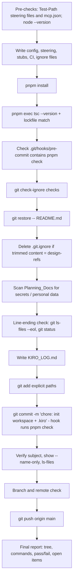

# Design Document: DREAME Day 1 Workspace Setup

## Overview

Day 1 creates the repository foundation for DREAME: seven Kiro steering files, the Context7 MCP configuration, an empty pnpm/TypeScript workspace with 12 placeholder folders and three stub scripts, a simple-git-hooks pre-commit hook, a CI skeleton, ignore and line-ending rules, a provisional `KIRO_LOG.md`, and one commit pushed to `origin/main`. No application code, Kiro hooks or runtime dependencies are added.

Environment facts verified on 2026-11-18: Windows with PowerShell, Node v22.23.5, pnpm 12.21.0, git 2.54.0.windows.1. Latest registry versions: typescript 7.0.2, simple-git-hooks 2.14.0. `git status --porcelain` showed ` D README.md`, `?? .git.ignore`, `?? .kiro/`, `?? design-refs/`, `?? docs/`. Only `LICENSE` and `README.md` are tracked. `.git.ignore` contains exactly `design-refs`.

Source locations used by the steering content:

| Source | Location |
|---|---|
| Brief §0 problem framing | `docs/Skeleton_Crew_Audit_and_Brief_v2.md` line 20 |
| Brief §0a claim / differentiation / comparison gate | lines 29, 32, 35 |
| Brief §2 app table | lines 102–110 |
| Brief §3 core contracts (runtime rule) | lines 111–139 (line 139) |
| Brief findings tables A / B / C / D | lines 51–63 / 64–78 / 79–87 / 88–97 |
| Architecture §A1, §A2, §A3, §A5, §A6, §A8 | `docs/Architecture_and_UI_Spec.md` lines 10, 31, 40 (CI order 86), 107, 119–141, 154 |
| Architecture Part C reference guidance (design-refs) | line 235 |
| Checklist §2 (overclaim fix), §3 step 8 (simple-git-hooks) | `docs/Submission_Checklist_and_Compliance.md` lines 34 (42), 43 (52) |

## Architecture

### File map

```
my-kiro-win/
├── .gitignore                    Req 8.1–8.2
├── .gitattributes                Req 8.5
├── package.json                  Req 6.2–6.5, 6.8, 7.4–7.7, 11.2
├── pnpm-workspace.yaml           Req 6.1 (+ build-script policy, Decision 4)
├── pnpm-lock.yaml                generated by pnpm install (Req 10.1)
├── tsconfig.base.json            Req 6.6
├── KIRO_LOG.md                   Req 9
├── .github/workflows/ci.yml      Req 7.10–7.13
├── .kiro/
│   ├── settings/mcp.json         Req 5
│   ├── specs/dreame-day1-workspace-setup/   (requirements, design, tasks, .config.kiro)
│   └── steering/                 Req 1–4 (product, tech, structure, security,
│                                  activity-authoring, testing, new-node-type)
├── apps/shop-challenge/README.md, apps/practice-path/README.md
├── packages/{schema,runtime,node-types,link,storage,ui}/README.md
├── tools/{create-app,validate}/README.md
├── activities/README.md
├── docs/kiro-evidence/README.md
└── (unchanged) LICENSE, README.md (restored from HEAD), docs/*.md, docs/*.txt, design-refs/
```

### Execution flow



Any failed gate stops the flow and goes straight to the partial report (Req 11.7). A post-push update to `KIRO_LOG.md` (for example, Context7 confirmation) goes in a new follow-up commit, never `--amend`.

## Components and Interfaces

### package.json (exact content)

```json
{
  "name": "dreame",
  "private": true,
  "type": "module",
  "packageManager": "pnpm@12.21.0",
  "engines": { "node": ">=22" },
  "scripts": {
    "check": "node -e \"console.log('not implemented yet')\"",
    "validate": "node -e \"console.log('not implemented yet')\"",
    "test:shared": "node -e \"console.log('not implemented yet')\"",
    "postinstall": "simple-git-hooks"
  },
  "simple-git-hooks": { "pre-commit": "pnpm check" },
  "devDependencies": {
    "simple-git-hooks": "^2.14.0",
    "typescript": "^7.0.2"
  }
}
```

**Decision 1, stub scripts use `node -e`.** pnpm runs scripts through `cmd.exe` on Windows and `sh` on Linux. Both pass the double-quoted argument to node unchanged, so output and exit code match in every Supported_Shell. The single quotes sit inside a double-quoted argument, which Req 11.2 allows. Extra arguments (`pnpm check foo`) become `process.argv` entries that the script ignores, and nothing is written to disk (Req 7.5). `echo` was rejected because pnpm appends extra arguments to the echoed text, breaking Req 7.4.

**Decision 2, manifest fields.** `"type": "module"` matches the ESM default of Vite and Vitest for later packages and has no effect on the stubs. `packageManager` pins the exact pnpm version so `pnpm/action-setup` uses it in CI (Req 6.3, 7.12). The `postinstall` script runs `simple-git-hooks`, which writes `.git/hooks/pre-commit` from the `simple-git-hooks` key (Req 7.6–7.7).

**Decision 3, TypeScript 7 risk.** typescript 7.x is the native (Go) port. Req 6.7 needs `pnpm exec tsc --version` to print `Version X.Y.Z`. The plan installs `^7.0.2` and runs the check. If `tsc` is missing or the output does not match `^Version \d+\.\d+\.\d+$`, the Setup_Agent reports it (Req 6.10), then, with the user's agreement, switches to the latest stable 6.x/5.x line found with `pnpm view "typescript@<7" version`, re-runs install and the check, and records the reason in `KIRO_LOG.md`. The package stays `typescript`, so the two-entry allowlist (Req 6.5) still holds.

### pnpm-workspace.yaml

```yaml
packages:
  - "apps/*"
  - "packages/*"
  - "tools/*"
allowBuilds:
  simple-git-hooks: false
```

**Decision 4, dependency build scripts.** pnpm 10 and later skip dependency lifecycle scripts unless allowed, and newer versions can fail the install on unreviewed builds. simple-git-hooks' own postinstall is not needed because the root `postinstall` always runs and installs the hook. The file therefore declares that build as not needed. The key name (`allowBuilds` map, or the older `ignoredBuiltDependencies: [simple-git-hooks]` list) is confirmed against the pnpm 12 docs or the install warning at execution time. Req 6.1 constrains only `packages`, so the extra key is allowed.

### tsconfig.base.json (exact content)

```json
{
  "compilerOptions": {
    "strict": true,
    "target": "ES2022",
    "lib": ["ES2023", "DOM", "DOM.Iterable"],
    "module": "ESNext",
    "moduleResolution": "Bundler",
    "verbatimModuleSyntax": true,
    "isolatedModules": true,
    "noUncheckedIndexedAccess": true,
    "noImplicitOverride": true,
    "noFallthroughCasesInSwitch": true,
    "forceConsistentCasingInFileNames": true,
    "skipLibCheck": true,
    "resolveJsonModule": true,
    "esModuleInterop": true
  }
}
```

**Decision 5.** `Bundler` resolution fits Vite apps and source-first workspace packages; `NodeNext` would force `.js` extensions in every import. `noUncheckedIndexedAccess` matters because manifest maps and arrays come from untrusted links. `exactOptionalPropertyTypes` is left out because it causes friction with TypeBox and React props; revisit later. There is no `include`, since this is a base config only. Plain JSON with no comments (Req 6.6).

### .kiro/settings/mcp.json (exact content, UTF-8 without BOM)

```json
{
  "mcpServers": {
    "context7": {
      "command": "npx",
      "args": ["-y", "@upstash/context7-mcp"]
    }
  }
}
```

Kiro starts the server; the Setup_Agent never runs `npx -y @upstash/context7-mcp` itself (Req 5.8).

### .github/workflows/ci.yml (exact content)

```yaml
name: CI
on:
  push:
    branches: [main]
  pull_request:
    branches: [main]
permissions:
  contents: read
jobs:
  check:
    runs-on: ubuntu-latest
    steps:
      - uses: actions/checkout@v4
      - uses: pnpm/action-setup@v4
      - uses: actions/setup-node@v4
        with:
          node-version: 22
          cache: pnpm
      - run: pnpm install --frozen-lockfile
      - run: pnpm check
```

**Decision 6.** `pnpm/action-setup` has no `version` input, so it reads `packageManager` (Req 7.12). It must run before `setup-node` because `cache: pnpm` needs the pnpm binary. No secrets or credential variables (Req 7.13).

### .gitignore and .gitattributes

```
# .gitignore
node_modules
dist
.env*
design-refs/
coverage/
*.log
.DS_Store
```

```
# .gitattributes
* text=auto eol=lf
```

(The `# filename` lines above are labels, not file content.) **Decision 7.** The four required entries come first; `coverage/`, `*.log` and `.DS_Store` are common build/OS noise for a Vitest + Windows/macOS project. No line contains `.kiro`, and no pattern (`.*`, `*`) matches `.kiro/` (Req 8.2). After `.gitattributes` is written, `git ls-files --eol LICENSE README.md` and `git status --porcelain` show whether either tracked file has line-ending-only changes (Req 8.8).

### Folder_Stubs (12 files)

Each stub is two lines: `# <folder path>` and one sentence restating the Architecture §A6 comment.

| File | Sentence |
|---|---|
| apps/shop-challenge/README.md | Vite + React app for Shop Challenge, with its own vercel.json. |
| apps/practice-path/README.md | Vite + React app for Practice Path, with its own vercel.json. |
| packages/schema/README.md | TypeBox schemas, generated Ajv validators, graph validator and upgraders. |
| packages/runtime/README.md | Pure reducer, registry, conditions and seeded rng, with no React. |
| packages/node-types/README.md | Shared content, choice and outcome node types; app-specific types live in each app. |
| packages/link/README.md | Link encode, decode, size caps and hash. |
| packages/storage/README.md | Safe localStorage wrapper. |
| packages/ui/README.md | Shared accessible components and theme tokens. |
| tools/create-app/README.md | Scaffold that copies the template, renames it, and adds a sample activity and test. |
| tools/validate/README.md | CLI run as `pnpm validate activities/*.json`, used by a Kiro hook and CI. |
| activities/README.md | Demo manifests stored as content-as-code. |
| docs/kiro-evidence/README.md | Screenshots for KIRO_LOG. |

### Steering_Set content plan

All rules are single bullets, start with an imperative verb, have at most 30 words and name a checkable item. Every heading with rules ends with a `Source:` line naming the document and section.

**product.md** (`inclusion: always`)
- `# DREAME` (project name; the Brief calls it "the toolkit"; no extra description sentence, per Req 2.5).
- `## Problem framing (for Impact + Presentation)`: Brief §0 paragraph from "AI coding agents can generate" to "not a universal proof of correctness.", emphasis markers removed. The bold label becomes this heading. Source: Brief §0.
- `## What we claim` and `## Differentiation statement`: Brief §0a blockquotes (lines 29, 32) without `>`. Source: Brief §0a.
- `## Claim rules` (Source: Brief §0a; Submission Checklist §2):
  - Use only Claim_Source wording from `.kiro/steering/product.md` for claims in README.md, submission form text, demo video narration, on-screen text and blog posts.
  - Do not claim an advantage over H5P, Lumi, Twine, Optimove Minigames, Genially or plain React + Kiro until its Brief §0a comparison-gate task is run and reported.
  - Do not use "correct by construction", "novel", "production ready", "production-ready", "without hallucinations", "guarantee", "better than" or "first ever" in any repository text.
- The three source passages were read and contain no Banned_Phrase_List phrase and no "GDevelop".

**tech.md** (`always`)
- `## Toolchain` (Source: Architecture Spec §A2; Brief B5): set `compilerOptions.strict` to `true` in `tsconfig.base.json` and every package tsconfig; use pnpm workspaces in `pnpm-workspace.yaml` with no npm or yarn lockfiles; keep `engines.node` at `>=22` and CI `node-version: 22`; precompile validators at build time with Ajv standalone code generation and do not import `ajv` in browser code; add a `package.json` dependency only when the Architecture Spec or Submission Checklist names it, and ask the user before any other.
- `## Hosting and backend` (Source: Architecture Spec §A1, §A8): no application backend, database, authentication service or server-side activity storage; keep the §A8 v2 backend in `ROADMAP.md` only.

**structure.md** (`always`)
- `## Layout` (Source: Architecture Spec §A6): code block copied from lines 119–141 with every path and comment; `docs/planning/` shown as `docs/`.
- `## Apps` (Source: Brief §2): table with Folder, Real audience, Mechanic and Own node types for Shop Challenge and Practice Path, copied from lines 102–110 without emphasis. Brief §2 is cited here, not in product.md (Introduction item 6).
- `## Boundaries` (Source: Brief §3): do not import from `apps/`, `react` or `react-dom` in any file under `packages/runtime`.
- `## Node type placement` (Source: Brief §2; Architecture Spec §A6): keep `content`, `choice` and `outcome` in `packages/node-types`, `collectionSelect` and `recommendOutcome` in `apps/shop-challenge`, `recall` and `reviewQueue` in `apps/practice-path`.

**security.md** (`always`)
- `## Code execution and DOM` (Source: Brief C1, B5): no `eval` or `new Function`; no `innerHTML` or `dangerouslySetInnerHTML`; both scoped to `apps/`, `packages/`, `tools/`.
- `## Links` (Source: Brief C1): accept only `https:` for CTA URLs and links to another origin, checked in schema and renderer, rejecting `javascript:`, `http:` and `data:`; render such links with `rel="noopener noreferrer"`.
- `## Privacy` (Source: Brief C3): no personal data including names; no user accounts; no analytics sent off the device; progress stored only on the device through `packages/storage`.
- `## Import limits` (Source: Brief C2; Architecture Spec §A3): reject before `JSON.parse` when the encoded link exceeds 8 KB or the decoded JSON exceeds 64 KB; check the node-count cap before the graph checks.
- `## Secrets` (Source: DREAME Day 1 project decision (spec dreame-day1-workspace-setup)): do not commit API keys, tokens, passwords or other secrets in any file, including `.kiro/settings/mcp.json`. No Planning_Doc covers secrets, so Req 1.9 allows this project-decision citation for Req 3.11 only.
- `## Reference files` (Source: Architecture Spec Part C (line 235–237)): keep `design-refs/` in `.gitignore`; do not stage or commit files under `design-refs/`.

**activity-authoring.md** (`fileMatch`, `"activities/**/*.json"`)
- `## Graph shape` (Source: Brief §B1, §B2, §B8): DAG only, with retry and review as runtime policy and never back-edges; `fallbackOutcomeId` names an existing outcome node and applies when `limits.maxTransitions` is exceeded; the last edge of every node with edges has no `when`.
- `## Conditions` (Source: Brief §B2): operators limited to `eq`, `gte`, `lte`, `includes`, `and`, `or`, `not`; `var` names a declared `variables` entry; `answer` names an existing node ID; nesting depth at most 8.
- `## Demo data` (Source: Brief §C3, §C4; Submission Checklist §2): synthetic data with no real names or details; no product brand logos; CTAs to a website URL or a WhatsApp business line the builder agrees to publish, never a personal number; `validUntil` absent or `2027-12-31` or later.
- `## CTA URLs` (Source: Brief §C1): `https:` only, allowing `https://wa.me/...` and rejecting `http:`, `javascript:` and `data:`.

**testing.md** (`fileMatch`, `"**/*.test.ts"`)
- `## Tools and commands` (Source: Brief §5; Architecture Spec §A3): Vitest and fast-check; run with `vitest --run` or `vitest run`; no watch mode.
- `## Required property tests` (Source: Brief §5; Architecture Spec §A3): the three properties (a) reaches an outcome within `maxTransitions` for generated answer sequences, (b) the validator does not crash on random JSON, (c) the same seed and actions produce the same result. They come from Brief §5 (Kiro plan table, line 155) and Architecture Spec §A3 (line 80).
- `## Describing results` (Source: Brief §0, §5): describe results as evidence for the properties tested, never as proof of correctness.

**new-node-type.md** (`manual`)
- `## Steps` (Source: Brief §3, §B4; Architecture Spec §A6): numbered steps 1–12 in the Req 4.5 order, each written as an imperative sentence (for example "1. Define `type` as a unique string.", "5. Define `validate` returning `Diagnostic[]`.", "12. Add Vitest tests for `validate` and `reduce`.").
- `## Purity` (Source: Brief §3, §B6): `reduce` is a pure function of `(cfg, state, response, env)` that returns a new `AttemptState` without mutating inputs; it uses only `env.now` and the seeded `env.rng`, never `Date.now`, `new Date()` or `Math.random`.

### KIRO_LOG.md (provisional format, Decision 9)

```markdown
# KIRO_LOG — DREAME

> Provisional format: the §6 template of `Kiro_Setup_and_Operating_Playbook.md` is not in the
> workspace. This format is provisional until that playbook is supplied.

## 2026-11-18 — Day 1
- **Goal:** ...
- **Kiro features used:**
  - Spec workflow: <one sentence>. `.kiro/specs/dreame-day1-workspace-setup/`
  - Steering: <one sentence>. `.kiro/steering/product.md`
  - MCP: configured; connection not yet confirmed by the user. `.kiro/settings/mcp.json`
- **Files created:** <one path per line, = staged set minus Planning_Docs, incl. KIRO_LOG.md, pnpm-lock.yaml>
- **Commands and results:** <command> → exit <code>
- **Decisions:** ...
- **Problems and fixes:** ...
- **Open items:** missing playbook; Context7 confirmation
```

The log contains no statement about the commit or push (Req 9.5).

### Command conventions (Req 11.1)

Commands are separated by `;` or run as separate calls, never with `&&` or `||`. Files are written with the editor tool (UTF-8, no BOM) and never with PowerShell 5.1 `Set-Content -Encoding UTF8`, which adds a BOM. The final tree uses `Get-ChildItem -Recurse -Force -Name | Where-Object { $_ -notmatch '^(\.git|node_modules|design-refs)(\\|$)' }`.

Staging uses one explicit `git add` listing: `.kiro/steering/*.md` (seven paths), `.kiro/specs/dreame-day1-workspace-setup`, `.kiro/settings/mcp.json`, `pnpm-workspace.yaml`, `package.json`, `tsconfig.base.json`, the 12 Folder_Stub paths, `.github/workflows/ci.yml`, `.gitignore`, `.gitattributes`, `KIRO_LOG.md`, `pnpm-lock.yaml`, and each Planning_Doc that passed the scan.

Planning_Doc scan patterns for Req 10.13 (`Select-String`, case-insensitive): `(api[_-]?key|secret|token|password)\s*[:=]`, `AKIA[0-9A-Z]{16}`, `ghp_[A-Za-z0-9]{36}`, `sk-[A-Za-z0-9]{20,}`, email `[A-Za-z0-9._%+-]+@[A-Za-z0-9.-]+\.[A-Za-z]{2,}`, phone `\+\d{1,3}[\s-]?\d{3}[\s-]?\d{3,4}[\s-]?\d{3,4}` and `\b0\d{10}\b`. The phone patterns are kept narrow so dates and table numbers do not match.

## Data Models

No application data models. The only structured shapes are the files above:

| File | Shape |
|---|---|
| Steering Front_Matter | YAML map: `inclusion` ∈ {`always`, `fileMatch`, `manual`}; `fileMatchPattern` string only when `fileMatch` |
| `mcp.json` | `{ mcpServers: { context7: { command: "npx", args: string[2] } } }` |
| `package.json` | npm manifest as shown; `devDependencies` has exactly two keys |
| `pnpm-workspace.yaml` | `packages: string[3]` plus one build-policy key |
| `tsconfig.base.json` | `{ compilerOptions: {...} }` |
| `ci.yml` | GitHub Actions workflow with one job and six steps |

## Correctness Properties

PBT does not apply here: this spec produces configuration, documentation and git state, with no functions that take generated input. Each requirement is verified with a single-run PowerShell command, executed once at the step in the execution flow above. All commands run in PowerShell 5.1 and 7 from the Workspace_Root.

| Req | Check | Pass when |
|---|---|---|
| 1.1 | `(Get-ChildItem .kiro/steering -Force).Name \| Sort-Object` | exactly the 7 names |
| 1.2–1.6 | `Get-Content .kiro/steering/<f>.md -TotalCount 4` for each file; `(Get-Content .kiro/steering/product.md -TotalCount 1) -eq '---'` | line 1 `---`; keys and values as in Req 1.3–1.6 |
| 1.7 | `Select-String -Path .kiro/steering/*.md -Pattern '^\s*(-\|\d+\.)\s' \| Where-Object { ($_.Line -split '\s+' \| Where-Object { $_ }).Count -gt 31 }` | no output (30 words + marker) |
| 1.9 | `Select-String -Path .kiro/steering/*.md -Pattern '^Source:'` | one per rule-bearing heading |
| 2.2–2.4 | Normalize Brief lines 20, 29, 32 and product.md with `-replace '\*\*\|\*\|_',''`, `-replace '(?m)^\s*>\s?',''`, `-replace '\s+',' '`, then `$product.Contains($passage)` | `True` for all three |
| 2.7 | `Select-String -Path .kiro/steering/*.md -Pattern 'correct by construction\|novel\|production ready\|production-ready\|without hallucinations\|guarantee\|better than\|first ever'` | only the quoted "Do not use" rule in product.md |
| 2.9 | `Select-String -Path .kiro/steering/product.md -Pattern 'GDevelop'` | no output |
| 3.4–3.12, 4.x | `Select-String -Path .kiro/steering/<f>.md -Pattern '<key term>'` per term (`packages/runtime`, `noopener noreferrer`, `8 KB`, `fallbackOutcomeId`, `vitest --run`, `env.rng`) | one match per term |
| 5.1–5.3 | `$b=[IO.File]::ReadAllBytes('.kiro/settings/mcp.json'); $b[0] -ne 0xEF`; `(Get-Content .kiro/settings/mcp.json -Raw \| ConvertFrom-Json).mcpServers.context7 \| ConvertTo-Json -Compress` | no BOM; `{"command":"npx","args":["-y","@upstash/context7-mcp"]}` |
| 6.1–6.5 | `Get-Content pnpm-workspace.yaml`; `$p = Get-Content package.json -Raw \| ConvertFrom-Json; $p.packageManager; $p.engines.node; $p.devDependencies.PSObject.Properties.Name` | three globs; `pnpm@12.21.0`; `>=22`; two dev deps |
| 6.6 | `(Get-Content tsconfig.base.json -Raw \| ConvertFrom-Json).compilerOptions.strict` | `True` |
| 6.7 | `pnpm exec tsc --version; $LASTEXITCODE`; `Select-String -Path pnpm-lock.yaml -Pattern 'typescript@(\d+\.\d+\.\d+)'` | exit 0, `Version X.Y.Z` equals lockfile version |
| 7.1–7.3 | `Get-ChildItem <folder> -Force -Recurse` for each of the 12 folders | only `README.md` |
| 7.4–7.5 | `$a = git status --porcelain; pnpm check extra; $LASTEXITCODE; $b = git status --porcelain; Compare-Object $a $b` (repeat for `validate`, `test:shared`) | prints `not implemented yet`, exit 0, no diff |
| 7.8 | `Select-String -Path .git/hooks/pre-commit -Pattern 'pnpm check'` | one match |
| 7.14 | `Test-Path .kiro/hooks` | `False` |
| 8.3 | `git check-ignore -v <path>; $LASTEXITCODE` for the four paths | no output, `1` |
| 8.4 | `git ls-files design-refs`; `git check-ignore -v design-refs/linktree.webp; $LASTEXITCODE` | empty; `.gitignore:4:design-refs/ ...`, `0` |
| 8.6 | `(Get-Content .git.ignore -Raw).Trim() -ceq 'design-refs'` | `True`, then `Remove-Item .git.ignore` |
| 10.1 | `pnpm install; $LASTEXITCODE; Test-Path pnpm-lock.yaml` | `0`, `True` |
| 10.3–10.4 | `git restore -- README.md; git status --porcelain -- README.md; git diff HEAD -- README.md` | both empty |
| 10.5 | `git commit -m "chore: init workspace + .kiro"` output; `git log -1 --format=%s` | contains `not implemented yet`; exact subject |
| 10.6 | `git ls-files design-refs node_modules .git.ignore`; `git show --name-only --format= HEAD` | empty; only staged-set paths |
| 10.12 | `git branch --show-current`; `git remote get-url origin` | `main`; the expected URL |
| 10.9 | `git rev-parse HEAD`; `git rev-parse origin/main` | equal hashes |

## Error Handling

| Criterion | Trigger | Handling |
|---|---|---|
| 1.10 | No source text for a planned rule | Omit the rule; list topic and target file in the final report |
| 1.11 / 5.5 | Steering file or `mcp.json` exists before setup (`Test-Path`) | Leave it unchanged; report it (server names for mcp.json); ask before overwrite or merge |
| 2.10 | A Brief passage is not found | Leave it out of product.md; report which passage |
| 5.4 / 5.7 / 9.7 | User reports Context7 error | Record the error text in KIRO_LOG and mark MCP as failed/unresolved; keep `command`/`args`; ask before changing them |
| 6.9 | `node --version` major < 22 | Skip install; report the version; record in KIRO_LOG; keep files |
| 6.10 | `tsc --version` fails or prints no `Version` line | Report output and exit code; record in KIRO_LOG; no commit; offer the Decision 3 fallback |
| Decision 4 | Install warns about or fails on ignored builds | Switch to the build-policy key pnpm 12 names in the message; re-run install; log it |
| 7.9 | Hook missing or lacks `pnpm check` | Report the hook state; no commit until the user decides |
| 8.7 | `.git.ignore` trimmed content ≠ `design-refs` | Keep it unstaged and unchanged; report its content |
| 8.8 | Tracked files show line-ending-only changes | List paths; exclude from the commit unless the user confirms |
| 8.9 | Any check-ignore result is unexpected | No commit; report path, full output, exit code |
| 8.10 | `git ls-files design-refs` lists files | List them; do not untrack without confirmation; warn that pushed history keeps them |
| 10.8 | `git push` non-zero | Report the error; keep the commit local; no pull, rebase, reset or force without confirmation |
| 10.10 | Install fails or lockfile missing | Report the output; stage nothing; no commit |
| 10.11 | Hook or commit fails | Report the output; leave files staged; never use `--no-verify` |
| 10.12 | Wrong branch or remote | Do not push; ask the user |
| 10.14 | Scan matches in a Planning_Doc | Leave that doc unstaged; report path and line of each match |
| 11.7 | Any step fails before push | Partial report: failed step, error text, steps not run; keep created files |

## Testing Strategy

- **No unit or property-based tests.** Day 1 adds no application code. Vitest and fast-check are named in testing.md for later days but are not installed today (Req 6.5).
- **Command-level verification.** Each row of the Correctness Properties table runs once at its point in the execution flow, and its result feeds the pass/fail list of the final report (Req 11.6).
- **Content review.** The steering files are checked against the source line ranges in the Overview: verbatim passages by normalized comparison, rules by word count, citation presence and banned-phrase search.
- **CI smoke test.** The first push runs `.github/workflows/ci.yml`. A green run confirms that `pnpm install --frozen-lockfile` and `pnpm check` work on Linux, which covers the `sh` side of Req 7.4 and 11.2. CI status is reported to the user but does not gate Day 1.
- **Cross-shell check.** Running the stub scripts in PowerShell 5.1 (`powershell -NoProfile -Command "pnpm check"`) and PowerShell 7 (`pwsh -NoProfile -Command "pnpm check"`) covers the Windows shells. Git Bash is checked only if it is installed.
