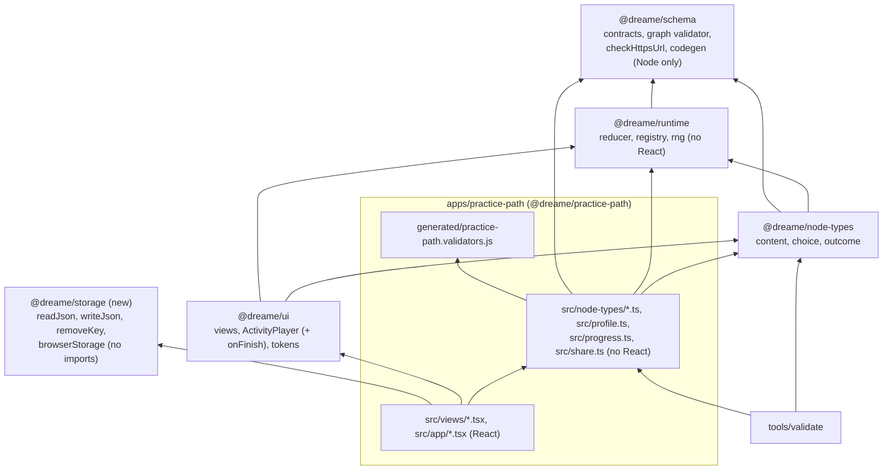
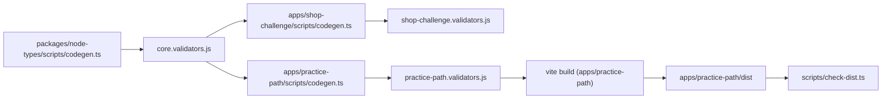
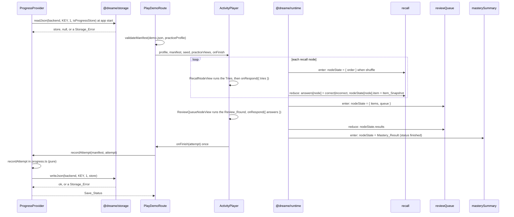

# Design Document: practice-path

## Overview

This design covers Days 8 and 9 of the Brief §8 plan. It adds:

1. The Day 6–7 entries in `KIRO_LOG.md` and their commit (Requirements 1, 2).
2. The workspace package `@dreame/practice-path` in `apps/practice-path`, with the `practice-path` profile, its precompiled validators and the App_Wiring_Files of ui-renderer D20 (Requirements 3, 4, 23).
3. The app node types `recall`, `reviewQueue` and `masterySummary`, their views and tests, and the pure Tutor_Share_Link builder (Requirements 5–10, 15–17).
4. The new package `@dreame/storage` in `packages/storage`, and the device progress model with export, import and clear (Requirements 11–13).
5. One additive change in a shared package: the optional `onFinish` prop of the `@dreame/ui` `ActivityPlayer` (Requirement 14).
6. The static Practice Path app: routes, bundled demo playback, landing page with device progress, footer, `vercel.json`, a two-app `PRIVACY.md` and the manual deploy of URL #2 (Requirements 18–21).
7. One Demo_Lesson and one Practice_Fixture (Requirement 22).
8. Scan, boundary rule and CI additions, and the task conventions (Requirements 19, 24).

Decisions D1–D54 of the earlier specs, the Playbook reconciliation P1–P12 and the 17 Resolved questions of 2026-11-21 stay in force. This design adds D55–D70 in "Decisions for the user". The user approved this design on 2026-11-21 and accepted D63 the same day; every other new decision follows from the requirements and the code.

`packages/runtime` and `packages/schema/src` do not change. Retry and review run inside the app node types (Resolved question 1), and the diagnostic codes this spec needs (`duplicate-option-id`, `duplicate-item-id`, `dangling-ref`, `type-mismatch`, `answer-not-upstream`, `blank-text`, `unsafe-url`) and `GraphCtx.isUpstream` already exist.

The new validator checks catch specified errors only, such as an answer key that names no option. They do not establish that questions, answer keys or explanations are factually accurate, or that the app is accessible. The property tests give evidence for the properties tested. Component tests and the axe check catch some accessibility errors; manual keyboard and screen-reader checks are still needed (Architecture Spec §A3).

### Research findings used by this design

Checked in the Workspace on 2026-11-22.

| Topic | Finding | Source |
|---|---|---|
| Node type hooks | `enter(cfg, s, env)` and `reduce(cfg, s, r, env)` see the attempt state, not the manifest; `isValidResponse(cfg, r)` sees neither. A node type reads earlier nodes only through `s.answers` and `s.nodeState`. | `packages/runtime/src/node-type.ts`, `reducer.ts` |
| Terminal enter | `enterNode` sets `status: 'finished'` and then calls `enter`, also on the limit fallback, so `masterySummary.enter` runs for every way an attempt reaches it. | `packages/runtime/src/reducer.ts` `enterNode` |
| Answer values | `AnswerValue` is `Scalar \| readonly string[]`; an `enum` `answerType` lets edges use `eq` on a string answer. | `packages/schema/src/contracts.ts`, `node-type.ts` |
| Validate context | `GraphCtx` has `manifest`, `nodePath` (`/nodes/<n>`), `variables`, `checkEffect`, `checkHttpsUrl`, `checkText` and `isUpstream`. Stage 7 calls `validate` per node in manifest order and adds `nodeId`; `choice` reads its node ID from `nodePath`. | `packages/schema/src/node-type.ts`, `graph.ts` `stageConditions`, `packages/node-types/src/choice.ts` |
| Diagnostic codes | Every code this spec reports exists in `DiagnosticCode`; no schema change is needed. | `packages/schema/src/diagnostics.ts` |
| Option order | `choice.enter` stores `{ order: env.rng.shuffle(ids) }` when `shuffle` is `true`; `orderedOptions(cfg, nodeState)` in `@dreame/ui` reads it and falls back to config order. Its parameter type `ChoiceConfig` accepts any config with `prompt`, `options` (`id`, `label`) and `shuffle?`. | `packages/node-types/src/choice.ts`, `packages/ui/src/choice-order.ts` |
| Reading an upstream node | `recommendOutcome.enter` reads `s.answers[cfg.from]` and `s.nodeState[cfg.from]` with own-property checks and a reader that returns `null` for a damaged value. | `apps/shop-challenge/src/node-types/recommendOutcome.ts` |
| Codegen | `buildProfileModule(profileId, nodeTypes)` composes one `oneOf` manifest validator and one `response_<type>` export per node type, inlines allowlisted Ajv helpers and throws on any other helper or forbidden pattern. | `packages/schema/src/codegen/index.ts` |
| Player | `ActivityPlayer` keeps `{ ps, rejected }` in `useReducer`, keys the view by node ID and passes `rejections`. It reports nothing to the app. `NodeRenderer` passes `rejections` through. | `packages/ui/src/components/ActivityPlayer.tsx`, `NodeRenderer.tsx` |
| Link button | `ExternalLinkButton({ label, url })` shows the host, asks for confirmation and renders an anchor with `target="_blank"` and `rel="noopener noreferrer"` only for a safe https URL. | `packages/ui/src/components/ExternalLinkButton.tsx` |
| URL check | `checkHttpsUrl` rejects non-https URLs, URLs over 2,048 characters, credentials and shortener hosts; `wa.me` is allowed. | `packages/schema/src/url.ts` |
| Workspace globs | Root `tsconfig.json` already includes `packages/*/src`, `packages/*/test`, `apps/*/src`, `apps/*/test`, `apps/*/scripts`, `apps/*/generated/*.d.ts` and `apps/*/vite.config.ts`; `vitest.config.ts` already includes `packages/*/test/**/*.test.ts(x)` and `apps/*/test/**/*.test.ts(x)`; `.gitignore` already lists `apps/*/generated/`, `dist` and `.vercel`. | those files |
| Scripts | Root `codegen` runs the `core` and Shop codegen; `check` runs codegen → `tsc` → depcruise → lint → `vitest run` → validate. `ci.yml` runs `pnpm check`, then `pnpm --filter @dreame/shop-challenge build`. | `package.json`, `.github/workflows/ci.yml` |
| Scans | The Source_Scan reads all of `apps/`, `packages/` and `tools/`. The boundary test lists React-free folders in `NO_UI_DIRS` and pure folders in `PURITY_DIRS`. The Shop and UI Privacy_Scans forbid `localStorage`. | `packages/schema/test/source-scan.test.ts`, `packages/runtime/test/boundaries.test.ts`, `apps/shop-challenge/test/privacy-scan.test.ts`, `packages/ui/test/privacy-scan.test.ts` |
| Boundary rules | `react-free-no-ui` covers `packages/node-types`, `packages/schema/src` and the Shop node types and profile. No rule covers `packages/storage` or imports between apps. | `tools/lint/src/depcruise-rules.ts` |
| Hooks | The Wiring_Hook fires on create and save of `apps/<app>/src/node-types/<name>.ts` (`[a-z][A-Za-z0-9]{0,31}`, so hyphenated names do not match) and `apps/<app>/src/views/<Type>NodeView.tsx`. The Regression_Hook (180 s) fires on any `.ts` save under `packages/runtime`, `packages/schema` or `packages/node-types`, test files included. The Activity_Hook (30 s) runs `pnpm -s validate:hook`, which runs `pnpm codegen` first. The Post_Task_Hook runs `pnpm -s check` with a 600 s timeout. | `.kiro/hooks/*.json` |
| Shop footer tests | `apps/shop-challenge/test/routes.test.tsx` checks the two footer links; `apps/shop-challenge/test/privacy-scan.test.ts` expects exactly 2 anchors in `Footer.tsx`. | those files |
| Shop status | `.kiro/specs/shop-challenge/tasks.md` has 104 of 104 tasks done; the last shop commit `02117a2` has author date 2026-11-22. | `tasks.md`; `git log` |
| Storage size | One Item_Record with a short key such as `practice-fractions:q1` takes about 100 JSON characters, so about 650 records fit the 65,536-character Value_Cap; with 64-character activity and item IDs, about 300 fit. 1,000 records do not fit in every case. | estimate from the Item_Record format (D63) |

## Architecture

### Package layers



- `packages/storage/src` imports nothing outside its own folder (Boundary rule `storage-no-imports`, C16).
- Only the app shell (`src/app/ProgressProvider.tsx`) imports `@dreame/storage`. Node types, views and `packages/ui` never touch storage (D65).
- The app imports nothing from `apps/shop-challenge` (rule `apps-no-sibling-apps`, C16).
- `tools/validate` imports only the React-free `./profile` and `./node-types` entries (Resolved question 15).

### Build-time flow



The Practice_Codegen runs after the `core` codegen, because `src/node-types/index.ts` imports `coreNodeTypes` from `@dreame/node-types`, whose barrel loads `core.validators.js`.

### Player and progress data flow



## Components and Interfaces

### C1. KIRO_LOG Day 6–7 entries and commit (Requirements 1, 2)

This is the first task (Requirement 1.1). The entries follow the Playbook §6 template, as the existing entries do: one `## YYYY-MM-DD — <title>` heading and five lines `Spec:`, `Kiro did:`, `Caught by:`, `Fix:` and `Kiro features:` (Requirement 1.3). They are appended after the last entry (`## 2026-11-21 — Rejection focus and CI enforcement deferred`); no existing line changes. The task checks this with `git diff -- KIRO_LOG.md`, which must show added lines only (Requirement 1.2).

**Heading date.** Each heading uses the author date of the commit that completed shop-challenge, read with `git log -1 --format=%ad --date=short 02117a2` (it printed `2026-11-22` on 2026-11-22). The hash is used only to read the date and is not written into the log (Requirement 1.10).

**Entries** (Requirements 1.5–1.7). The agent reads each number from its Fact_Source at run time and does not copy it from this table.

| Title | Spec | Kiro did | Caught by | Fix | Kiro features |
|---|---|---|---|---|---|
| shop-challenge spec done | `shop-challenge` | Built `@dreame/shop-challenge` with `collectionSelect`, `recommendOutcome`, the WhatsApp and Telegram channel modules, `tools/lint` and the live app at the Shop_Deploy_URL; N of N tasks marked done in `.kiro/specs/shop-challenge/tasks.md` (104 at design time); decisions in `.kiro/specs/shop-challenge/design.md` [shop `tasks.md`, `design.md`, `apps/shop-challenge/README.md`] | Each final shop-challenge check with its command and exit code, for example `pnpm check` exit 0 and `pnpm --filter @dreame/shop-challenge build` exit 0 [shop `tasks.md` final checkpoint, HANDOFF] | None needed | Spec workflow and tasks, steering, agent hooks, sub-agent task runs, fast-check property tests |
| Post-task check timeout raised | `shop-challenge / task 12.0` | Measured `pnpm -s check` at 224.6 s against the 300 s Post_Task_Hook timeout [shop design D53] | Requirement 18.12 timing step | The user raised the timeout to 600 s (D53) [shop design D53] | Agent hooks |
| Second TypeScript copy for lint tools | `shop-challenge / Requirement 18` | Added ESLint and dependency-cruiser in `tools/lint` [shop design D51] | `typescript-eslint` 8.73.0 supports `typescript <6.1.0`; TypeScript 7.0.2 has no classic compiler API [shop design research] | `typescript` 6.0.3 in `tools/lint` only, approved by the user (D51) | Spec workflow |
| Wiring hook replies | `shop-challenge / Requirement 19` | Created the Shop node type and view files [shop `tasks.md` task reports] | The Wiring_Hook added the wiring lines and `EXTENDING.md` sections, and replied "already wired" on a later save [task reports] | None needed | Agent hooks |
| First Vercel build failed | `shop-challenge / Requirement 16` | The first Vercel build ran before the app existed and failed; the later build served the Shop_Deploy_URL [HANDOFF, shop `tasks.md`] | Vercel build log reported by the user | The app build landed; the user redeployed | Spec tasks |
| Checkpoint missing from the task graph | `shop-challenge / tasks.md` | Ran tasks from the dependency graph [shop `tasks.md`] | A checkpoint task was not in the dependency graph, so it did not run by itself [HANDOFF] | Checkpoints run by hand; this spec notes it in `tasks.md` (Requirement 24.16) | Spec tasks |

The agent writes a row only when a Fact_Source records the event, and words each field from that source. At the start of the task the agent tells the user that it cannot take screenshots and asks for the file names of any Day 6 or Day 7 screenshots in `docs/kiro-evidence/` (Requirement 1.8). It links a screenshot only after `Test-Path` returns `True` (Requirement 1.9). No commit hash, commit message, statement about a commit or push, or file list appears in an entry (Requirement 1.10). The Repo_Text_Scan already covers `KIRO_LOG.md` (Requirement 1.11).

**Commit** (Requirement 2). The agent shows `git status --porcelain` and `git diff --stat` and asks whether to commit `KIRO_LOG.md`, the two Leftover_Status_Files and `.kiro/specs/practice-path/` in one commit. On approval it stages exactly those paths and runs `git -c user.name="chukwuebuka henry" -c user.email="121734925+ChukwuebukaHenrey@users.noreply.github.com" commit -m "<message>"`, without `--no-verify`, `--amend` or a co-author trailer. On a failed pre-commit check it reports the command, output and exit code and waits (Requirement 2.5). It never stages `packages/*/generated/`, `apps/*/generated/`, `apps/*/dist/`, `design-refs/`, `.git.ignore` or the four untracked `docs/` files (Requirement 2.6). Before a push request it reports `git rev-list --count origin/main..HEAD` (Requirement 2.7).

### C2. Practice_App package and workspace configuration (Requirements 3, 18.1, 18.2, 24.15)

```
apps/practice-path/
  package.json             # @dreame/practice-path
  tsconfig.json
  vite.config.ts
  vercel.json              # C17
  index.html               # C15
  README.md                # existing placeholder; Deploy_URL_2 added in C17
  scripts/
    codegen.ts             # Practice_Codegen (C3)
    check-dist.ts          # built-output checks (C16)
  generated/               # gitignored: practice-path.validators.js and .d.ts
  src/
    profile.ts             # Wiring_File W6 (C4)
    progress.ts            # Progress_Model (C10)
    share.ts               # Tutor_Share_Link builder (C8)
    demos.ts               # bundled Demo_Lessons (C15)
    lesson-end.ts          # localDateString, isLessonEnded (C15)
    node-types/
      index.ts             # Wiring_File W5 (C4)
      practice-rules.ts    # Try_Rules, Item_Result rule, Queue (C5)
      practice-state.ts    # node state schemas and readers (C5)
      recall.ts            # C6
      reviewQueue.ts       # C7
      masterySummary.ts    # C8
    views/
      registry.ts          # Wiring_File W7 (C4)
      RecallNodeView.tsx         # C12
      ReviewQueueNodeView.tsx    # C13
      MasterySummaryNodeView.tsx # C14
    app/
      main.tsx  App.tsx  ProgressProvider.tsx  SaveStatus.tsx  ProgressControls.tsx
      LandingView.tsx  PlayDemoRoute.tsx  LessonEndedView.tsx  NotFoundView.tsx  Footer.tsx
      save-status-text.ts  css.d.ts  practice.css
  test/
    *.test.ts              # node environment
    *.test.tsx             # jsdom environment
```

`practice-rules.ts` and `practice-state.ts` contain a hyphen, so the Wiring_Hook matcher does not fire on them; `progress.ts`, `share.ts` and the `app/` files are outside `src/node-types/` and `src/views/`.

`apps/practice-path/package.json` (Requirements 3.1, 3.12):

```json
{
  "name": "@dreame/practice-path",
  "version": "0.0.0",
  "private": true,
  "type": "module",
  "engines": { "node": "22.x" },
  "exports": {
    "./profile": "./src/profile.ts",
    "./node-types": "./src/node-types/index.ts"
  },
  "scripts": {
    "codegen": "node --experimental-strip-types scripts/codegen.ts",
    "build": "pnpm -w run codegen && vite build && node --experimental-strip-types scripts/check-dist.ts"
  },
  "dependencies": {
    "@dreame/node-types": "workspace:*",
    "@dreame/runtime": "workspace:*",
    "@dreame/schema": "workspace:*",
    "@dreame/storage": "workspace:*",
    "@dreame/ui": "workspace:*",
    "react": "^19.3.1",
    "react-dom": "^19.3.1",
    "react-router": "^8.5.2",
    "typebox": "^1.4.7"
  },
  "devDependencies": {
    "@testing-library/dom": "^10.4.2",
    "@testing-library/react": "^16.3.3",
    "@testing-library/user-event": "^14.6.12",
    "@types/react": "^19.3.0",
    "@types/react-dom": "^19.3.0",
    "axe-core": "^4.14.1",
    "vite": "^8.3.8"
  }
}
```

The list equals the Shop_App list plus the workspace link `@dreame/storage`. Both `exports` entries are React-free, so `tools/validate` can load them under `node --experimental-strip-types`.

`apps/practice-path/tsconfig.json`:

```json
{
  "extends": "../../tsconfig.base.json",
  "compilerOptions": {
    "strict": true,
    "types": ["node"]
  },
  "include": [
    "src/**/*.ts",
    "src/**/*.tsx",
    "scripts/**/*.ts",
    "test/**/*.ts",
    "test/**/*.tsx",
    "generated/*.d.ts",
    "vite.config.ts"
  ]
}
```

`apps/practice-path/vite.config.ts`:

```ts
import { defineConfig } from 'vite';

export default defineConfig({
  oxc: { jsx: { runtime: 'automatic', importSource: 'react' } },
  build: { outDir: 'dist', emptyOutDir: true },
});
```

**Root and shared changes** (C2 part; the full list of changes outside the app is in "Changes outside apps/practice-path").

| File | Change |
|---|---|
| `package.json` | `codegen` becomes `pnpm --filter @dreame/node-types run codegen && pnpm --filter @dreame/shop-challenge run codegen && pnpm --filter @dreame/practice-path run codegen` (Requirement 4.4). No other script changes. |
| `tsconfig.json` | No change: its globs already include `apps/*/…` and `packages/*/src` and `packages/*/test` (Requirement 3.6, D69). |
| `vitest.config.ts` | No change: the `node` project already includes `packages/*/test/**/*.test.ts` and `apps/*/test/**/*.test.ts`, the `dom` project `packages/*/test/**/*.test.tsx` and `apps/*/test/**/*.test.tsx` (Requirement 3.7, D69). |
| `.gitignore` | No change: `apps/*/generated/`, `dist` and `.vercel` are listed. |
| `tools/validate/package.json` | Adds `"@dreame/practice-path": "workspace:*"` to `dependencies`. |
| `.github/workflows/ci.yml` | One step `- run: pnpm --filter @dreame/practice-path build` after `- run: pnpm --filter @dreame/shop-challenge build`; `node-version: 22` stays (Requirement 24.15). |

`pnpm install` runs once after the three `package.json` files exist; it adds only workspace links, so `pnpm-lock.yaml` gains importer entries and no external package (Requirement 3.10). The lockfile change is committed with the `package.json` changes. Source files use relative imports with `.ts` or `.tsx` extensions and erasable syntax only (Requirement 3.11).

### C3. Practice_Codegen and the validator size test (Requirement 4)

`apps/practice-path/scripts/codegen.ts`, exact content:

```ts
// Build-time codegen for the `practice-path` profile validators (Requirement 4, design C3). Runs
// under `node --experimental-strip-types`. No try/catch: any thrown error exits non-zero (Req 4.6).
import { mkdirSync, writeFileSync } from 'node:fs';
import { fileURLToPath } from 'node:url';
import { gzipSync } from 'node:zlib';
import { buildProfileModule } from '@dreame/schema/codegen';
import { practiceNodeTypes } from '../src/node-types/index.ts';

const generatedDir = fileURLToPath(new URL('../generated/', import.meta.url));
const jsPath = fileURLToPath(new URL('../generated/practice-path.validators.js', import.meta.url));
const dtsPath = fileURLToPath(new URL('../generated/practice-path.validators.d.ts', import.meta.url));

const { js, dts } = buildProfileModule('practice-path', practiceNodeTypes);
const toLf = (text: string): string => text.replace(/\r\n/g, '\n');
const jsText = toLf(js);

mkdirSync(generatedDir, { recursive: true });
writeFileSync(jsPath, jsText, 'utf8');
writeFileSync(dtsPath, toLf(dts), 'utf8');

const jsBytes = Buffer.from(jsText, 'utf8');
const gzipBytes = gzipSync(jsBytes).length;
console.log(`codegen: wrote ${jsPath} and ${dtsPath} (${jsBytes.length} bytes JS, ${gzipBytes} bytes gzip)`);
```

`buildProfileModule` uses `DEFAULT_CODEGEN_OPTIONS` (D14) and already calls `inlineRuntimeHelpers` and `assertSelfContained` (Requirements 4.1, 4.2, 4.6). The output goes to `apps/practice-path/generated/` (Requirement 4.3).

`apps/practice-path/test/validator-size.test.ts` (node) fails when the module exceeds the limits below (Requirement 4.5). The codegen measurement task sets the limits with the shop C3 rule: raw limit = measured raw bytes × 1.10, rounded up to a multiple of 1,000; gzip limit = measured gzip bytes × 1.10, rounded up to a multiple of 500. The task writes the values into this table.

| Module | Measured raw | Measured gzip | Raw limit | Gzip limit |
|---|---|---|---|---|
| `apps/practice-path/generated/practice-path.validators.js` | to be measured | to be measured | to be set | to be set |
| `apps/shop-challenge/generated/shop-challenge.validators.js` (reference) | 231,675 | 17,231 | 255,000 | 19,000 |

The Source_Scan ajv check (c) asserts that `apps/practice-path/src` and `packages/storage/src` are among the scanned folders (Requirement 4.7, C16).

### C4. App wiring files and EXTENDING.md (Requirement 23)

The App_Wiring_Files are written in the first app task with the core node types and views only, before any Own_File exists (Requirement 23.1). The line forms follow shop D47 (Requirement 23.2):

| ID | File | Line forms per app node type `<type>` |
|---|---|---|
| W5 | `apps/practice-path/src/node-types/index.ts` | (a) `export * from './<type>.ts';` and (b) `import { <type>NodeType } from './<type>.ts';` with `<type>NodeType` in `practiceNodeTypes` |
| W6 | `apps/practice-path/src/profile.ts` | (c) `response_<type>` in the import from `'../generated/practice-path.validators.js'` and `<type>: response_<type>,` in `responseValidators` |
| W7 | `apps/practice-path/src/views/registry.ts` | (d) `import { <Type>NodeView } from './<Type>NodeView.tsx';`, `<Type>NodeView` in the export list, and `{ type: '<type>', Render: <Type>NodeView }` in `practiceViews` |
| W8 | `EXTENDING.md` | a `### <type>` section with `Node type`, `View` and `Tests` lines |

Final W5:

```ts
// Node types of the practice-path profile in profile order (Wiring_File W5). Imports no generated
// code and no React, so the codegen script and the validate CLI can load it.
import type { AnyNodeType } from '@dreame/runtime';
import { coreNodeTypes } from '@dreame/node-types';
import { recallNodeType } from './recall.ts';
import { reviewQueueNodeType } from './reviewQueue.ts';
import { masterySummaryNodeType } from './masterySummary.ts';

export * from './recall.ts';
export * from './reviewQueue.ts';
export * from './masterySummary.ts';

export const practiceNodeTypes: readonly AnyNodeType[] = [
  ...coreNodeTypes,
  recallNodeType,
  reviewQueueNodeType,
  masterySummaryNodeType,
];
```

Final W6:

```ts
// The practice-path profile (Wiring_File W6): the node types bound to their precompiled validators.
import { defineProfile, type Profile } from '@dreame/runtime';
import { practiceNodeTypes } from './node-types/index.ts';
import {
  response_choice,
  response_content,
  response_masterySummary,
  response_outcome,
  response_recall,
  response_reviewQueue,
  validateManifest,
} from '../generated/practice-path.validators.js';

export const PRACTICE_PROFILE_ID = 'practice-path';

export const practiceProfile: Profile = defineProfile({
  id: PRACTICE_PROFILE_ID,
  nodeTypes: practiceNodeTypes,
  validateSchema: validateManifest,
  responseValidators: {
    content: response_content,
    choice: response_choice,
    outcome: response_outcome,
    recall: response_recall,
    reviewQueue: response_reviewQueue,
    masterySummary: response_masterySummary,
  },
});
```

Final W7:

```ts
// Views of the practice-path profile (Wiring_File W7), in profile order.
import { ChoiceNodeView, ContentNodeView, createRenderRegistry, OutcomeNodeView, type RenderRegistry } from '@dreame/ui';
import { RecallNodeView } from './RecallNodeView.tsx';
import { ReviewQueueNodeView } from './ReviewQueueNodeView.tsx';
import { MasterySummaryNodeView } from './MasterySummaryNodeView.tsx';

export { RecallNodeView, ReviewQueueNodeView, MasterySummaryNodeView };

export const practiceViews: RenderRegistry = createRenderRegistry([
  { type: 'content', Render: ContentNodeView },
  { type: 'choice', Render: ChoiceNodeView },
  { type: 'outcome', Render: OutcomeNodeView },
  { type: 'recall', Render: RecallNodeView },
  { type: 'reviewQueue', Render: ReviewQueueNodeView },
  { type: 'masterySummary', Render: MasterySummaryNodeView },
]);
```

The first versions are these files without the app node type lines; `practiceNodeTypes` is then `[...coreNodeTypes]`, which still generates a valid module.

**EXTENDING.md entries** (Requirement 23.4), after the two Shop sections, in the existing form:

```
### recall

- Node type: `apps/practice-path/src/node-types/recall.ts` (`recallNodeType`, profile `practice-path`)
- View: `apps/practice-path/src/views/RecallNodeView.tsx`
- Tests: `apps/practice-path/test/recall.test.ts`, `apps/practice-path/test/recall.property.test.ts`
```

`### reviewQueue` and `### masterySummary` use the same form. Until a view file exists, its line is `- View: not written yet`.

**`tools/validate/test/extending-doc.test.ts`** (Requirement 23.5) changes in the wiring task, before the hook adds any section:

- It imports `practiceNodeTypes` from `@dreame/practice-path/node-types` next to `shopNodeTypes`.
- `APPS` is `[{ app: 'shop-challenge', types: <shop app types> }, { app: 'practice-path', types: <practice app types> }]`, each list being the app's node types that are not core types, in profile order.
- The expected `###` headings are the core types, then the shop app types, then the practice app types.
- `appViewPath(app, type)` returns `apps/<app>/src/views/<Type>NodeView.tsx`; the View line names that path when the file exists and reads `- View: not written yet` when it does not.

**Practice_Views test** (Requirement 23.3). `apps/practice-path/test/registry.test.tsx` checks that `practiceViews.types()` equals `practiceProfile.nodeTypes.map((t) => t.type)`. It is written after the three views exist.

The Own_Files tests are `apps/practice-path/test/<type>.test.ts` and `apps/practice-path/test/<type>.property.test.ts` (Requirement 23.6). When a node type file is created, Wiring_Hook steps 5 and 6 create these two files at these paths; the following tasks complete them, so the hook creates no other test file. The four files in `.kiro/hooks/` stay unchanged (Requirement 23.8).

### C5. Practice rules and node state readers (Requirements 5–9, 12.4)

`apps/practice-path/src/node-types/practice-rules.ts` holds the pure rules shared by the node types, views, Progress_Model and tests. It imports only types from `./practice-state.ts` and reads no clock or randomness.

```ts
import type { ItemResult, ItemSnapshot, ItemSummary, ReviewResult, TryResult } from './practice-state.ts';

/** The fields of a Recall config that the Try_Rules read. */
export interface TryRulesConfig {
  readonly options: readonly { readonly id: string }[];
  readonly correctOptionId: string;
  readonly maxRetries: number;
}

/** Try_Rules of the Glossary: options named, no repeats, at most maxRetries + 1, wrong before the last, last correct or out of Tries. */
export function meetsTryRules(cfg: TryRulesConfig, tries: readonly string[]): boolean;

/** `correct` when the first Try is the correct option, else `incorrect`. */
export function firstTryResult(correctOptionId: string, tries: readonly string[]): TryResult;

/** Tries left after `tries` under the Retry_Limit: `maxRetries + 1 - tries.length`, at least 0. */
export function triesLeft(maxRetries: number, tries: readonly string[]): number;

/** Item_Result rule: firstTry when the First_Try_Result is correct; reviewed when it is incorrect and the Review_Result is correct; missed otherwise (no Review_Result counts as missed). */
export function itemResult(firstTry: TryResult, review: TryResult | undefined): ItemResult;

/** The Queue: the snapshots whose `firstTry` is `incorrect`, in the given order, each Item_ID once. */
export function buildQueue(snapshots: readonly ItemSnapshot[]): ItemSnapshot[];

/** One Review_Result per Queue Item, in Queue order; answers whose itemId names no Queue Item are ignored. */
export function reviewResults(
  queue: readonly ItemSnapshot[],
  answers: readonly { readonly itemId: string; readonly optionId: string }[],
): ReviewResult[];

/** Item summaries in order, used by reviewQueue.enter (Requirement 8.2). */
export function summarize(snapshot: ItemSnapshot): ItemSummary;
```

`meetsTryRules` returns `true` exactly when: `1 <= tries.length <= maxRetries + 1`; every Try is an option ID; no Try repeats; every Try before the last is not `correctOptionId`; and the last Try is `correctOptionId` or `tries.length === maxRetries + 1`. `reviewResults` builds a `Map` from the first answer per Item_ID, so `__proto__` or `toString` never match.

`apps/practice-path/src/node-types/practice-state.ts` holds the TypeBox schemas and static types of the node state (Data Models) and one reader per state:

```ts
/** The value as a RecallNodeState when every field has the right JSON type, else null. */
export function readRecallNodeState(value: JsonValue | undefined): RecallNodeState | null;
/** The value as a ReviewQueueNodeState, else null. */
export function readReviewQueueState(value: JsonValue | undefined): ReviewQueueNodeState | null;
/** The value as a MasteryResult, else null. */
export function readMasteryResult(value: JsonValue | undefined): MasteryResult | null;
```

The readers are hand-written checks that read own properties only and check every field the matching TypeBox schema names, with closed objects (D70). They run in the browser, where no schema compiler may run (`tech.md`). The node types and views read node state only through them.

### C6. `recall` node type (Requirements 5, 6)

File `apps/practice-path/src/node-types/recall.ts`. String lengths are UTF-16 code units (runtime-core D6).

```ts
import Type, { type Static } from 'typebox';
import { NODE_ID_PATTERN, severityOf, type Diagnostic, type DiagnosticCode, type GraphCtx } from '@dreame/schema';
import type { NodeType } from '@dreame/runtime';
import { firstTryResult, meetsTryRules } from './practice-rules.ts';
import type { ItemSnapshot, RecallNodeState } from './practice-state.ts';

const closed = { additionalProperties: false } as const;

export const RECALL_LIMITS = { minOptions: 2, maxOptions: 5, maxRetries: 3, maxTries: 4 } as const;

export const RecallOptionSchema = Type.Object(
  { id: Type.String({ pattern: NODE_ID_PATTERN }), label: Type.String({ maxLength: 200 }) },
  closed,
);

export const RecallConfigSchema = Type.Object(
  {
    itemId: Type.String({ pattern: NODE_ID_PATTERN }),
    prompt: Type.String({ maxLength: 500 }),
    options: Type.Array(RecallOptionSchema, { minItems: RECALL_LIMITS.minOptions, maxItems: RECALL_LIMITS.maxOptions }),
    correctOptionId: Type.String({ pattern: NODE_ID_PATTERN }),
    explanation: Type.String({ maxLength: 1000 }),
    maxRetries: Type.Integer({ minimum: 0, maximum: RECALL_LIMITS.maxRetries }),
    topic: Type.Optional(Type.String({ minLength: 1, maxLength: 60 })),
    shuffle: Type.Optional(Type.Boolean()),
  },
  closed,
);

export const RecallResponseSchema = Type.Object(
  { tries: Type.Array(Type.String({ maxLength: 64 }), { minItems: 1, maxItems: RECALL_LIMITS.maxTries }) },
  closed,
);

export type RecallOption = Static<typeof RecallOptionSchema>;
export type RecallConfig = Static<typeof RecallConfigSchema>;
export type RecallResponse = Static<typeof RecallResponseSchema>;

export const recallNodeType: NodeType<RecallConfig, RecallResponse>;
```

String limits (Requirement 5.4):

| Field | Limit |
|---|---|
| `itemId`, option `id`, `correctOptionId` | `NODE_ID_PATTERN` (1–64) |
| `prompt` | 500 |
| option `label` | 200 |
| `explanation` | 1,000 |
| `topic` | 1–60 |
| response `tries[]` entries | 64 |

**Descriptor fields.** `type: 'recall'`, `version: 1`, `terminal: false` (Requirement 5.1). `answerType: () => ({ kind: 'enum', values: ['correct', 'incorrect'] })` (Requirement 5.9).

**`validate(cfg, ctx)`.** `base` is `${ctx.nodePath}/config`; every diagnostic has `stage: 'conditions'` and `severity: severityOf(code)`; stage 7 adds `nodeId`.

1. `ctx.checkText` on `prompt`, each option `label` (`/options/<i>/label`) and `explanation` (Requirement 5.7).
2. For each option `i` whose `id` was seen before: `duplicate-option-id` at `base + '/options/<i>/id'`, message `Option ID "<id>" is used more than once in this question.` (Requirement 5.5).
3. When no option has the ID `correctOptionId`: `dangling-ref` at `base + '/correctOptionId'`, message `correctOptionId "<id>" names no option of this question.` (Requirement 5.6).
4. The node index `n` is read from `ctx.nodePath` as in `choice`. When a node at index `j < n` in `ctx.manifest.nodes` has type `recall` and the same `config.itemId`: `duplicate-item-id` at `base + '/itemId'`, message `Item ID "<itemId>" is already used by node "<id of j>".` (Requirement 5.8). Stage 7 runs only on schema-valid manifests, so the earlier config can be read as `RecallConfig`.

**`isValidResponse(cfg, r)`** returns `true` exactly when `r` is a non-null, non-array object with an own `tries` property that is an array of strings and `meetsTryRules(cfg, tries)` is `true` (Requirements 6.2, 6.3). The precompiled `response_recall` runs first in `checkAction` (Requirement 6.1).

**`enter(cfg, s, env)`** (Requirement 6.6, D55): when `cfg.shuffle === true`, it returns `{ ...s, nodeState: { ...s.nodeState, [s.currentNodeId]: { order: env.rng.shuffle(cfg.options.map((o) => o.id)) } } }`; otherwise it returns `s`. The shape equals the `choice` state, so the view can call `orderedOptions` from `@dreame/ui`.

**`reduce(cfg, s, r)`** (Requirements 6.4, 6.5, 6.6):

```ts
reduce(cfg, s, r) {
  const id = s.currentNodeId;
  const firstTry = firstTryResult(cfg.correctOptionId, r.tries);
  const prior = Object.hasOwn(s.nodeState, id) ? readRecallNodeState(s.nodeState[id]) : null;
  const item: ItemSnapshot = snapshot(cfg, r.tries, firstTry); // options in config order, tries copied
  const state: RecallNodeState = prior?.order === undefined ? { item } : { order: [...prior.order], item };
  return { ...s, answers: { ...s.answers, [id]: firstTry }, nodeState: { ...s.nodeState, [id]: state } };
}
```

`snapshot` copies `itemId`, `prompt`, `options` (`{ id, label }` each, config order), `correctOptionId`, `explanation`, `tries` and `firstTry`, and `topic` only when it is set. Neither hook reads `env.now`; only `enter` calls `env.rng`, and only when `shuffle` is set; both build new objects (Requirement 6.7).

### C7. `reviewQueue` node type (Requirements 7, 8)

File `apps/practice-path/src/node-types/reviewQueue.ts`.

```ts
export const REVIEW_LIMITS = { maxFrom: 24 } as const;

export const ReviewQueueConfigSchema = Type.Object(
  {
    title: Type.String({ maxLength: 120 }),
    from: Type.Array(Type.String({ pattern: NODE_ID_PATTERN }), { minItems: 1, maxItems: REVIEW_LIMITS.maxFrom, uniqueItems: true }),
    intro: Type.Optional(Type.String({ maxLength: 500 })),
    emptyText: Type.Optional(Type.String({ maxLength: 300 })),
  },
  closed,
);

export const ReviewAnswerSchema = Type.Object(
  { itemId: Type.String({ maxLength: 64 }), optionId: Type.String({ maxLength: 64 }) },
  closed,
);
export const ReviewQueueResponseSchema = Type.Object(
  { answers: Type.Array(ReviewAnswerSchema, { maxItems: REVIEW_LIMITS.maxFrom }) },
  closed,
);

export type ReviewQueueConfig = Static<typeof ReviewQueueConfigSchema>;
export type ReviewQueueResponse = Static<typeof ReviewQueueResponseSchema>;
export const reviewQueueNodeType: NodeType<ReviewQueueConfig, ReviewQueueResponse>;
```

`uniqueItems` on an array whose item schema has `type: 'string'` makes Ajv emit an inline loop with no `equal` runtime helper (D58). If Ajv ever needed the helper, `inlineRuntimeHelpers` would throw and codegen would fail, so the risk shows at the first `pnpm codegen`. `reviewQueue.test.ts` checks that the precompiled validator rejects `from: ['q1', 'q1']` (Requirement 7.2).

**Descriptor fields.** `type: 'reviewQueue'`, `version: 1`, `terminal: false`, `answerType: () => null` (Requirements 7.1, 7.7).

**`validate(cfg, ctx)`** (Requirements 7.3–7.6): `ctx.checkText(cfg.title, base + '/title')`; then for each `from[i]` at path `base + '/from/<i>'`: `dangling-ref` when no node has that ID; else `type-mismatch` when its type is not `recall`; else `answer-not-upstream` when `ctx.isUpstream(id)` is `false`. Messages follow the `recommendOutcome` wording (`from entry "<id>" …`).

**Queue state** (Requirements 8.1–8.3):

```ts
/** Pure: reads only s.nodeState[from[i]] for each entry, own properties only. */
export function reviewQueueState(cfg: ReviewQueueConfig, s: AttemptState): ReviewQueueNodeState;
```

For each `from` entry in order, `readRecallNodeState(s.nodeState[id])?.item` gives a snapshot or nothing. `items` is `summarize` of every snapshot found, in `from` order; `queue` is `buildQueue(snapshots)`. With no snapshot found, both are empty.

**`enter(cfg, s)`** stores `reviewQueueState(cfg, s)` under `s.currentNodeId`.

**`isValidResponse(cfg, r)`** returns `true` exactly when `r` is a non-null, non-array object with an own `answers` array whose entries are objects with string `itemId` and `optionId`, and no `itemId` repeats (Requirements 8.5, 8.6). It cannot see the Queue, so it does not require an answer per Queue Item; a missing answer gives `incorrect` (Requirement 8.7).

**`reduce(cfg, s, r)`** (Requirements 8.7, 8.8): `base = readReviewQueueState(s.nodeState[id]) ?? reviewQueueState(cfg, s)`; the stored state is `{ items: base.items, queue: base.queue, results: reviewResults(base.queue, r.answers) }`. The recompute keeps `reduce` correct on a state that did not pass through `enter`, as `collectionSelect.reduce` does (D57). No `answers` entry is written. Neither hook reads `env` (Requirement 8.9).

### C8. `masterySummary` node type and the Tutor_Share_Link (Requirement 9)

File `apps/practice-path/src/node-types/masterySummary.ts`.

```ts
export const TUTOR_SHARE_URL_PATTERN = '^https://wa\\.me/[0-9]{6,15}$';

export const MasterySummaryConfigSchema = Type.Object(
  {
    title: Type.String({ maxLength: 120 }),
    body: Type.String({ maxLength: 2000 }),
    from: Type.String({ pattern: NODE_ID_PATTERN }),
    tutorShare: Type.Optional(
      Type.Object({ label: Type.String({ maxLength: 60 }), url: Type.String({ pattern: TUTOR_SHARE_URL_PATTERN }) }, closed),
    ),
  },
  closed,
);
export const MasterySummaryResponseSchema = Type.Object({}, closed);

export type MasterySummaryConfig = Static<typeof MasterySummaryConfigSchema>;
export type MasterySummaryResponse = Static<typeof MasterySummaryResponseSchema>;
export const masterySummaryNodeType: NodeType<MasterySummaryConfig, MasterySummaryResponse>;
```

**Descriptor fields.** `type: 'masterySummary'`, `version: 1`, `terminal: true`, `answerType: () => null`; `isValidResponse` is the `outcome` rule; `reduce` returns `s` and is never called (Requirements 9.1, 9.8).

**`validate(cfg, ctx)`** (Requirements 9.3–9.7): `ctx.checkText(cfg.title, base + '/title')`; `ctx.checkHttpsUrl(cfg.tutorShare.url, base + '/tutorShare/url')` when `tutorShare` is set; `from` at `base + '/from'`: `dangling-ref`, else `type-mismatch` (not `reviewQueue`), else `answer-not-upstream`.

**`enter(cfg, s)`** (Requirements 9.9–9.11) stores `masteryResult(cfg, s)`:

```ts
/** Pure: reads only s.nodeState[cfg.from], own property only. */
export function masteryResult(cfg: MasterySummaryConfig, s: AttemptState): MasteryResult;
```

1. `source = readReviewQueueState(s.nodeState[cfg.from])`. When it is `null`: `{ items: [], counts: { firstTry: 0, reviewed: 0, missed: 0 }, missedTopics: [], nextReview: [] }` (Requirement 9.10).
2. `review` maps Item_ID to Review_Result from `source.results ?? []`.
3. `items` lists each `source.items` entry in order as `{ itemId, prompt, result: itemResult(entry.firstTry, review.get(entry.itemId)) }`, plus `topic` when set.
4. `counts` counts each result; `missedTopics` holds the distinct `topic` values of `missed` items in first-occurrence order; `nextReview` holds the Item_IDs of `reviewed` and `missed` items in order.

**Tutor_Share_Link** (Requirements 9.13–9.15, D59, D60). File `apps/practice-path/src/share.ts`, React-free and pure:

```ts
export const SHARE_TEXT_MAX = 500;
export const SHARE_LINK_MAX = 2048;

/** Lone UTF-16 surrogates replaced with U+FFFD, so encodeURIComponent never throws. */
export function wellFormed(text: string): string;

/** The Share_Text with the first `topicCount` Missed_Topics. */
export function shareText(title: string, result: MasteryResult, topicCount: number): string;

/** `${baseUrl}?text=${encodeURIComponent(text)}`, dropping Missed_Topics from the end until the text is at most 500 code units and the link at most 2,048. */
export function tutorShareLink(baseUrl: string, title: string, result: MasteryResult): string;
```

The Share_Text has four lines joined by `\n`:

```
<title>
First try: <firstTry> of <n>
After review: <firstTry + reviewed> of <n>
Topics to review: <topic 1>, <topic 2>, …      (or "Topics to review: none")
```

`<title>` and each topic pass through `wellFormed`. The lesson title is the Mastery_Summary `title`, because the manifest has no title field and the view sees only `cfg` and `nodeState` (D59). With the schema limits (title ≤ 120 code units, `baseUrl` ≤ 29), the text with no topics is under 220 code units and its link under 1,300, so the loop always ends. The text holds no other data (Requirement 9.15).

### C9. `@dreame/storage` (Requirement 11)

```
packages/storage/
  package.json
  tsconfig.json
  README.md               # existing; one paragraph on the API is added
  src/index.ts
  test/storage.test.ts
  test/storage.property.test.ts
  test/browser-storage.test.tsx   # jsdom: browserStorage() returns window storage; a throwing getter gives null
  test/privacy-scan.test.ts
```

`packages/storage/package.json` (Requirement 11.1):

```json
{
  "name": "@dreame/storage",
  "version": "0.0.0",
  "private": true,
  "type": "module",
  "exports": { ".": "./src/index.ts" }
}
```

`packages/storage/tsconfig.json`:

```json
{
  "extends": "../../tsconfig.base.json",
  "compilerOptions": {
    "strict": true,
    "types": ["node"]
  },
  "include": ["src/**/*.ts", "test/**/*.ts", "test/**/*.tsx"]
}
```

`packages/storage/src/index.ts` (D62) imports nothing:

```ts
export type StorageError = 'unavailable' | 'quota' | 'too-large' | 'corrupt' | 'version';
export type StoreResult<T> = { readonly ok: true; readonly value: T } | { readonly ok: false; readonly error: StorageError };

export interface StorageBackend {
  getItem(key: string): string | null;
  setItem(key: string, value: string): void;
  removeItem(key: string): void;
}

export type Json = null | boolean | number | string | readonly Json[] | { readonly [k: string]: Json };

/** 65,536 UTF-16 code units for the serialized Envelope text (Value_Cap). */
export const VALUE_CAP = 65_536;

/** The browser storage object, or null when the global is missing or reading it throws (Requirement 11.4). */
export function browserStorage(): StorageBackend | null;

/** Reads one Envelope; `{ ok: true, value: null }` when nothing is stored (Requirements 11.7, 11.9, 11.10, 11.12, 11.13). */
export function readJson<T>(
  backend: StorageBackend | null,
  key: string,
  version: number,
  check: (data: unknown) => data is T,
): StoreResult<T | null>;

/** Writes `{ v: version, data: value }` as JSON text (Requirements 11.6, 11.8, 11.10, 11.11). */
export function writeJson(backend: StorageBackend | null, key: string, version: number, value: Json): StoreResult<null>;

/** Removes the key (Requirements 11.5, 11.10). */
export function removeKey(backend: StorageBackend | null, key: string): StoreResult<null>;

/** True for a DOMException named QuotaExceededError or NS_ERROR_DOM_QUOTA_REACHED, or with code 22 or 1014. */
export function isQuotaError(e: unknown): boolean;
```

Rules (Requirement 11.5: every function wraps its body in `try`/`catch` and returns a Store_Result):

- `browserStorage` reads `globalThis.localStorage` inside `try`; it returns `null` when the read throws (for example a `SecurityError` when site data is blocked) or the value is `undefined` or `null`. This file is the only source file under `apps/`, `packages/` and `tools/` that names the global (Requirement 19.3).
- `readJson`: backend `null` → `unavailable`; `getItem` throws → `unavailable`; result `null` → `{ ok: true, value: null }`; result not a string → `corrupt`; text longer than `VALUE_CAP` → `too-large` before `JSON.parse`; `JSON.parse` throws → `corrupt`; value not a plain object with exactly the own keys `v` and `data`, or `v` not an integer → `corrupt`; `v !== version` → `version`; `check(data)` false or throws → `corrupt`; else `{ ok: true, value: data }`.
- `writeJson`: backend `null` → `unavailable`; `JSON.stringify` throws → `corrupt`; text longer than `VALUE_CAP` → `too-large` with no `setItem` call (Requirement 11.8); `setItem` throws a quota error → `quota`; another throw → `unavailable`.
- `removeKey`: backend `null` or `removeItem` throws → `unavailable`.

`check` runs after the version check, so a value from another version is reported as `version`, not `corrupt`.

### C10. Progress_Model (Requirements 12, 13.6, 13.8, 13.9)

File `apps/practice-path/src/progress.ts`, React-free and pure (Requirement 12.7). It imports types from `@dreame/runtime` and `@dreame/schema`, the `RecallConfig` type, `readRecallNodeState` and `readReviewQueueState` from the node types, and `itemResult` from `practice-rules.ts`.

```ts
export const PROGRESS_KEY_NAME = 'dreame.practice-path.progress';
export const PROGRESS_VERSION = 1;
export const RECORD_CAP = 1_000;
export const PROGRESS_FILE_NAME = 'practice-path-progress.json';
export const PROGRESS_FILE_FORMAT = 'dreame-practice-progress';
/** Largest Progress_File text kept and accepted on import, in characters (equal to bytes: the text is ASCII, D63). */
export const PROGRESS_FILE_MAX = 65_536;
/** `<activityId>:<itemId>` with ACTIVITY_ID_PATTERN and NODE_ID_PATTERN parts. */
export const PROGRESS_KEY_PATTERN = '^[a-z0-9][a-z0-9-]{0,63}:[A-Za-z][A-Za-z0-9_-]{0,63}$';

export type ItemResult = 'firstTry' | 'reviewed' | 'missed';
export interface ItemRecord {
  readonly seen: number;
  readonly firstTryMisses: number;
  readonly last: ItemResult;
  readonly lastSeenAt: number;
}
export type ProgressStore = Readonly<Record<string, ItemRecord>>;
export interface AnsweredItem { readonly itemId: string; readonly firstTry: 'correct' | 'incorrect'; readonly result: ItemResult }

export function progressKey(activityId: string, itemId: string): string;
/** Data check: closed records, keys match PROGRESS_KEY_PATTERN, at most RECORD_CAP records (Requirement 12.10). */
export function isProgressStore(value: unknown): value is ProgressStore;
/** Item IDs of the Recall nodes of a manifest, in manifest order. */
export function lessonItemIds(manifest: Manifest): string[];
/** Answered Recall Items of an attempt, in manifest order (Requirements 12.3, 12.4). */
export function answeredItems(manifest: Manifest, s: AttemptState): AnsweredItem[];
/** One Attempt_End applied to the store at time `now` (Requirements 12.3, 12.5, 12.6). */
export function updateProgress(store: ProgressStore, activityId: string, items: readonly AnsweredItem[], now: number): ProgressStore;
/** `updateProgress(store, manifest.activityId, answeredItems(manifest, s), s.updatedAt)`. */
export function recordAttempt(store: ProgressStore, manifest: Manifest, s: AttemptState): ProgressStore;
/** Due_For_Review count of the given Item IDs (Requirement 12.8). */
export function dueCount(store: ProgressStore, activityId: string, itemIds: readonly string[]): number;
export function isDueForReview(record: ItemRecord): boolean;
/** Requirement 13.6: per key the record with the later lastSeenAt, the current one on equal times. */
export function mergeProgress(current: ProgressStore, incoming: ProgressStore): ProgressStore;
/** Compact JSON text of { format, version, items } (Requirement 13.1). */
export function buildProgressFile(store: ProgressStore): string;
/** The items of a Progress_File text, or null when the text is not JSON or fails the check (Requirement 13.5). */
export function parseProgressFile(text: string): ProgressStore | null;
```

- **Item_Record check.** An Item_Record has exactly the own keys `seen`, `firstTryMisses`, `last` and `lastSeenAt`; `seen` is an integer 1–1,000,000,000; `firstTryMisses` an integer 0–`seen`; `last` one of the three results; `lastSeenAt` an integer 0–8,640,000,000,000,000.
- **`answeredItems`.** For each node of type `recall` in manifest order, the First_Try_Result is `s.answers[node.id]` (own property) when it is `correct` or `incorrect`; nodes without one are skipped. The Review_Result is the `results` entry with the node's `itemId` in the first `reviewQueue` node, in manifest order, whose stored state has one (Item_IDs are unique per manifest, Requirement 5.8). The result is `itemResult(firstTry, review)`, so a Queue Item without a Review_Result is `missed` (Requirement 12.4).
- **`updateProgress`.** For each item, the key's record becomes `{ seen: old.seen + 1 (or 1), firstTryMisses: old + (incorrect ? 1 : 0), last: result, lastSeenAt: now }`; other records are copied unchanged (Requirement 12.5). Then `trim(store, keep)` runs with `keep` = the keys of this attempt.
- **`trim(store, keep)`** (Requirement 12.6, D63). While the store holds more than `RECORD_CAP` records, or `buildProgressFile(store).length` exceeds `PROGRESS_FILE_MAX` (D63, accepted 2026-11-21), it removes the record not in `keep` that is first in the order (`lastSeenAt` ascending, then key ascending by code unit). The order is total, so equal inputs give equal outputs.
- **`mergeProgress`** builds the union with the 13.6 rule, then runs `trim` with an empty `keep`. For stores within the caps, `merge(a, a)` equals `a` and `merge(merge(a, b), b)` equals `merge(a, b)`: the records that `trim` drops come first in the total order, so they are dropped again (Requirement 13.9).
- **Key order.** Every function builds its result with keys sorted by code unit, so `buildProgressFile` of equal stores gives equal text.
- **Text size.** Keys and values are ASCII, so the Progress_File text length in characters equals its UTF-8 byte count. The Envelope text `{"v":1,"data":<store>}` is shorter than the Progress_File text `{"format":"dreame-practice-progress","version":1,"items":<store>}` for the same store, so a store that passes `trim` fits the Value_Cap, and its export passes the 65,536-byte import cap (Requirement 13.4).

### C11. `onFinish` in ActivityPlayer (Requirement 14)

`packages/ui/src/components/ActivityPlayer.tsx` changes (D61):

```tsx
import type { AttemptState, JsonValue, Profile, Runtime } from '@dreame/runtime';

export interface ActivityPlayerProps {
  // ... existing props unchanged
  /** Called once per mount when the attempt status leaves `playing`, with the attempt state at that point. */
  readonly onFinish?: (attempt: AttemptState) => void;
}

// inside ActivityPlayer, after the existing refs:
const onFinishRef = useRef(onFinish);
const finishReported = useRef(false);

useEffect(() => {
  onFinishRef.current = onFinish;
});

useEffect(() => {
  if (attempt.status === 'playing' || finishReported.current) return;
  finishReported.current = true;
  onFinishRef.current?.(attempt);
}, [attempt]);
```

- The first effect runs before the second in the same commit, so the latest callback is used (Requirement 14.2).
- `finishReported` lives in a ref, which React keeps across the StrictMode effect re-run, so the callback runs once per Attempt_End (Requirement 14.4). A terminal entry node finishes in `createAttempt`; the effect reports it after the first commit.
- While the status is `playing` the effect returns early (Requirement 14.3). A new attempt needs a remount with a new `key`, which resets the ref.
- With no `onFinish`, the optional call does nothing; no existing behaviour changes (Requirement 14.5). No storage code enters `@dreame/ui` (Requirement 14.7).

Existing `@dreame/ui` tests: none changes (Requirement 14.6). A new file `packages/ui/test/ActivityPlayer.finish.test.tsx` covers: no call while playing; one call with `status: 'finished'` after the outcome; one call under `<StrictMode>`; one call for a manifest whose entry node is terminal; one call with `limit_reached`; no call and no error with no prop.

### C12. RecallNodeView (Requirement 15)

File `apps/practice-path/src/views/RecallNodeView.tsx`, a `RenderModule<RecallConfig, RecallResponse>`.

```
<form className="dr-node dr-choice pp-recall" noValidate onSubmit={check}>
  <fieldset role="radiogroup" aria-labelledby={legendId} aria-describedby={showError ? errorId : undefined}>
    <legend id={legendId}>{cfg.prompt}</legend>
    for each option of orderedOptions(cfg, nodeState):
    <label className="dr-option">
      <input type="radio" name={groupName} value={option.id} checked={selected === option.id}
             disabled={done || tried.includes(option.id)} onChange={select} />
      <span>{option.label}</span>
    </label>
  </fieldset>
  {showError && <p id={errorId} className="dr-error" role="alert">Choose an answer first.</p>}
  {!done && <button type="submit" className="dr-button dr-button-primary">Check</button>}
  {feedback !== null &&
    <div ref={feedbackRef} tabIndex={-1} className="pp-feedback">
      retry:   <p>Not quite. Try again.</p><p>{left} tries left</p>        ("1 try left")
      correct: <p>Correct</p><p className="dr-body">{cfg.explanation}</p>
      out:     <p>Not this time</p><p>The answer is: {correctLabel}</p><p className="dr-body">{cfg.explanation}</p>
    </div>}
  {done && <button type="button" className="dr-button dr-button-primary" onClick={finish}>Continue</button>}
</form>
```

- **Order** (Requirement 15.1): `orderedOptions(cfg, nodeState)` from `@dreame/ui` (D55).
- **Check** (Requirements 15.2–15.5): no selection shows the error and records no Try. Otherwise the Try is appended. A correct Try, or a wrong Try with `triesLeft === 0`, sets `done`. A wrong Try with Tries left clears the selection and shows the retry feedback; tried options are disabled, and neither the explanation nor the correct option is shown.
- **Focus** (Requirement 15.6): an effect focuses `feedbackRef` after each check that shows feedback. Every result is stated in text.
- **Continue** (Requirements 15.7, 15.8): `if (responded.current) return; responded.current = true; onRespond({ tries })`. `useEffect(() => { responded.current = false; }, [rejections])` re-enables it after a Rejection; the view is not remounted (shop D48).
- Native elements, text children only, no `style` attribute (Requirement 15.9). After `done`, every radio is disabled so the shown result cannot change.

### C13. ReviewQueueNodeView (Requirement 16)

File `apps/practice-path/src/views/ReviewQueueNodeView.tsx`, a `RenderModule<ReviewQueueConfig, ReviewQueueResponse>`.

State: `step` (`-1` intro, `0…n-1` Queue Item), `selected`, `checked`, `answers` (`{ itemId, optionId }[]`), `responded` ref.

- `state = readReviewQueueState(nodeState)`. When it is `null` or `state.queue` is empty (Requirement 16.5): `<h2>{cfg.title}</h2>`, `<p>{cfg.emptyText ?? 'Nothing to review. Every question was right on the first try.'}</p>` and a Continue button that calls `onRespond({ answers: [] })` once.
- Intro (Requirement 16.1): `<h2 tabIndex={-1}>{cfg.title}</h2>`, `cfg.intro` when present, `<p>{n === 1 ? '1 question to review' : `${n} questions to review`}</p>`, and a Start button.
- Item `k` (Requirement 16.2): `<h3 tabIndex={-1}>Question {k + 1} of {n}</h3>`, a `form` with a `fieldset` (`legend` = snapshot prompt) and one radio per snapshot option in snapshot order, and a Check button. Check with no selection shows "Choose an answer first." linked by `aria-describedby`.
- After Check (Requirement 16.3): radios disabled, one answer recorded, feedback element with "Correct" or "Not this time", "The answer is: <label>", the explanation, and a Next button.
- Next on the last Item (Requirement 16.4) calls `onRespond({ answers })` once, with one entry per Queue Item in Queue order; the `rejections` effect resets the flag.
- Focus (Requirement 16.6) moves to the `h3` of each new Item and to the feedback element after Check; Start and the first render keep the player's focus rules.
- Text children only, native elements, no `style` attribute (Requirement 16.7).

### C14. MasterySummaryNodeView (Requirement 17)

File `apps/practice-path/src/views/MasterySummaryNodeView.tsx`, a `RenderModule<MasterySummaryConfig, MasterySummaryResponse>`.

```
<div className="dr-node pp-summary">
  <h2 className="dr-heading" tabIndex={-1}>{cfg.title}</h2>
  <p className="dr-body">{cfg.body}</p>
  {result === null
    ? <p className="dr-note">No results to show for this attempt.</p>
    : <>
        <p>First try: {counts.firstTry} of {n}</p>
        <p>After review: {counts.firstTry + counts.reviewed} of {n}</p>
        <section aria-labelledby={itemsId}><h3 id={itemsId}>Your answers</h3>
          <ul>{items: <li><span>{prompt}</span> <span>{RESULT_TEXT[result]}</span></li>}</ul></section>
        {missedTopics.length > 0 && <section aria-labelledby={topicsId}><h3 id={topicsId}>Topics to practise</h3><ul>…</ul></section>}
        {nextReview.length > 0
          ? <section aria-labelledby={nextId}><h3 id={nextId}>Review next time</h3><ul>{prompts}</ul></section>
          : <p>Nothing to review next time.</p>}
        {shareUrl !== null && cfg.tutorShare && <ExternalLinkButton label={cfg.tutorShare.label} url={shareUrl} />}
      </>}
</div>
```

- `result = readMasteryResult(nodeState)`; `n = result.items.length` (Requirement 17.2). `RESULT_TEXT` is `{ firstTry: 'Right on the first try', reviewed: 'Right in review', missed: 'Still to learn' }` (Requirement 17.3).
- `shareUrl` is `tutorShareLink(cfg.tutorShare.url, cfg.title, result)` when `cfg.tutorShare` is set and `checkHttpsUrl(link, '')` returns no diagnostic, else `null` (Requirement 17.6). `ExternalLinkButton` shows the `wa.me` host and the confirm step.
- With `result === null` there is no share button (Requirement 17.7). The view has no control that calls `onRespond` (Requirement 17.8).
- `.dr-body` keeps line breaks (Requirement 17.1); every string is a text child; no `style` attribute (Requirement 17.9).

### C15. App shell, progress provider, routes and views (Requirements 13, 18)

`apps/practice-path/index.html`:

```html
<!doctype html>
<html lang="en">
  <head>
    <meta charset="UTF-8" />
    <meta name="viewport" content="width=device-width, initial-scale=1" />
    <title>Practice Path</title>
    <meta name="description" content="Short practice lessons with a review round for missed questions. No sign-up, no tracking." />
    <meta property="og:title" content="Practice Path" />
    <meta property="og:description" content="Answer, read why, and review the questions you missed. Progress stays on your device. No sign-up, no tracking." />
  </head>
  <body>
    <div id="root"></div>
    <script type="module" src="/src/app/main.tsx"></script>
  </body>
</html>
```

`src/app/main.tsx` imports `@dreame/ui/tokens.css`, `@dreame/ui/components.css` and `./practice.css` (Requirement 18.19), finds `#root` (throwing an `Error` when it is missing) and renders `<StrictMode><BrowserRouter><ProgressProvider><App /></ProgressProvider></BrowserRouter></StrictMode>`. `src/app/css.d.ts` is a copy of the shop file.

`src/app/App.tsx`: the shop layout with `pp-` class names and the routes `/` → `LandingView`, `/play/demo/:id` → `PlayDemoRoute`, `*` → `NotFoundView`, then `<Footer />` (Requirement 18.3).

`src/demos.ts`:

```ts
import fractions from '../../../activities/practice-fractions.json';
export interface DemoEntry { readonly id: string; readonly title: string; readonly json: unknown }
export const DEMOS: readonly DemoEntry[] = Object.freeze([
  Object.freeze({ id: 'practice-fractions', title: 'Fractions and percentages', json: fractions }),
]);
/** Lookup in a Map, so __proto__ or toString never match. */
export function findDemo(id: string | undefined): DemoEntry | undefined;
```

`src/lesson-end.ts`: `localDateString(d: Date): string` and `isLessonEnded(validUntil: string | undefined, today: string): boolean`, the shop `offer.ts` functions under the app's own names (no import from the Shop_App, Requirement 3.5).

**ProgressProvider** (`src/app/ProgressProvider.tsx`, D65) is the only module that imports `@dreame/storage`:

```ts
export type SaveStatusValue =
  | { readonly kind: 'idle' }
  | { readonly kind: 'saved' }
  | { readonly kind: 'not-saved'; readonly error: StorageError }
  | { readonly kind: 'read-failed'; readonly error: 'corrupt' | 'version' | 'too-large' };

export type ImportOutcome =
  | { readonly kind: 'too-large' }
  | { readonly kind: 'invalid' }
  | { readonly kind: 'loaded'; readonly count: number };

export interface ProgressApi {
  readonly store: ProgressStore;
  /** false when the read at app start returned `unavailable`. */
  readonly backendAvailable: boolean;
  readonly status: SaveStatusValue;
  recordAttempt(manifest: Manifest, attempt: AttemptState): void;
  importFile(file: File): Promise<ImportOutcome>;
  exportFile(): void;
  clear(): void;
}

export interface ProgressProviderProps {
  readonly children: ReactNode;
  /** Defaults to browserStorage(); tests pass an in-memory backend or null. */
  readonly backend?: StorageBackend | null;
  /** Defaults to a Blob download; tests pass a recorder. */
  readonly download?: (fileName: string, text: string) => void;
}
export function ProgressProvider(props: ProgressProviderProps): ReactNode;
export function useProgress(): ProgressApi;
```

- **Start** (Requirements 12.11, 18.14, 18.21): a `useState` initializer calls `readJson(backend, PROGRESS_KEY_NAME, PROGRESS_VERSION, isProgressStore)` once. `{ ok: true, value }` gives `value ?? {}` and status `idle`; `unavailable` gives `{}` with `backendAvailable: false`; `corrupt`, `version` or `too-large` give `{}` and status `read-failed`.
- **Save** (Requirements 18.8–18.10): `recordAttempt` computes `recordAttempt(store, manifest, attempt)` from `progress.ts`, sets the store, calls `writeJson`, and sets status `saved` or `not-saved` with the error. A successful write replaces the unreadable value and clears `read-failed` (Requirement 12.11).
- **Export** (Requirements 13.1, 13.2, D64): `download(PROGRESS_FILE_NAME, buildProgressFile(store))`. The default `download` builds `new Blob([text], { type: 'application/json' })`, creates a URL with `URL.createObjectURL`, creates a detached anchor with `document.createElement('a')`, sets `href` and `download`, calls `click()`, and revokes the URL. Nothing is sent over the network; it works when storage is unavailable, because it reads the in-memory store.
- **Import** (Requirements 13.3–13.6): `file.size > PROGRESS_FILE_MAX` gives `too-large` before any read; otherwise `await file.text()`, then `parseProgressFile(text)`; `null` gives `invalid`; else `mergeProgress(store, items)` is set and saved as above.
- **Clear** (Requirement 13.7): `removeKey(backend, PROGRESS_KEY_NAME)`, store set to `{}`; a failed remove shows `not-saved` with the error.

**SaveStatus** (`src/app/SaveStatus.tsx`): `<p className="pp-save-status" role="status">` with text from `src/app/save-status-text.ts`:

| Status | Text |
|---|---|
| `saved` | "Saved on this device — export to keep" (Requirement 18.9) |
| `not-saved` | "Not saved on this device. " + reason, followed by the Export button (Requirement 18.10) |
| `read-failed` | "Saved progress on this device could not be read. It will be replaced at the next save. " + reason (Requirement 18.21) |
| `idle` | nothing rendered |

| Storage_Error | Reason |
|---|---|
| `unavailable` | "This browser is not letting the app save, for example in a private window or with site data blocked." |
| `quota` | "This browser's storage for this site is full." |
| `too-large` | "The progress is larger than the 64 KB the app can save." |
| `corrupt` | "The saved data is damaged or was not made by this app." |
| `version` | "The saved data was made by another version of this app." |

**ProgressControls** (`src/app/ProgressControls.tsx`, Requirement 13): an "Export progress" button; a `<label>` "Import progress" with `<input type="file" accept="application/json,.json">`, whose `onChange` calls `importFile` and shows "This file is larger than 64 KB, so it was not loaded.", "This file is not a Practice Path progress file, so it was not loaded." or "Progress loaded: <n> questions." in a `role="status"` paragraph; and a "Clear progress" button that opens an inline group "Clear all progress saved on this device?" with "Yes, clear" and "Cancel" buttons (D67).

**PlayDemoRoute** (`src/app/PlayDemoRoute.tsx`, Requirements 18.4–18.8, 18.11):

1. `findDemo(useParams().id)`; no match renders `NotFoundView` (Requirement 18.6).
2. `useMemo(() => validateManifest(demo.json, practiceProfile), [demo])`; `ok: false` renders `InvalidActivityView` with `actionLabel="Back to home"` (Requirement 18.5).
3. `isLessonEnded(manifest.validUntil, localDateString(new Date()))` renders `LessonEndedView` (Requirement 18.7).
4. Otherwise: `<h1>{demo.title}</h1>`, `<ActivityPlayer key={`${demo.id}#${run}`} profile={practiceProfile} manifest={manifest} seed={seed} views={practiceViews} onFinish={finish} />`, where `seed` is from `crypto.getRandomValues(new Uint32Array(1))[0] ?? 0` and `finish(attempt)` calls `progress.recordAttempt(manifest, attempt)` and sets `finished`.
5. While `finished` or the status is `read-failed`, `<SaveStatus />` shows under the player; while `finished`, a "Practice again" button increments `run`, draws a new seed and clears `finished` (Requirement 18.11).

| View | File | Content |
|---|---|---|
| LandingView | `src/app/LandingView.tsx` | `<h1>Practice Path</h1>`; "Practice lessons for tutors and lesson creators: learners answer a question, read why, and every question missed on the first try comes back in a review round."; the Brief §0 sentence "The toolkit checks activity definitions against documented structural and supported semantic rules before playback."; per `DEMOS` entry a `<Link>` with its title and "<k> to review on this device" from `dueCount` over `lessonItemIds` of the validated manifest (no count when it fails validation); "No sign-up · No tracking · Open source"; "Progress is saved on this device only — export to keep it"; the note of Requirement 18.14 when `backendAvailable` is false; "For practice only. The answers are part of this page, so it is not suited to graded tests."; `<SaveStatus />`; `<ProgressControls />` (Requirements 18.12–18.15, 18.17, 18.21) |
| NotFoundView | `src/app/NotFoundView.tsx` | "Page not found", one sentence, `<Link to="/">Back to home</Link>` |
| LessonEndedView | `src/app/LessonEndedView.tsx` | "This lesson has ended", "The lesson author set this lesson to end on {validUntil}. The end date is checked on this device only.", `<Link to="/">Back to home</Link>` |
| Footer | `src/app/Footer.tsx` | "Built with Kiro"; anchors "MIT License" (`https://github.com/ChukwuebukaHenrey/my-kiro-win/blob/main/LICENSE`), "Source on GitHub" (`https://github.com/ChukwuebukaHenrey/my-kiro-win`) and "Shop Challenge, the sister app" (`https://my-kiro-win-shop-challenge.vercel.app/`), each with `target="_blank"`, `rel="noopener noreferrer"` and "(opens in a new tab)"; "Activities are made by their authors and are not verified by Practice Path." (Requirement 18.16) |

`src/app/practice.css` holds layout rules (`.pp-app`, `.pp-main`, `.pp-recall`, `.pp-feedback`, `.pp-summary`, `.pp-save-status`, `.pp-controls`, `.pp-footer`) that use only `var(--dr-*)` tokens; no component sets a `style` attribute.

### C16. Privacy, scans, boundary rules and build checks (Requirements 4.7, 19, 24.15)

| File | Change or content |
|---|---|
| `apps/practice-path/test/privacy-scan.test.ts` (new, node) | The shop scan adapted to `apps/practice-path/src`: no `fetch(`, `XMLHttpRequest`, `sendBeacon`, `WebSocket`, `localStorage`, `sessionStorage` or `indexedDB` (Requirements 19.2, 19.3); every `<input` tag has `type` `radio` or `file`, and no `<textarea` or `<select` (Requirement 19.1); no JSX `style=` (Requirement 19.6); every `<a` tag has an https `href` (literal or same-file constant), `target="_blank"` and `rel="noopener noreferrer"` (Requirement 19.5). It asserts that the scan finds the radio inputs of `RecallNodeView.tsx`, the file input of `ProgressControls.tsx` and 3 anchors in `Footer.tsx`. |
| `packages/storage/test/privacy-scan.test.ts` (new, node) | Over `packages/storage/src`: no network call, `sessionStorage` or `indexedDB`, and no `react`, `react-dom`, `@dreame/ui` or `apps/` import (Requirements 11.2, 19.2). Over every `.ts`/`.tsx` file in `apps/*/src`, `packages/*/src` and `tools/*/src`: the files that name `localStorage` are exactly `packages/storage/src/index.ts` (Requirement 19.3). |
| `packages/schema/test/source-scan.test.ts` | Test (a) also asserts a `.tsx` file under `apps/practice-path/src/` and a `.ts` file under `packages/storage/src/` (Requirement 19.4). Test (c) also asserts that `apps/practice-path/src` and `packages/storage/src` are scanned (Requirement 4.7). |
| `packages/runtime/test/boundaries.test.ts` | `NO_UI_DIRS` adds `apps/practice-path/src/node-types` and `packages/storage/src`; single-file cases for `apps/practice-path/src/profile.ts`, `progress.ts` and `share.ts` (Requirements 3.4, 19.8). `PURITY_DIRS` adds `apps/practice-path/src/node-types`, and the purity case also scans `progress.ts` and `share.ts` for the wall clock and `Math.random` (Requirement 12.7). |
| `tools/validate/test/repo-text.test.ts` | New describe "practice-path repository text (Requirement 19.10)": `.kiro/specs/practice-path/*.md`, every file under `apps/practice-path/src`, `apps/practice-path/index.html`, `apps/practice-path/README.md`, `packages/storage/README.md`; `PRIVACY.md` stays in the shop block. |
| `apps/practice-path/scripts/check-dist.ts` (new) | Exact copy of `apps/shop-challenge/scripts/check-dist.ts` with the first comment line changed to "Built-output checks for the Practice_App (practice-path Requirements 19.6, 19.7)". It reads `dist/index.html` and exits 1 on an inline `<script>`, a `<style>` element or a `style=` attribute, and sums the gzip sizes of `dist/assets/*.js` against `JS_GZIP_LIMIT = 153_600`. |
| `tools/lint/src/depcruise-rules.ts` | See below (Requirement 19.8, D66). |
| `tools/lint/test/lint-rules.test.ts` | Two cases in the existing temporary-folder form: `packages/storage/src/sample.ts` importing `react` reports `react-free-no-ui` and `storage-no-imports`; `apps/practice-path/src/sample.ts` importing `../../shop-challenge/src/format.ts` reports `apps-no-sibling-apps`. |
| ESLint config | No change: `react/no-danger` covers `apps/**/*.{ts,tsx}` and `packages/**/*.{ts,tsx}`, and the jsx-a11y rules cover `apps/**/*.tsx` (Requirement 19.9). |

**Boundary_Rules** after the change (`tools/lint/src/depcruise-rules.ts`):

```ts
  {
    name: 'react-free-no-ui',
    comment: 'React-free modules must not import react, react-dom or @dreame/ui (shop Requirement 18.4; practice-path Requirement 19.8).',
    severity: 'error',
    from: {
      path:
        '^(packages/node-types/(src|scripts)/|packages/schema/src/|packages/storage/src/' +
        '|apps/shop-challenge/src/node-types/|apps/shop-challenge/src/profile\\.ts$' +
        '|apps/practice-path/src/node-types/|apps/practice-path/src/(profile|progress|share)\\.ts$)',
    },
    to: { path: [REACT, UI] },
  },
  {
    name: 'storage-no-imports',
    comment: 'packages/storage/src imports only its own files: no runtime dependency, no React, no apps/ (practice-path Requirements 11.1, 11.2).',
    severity: 'error',
    from: { path: '^packages/storage/src/' },
    to: { pathNot: '^packages/storage/src/' },
  },
  {
    name: 'apps-no-sibling-apps',
    comment: 'An app must not import another app (Brief D2; practice-path Requirement 3.5).',
    severity: 'error',
    from: { path: '^apps/([^/]+)/' },
    to: { path: '^apps/', pathNot: '^apps/$1/' },
  },
```

`storage-no-imports` also matches type-only imports, because `tsPreCompilationDeps` is `true`. `apps-no-sibling-apps` uses dependency-cruiser group matching (`$1` refers to the first group of `from.path`). The demos import `activities/*.json`, which is outside `apps/`, so the rule does not match them.

**`PRIVACY.md`** (Requirement 19.11), exact new content. The two app parts start with bold labels, not headings, so the file keeps one heading as today:

```
# Privacy

DREAME has two apps, Shop Challenge and Practice Path. Neither app collects personal data. Neither has accounts, sign-up or analytics.

- The apps ask for no name, email address or phone number.
- The apps send nothing about you to any server.
- The demo activities are bundled into each app. The apps make no network request for them.
- The apps are static files hosted on Vercel. Vercel, as the host, receives the standard request data that any website receives, such as your IP address.

**Shop Challenge**

- Shop Challenge stores nothing on your device.
- When you open a seller's link, you leave the app. The seller's site has its own privacy terms.

**Practice Path**

- Practice Path saves your practice progress in this browser on this device only, under the storage key `dreame.practice-path.progress`. It never sends your progress to a server.
- For each question it keeps four values: how many times you answered it (`seen`), how many times your first answer was wrong (`firstTryMisses`), your latest result (`last`) and the time of that attempt (`lastSeenAt`). It does not keep which options you picked, and it keeps nothing else about you.
- To remove your progress, use "Clear progress" on the Practice Path home page, or clear this site's data in your browser settings.
- "Export progress" saves the file `practice-path-progress.json` on your device. The file stays with you; the app does not upload it. "Import progress" reads a file you pick on this device.
- "Send result to tutor" opens WhatsApp only when you choose it. The message holds the lesson title, your two scores and the topics to review, and WhatsApp shows it to you before you send it. WhatsApp has its own privacy terms.
- The answers are part of the app's page, so Practice Path is for practice, not for graded tests.
```

### C17. Static hosting configuration and deploy URL #2 (Requirements 20, 21)

`apps/practice-path/vercel.json`, exact content (equal to the shop file):

```json
{
  "$schema": "https://openapi.vercel.sh/vercel.json",
  "installCommand": "pnpm install --frozen-lockfile",
  "buildCommand": "pnpm run build",
  "outputDirectory": "dist",
  "rewrites": [{ "source": "/(.*)", "destination": "/index.html" }],
  "headers": [
    {
      "source": "/(.*)",
      "headers": [
        {
          "key": "Content-Security-Policy",
          "value": "default-src 'self'; script-src 'self'; style-src 'self'; img-src 'self' https: data:; connect-src 'self'; frame-ancestors 'none'; base-uri 'none'; form-action 'none'"
        },
        { "key": "Referrer-Policy", "value": "no-referrer" },
        { "key": "X-Content-Type-Options", "value": "nosniff" },
        { "key": "Permissions-Policy", "value": "camera=(), microphone=(), geolocation=()" }
      ]
    }
  ]
}
```

The Export download uses a `blob:` URL created by the page itself; the CSP has no `navigate-to` or download directive, so the download is allowed, and `connect-src 'self'` is not involved because nothing is fetched.

`apps/practice-path/test/vercel-config.test.ts` parses the file and checks the headers, the rewrite, the three commands and that no `env`, `build` or `buildEnv` key exists (Requirement 20.4). Property 20 compares the headers with Architecture Spec §A3 read at run time.

**Deploy steps for the user** (Requirement 21.1). The agent gives these steps and states that the user performs them with the user's own Vercel account:

1. Push `main` to GitHub, only when the user asks (Requirement 2.7), after `pnpm --filter @dreame/shop-challenge build` and `pnpm --filter @dreame/practice-path build` both exit 0 (Requirement 21.3).
2. In Vercel, "Add New… → Project", import `ChukwuebukaHenrey/my-kiro-win` again. This creates a second project next to the Shop Challenge project.
3. Set Root Directory to `apps/practice-path`. Leave Framework Preset as detected; `vercel.json` sets the install command, build command and output directory. Keep "Include files outside the root directory in the Build Step" on, because the build reads `packages/`, `activities/` and the lockfile.
4. Add no environment variable.
5. Deploy, check the pnpm version line in the build log (shop D52), and send the agent the Deploy_URL_2.

The agent writes no Vercel token, project ID, organisation ID or other account data to any file (Requirement 21.2); `.vercel` is gitignored.

**Deploy checks** (Requirements 21.4, 21.5), in PowerShell 5.1, for `/` and `/play/demo/practice-fractions`:

```powershell
try { $r = Invoke-WebRequest -Uri "<Deploy_URL_2>/play/demo/practice-fractions" -UseBasicParsing -MaximumRedirection 0; $r.StatusCode; $r.Headers['Content-Security-Policy']; $r.Headers['Referrer-Policy']; $r.Headers['X-Content-Type-Options']; $r.Headers['Permissions-Policy'] } catch { $_.Exception.Response.StatusCode.value__ }
```

The agent reports each status code and header result and changes no Vercel setting. When all pass, it adds the Deploy_URL_2 and "No login needed" to `apps/practice-path/README.md` (Requirement 21.6), then adds a third footer anchor "Practice Path, the sister app" to `apps/shop-challenge/src/app/Footer.tsx` and updates `apps/shop-challenge/test/routes.test.tsx` (the new link and its `href`) and `apps/shop-challenge/test/privacy-scan.test.ts` (3 footer anchors) (Requirement 21.7). It then asks the user for the Android check of Requirement 21.8 and records the reported result.

### C18. Demo lesson, fixture and validate CLI (Requirement 22)

`tools/validate/src/run.ts`:

```ts
import { practiceProfile } from '@dreame/practice-path/profile';
export const PROFILES: Readonly<Record<string, ProfileDescriptor>> = Object.freeze({
  core: coreProfile,
  'shop-challenge': shopProfile,
  'practice-path': practiceProfile,
});
```

The unknown-profile message then lists the three IDs; `run.test.ts` still finds `one of: core` (Requirement 22.7). The entry lands before any `activities/practice-*.json` exists, so the Activity_Hook can validate it.

**Demo_Lesson** `activities/practice-fractions.json` (D68). The task first writes a synthetic draft of 6 questions on "Fractions and percentages", each with a prompt, 2–5 options, the correct option, an explanation and a Topic, and shows it to the user; it saves the file only after approval, with any corrections or replacement questions (Requirements 22.1, 22.2). Planned Topics: "Equivalent fractions", "Adding fractions", "Fraction of an amount", "Percent of an amount", "Fractions as percentages", "Percentage change".

| Node | Type | Config summary | Edges |
|---|---|---|---|
| `intro` | `content` | title "Fractions and percentages", body with how the review round works | `q1` |
| `q1` … `q6` | `recall` | `itemId` `fractions-1` … `fractions-6`, `maxRetries: 1`, `topic`, `shuffle: true` | next question; `q6` → `review` |
| `review` | `reviewQueue` | `title` "Review round", `from: ["q1", …, "q6"]`, `intro` | `result` |
| `result` | `masterySummary` | `title` "Fractions and percentages: your results", `from: "review"`, `tutorShare: { label: "Send result to tutor", url: "https://wa.me/12125550142" }` | none |

`requires` is `{ "content": 1, "recall": 1, "reviewQueue": 1, "masterySummary": 1 }`; `entryNodeId` `intro`; `fallbackOutcomeId` `result`; `limits` `{ "maxNodes": 12, "maxTransitions": 12 }` (the path has 8 transitions); `variables` `[]`; `theme` `default`; no `validUntil` (Requirements 22.3–22.6). `https://wa.me/12125550142` is the approved fictional number (Resolved question 10); no other WhatsApp number appears under `activities/`.

**Practice_Fixture** `activities/fixtures/broken-practice-answer-key.json`: the Demo_Lesson shape with one `recall` node whose `correctOptionId` is `"zz"`, which names no option. `pnpm -s validate activities/fixtures/broken-practice-answer-key.json` prints `FAIL`, one `conditions/dangling-ref` at `/nodes/<n>/config/correctOptionId`, and exits 1 (Requirement 22.8). `activities/fixtures/README.md` gains one paragraph in the existing form (Requirement 22.9). The Activity_Hook reports the failure when the agent writes the file; that report is expected.

**Play test** `apps/practice-path/test/demo-manifest.test.ts` (node, Requirement 22.10): validates the Demo_Lesson with `practiceProfile`, plays it with `createAttempt` and `reduce` using a fixed seed: Start, then for `q1` and `q4` a wrong first Try followed by the correct option, the correct option first for the other four, then a review response that answers `fractions-1` correctly and `fractions-4` wrongly. It checks that the Queue holds exactly `fractions-1` and `fractions-4`, that the attempt is `finished` at `result`, and that the counts are `{ firstTry: 4, reviewed: 1, missed: 1 }`. It also checks that `DEMOS` IDs equal the manifests' `activityId` values.

### Changes outside apps/practice-path

| Area | File | Change |
|---|---|---|
| `packages/storage` (new package) | `package.json`, `tsconfig.json`, `src/index.ts`, four test files; `README.md` gets an API paragraph | C9 |
| `packages/ui` | `src/components/ActivityPlayer.tsx` | optional `onFinish` prop (C11) |
| `packages/ui` | `test/ActivityPlayer.finish.test.tsx` (new) | C11; no existing UI test changes |
| `packages/schema` | `test/source-scan.test.ts` | two assertions in (a), two in (c) (C16); `src/` unchanged |
| `packages/runtime` | `test/boundaries.test.ts` | new folders and files in the UI and purity scans (C16); `src/` unchanged |
| `tools/validate` | `package.json`, `src/run.ts` | `@dreame/practice-path` dependency and `PROFILES` entry (C18) |
| `tools/validate` | `test/extending-doc.test.ts`, `test/repo-text.test.ts`, `test/run.test.ts` | C4, C16, C18 |
| `tools/lint` | `src/depcruise-rules.ts`, `test/lint-rules.test.ts` | C16 |
| Root | `package.json` | `codegen` script (C2) |
| Root | `.github/workflows/ci.yml` | one build step (C2) |
| Root | `PRIVACY.md`, `EXTENDING.md`, `KIRO_LOG.md` | C16, C4, C1 |
| Root | `pnpm-lock.yaml` | workspace link entries from `pnpm install` (C2) |
| `activities/` | `practice-fractions.json`, `fixtures/broken-practice-answer-key.json`, `fixtures/README.md` | C18 |
| `apps/shop-challenge` | `src/app/Footer.tsx`, `test/routes.test.tsx`, `test/privacy-scan.test.ts` | one link to Deploy_URL_2, after it is live (C17, Resolved question 12) |
| Unchanged | `packages/runtime/src`, `packages/schema/src`, `packages/node-types`, the other `packages/ui` files, root `tsconfig.json`, `vitest.config.ts`, `.gitignore`, `pnpm-workspace.yaml`, the ESLint config, `.kiro/hooks/*` | |

## Data Models

### Manifest node configs

| Type | Field | Type and limits | Required |
|---|---|---|---|
| `recall` | `itemId` | `NODE_ID_PATTERN`, unique among `recall` nodes of the manifest | yes |
| | `prompt` | string ≤ 500 | yes |
| | `options` | 2–5 `{ id: NODE_ID_PATTERN, label: string ≤ 200 }`, IDs unique | yes |
| | `correctOptionId` | `NODE_ID_PATTERN`, names an option | yes |
| | `explanation` | string ≤ 1,000 | yes |
| | `maxRetries` | integer 0–3 | yes |
| | `topic` | string 1–60 | no |
| | `shuffle` | boolean | no |
| `reviewQueue` | `title` | string ≤ 120 | yes |
| | `from` | 1–24 unique node IDs of upstream `recall` nodes | yes |
| | `intro` | string ≤ 500 | no |
| | `emptyText` | string ≤ 300 | no |
| `masterySummary` | `title` | string ≤ 120 | yes |
| | `body` | string ≤ 2,000 | yes |
| | `from` | node ID of an upstream `reviewQueue` node | yes |
| | `tutorShare` | `{ label: string ≤ 60, url: '^https://wa\.me/[0-9]{6,15}$' }`, `url` also checked by `checkHttpsUrl` | no |

Every object schema is closed with `additionalProperties: false` (Requirements 5.2, 5.3, 7.2, 9.2).

### Responses and answers

| Type | Response (TypeBox, closed) | Stored answer (`s.answers[nodeId]`) |
|---|---|---|
| `recall` | `{ tries: string[] }`, 1–4 entries of ≤ 64 | `'correct' \| 'incorrect'`, the First_Try_Result; `answerType` `{ kind: 'enum', values: ['correct', 'incorrect'] }` |
| `reviewQueue` | `{ answers: { itemId: string ≤ 64, optionId: string ≤ 64 }[] }`, ≤ 24 entries | none; `answerType` `null` |
| `masterySummary` | `{}` | none; `answerType` `null` |

### Node state

Node state is plain JSON (`JsonValue`), so `JSON.parse(JSON.stringify(s))` stays deep-equal to `s` (runtime-core Req 15.12). Optional fields are left out when absent, never set to `undefined`. The schemas live in `practice-state.ts` and give the static types; the hand-written readers of C5 check values against them (D70).

```ts
const closed = { additionalProperties: false } as const;

export const TryResultSchema = Type.Union([Type.Literal('correct'), Type.Literal('incorrect')]);
export const ItemResultSchema = Type.Union([Type.Literal('firstTry'), Type.Literal('reviewed'), Type.Literal('missed')]);

/** Item_Snapshot: one answered Item, written by recall.reduce. */
export const ItemSnapshotSchema = Type.Object(
  {
    itemId: Type.String(),
    topic: Type.Optional(Type.String()),
    prompt: Type.String(),
    options: Type.Array(Type.Object({ id: Type.String(), label: Type.String() }, closed)), // config order
    correctOptionId: Type.String(),
    explanation: Type.String(),
    tries: Type.Array(Type.String()), // as responded
    firstTry: TryResultSchema,
  },
  closed,
);

/** s.nodeState[<recall node>]: `{ order }` after enter with shuffle; `{ order?, item }` after reduce. */
export const RecallNodeStateSchema = Type.Object(
  { order: Type.Optional(Type.Array(Type.String())), item: Type.Optional(ItemSnapshotSchema) },
  closed,
);

export const ItemSummarySchema = Type.Object(
  { itemId: Type.String(), topic: Type.Optional(Type.String()), prompt: Type.String(), firstTry: TryResultSchema },
  closed,
);
export const ReviewResultSchema = Type.Object({ itemId: Type.String(), result: TryResultSchema }, closed);

/** s.nodeState[<reviewQueue node>]: `{ items, queue }` after enter; `results` added by reduce. */
export const ReviewQueueNodeStateSchema = Type.Object(
  {
    items: Type.Array(ItemSummarySchema), // every from node with a snapshot, from order
    queue: Type.Array(ItemSnapshotSchema), // first-try misses, from order
    results: Type.Optional(Type.Array(ReviewResultSchema)), // Queue order
  },
  closed,
);

export const MasteryItemSchema = Type.Object(
  { itemId: Type.String(), topic: Type.Optional(Type.String()), prompt: Type.String(), result: ItemResultSchema },
  closed,
);

/** Mastery_Result: s.nodeState[<masterySummary node>], written by enter. */
export const MasteryResultSchema = Type.Object(
  {
    items: Type.Array(MasteryItemSchema),
    counts: Type.Object(
      { firstTry: Type.Integer({ minimum: 0 }), reviewed: Type.Integer({ minimum: 0 }), missed: Type.Integer({ minimum: 0 }) },
      closed,
    ),
    missedTopics: Type.Array(Type.String()),
    nextReview: Type.Array(Type.String()), // Item_IDs of reviewed and missed items, in item order
  },
  closed,
);

export type TryResult = Static<typeof TryResultSchema>;
export type ItemResult = Static<typeof ItemResultSchema>;
export type ItemSnapshot = Static<typeof ItemSnapshotSchema>;
export type RecallNodeState = Static<typeof RecallNodeStateSchema>;
export type ItemSummary = Static<typeof ItemSummarySchema>;
export type ReviewResult = Static<typeof ReviewResultSchema>;
export type ReviewQueueNodeState = Static<typeof ReviewQueueNodeStateSchema>;
export type MasteryItem = Static<typeof MasteryItemSchema>;
export type MasteryResult = Static<typeof MasteryResultSchema>;
```

`progress.ts` re-exports `ItemResult` from `practice-state.ts`, so both modules use one type.

### Device storage format, version 1

Key: `dreame.practice-path.progress` (Progress_Key_Name). Value: the Envelope text, at most 65,536 UTF-16 code units (Value_Cap):

```json
{"v":1,"data":{"practice-fractions:fractions-1":{"seen":2,"firstTryMisses":1,"last":"reviewed","lastSeenAt":1763800000000}}}
```

| Part | Rule |
|---|---|
| Envelope | exactly the keys `v` (integer, `1`) and `data` |
| `data` keys | Progress_Key `<activityId>:<itemId>`, matching `PROGRESS_KEY_PATTERN`; at most 1,000 (Record_Cap) |
| Item_Record | exactly `seen` (integer 1–1,000,000,000), `firstTryMisses` (integer 0–`seen`), `last` (`firstTry`, `reviewed` or `missed`), `lastSeenAt` (integer epoch ms, 0–8.64e15) |
| Trim | when over 1,000 records, or when the Progress_File text would exceed 65,536 characters (D63, accepted 2026-11-21), the records with the oldest `lastSeenAt` go first (ties by key), keeping the records of the current attempt |
| Unreadable value | a `corrupt`, `version` or `too-large` read starts an empty store; the next successful save replaces the stored text (Requirement 12.11) |

### Progress_File

File name `practice-path-progress.json`, compact JSON, at most 65,536 bytes:

```json
{"format":"dreame-practice-progress","version":1,"items":{"practice-fractions:fractions-1":{"seen":2,"firstTryMisses":1,"last":"reviewed","lastSeenAt":1763800000000}}}
```

`parseProgressFile` accepts exactly the three keys, `format` equal to `"dreame-practice-progress"`, `version` equal to `1`, and `items` that pass `isProgressStore`.

### App data

| Type | Fields | Notes |
|---|---|---|
| `DemoEntry` | `id`, `title`, `json` | `id` equals the manifest `activityId`; lookup through a `Map` |
| `AnsweredItem` | `itemId`, `firstTry`, `result` | from `answeredItems` (C10) |
| `SaveStatusValue` | `idle`, `saved`, `not-saved` + error, `read-failed` + error | C15 |
| `ImportOutcome` | `too-large`, `invalid`, `loaded` + count | C15 |
| `StoreResult<T>` | `{ ok: true, value }` or `{ ok: false, error }` | C9 |

## Correctness Properties

*A property is a characteristic or behavior that should hold true across all valid executions of a system: a formal statement about what the system should do. Properties connect human-readable specifications to checks that a machine can run.* (The standard wording ends with a phrase on the product.md banned list, so it is reworded here, as in ui-renderer and shop-challenge.)

The property tests give evidence for the properties tested; they do not prove correctness (`testing.md`). Property reflection merged these criteria: 5.9, 6.4–6.6 and 6.9 into Property 2; 6.7, 6.10, 8.9, 8.12 and 9.11 into Property 3; 8.1–8.3 and 8.10 into Property 4; 8.4–8.8 and 8.11 into Property 5; 9.9, 9.10 and 9.12 into Property 6; 9.13–9.15 into Property 7; 11.6, 11.7 and 11.14 into Property 11; 11.5, 11.8–11.13 and 11.15 into Property 12; 12.3–12.6 and 12.9 into Property 13; 12.2 and 12.10 into Property 14; 13.6 and 13.9 into Property 16; 15.4, 15.7, 15.8 and 15.10 into Property 17; 16.2, 16.4 and 16.8 into Property 18; the text display criteria of the three views into Property 19; and 20.1, 20.2 and 20.5 into Property 20. Criteria classified as examples, smoke checks or manual steps are covered in the Testing Strategy.

### Property 1: Recall response acceptance matches the Try_Rules model

*For any* generated `recall` config (2–5 options with unique IDs, a `correctOptionId` among them, `maxRetries` 0–3) and *any* candidate response (Try lists of 0–6 entries drawn from the option IDs and unknown IDs, with repeats, a correct Try before the last, too few or too many Tries, non-string entries, extra keys, or random JSON), `checkAction` on an attempt at that node accepts the response exactly when a reference model written in the test accepts it: the value is an object with only the key `tries`, an array of 1–4 strings of at most 64 code units, and the Tries meet the Try_Rules. A rejection has the code `invalid-response`.

**Validates: Requirements 6.1, 6.2, 6.3, 6.8**

### Property 2: Recall stores the First_Try_Result and an unchanged Item_Snapshot

*For any* generated `recall` config, seed and accepted Try list, running `enter` and then `reduce` stores under the node ID the answer `correct` exactly when the first Try equals `correctOptionId` and `incorrect` otherwise, and that answer is one of the `answerType` values; the stored state passes `readRecallNodeState`, its Item_Snapshot holds the response Tries unchanged, the options in config order, the config `itemId`, `prompt`, `correctOptionId`, `explanation` and `topic`, and the matching `firstTry`; and when `shuffle` is `true`, the stored `order` is a permutation of the option IDs equal to the order `enter` stored.

**Validates: Requirements 5.9, 6.4, 6.5, 6.6, 6.9**

### Property 3: Practice node type hooks leave their inputs unchanged and are deterministic

*For any* generated `recall` config, attempt state and accepted response, *any* generated `reviewQueue` config with an attempt state holding any mix of Recall node states and an accepted response, and *any* generated `masterySummary` config with an attempt state that may or may not hold the `from` state, calling `recall.enter`, `recall.reduce`, `reviewQueue.enter`, `reviewQueue.reduce` and `masterySummary.enter` on deep-frozen inputs throws no error, leaves the inputs deep-equal to the originals, changes `rngState` only through `env.rng`, and returns a state deep-equal to a second call with the same inputs and an `Env` built from the same seed.

**Validates: Requirements 6.7, 6.10, 8.9, 8.12, 9.11**

### Property 4: The Queue holds exactly the first-try misses in `from` order

*For any* generated `reviewQueue` `from` list of 1–24 node IDs and *any* attempt state in which each `from` node has no state, a damaged state, or an Item_Snapshot with `firstTry` `correct` or `incorrect`, the state stored by `reviewQueue.enter` has `items` equal to the summaries of the found snapshots in `from` order and `queue` equal to the found snapshots whose `firstTry` is `incorrect`, in `from` order, with no Item_ID twice; the `queue` is empty when no found snapshot is `incorrect`.

**Validates: Requirements 8.1, 8.2, 8.3, 8.10**

### Property 5: Review responses and Review_Results match the reference model

*For any* generated Queue of 0–24 Item_Snapshots and *any* candidate response (answer lists of 0–30 entries with Queue Item_IDs, unknown IDs and repeats, correct and wrong option IDs, extra keys, or random JSON), `checkAction` accepts the response exactly when a reference model accepts it (an object with only `answers`, at most 24 closed `{ itemId, optionId }` entries of strings up to 64 code units, no repeated `itemId`); and for every accepted response, `reduce` stores one Review_Result per Queue Item in Queue order, `correct` exactly when the response has an answer for that Item_ID whose `optionId` equals the Item's `correctOptionId`, with answers for unknown Item_IDs ignored.

**Validates: Requirements 8.4, 8.5, 8.6, 8.7, 8.8, 8.11**

### Property 6: Mastery_Result follows the Item_Result rule

*For any* generated Review_Queue node state (items with any Topics, any `firstTry` values and any subset of Review_Results) or a missing or damaged state, the Mastery_Result stored by `masterySummary.enter` lists the items in the stored order with `result` equal to the Item_Result rule, its counts sum to the number of listed items and equal the count of each result, `nextReview` equals the Item_IDs of the `reviewed` and `missed` items in order, `missedTopics` equals the distinct Topics of the `missed` items in first-occurrence order, and for a missing or damaged state every list is empty and every count is 0.

**Validates: Requirements 9.9, 9.10, 9.12**

### Property 7: The Tutor_Share_Link is safe and short and round-trips its text

*For any* generated `wa.me` URL with 6–15 digits, title of at most 120 code units (including markup, non-ASCII text, emoji and lone surrogates) and Mastery_Result (0–24 items, Topics of 1–60 code units), `tutorShareLink` returns a URL for which `checkHttpsUrl` reports nothing, whose host is `wa.me` and whose length is at most 2,048 code units; decoding its `text` parameter gives exactly `shareText(title, result, k)` for the largest `k` whose text is at most 500 code units and whose link is at most 2,048; and that text consists only of the well-formed title, the First_Try count, the after-review count, the item count and the first `k` Missed_Topics.

**Validates: Requirements 9.13, 9.14, 9.15**

### Property 8: Practice manifests that pass validation finish within `maxTransitions`

*For any* generated `practice-path` manifest that passes `validateManifest` (lesson graphs with an optional `content` intro, 1–8 `recall` nodes with optional `eq` branches through a `content` hint node that rejoins the chain, a `reviewQueue` naming every `recall` node and a `masterySummary`, and core-type manifests relabelled to the practice profile), *any* seed and *every* generated sequence of accepted responses tested, the runtime reaches status `finished` or `limit_reached` within `limits.maxTransitions` transitions.

**Validates: Requirements 10.1**

### Property 9: The validator does not crash on random input with the practice profile

*For any* generated JSON value, and *any* valid `practice-path` manifest with one value replaced by random JSON, `validateManifest(value, practiceProfile)` returns a result with `ok` and at most 50 diagnostics and throws no error.

**Validates: Requirements 10.2**

### Property 10: Same seed and same actions give the same attempt

*For any* generated `practice-path` manifest that passes validation, *any* uint32 seed, *any* sequence of actions (accepted, rejected and random JSON responses) and *any* clock sequence, two runs of `createAttempt` and `reduce` with equal inputs return deep-equal attempt states after every step.

**Validates: Requirements 10.3**

### Property 11: A stored value reads back unchanged

*For any* generated key, version and JSON value whose Envelope text fits the Value_Cap, `writeJson` followed by `readJson` with the same key and version and an accepting check on an in-memory backend returns `{ ok: true, value }` with `value` deep-equal to the written value, the stored text is the Envelope `{"v":<version>,"data":<value>}`, and a read of a key that was never written returns `{ ok: true, value: null }`.

**Validates: Requirements 11.6, 11.7, 11.14**

### Property 12: Storage calls return a Store_Result for every backend behaviour

*For any* generated backend behaviour (`null`; methods that return any string, `null` or a non-string; methods that throw a quota error, another `Error` or a non-error value), stored text (valid Envelopes of the same or another version, Envelopes with extra keys, non-JSON, JSON that is not an Envelope, text over the Value_Cap) and value (fitting or over the Value_Cap), every call of `readJson`, `writeJson` and `removeKey` returns a Store_Result without throwing, and its error equals the error a reference model of the C9 rules predicts; a write over the Value_Cap leaves the stored text unchanged and makes no `setItem` call.

**Validates: Requirements 11.5, 11.8, 11.9, 11.10, 11.11, 11.12, 11.13, 11.15**

### Property 13: A progress update counts each answered Item once and keeps every other record

*For any* generated Progress_Store within the caps, activity ID, list of answered Items with unique Item_IDs and time `now` not earlier than any stored `lastSeenAt`, `updateProgress` returns a store in which each answered Item's record has `seen` one more than before (1 when new), `firstTryMisses` one more exactly when its First_Try_Result is `incorrect`, `last` equal to its Item_Result and `lastSeenAt` equal to `now`; every other record that remains is deep-equal to its old value; the store holds at most Record_Cap records and its Progress_File text is at most 65,536 characters; the answered Items' records are always kept; and the records removed are the ones first in the (`lastSeenAt`, key) order. *For any* generated attempt played on a generated lesson, `answeredItems` gives each `recall` node with a stored answer once, with the Item_Result rule applied and a missing Review_Result counted as `missed`.

**Validates: Requirements 12.3, 12.4, 12.5, 12.6, 12.9**

### Property 14: The progress data check accepts stores and rejects extra fields

*For any* generated Progress_Store within the caps, `isProgressStore` returns `true`; and *for any* such store with one change (an extra field in one Item_Record, a missing field, a field of the wrong type, `firstTryMisses` above `seen`, a key that does not match `PROGRESS_KEY_PATTERN`, or more than Record_Cap records), `isProgressStore` returns `false`.

**Validates: Requirements 12.2, 12.10**

### Property 15: The Progress_File round-trips

*For any* generated Progress_Store within the caps, `parseProgressFile(buildProgressFile(store))` merged into an empty store gives a store deep-equal to the original, and the file text is at most 65,536 bytes.

**Validates: Requirements 13.8**

### Property 16: Merging keeps the later record and is idempotent

*For any* generated Progress_Stores `a` and `b` within the caps, `mergeProgress(a, b)` holds for each key the record with the later `lastSeenAt` and the record of `a` on equal times (before trimming), `mergeProgress(a, a)` equals `a`, and `mergeProgress(mergeProgress(a, b), b)` equals `mergeProgress(a, b)`.

**Validates: Requirements 13.6, 13.9**

### Property 17: The recall view sends only valid responses

*For any* generated `recall` config (with or without `shuffle` and a stored order) and *any* sequence of 0–12 option picks and check activations followed by 1–3 continue activations, the RecallNodeView disables each option already tried, shows neither the explanation nor the correct option while Tries remain after a wrong Try, calls `onRespond` at most once, and when it calls it, passes `{ tries }` in the order the Tries were made, which passes `recallNodeType.isValidResponse` and `response_recall`.

**Validates: Requirements 15.4, 15.7, 15.8, 15.10**

### Property 18: The review view sends one answer per Queue Item in Queue order

*For any* generated non-empty Queue (given through the node state that `enter` stores) and *any* sequence of option picks per Queue Item, completing the Review_Round makes the ReviewQueueNodeView show "Question k of n" for each Item in Queue order and call `onRespond` once with `{ answers }` that lists every Queue Item_ID exactly once in Queue order, with the picked option IDs, and passes `reviewQueueNodeType.isValidResponse` and `response_reviewQueue`.

**Validates: Requirements 16.2, 16.4, 16.8**

### Property 19: Practice views show manifest and stored strings as text

*For any* strings used as `recall` `prompt`, option labels and `explanation`, `reviewQueue` `title`, `intro` and `emptyText`, Queue snapshot prompts and labels, and `masterySummary` `title`, `body`, item prompts and Topics (including strings with markup such as `<b>x</b>` or ``), the rendered views contain an element whose `textContent` equals or contains each displayed string, and create no element that the string's markup names.

**Validates: Requirements 15.9, 16.7, 17.9, 17.10**

### Property 20: The hosting headers and rewrite apply to every path

*For any* generated request path starting with `/` (route paths, asset paths, deep paths, encoded characters), the `source` of the Vercel_Config header rule and of its rewrite rule, read as the path pattern `/(.*)`, matches the path; the header rule sets exactly the four headers of Architecture Spec §A3, each byte-equal to the value parsed from `docs/Architecture_and_UI_Spec.md` at run time; and the rewrite destination is `/index.html`.

**Validates: Requirements 20.1, 20.2, 20.5**

## Error Handling

| Situation | Behaviour |
|---|---|
| Two options of a question share an ID | `duplicate-option-id` at `/nodes/<n>/config/options/<i>/id` (Requirement 5.5). |
| `correctOptionId` names no option | `dangling-ref` at `/nodes/<n>/config/correctOptionId`; validation fails (Requirement 5.6). The Practice_Fixture checks this path. |
| Two `recall` nodes share an `itemId` | `duplicate-item-id` at the later node's `/config/itemId` (Requirement 5.8). |
| Blank prompt, label, explanation or title | `conditions/blank-text` at that path (Requirements 5.7, 7.6, 9.6). |
| `from` names no node, the wrong type, or a node not upstream | `dangling-ref`, `type-mismatch` or `answer-not-upstream` at that entry (Requirements 7.3–7.5, 9.3–9.5). |
| Repeated `from` entry | The schema stage rejects it (`uniqueItems`, D58). |
| Unsafe `tutorShare` URL | The schema pattern accepts only `https://wa.me/<6–15 digits>`; `checkHttpsUrl` also runs and reports `conditions/unsafe-url` at `/config/tutorShare/url` (Requirement 9.7). If a damaged state ever reached the view, `ExternalLinkButton` shows its blocked note and no anchor. |
| A Recall response breaks a Try_Rule | `checkAction` returns `invalid-response`; the attempt is unchanged; the player inserts a focused alert; the view keeps its state and allows Continue again (C12, shop C11). |
| A Review response repeats an Item_ID | `invalid-response`, as above (Requirement 8.6). |
| Review answers for unknown Item_IDs, or a Queue Item with no answer | Ignored, and `incorrect`, respectively (Requirements 8.7, 8.8). |
| `reviewQueue` reached with no Recall snapshot (for example a damaged state) | Empty Queue; the view shows the empty text and a Continue control (Requirement 16.5). |
| `masterySummary` reached with no Review_Queue state, for example through the limit fallback before the review | Empty Mastery_Result; the view shows the title, the body and "No results to show for this attempt." with no share button (Requirements 9.10, 17.7). |
| The title or a Topic holds a lone surrogate | `wellFormed` replaces it with U+FFFD before `encodeURIComponent`, which would throw a `URIError` on it (D60). |
| Storage blocked or missing | `browserStorage()` returns `null`; every call returns `unavailable`; the landing view shows the Requirement 18.14 note; all routes stay playable; export still works from memory. |
| Storage full | `writeJson` returns `quota`; the Save_Status shows "Not saved on this device." with the reason and the Export button. |
| Stored progress damaged, of another version, or over the Value_Cap | Read returns `corrupt`, `version` or `too-large`; the app starts empty, shows the `read-failed` Save_Status, and the next successful save replaces the stored text (Requirements 12.11, 18.21). |
| Store would exceed 1,000 records or the size limit | `trim` drops the oldest records not in the current attempt (Requirement 12.6, D63). |
| Imported file over 65,536 bytes | Rejected from `file.size` before the text is read, so `JSON.parse` never runs (Requirement 13.4). |
| Imported file not JSON, or not a Progress_File | Plain-language message; the store is unchanged (Requirement 13.5). |
| Clear fails because storage is unavailable | The in-memory store is emptied; the Save_Status shows "Not saved on this device." with the reason. |
| `onFinish` fires again under StrictMode | The `finishReported` ref stops the second call (Requirement 14.4). |
| Demo ID not bundled | Not-found view with a link to `/` (Requirement 18.6). |
| Bundled demo fails validation in the browser | `InvalidActivityView` with "Back to home" (Requirement 18.5). |
| `validUntil` earlier than the device date | Lesson-ended view (Requirement 18.7). |
| `#root` missing | `main.tsx` throws an `Error` with a plain message; a build bug, not a player state. |
| Generated module over its byte limit | `validator-size.test.ts` fails, so `pnpm check`, the pre-commit hook and CI fail (Requirement 4.5). |
| Built `index.html` with inline script or style, or JS over 150 KB gzip | `check-dist.ts` exits 1, so the app build, the CI step and the Vercel build fail (Requirements 19.6, 19.7). |
| Ajv needs a runtime helper for `uniqueItems` | `inlineRuntimeHelpers` throws and `pnpm codegen` exits non-zero; the task reports it and the user decides between allowlisting the helper and a `validate` check (D58). |
| Wiring_Hook fires before a wiring file exists | Cannot happen if the task order holds (Requirement 23.1); the prompt stops and names the missing file. |
| Activity_Hook times out at 30 s | `validate:hook` now runs three codegen steps; the agent reports the time and asks the user before any hook change (Requirement 23.8). |
| `pnpm -s check` takes more than 480 s | The agent reports the time and asks the user whether to narrow the check or split tests (Requirement 24.14). |
| A deploy check returns a non-200 status or a header differs | The agent reports it and changes no Vercel setting (Requirement 21.5). |

## Testing Strategy

### Dual approach

Example tests cover fixed behaviour: schema limits, each validator diagnostic, the storage package on a jsdom `localStorage`, the provider's start, save, import, export and clear paths, routes, views in specific states, configuration files and scans. Property tests cover the 20 properties above, where behaviour varies with the input: response rules, node state, review results, mastery results, the share link, termination, replay, storage error mapping, the progress model, the views' responses and text display, and header coverage. Both run in `pnpm check`. UI rendering is tested with Testing Library and axe, not with snapshots.

### Property test configuration

- Library: fast-check 4.10.3 (root devDependency). No property framework is written by hand.
- Each property is one test with `numRuns` of at least 100 (Requirements 10.4, 24.8). Component properties (17, 18, 19) render in jsdom and use `fireEvent` for clicks to keep the run short; keyboard examples use user-event.
- Each test title carries the tag `Feature: practice-path, Property N: <title>`, and the comment `**Validates: Requirements …**` (Requirement 24.8).
- Generators live in `apps/practice-path/test/practice-arbitraries.ts`: `recallConfigArb`, `acceptedTriesArb(cfg)`, `candidateTriesArb(cfg)`, `snapshotArb`, `reviewQueueConfigArb`, `queueArb`, `reviewStateArb`, `masteryResultArb`, `lessonManifestArb`, `practiceManifestArb` (`lessonManifestArb` or a `validManifestArb` manifest from `packages/node-types/test/arbitraries.ts` relabelled to `practice-path`), `practiceAcceptedResponse(rt, s, pick)`, `playPracticeManifest(rt, opts)`, `progressStoreArb` (within the caps), `waMeUrlArb` and `titleArb`. The core arbitraries are reused through a relative import and are not changed. Storage generators (`backendBehaviourArb`, `jsonValueArb`) live in `packages/storage/test/storage.property.test.ts`.
- Comments and test titles describe results as evidence for the properties tested.

| Property | Test file | Environment |
|---|---|---|
| 1, 2 | `apps/practice-path/test/recall.property.test.ts` | node |
| 3 | `apps/practice-path/test/purity.property.test.ts` (references all three node type constants) | node |
| 4, 5 | `apps/practice-path/test/reviewQueue.property.test.ts` | node |
| 6 | `apps/practice-path/test/masterySummary.property.test.ts` | node |
| 7 | `apps/practice-path/test/share.property.test.ts` | node |
| 8 | `apps/practice-path/test/termination.property.test.ts` | node |
| 9 | `apps/practice-path/test/validator.property.test.ts` | node |
| 10 | `apps/practice-path/test/replay.property.test.ts` | node |
| 11, 12 | `packages/storage/test/storage.property.test.ts` | node |
| 13–16 | `apps/practice-path/test/progress.property.test.ts` | node |
| 17 | `apps/practice-path/test/RecallNodeView.property.test.tsx` | jsdom |
| 18 | `apps/practice-path/test/ReviewQueueNodeView.property.test.tsx` | jsdom |
| 19 | `apps/practice-path/test/text-rendering.property.test.tsx` | jsdom |
| 20 | `apps/practice-path/test/vercel-config.property.test.ts` | node |

`recall.property.test.ts`, `reviewQueue.property.test.ts` and `masterySummary.property.test.ts` are the Own_Files property tests (Requirement 23.6); each references its node type constant, so Wiring_Hook step 6 creates no other file. When the hook creates one of them with its own purity property, the first property task of that file replaces it with the design's property and keeps the file name.

### Example tests

| Test file | Covers |
|---|---|
| `apps/practice-path/test/profile.test.ts` | profile ID; node type names in order, each once; generated module exports `validateManifest` and one `response_<type>` per node type (Requirements 3.3, 4.2) |
| `apps/practice-path/test/validator-size.test.ts` | byte limits (Requirement 4.5) |
| `apps/practice-path/test/practice-rules.test.ts` | `meetsTryRules` on each rule, `itemResult` table, `buildQueue`, `reviewResults` with `__proto__` IDs, readers on damaged values |
| `apps/practice-path/test/recall.test.ts` | descriptor fields; schema bounds with the precompiled validator; closed objects; each diagnostic and its path; `reduce` example (Requirements 5.1–5.9, 6.4) |
| `apps/practice-path/test/reviewQueue.test.ts` | descriptor fields; schema bounds incl. repeated `from`; each diagnostic; `enter` with no snapshots; `reduce` without `enter` (Requirements 7.1–7.7, 8.3, 8.8) |
| `apps/practice-path/test/masterySummary.test.ts` | descriptor fields; `tutorShare` pattern at 5, 6, 15 and 16 digits, `http:` and another host; each diagnostic; `enter` with and without `from` state (Requirements 9.1–9.10) |
| `apps/practice-path/test/share.test.ts` | the four-line text; "none" with no topics; topics dropped from the end at the 500 limit; a lone surrogate becomes U+FFFD |
| `packages/storage/test/storage.test.ts` | each C9 rule with an in-memory backend, including a `DOMException('…', 'QuotaExceededError')` |
| `packages/storage/test/browser-storage.test.tsx` | `browserStorage()` returns the jsdom storage; returns `null` when a stubbed getter throws |
| `apps/practice-path/test/progress.test.ts` | key format, `dueCount`, `answeredItems` on the scripted demo attempt, trim tie order, `parseProgressFile` on wrong `format` and `version` |
| `packages/ui/test/ActivityPlayer.finish.test.tsx` (new) | Requirement 14 cases (C11) |
| `apps/practice-path/test/RecallNodeView.test.tsx` | legend and radios; no-selection message with `aria-describedby`; "Correct"; "Not quite. Try again." with "1 try left"; "Not this time" with the answer; focus on feedback; keyboard pick with arrows and Enter (Requirements 15.1–15.9) |
| `apps/practice-path/test/ReviewQueueNodeView.test.tsx` | intro text "1 question to review" and "3 questions to review"; empty and damaged states with default and custom text; focus moves; one Try per Item (Requirements 16.1–16.7) |
| `apps/practice-path/test/MasterySummaryNodeView.test.tsx` | heading, body line breaks, both score lines, item results, topics heading, "Review next time" and "Nothing to review next time.", share button with the `wa.me` host and its confirm step, no button without `tutorShare` or with a damaged state, no respond control (Requirements 17.1–17.8) |
| `apps/practice-path/test/registry.test.tsx` | `practiceViews.types()` equals the profile names (Requirement 23.3) |
| `apps/practice-path/test/progress-provider.test.tsx` | start with an empty, a valid, a damaged and another-version value; `null` backend; save after `recordAttempt` writes the key with `v: 1`; quota error status; export with a `null` backend through the download recorder; import of a 65,537-byte file (text never read), non-JSON and a valid file; clear with confirm (Requirements 12.1, 12.11, 13.1–13.7, 18.8–18.10, 18.21) |
| `apps/practice-path/test/routes.test.tsx` | `MemoryRouter` at `/`, `/play/demo/practice-fractions`, `/play/demo/nope`, `/x`; invalid manifest through a test demo list; `isLessonEnded`; due count on the landing page; footer links; Practice again remounts with a new attempt (Requirements 18.3–18.7, 18.11–18.17) |
| `apps/practice-path/test/a11y.test.tsx` | axe on the landing, not-found and lesson-ended views, the Save_Status in its saved, not-saved and read-failed states, the three practice views, and the player on each node of the demo (Requirement 18.20) |
| `apps/practice-path/test/index-html.test.ts` | title, `og:title`, `og:description` (Requirement 18.18) |
| `apps/practice-path/test/privacy-scan.test.ts`, `packages/storage/test/privacy-scan.test.ts` | Requirements 11.2, 19.1–19.3, 19.5, 19.6 |
| `apps/practice-path/test/vercel-config.test.ts` | Requirements 20.3, 20.4, 20.6 |
| `apps/practice-path/test/demo-manifest.test.ts` | Requirements 22.4, 22.5, 22.10 |
| `tools/validate/test/run.test.ts` (one case added) | a `practice-path` manifest passes; the Practice_Fixture gives one `dangling-ref` and exit 1 (Requirements 22.7, 22.8) |
| `tools/validate/test/extending-doc.test.ts`, `repo-text.test.ts` (changed) | Requirements 23.5, 19.10 |
| `packages/schema/test/source-scan.test.ts`, `packages/runtime/test/boundaries.test.ts` (changed) | Requirements 3.4, 4.7, 12.7, 19.4, 19.8 |
| `tools/lint/test/lint-rules.test.ts` (two cases added) | the two new Boundary_Rules |

The axe scan and role queries catch some accessibility errors only. Keyboard and screen-reader checks by a person are still needed (Architecture Spec §A3).

### Verification commands

Tasks list Verify commands for PowerShell 5.1 with `;` and `; $LASTEXITCODE`, no `&&` or `||`, and Vitest only as `pnpm exec vitest run <path>` (Requirements 24.2, 24.3). App tests import generated code, so a Verify command that runs them starts with `pnpm codegen;`. Typical forms:

```
pnpm codegen; $LASTEXITCODE
pnpm codegen; pnpm exec vitest run apps/practice-path/test/recall.test.ts; $LASTEXITCODE
pnpm exec vitest run packages/storage/test/storage.test.ts; $LASTEXITCODE
pnpm exec vitest run packages/ui/test/ActivityPlayer.finish.test.tsx; $LASTEXITCODE
pnpm -s validate activities/practice-fractions.json; $LASTEXITCODE
pnpm -s validate activities/fixtures/broken-practice-answer-key.json; $LASTEXITCODE   # expected 1
pnpm --filter @dreame/practice-path build; $LASTEXITCODE
pnpm -s depcruise; $LASTEXITCODE
pnpm -s lint; $LASTEXITCODE
git diff --exit-code -- .kiro/hooks; $LASTEXITCODE
pnpm check; $LASTEXITCODE
```

Each command other than a full `pnpm check` must finish within 180,000 ms; a full `pnpm check` gets 600,000 ms (Requirement 24.3). The app builds and the full check run only in checkpoint tasks.

### Notes for the tasks run

**One task at a time.** Tasks run one at a time, in order. Checkpoint tasks are not part of the task dependency graph, so the orchestrator runs each checkpoint by hand (Requirement 24.16). Each task ends with a test run (Requirement 24.10), and each property test is its own task (Requirement 24.11).

**Build order.**

1. KIRO_LOG Day 6–7 entries and the commit question (C1). First task (Requirement 1.1).
2. `packages/storage/package.json` and `tsconfig.json`, `apps/practice-path/package.json`, `tsconfig.json` and `vite.config.ts`, the `tools/validate/package.json` dependency, then one `pnpm install` after the user confirms that it adds workspace links only (C2, C9).
3. App_Wiring_Files W5–W7 with the core types only, the Practice_Codegen, the root `codegen` script and the `extending-doc.test.ts` change (C3, C4). These come before any Own_File, because the Wiring_Hook stops when an app wiring file is missing (Requirement 23.1).
4. The validate CLI profile entry and its `run.test.ts` case for a minimal manifest (C18), before any `activities/practice-*.json` exists.
5. `practice-state.ts` and `practice-rules.ts` with `practice-rules.test.ts` (C5).
6. `recall.ts` (C6). Creating it fires the Wiring_Hook: it adds the W5 and W6 lines, writes the `EXTENDING.md` section with `View: not written yet`, creates `recall.test.ts` and `recall.property.test.ts`, and runs `pnpm -s test:shared`. The agent records the reply (Requirement 23.7). Then the example tests, Property 1 and Property 2, each its own task.
7. `reviewQueue.ts` (C7) the same way; its example tests; Properties 4 and 5.
8. `masterySummary.ts` and `share.ts` (C8) the same way; example tests; Properties 6 and 7; then Property 3.
9. Validator size measurement: `pnpm codegen`, write the sizes and limits into the C3 table, add `validator-size.test.ts` and `profile.test.ts`.
10. Practice profile Properties 8, 9 and 10, one task each.
11. `packages/storage/src/index.ts` with its example tests and `browser-storage.test.tsx`; Properties 11 and 12 (C9).
12. `progress.ts` with `progress.test.ts`; Properties 13, 14, 15 and 16 (C10). D63 was accepted on 2026-11-21, so `trim` applies both the Record_Cap and the 65,536-character limit.
13. `onFinish` in `ActivityPlayer` with `ActivityPlayer.finish.test.tsx` (C11). `.tsx` saves under `packages/ui` do not fire the Regression_Hook.
14. `RecallNodeView.tsx` (C12): creating it fires the Wiring_Hook for W7 and the `View` line; example tests; Property 17. Then `ReviewQueueNodeView.tsx` (C13), tests, Property 18; `MasterySummaryNodeView.tsx` (C14), tests; `registry.test.tsx`; Property 19.
15. Demo_Lesson draft shown to the user, then the file, the fixture, the fixtures README and `demo-manifest.test.ts` (C18). The Activity_Hook fires on each `activities/` file.
16. App shell (C15): `save-status-text.ts`, `ProgressProvider.tsx` with `progress-provider.test.tsx`; `SaveStatus.tsx`, `ProgressControls.tsx`; the views, `App.tsx`, `main.tsx`, `practice.css`, `index.html`; `routes.test.tsx`, `index-html.test.ts`, `a11y.test.tsx`. One component and its test per task.
17. Scans and boundaries (C16): the two privacy scans; the `source-scan.test.ts` and `boundaries.test.ts` changes (each save fires the Regression_Hook, 180 s; write each file in one save); `repo-text.test.ts`; the Boundary_Rules and their lint test cases; `PRIVACY.md`; `check-dist.ts`.
18. `vercel.json`, its example test and Property 20 (C17).
19. The `ci.yml` step (Requirement 24.15).
20. Checkpoint: `pnpm check`, both app builds, then the timing step below.
21. Commit with user approval (Requirement 2 rules), then a push only when the user asks.
22. Deploy steps, deploy checks, README entry, the Shop footer link and the Android check (C17).

**Wiring_Hook behaviour.** The hook fires on create and on save of `apps/practice-path/src/node-types/<name>.ts` and `apps/practice-path/src/views/<Type>NodeView.tsx`. `index.ts` gets "no wiring needed"; `practice-rules.ts` and `practice-state.ts` do not match. The first trigger per node type adds the lines and runs `pnpm -s test:shared`, which takes about 100–180 s; later saves of the same file give "already wired" and run nothing. A task that creates a node type file should expect that run inside its own time.

**Post_Task_Hook time.** The Post_Task_Hook runs `pnpm -s check` after every task (Requirement 24.12), with a 600 s timeout. The last run took about 140–240 s for 820 tests. This spec adds the practice codegen (about 5 s), about 30 test files and 20 property tests at 100 runs, so the check may grow by 60–120 s. The plan keeps each task to one component or one property, so a failed check points at one change, and counts about 5 minutes of check time after each task. Timing checks (Requirements 24.13, 24.14): after step 10 (first practice properties in the check), after step 14 (component properties) and at the step 20 checkpoint, the agent asks the user to close heavy processes, runs `Measure-Command { pnpm -s check }` and records the wall time. Above 480 s (80% of 600 s), it stops and asks the user whether to narrow the Check_Pipeline or split tests, and changes neither on its own. If the hook times out earlier, the agent stops and asks.

**Hook interactions.**

- Regression_Hook (H2, 180 s): fires on `.ts` saves under `packages/runtime`, `packages/schema` and `packages/node-types`, which in this spec are only `boundaries.test.ts` and `source-scan.test.ts`.
- Activity_Hook (H1, 30 s): fires on `activities/**/*.json`; the Practice_Fixture fails by design. `validate:hook` runs `pnpm codegen` with three codegen steps; if the hook times out, the agent reports it and asks the user.
- The four hook files stay unchanged (Requirement 23.8); the final checkpoint runs `git diff --exit-code -- .kiro/hooks`.

**Manual steps for the user.**

- Day 6–7 screenshots: the agent cannot take screenshots (Requirement 1.8).
- Commit approvals and push requests (Requirements 2, 24.17).
- Approval or correction of the Demo_Lesson draft (Requirement 22.2).
- Vercel project creation and the first deploy (Requirement 21.1).
- The Android check of Deploy_URL_2 (Requirement 21.8) and a keyboard and screen-reader pass.

## Dependencies

No new external dependency (Resolved question 16, Requirements 3.8, 3.9). Checked against the installed packages on 2026-11-22; no registry lookup was needed because nothing new is added.

| Package | Version | Where | Named? | Status |
|---|---|---|---|---|
| `react`, `react-dom` | 19.3.1 (installed) | app `dependencies` | yes, React 19 (§A7) | allowed, as in Shop |
| `react-router` | 8.5.2 (installed) | app `dependencies` | yes (§A7) | approved 2026-11-20 (D40) |
| `typebox` | 1.4.7 (installed) | app `dependencies` | yes (§A3) | allowed |
| `vite` | 8.3.8 (installed) | app `devDependencies` | yes (§A7) | allowed |
| `@testing-library/react`, `@testing-library/dom`, `@testing-library/user-event`, `@types/react`, `@types/react-dom`, `axe-core` | the `@dreame/ui` ranges (installed) | app `devDependencies` | approved 2026-11-19 (ui-renderer D15, D17) | allowed |
| `@dreame/storage` | workspace | app `dependencies` | new workspace package of this spec (Architecture Spec §A6) | no external code |
| `@dreame/practice-path` | workspace | `tools/validate` `dependencies` | Resolved question 15 | no external code |
| `fast-check`, `vitest`, `jsdom`, `@types/node` | root devDependencies (installed) | tests of both new packages | yes | unchanged |

`packages/storage` has no `dependencies` or `devDependencies` entry; its tests use the root devDependencies, as `packages/runtime` does. Any other package stops the task for approval (Requirement 3.8).

## Decisions for the user

### Decisions in force

D1–D54 of the earlier specs and the 17 Resolved questions of 2026-11-21 stay in force. The ones this design leans on most: shop D45 (validate CLI depends on the app's React-free entry), D47 (wiring line forms), D48 (`rejections` prop), D49 (no `@vitejs/plugin-react`), D52 (pnpm on Vercel), D53 (600 s Post_Task_Hook timeout).

### New decisions in this design

| ID | Decision | Choice | Alternative | Reason | Status |
|---|---|---|---|---|---|
| D55 | Recall option order | `recall.enter` stores `{ order }` only when `shuffle` is set, in the `choice` shape; the view calls `orderedOptions` from `@dreame/ui`; `reduce` keeps the order next to the Item_Snapshot | A Recall-specific order helper in the app | One order rule for both question types; no change in `@dreame/ui` | follows Requirements 6.6, 15.1 |
| D56 | First_Try_Result and duplicate Item_IDs | The node answer is `'correct' \| 'incorrect'`; `duplicate-item-id` is found by scanning `ctx.manifest.nodes` before the current index | A new `GraphCtx` method | `GraphCtx.manifest` already holds every node; no schema change | follows Requirements 5.8, 5.9 |
| D57 | Review state | `reviewQueue.enter` builds `{ items, queue }` from the Recall snapshots; `reduce` recomputes it when the state is missing and adds `results` keyed by Item_ID | Compute the Queue only in the view | The node state is the single source for the view, the Mastery_Summary and the Progress_Model, and stays correct when a test calls `reduce` without `enter` (shop C7 pattern) | follows Requirements 8.1–8.8 |
| D58 | No repeated `from` entry | Schema `uniqueItems: true` on a typed string array; codegen fails loudly if Ajv needs the `equal` helper | A `validate` diagnostic | Requirement 7.2 puts the rule in the schema; Ajv emits an inline check for scalar item types | follows Requirement 7.2 |
| D59 | Lesson title in the Share_Text | The Mastery_Summary `title` | A new `lessonTitle` field, or the app passing the demo title | The manifest has no title field and the view sees only `cfg` and `nodeState`; Requirement 9.2 fixes the config fields | follows Requirements 9.2, 9.13 |
| D60 | Share_Text limits | Drop Missed_Topics from the end until the text is at most 500 code units and the link at most 2,048; lone surrogates become U+FFFD | Cut by text length only | Percent-encoding can grow one code unit to 9 characters, so a 500-unit text alone can exceed the 2,048 link limit of Requirement 9.14; `encodeURIComponent` throws on lone surrogates | follows Requirements 9.13, 9.14 |
| D61 | `onFinish` mechanics | A once-per-mount ref and a latest-callback ref in `ActivityPlayer`; the end time is `attempt.updatedAt`; "Practice again" remounts the player with a new key and seed | Report through `playerReducer` | Refs survive the StrictMode effect re-run; no change to the pure player reducer | follows Requirement 14 |
| D62 | Storage API | Pure functions with the backend as a parameter; `check` runs after the version check; a `JSON.stringify` failure maps to `corrupt`; quota errors detected by DOMException name or code | A class wrapping one key | Tests pass doubles without globals; the five Storage_Errors of the Glossary cover every path | follows Requirement 11 |
| D63 | Records that do not fit the Value_Cap | `trim` also drops the oldest records (not of the current attempt) until the Progress_File text is at most 65,536 characters; the Envelope is then within the Value_Cap and the export can be imported again | Keep only the 1,000-record cap, so once the store passes about 300–650 records every save returns `too-large` until the learner clears it | 1,000 records need 100,000–215,000 characters, above the 65,536 cap of Requirement 11.8, and the 65,536-byte import cap of Requirement 13.4 would refuse the app's own export | **accepted 2026-11-21**; Requirement 12.6 holds the size condition |
| D64 | Export and import mechanics | Compact JSON; a `Blob`, `URL.createObjectURL` and a detached anchor from `document.createElement('a')` with `download`; import through `<input type="file">` with the size check before `file.text()` | A JSX anchor with a `blob:` href | The Privacy_Scan requires every JSX anchor to have an https `href`; compact JSON keeps the export within the import cap | follows Requirements 13.1–13.4, 19.5 |
| D65 | Where storage is used | One `ProgressProvider` context in the app shell reads storage once at app start and writes after each Attempt_End, import and clear | Each route reads and writes storage | One owner of the in-memory store and the Save_Status; views and node types stay free of storage (Resolved question 13) | follows Requirements 12.1, 14, 18.8 |
| D66 | Boundary rules | Extend `react-free-no-ui`; add `storage-no-imports` and `apps-no-sibling-apps` (C16) | Rely on the scan tests only | Playbook §3a asks for CI enforcement of every rule that matters; dependency-cruiser also sees type-only imports | follows Requirements 3.5, 11.1, 11.2, 19.8 |
| D67 | Clear confirmation | An inline group with "Yes, clear" and "Cancel" | `window.confirm` | Testable in jsdom, keyboard reachable, same look as the link confirm step | follows Requirement 13.7 |
| D68 | Demo and fixture names | `activities/practice-fractions.json` (`activityId` `practice-fractions`, Item_IDs `fractions-1` … `fractions-6`); `activities/fixtures/broken-practice-answer-key.json` | Other names | Matches the `activities/practice-*.json` pattern of the Glossary and the shop fixture naming | follows Requirements 22.4, 22.8 |
| D69 | Root configuration | Only the root `codegen` script and `ci.yml` change; `tsconfig.json`, `vitest.config.ts`, `.gitignore`, `pnpm-workspace.yaml` and the ESLint config already cover the new folders | Add explicit entries | The existing globs `apps/*` and `packages/*` include both new packages; fewer edits to shared files | follows Requirements 3.6, 3.7, 19.9 |
| D70 | Node state checks | TypeBox schemas give the node state types; hand-written readers check values at run time | Runtime schema checking | `tech.md` forbids compiling schemas at run time and Ajv in browser code | follows `tech.md` |

### Open questions

None. The user accepted D63 on 2026-11-21: `trim` drops the oldest records outside the current attempt until at most 1,000 records remain and the Progress_File text is at most 65,536 characters, and Requirement 12.6 states both conditions.

## Requirements traceability

| Requirement | Design sections | Tests |
|---|---|---|
| 1, 2 | C1 | Verify commands; `repo-text.test.ts` |
| 3 | C2, C4, Dependencies | `profile.test.ts`, `boundaries.test.ts`, depcruise, `pnpm typecheck` |
| 4 | C3 | `validator-size.test.ts`, `profile.test.ts`, `source-scan.test.ts` |
| 5 | C5, C6 | Properties 1, 2; `recall.test.ts` |
| 6 | C5, C6 | Properties 1, 2, 3 |
| 7 | C7 | `reviewQueue.test.ts` |
| 8 | C5, C7 | Properties 3, 4, 5 |
| 9 | C8 | Properties 3, 6, 7; `masterySummary.test.ts`, `share.test.ts` |
| 10 | Testing Strategy | Properties 8, 9, 10 |
| 11 | C9 | Properties 11, 12; `storage.test.ts`, `browser-storage.test.tsx`, storage privacy scan |
| 12 | C10, C15 | Properties 13, 14; `progress.test.ts`, `progress-provider.test.tsx` |
| 13 | C10, C15 | Properties 15, 16; `progress-provider.test.tsx` |
| 14 | C11 | `ActivityPlayer.finish.test.tsx`; existing `@dreame/ui` tests |
| 15 | C12 | Properties 17, 19; `RecallNodeView.test.tsx` |
| 16 | C13 | Properties 18, 19; `ReviewQueueNodeView.test.tsx` |
| 17 | C14 | Property 19; `MasterySummaryNodeView.test.tsx` |
| 18 | C15 | `routes.test.tsx`, `progress-provider.test.tsx`, `index-html.test.ts`, `a11y.test.tsx`; app build |
| 19 | C16 | privacy scans, `source-scan.test.ts`, `boundaries.test.ts`, depcruise, lint, `repo-text.test.ts`, `check-dist.ts` |
| 20 | C17 | Property 20; `vercel-config.test.ts` |
| 21 | C17 | deploy checks and the user's Android check |
| 22 | C18 | `demo-manifest.test.ts`, `run.test.ts`, validate CLI runs |
| 23 | C4 | `extending-doc.test.ts`, `registry.test.tsx`; hook replies in task reports |
| 24 | Testing Strategy ("Notes for the tasks run"), C2 (`ci.yml`) | task conventions; timing steps |
