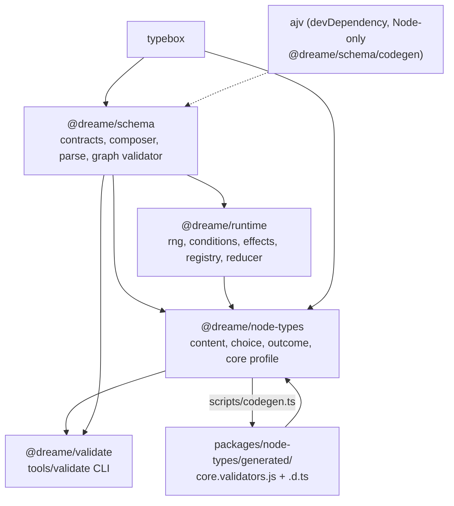
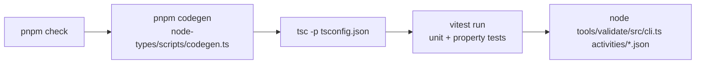
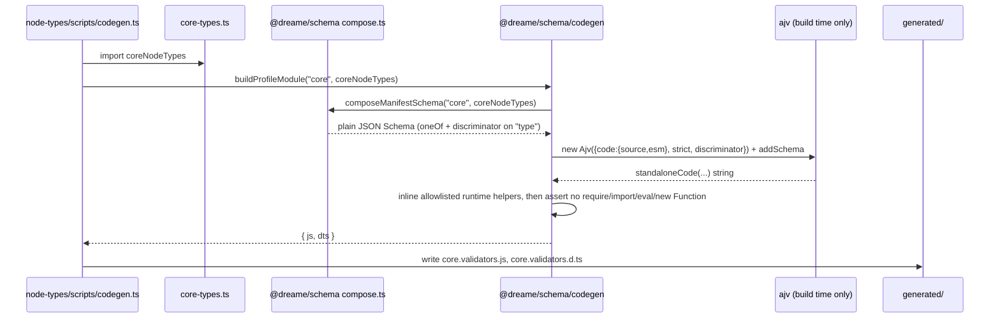

# Design Document: Runtime Core (DREAME Days 2–4)

## Overview

This spec covers Days 2–4 of the DREAME 16-day plan (Brief §8): the TypeBox contracts and schema composer, the Ajv standalone precompilation step, the pure runtime reducer and registry, the shared `content` / `choice` / `outcome` node types, the seeded environment, the graph validator in `packages/schema/src/graph.ts`, the fast-check property tests, a minimal `tools/validate` CLI, and one valid demo manifest plus one deliberately broken fixture. It also replaces the three Day 1 stub scripts (`check`, `validate`, `test:shared`) in the root `package.json` with real commands.

The toolkit checks activity definitions against documented structural and supported semantic rules before playback (Brief §0). The validator in this spec implements the rule order from Brief §3: schema → size caps → unique IDs → dangling refs → DAG → every node reaches a terminal → type-checked conditions. These checks catch the specified errors only. They do not establish factual accuracy, accessibility, or the correctness of custom node-type code. The property tests give evidence for the properties they test, over the inputs fast-check generates; they are not a proof of correctness.

Environment facts (from the Day 1 log and the registry on 2026-11-19): Windows, PowerShell 5.1, Node v22.23.5, pnpm 12.21.0, TypeScript 7.0.2 installed at the root. Registry versions checked with `pnpm view`: `typebox` 1.4.7, `ajv` 8.20.0, `vitest` 5.1.1 (requires the `vite` peer, `^6.4 || ^7 || ^8`, and Node `^22.12.0`), `vite` 8.3.8, `fast-check` 4.10.3, `@types/node@22` 22.20.5.

### Scope

| In scope | Out of scope (later day or other spec) |
|---|---|
| `packages/schema`: TypeBox contracts, composer, codegen helper, byte cap + parse, URL check, graph validator | React renderers and every `Render` UI module (Day 5) |
| `packages/runtime`: seeded RNG, condition evaluator, effects, registry, profile, reducer | App-specific node types `collectionSelect`, `recommendOutcome`, `recall`, `reviewQueue` (Days 6, 8) |
| `packages/node-types`: `content`, `choice`, `outcome`, the `core` profile and its generated validators | `apps/shop-challenge`, `apps/practice-path` |
| `tools/validate`: `pnpm validate activities/*.json` | Kiro hooks, including "hooks 1 and 2" of Day 4 (see Open dependency 1) |
| `activities/`: one valid demo manifest, one broken fixture | Kiro powers |
| Root scripts `codegen`, `typecheck`, `test:shared`, `validate`, `check`; root `tsconfig.json`, `vitest.config.ts` | `packages/link` (encode/decode, 8 KB link cap, SHA-256 hash) and `packages/storage` (AttemptRecord persistence) |
| Unit tests and fast-check property tests | `DraftDoc` permissive schema (B10), `schemaVersion` upgraders (B9), `collections` (B3), review/retry policy (B1), dependency-cruiser, ESLint, Playwright, `pnpm audit` in CI |

No hard dependency on `packages/link` or `packages/storage` exists. The 64 KB JSON cap is applied in `packages/schema` (`parseManifestText`) because the CLI reads files, not links. The 8 KB encoded-link cap belongs to `packages/link`. `AttemptState` is JSON-serializable so `packages/storage` can persist it later without runtime changes.

### Open dependencies and flagged issues

1. **Missing playbook (open dependency).** `Kiro_Setup_and_Operating_Playbook.md` is not in the workspace. Brief §5 defers hook setup to it, and Brief §8 Day 4 lists "hooks 1 and 2". This spec creates no files under `.kiro/hooks/`. The CLI's output and exit codes are designed so a hook can call `pnpm validate <file>` later.
2. **Dependencies not named in the docs.** `@types/node` is needed to typecheck Node-only files (codegen script, CLI, source-scan tests) under `strict`. It is not named in the Architecture Spec or Submission Checklist, so tech.md required the user's approval, which the user gave on 2026-11-19 (Decision D12, approved).
3. **Layout reading.** Architecture Spec §A6 says `packages/schema` holds "generated Ajv validators". A per-profile validator needs the node types' config schemas, and `packages/node-types` already depends on `packages/schema`, so generating the `core` profile inside `packages/schema` would create a workspace dependency cycle. This design puts the composer and codegen functions in `packages/schema` and the generated `core` output in `packages/node-types/generated/` (Decision D2, approved by the user on 2026-11-19).
4. **CI order.** Architecture Spec §A3 lists typecheck before codegen. Generated files are gitignored in this design, so `pnpm check` runs codegen first (Decision D3, approved by the user on 2026-11-19).

## Architecture

### Package dependency graph



There are no cycles. `@dreame/runtime` imports neither `react`, `react-dom`, nor anything under `apps/` (structure.md). `@dreame/runtime` does not depend on `@dreame/node-types`; its tests use local fixture node types. Integration and property tests that need real node types live in `packages/node-types/test/`.

### File map

```
my-kiro-win/
├── package.json                       scripts replaced; devDependencies added (Req 1, 18)
├── tsconfig.base.json                 + noEmit, allowImportingTsExtensions, erasableSyntaxOnly (Req 1.3)
├── tsconfig.json                      root typecheck program, strict (Req 1.4)
├── vitest.config.ts                   root test config (Req 18.3)
├── .gitignore                         + packages/*/generated/ (Req 4.6)
├── packages/schema/
│   ├── package.json  tsconfig.json
│   ├── src/index.ts                   browser-safe barrel (no ajv)
│   ├── src/ids.ts                     ID patterns, HARD_LIMITS, MAX_MANIFEST_JSON_BYTES
│   ├── src/contracts.ts               TypeBox schemas + static types (Ref, Cond, Edge, VarDecl, Effect, Manifest…)
│   ├── src/diagnostics.ts             Diagnostic, Stage, DiagnosticCode, severityOf, sortDiagnostics
│   ├── src/node-type.ts               NodeTypeDescriptor, GraphCtx, ValueType, ProfileDescriptor, StandaloneValidate
│   ├── src/compose.ts                 composeManifestSchema, toPlainJsonSchema
│   ├── src/parse.ts                   parseManifestText (64 KB cap before JSON.parse)
│   ├── src/url.ts                     checkHttpsUrl, SHORTENER_HOSTS
│   ├── src/ajv-errors.ts              mapSchemaErrors (Ajv error objects → Diagnostic[])
│   ├── src/graph.ts                   validateManifest, validateManifestText (stages 2–7)
│   ├── src/codegen/index.ts           buildProfileModule (Node-only; imports ajv)
│   └── test/*.test.ts
├── packages/runtime/
│   ├── package.json  tsconfig.json
│   ├── src/index.ts
│   ├── src/rng.ts                     createRng (mulberry32), SeededRng
│   ├── src/state.ts                   AttemptState, Action, Clock, Env, RuntimeEvent
│   ├── src/node-type.ts               NodeType<C, R>, AnyNodeType
│   ├── src/conditions.ts              evaluateCond, readRef
│   ├── src/effects.ts                 applyEffects, clampToDecl
│   ├── src/registry.ts                createRegistry, Registry
│   ├── src/profile.ts                 defineProfile, Profile
│   ├── src/reducer.ts                 createRuntime, createAttempt, checkAction, reduce
│   └── test/*.test.ts                 (fixture node types in test/fixtures/)
├── packages/node-types/
│   ├── package.json  tsconfig.json
│   ├── src/content.ts  src/choice.ts  src/outcome.ts
│   ├── src/core-types.ts              coreNodeTypes (no generated import)
│   ├── src/core-profile.ts            coreProfile (binds generated validators)
│   ├── src/index.ts
│   ├── scripts/codegen.ts             writes generated/core.validators.{js,d.ts}
│   ├── generated/                     gitignored
│   └── test/                          unit, integration, property tests, arbitraries.ts
├── tools/validate/
│   ├── package.json  tsconfig.json
│   ├── src/expand.ts  src/format.ts  src/run.ts  src/cli.ts
│   └── test/*.test.ts
└── activities/
    ├── core-demo-study-break.json     valid demo (profile "core")
    └── fixtures/
        ├── README.md                  states the fixture is broken on purpose
        └── broken-dangling-edge.json  fails at stage "refs"
```

### Build and check pipeline



`pnpm check` is the simple-git-hooks pre-commit command and the only CI step after install, so `.github/workflows/ci.yml` does not change. Steps are joined with `&&` inside the `package.json` script, which `cmd.exe` and `sh` both support; the PowerShell rule against `&&` (Day 1 Req 11.1) applies to commands run in PowerShell, not to script values (Day 1 Req 11.2).

## Sequence Diagrams

### Build-time codegen



### Validation pipeline (CLI, later the player)

```mermaid
sequenceDiagram
    participant CLI as tools/validate run()
    participant Parse as parseManifestText
    participant Graph as validateManifest
    participant Ajv as generated validateManifest_core
    participant NT as NodeTypeDescriptor.validate

    CLI->>CLI: read bytes; reject if > 65,536 bytes (before decode/parse)
    CLI->>Parse: text
    Parse->>Parse: UTF-8 byte cap, then JSON.parse
    Parse-->>CLI: unknown value or Diagnostic[]
    CLI->>CLI: pick profile from value.profile
    CLI->>Graph: validateManifest(value, coreProfile)
    Graph->>Ajv: stage 1 schema
    Graph->>Graph: stage 2 caps → 3 ids → 4 refs → 5 dag → 6 terminal
    Graph->>NT: stage 7 conditions + per-node validate(cfg, ctx)
    Graph-->>CLI: {ok, manifest?, diagnostics}
    CLI-->>CLI: print PASS/FAIL lines, exit 0/1/2
```

### One reducer step

```mermaid
sequenceDiagram
    participant Caller
    participant Red as reduce()
    participant Reg as Registry
    participant NT as NodeType
    participant Cond as evaluateCond

    Caller->>Red: reduce(rt, state, {type:"respond", nodeId, response}, {now})
    Red->>Red: checkAction → rejection? return same state object
    Red->>Reg: get(node.type)
    Red->>Red: rng = createRng(state.rngState); env = {now, rng}
    Red->>NT: reduce(cfg, state, response, env)
    NT-->>Red: state with answer / effects
    Red->>Cond: first edge whose when is absent or true
    alt transitions + 1 > limits.maxTransitions
        Red->>Red: enter fallbackOutcomeId, status limit_reached, event limit_reached
    else
        Red->>Red: enter edge.to, transitions + 1
    end
    Red->>NT: enter?(cfg, state, env) for the new node
    Red-->>Caller: new state with rngState = rng.state, updatedAt = now
```

## Components and Interfaces

All source is TypeScript under `strict`. Relative imports use explicit `.ts` extensions so Node 22 can run scripts by type stripping (Decision D4). Only erasable syntax is used: no `enum`, `namespace` or constructor parameter properties.

### Component 1: `@dreame/schema` (`packages/schema`)

**Purpose:** one source of truth for the manifest contract (Architecture Spec §A2 layer 1), the schema composer, the build-time codegen helper, the byte cap, and the graph validator.

**package.json**

```json
{
  "name": "@dreame/schema",
  "version": "0.0.0",
  "private": true,
  "type": "module",
  "exports": {
    ".": "./src/index.ts",
    "./codegen": "./src/codegen/index.ts"
  },
  "dependencies": { "typebox": "^1.4.7" },
  "devDependencies": { "ajv": "^8.20.0" }
}
```

`./codegen` is the only module that imports `ajv`. `src/index.ts` does not re-export it, so browser code that imports `@dreame/schema` never reaches `ajv` (tech.md, Brief B5).

**Limits and ID patterns (`src/ids.ts`)**

```typescript
export const MAX_MANIFEST_JSON_BYTES = 65_536;          // Brief C2, security.md
export const HARD_LIMITS = {
  maxNodes: 200,          // design value, Decision D10
  maxTransitions: 1_000,  // design value
  maxEdgesPerNode: 16,    // design value
  maxVariables: 32,       // design value
  maxCondDepth: 8,        // Brief B2
  maxCondArgs: 8,         // design value
  maxOptions: 8,          // design value
  maxEffectsPerOption: 8, // design value
  maxTextLength: 2_000,   // design value (UTF-16 code units, Decision D6)
  maxDiagnostics: 50,     // design value
} as const;

export const NODE_ID_PATTERN = '^[A-Za-z][A-Za-z0-9_-]{0,63}$';   // no leading "_" → excludes "__proto__"
export const VAR_ID_PATTERN = '^[A-Za-z][A-Za-z0-9_]{0,31}$';
export const TYPE_NAME_PATTERN = '^[a-z][A-Za-z0-9]{0,31}$';
export const ACTIVITY_ID_PATTERN = '^[a-z0-9][a-z0-9-]{0,63}$';
export const THEME_PATTERN = '^[a-z0-9-]{1,32}$';
export const DATE_PATTERN = '^[0-9]{4}-[0-9]{2}-[0-9]{2}$';
export const HTTPS_PREFIX_PATTERN = '^https://';
```

**Contracts (`src/contracts.ts`)** — TypeBox 1.x builders (`import Type from 'typebox'`). Static types follow Brief §3; the recursive `Cond` type is written by hand and its schema is built as a depth-bounded set of `$defs` (Decision D5).

```typescript
export type NodeId = string;
export type Scalar = string | number | boolean;
export type AnswerValue = Scalar | readonly string[];

export type VarDecl =
  | { id: string; type: 'number'; initial: number; min?: number; max?: number }
  | { id: string; type: 'boolean'; initial: boolean }
  | { id: string; type: 'enum'; initial: string; values: string[] };

export type Ref = { answer: NodeId } | { var: string };

export type Cond =
  | { op: 'eq' | 'gte' | 'lte' | 'includes'; ref: Ref; value: Scalar }
  | { op: 'and' | 'or'; args: Cond[] }
  | { op: 'not'; arg: Cond };

export type Edge = { to: NodeId; when?: Cond };        // first match wins; last edge unconditional

export type Effect =
  | { op: 'set'; var: string; value: Scalar }
  | { op: 'add'; var: string; value: number };

export type ManifestNode = {
  id: NodeId;
  type: string;
  config: unknown;            // narrowed per node type by the composed schema
  edges: Edge[];              // [] for terminal node types
};

export interface Manifest {
  schemaVersion: 1;
  profile: string;            // 'core' in this spec; 'shop-challenge' | 'practice-path' later
  activityId: string;
  version: number;
  requires: Record<string, number>;
  entryNodeId: NodeId;
  fallbackOutcomeId: NodeId;
  limits: { maxNodes: number; maxTransitions: number };
  variables: VarDecl[];
  nodes: ManifestNode[];
  theme: string;
  validUntil?: string;        // YYYY-MM-DD
}

declare const validBrand: unique symbol;
export type ValidManifest = Manifest & { readonly [validBrand]: true };

// TypeBox schemas (plain JSON Schema after toPlainJsonSchema):
export const RefSchema: TSchema;          // oneOf [{answer}, {var}], both closed
export const ScalarSchema: TSchema;       // anyOf string(maxLength 64) | number | boolean
export const VarDeclSchema: TSchema;      // oneOf discriminated on "type", closed
export const EffectSchema: TSchema;       // oneOf discriminated on "op", closed
export const LimitsSchema: TSchema;       // closed; maxNodes 1..200, maxTransitions 0..1000 (integers)
export function condDefs(maxDepth: number): Record<string, unknown>;   // { CondD1 … CondD8 }
export const EdgeSchemaRef: unknown;      // { type:'object', additionalProperties:false, required:['to'],
                                          //   properties:{ to: NodeId, when: { $ref:'#/$defs/CondD8' } } }
```

`condDefs(8)` returns eight definitions. `CondD1` is the leaf only. `CondDk` (k ≥ 2) is `oneOf` with discriminator `op` over the leaf (`op` enum `eq|gte|lte|includes`), `and/or` (`args`: 1–8 items of `CondD(k-1)`) and `not` (`arg`: `CondD(k-1)`). No definition references itself, so Ajv's generated code recurses at most eight levels on any input.

**Diagnostics (`src/diagnostics.ts`)**

```typescript
export type Stage = 'parse' | 'schema' | 'caps' | 'ids' | 'refs' | 'dag' | 'terminal' | 'conditions';
export type Severity = 'error' | 'warning';
export type DiagnosticCode =
  | 'too-large' | 'invalid-utf8' | 'invalid-json' | 'unknown-profile'
  | 'schema' | 'unknown-node-type' | 'profile-mismatch'
  | 'node-cap' | 'transition-cap'
  | 'duplicate-node-id' | 'duplicate-var-id' | 'duplicate-option-id'
  | 'dangling-ref' | 'undeclared-var' | 'requires-missing' | 'requires-version' | 'requires-unknown' | 'requires-unused'
  | 'cycle'
  | 'dead-end' | 'terminal-has-edges' | 'last-edge-conditional' | 'fallback-not-terminal'
  | 'no-terminal-reachable' | 'unreachable-node' | 'limit-below-longest-path'
  | 'cond-too-deep' | 'type-mismatch' | 'ref-not-answerable' | 'answer-not-upstream'
  | 'var-decl-invalid' | 'effect-invalid' | 'invalid-date' | 'unsafe-url' | 'blank-text';

export interface Diagnostic {
  readonly severity: Severity;
  readonly stage: Stage;
  readonly code: DiagnosticCode;
  readonly path: string;        // JSON Pointer into the manifest ("" = root)
  readonly message: string;     // plain language, no stack traces
  readonly nodeId?: NodeId;
}

export function sortDiagnostics(d: readonly Diagnostic[]): Diagnostic[];   // stable: stage order, then path, then code
export function severityOf(code: DiagnosticCode): Severity;               // 'warning' for 'requires-unused', else 'error'
```

**Stage and severity of each code.** `requires-unused` is the only warning-level code; every other code is an error. A warning does not stop later stages and does not fail the manifest: a passing result may carry warnings, and the CLI exits 0 for a file with warnings only. When a later stage reports an error, warnings from earlier stages stay in the result.

| Stage | Codes (severity `error` unless marked) |
|---|---|
| `parse` | `too-large`, `invalid-utf8`, `invalid-json`; `unknown-profile` (CLI only, reported after parsing and before stage 1) |
| `schema` (1) | `schema`, `unknown-node-type`, `profile-mismatch`, `cond-too-deep` |
| `caps` (2) | `node-cap`, `transition-cap` |
| `ids` (3) | `duplicate-node-id`, `duplicate-var-id` |
| `refs` (4) | `dangling-ref`, `undeclared-var`, `requires-missing`, `requires-version`, `requires-unknown`, `requires-unused` (warning) |
| `dag` (5) | `cycle` |
| `terminal` (6) | `dead-end`, `terminal-has-edges`, `last-edge-conditional`, `fallback-not-terminal`, `unreachable-node`, `no-terminal-reachable`, `limit-below-longest-path` |
| `conditions` (7) | `type-mismatch`, `ref-not-answerable`, `answer-not-upstream`, `var-decl-invalid`, `effect-invalid`, `invalid-date`, `blank-text`, and the node-type codes `duplicate-option-id`, `unsafe-url` |

`cond-too-deep` belongs to stage 1 because the `CondD1…CondD8` schema enforces the depth. A condition nested deeper than 8 levels fails the schema; `mapSchemaErrors` measures the nesting depth of each edge's `when` in the input (a leaf is depth 1, `and`/`or`/`not` add 1; the walk is iterative and stops at depth 9) and, for a `when` deeper than 8, reports one `schema/cond-too-deep` at that `when` path in place of the Ajv errors inside it.

**Node-type descriptor (`src/node-type.ts`)** — the part of Brief §3 `NodeType` that the validator and composer need. `@dreame/runtime` extends it with `reduce`; `Render` is added by Day 5 UI modules.

```typescript
export type JsonSchema = Record<string, unknown>;
export type ValueType =
  | { kind: 'number'; min?: number; max?: number }
  | { kind: 'boolean' }
  | { kind: 'enum'; values: readonly string[] }
  | { kind: 'set'; values: readonly string[] };       // multi-select answers (used by later node types)

export interface GraphCtx {
  readonly manifest: Manifest;                        // schema-valid, IDs unique, refs resolved
  readonly nodePath: string;                          // e.g. "/nodes/3"
  readonly variables: ReadonlyMap<string, VarDecl>;
  checkEffect(effect: Effect, path: string): Diagnostic[];
  checkHttpsUrl(url: string, path: string): Diagnostic[];
  checkText(text: string, path: string): Diagnostic[];  // blank-text
}

export interface NodeTypeDescriptor<C = unknown> {
  readonly type: string;                              // matches TYPE_NAME_PATTERN
  readonly version: number;                           // positive integer
  readonly terminal: boolean;                         // true → node must have no edges
  readonly configSchema: TSchema;                     // closed
  readonly responseSchema: TSchema;                   // closed
  validate(cfg: C, ctx: GraphCtx): Diagnostic[];
  answerType(cfg: C): ValueType | null;               // null → node cannot be an `answer` ref target
}

export interface StandaloneValidate {
  (data: unknown): boolean;
  errors?: ReadonlyArray<{ instancePath: string; keyword: string; params: Record<string, unknown>; message?: string }> | null;
}

export interface ProfileDescriptor {
  readonly id: string;
  readonly nodeTypes: readonly NodeTypeDescriptor[];
  readonly validateSchema: StandaloneValidate;        // generated, precompiled
}
```

`GraphCtx.checkEffect` implements Requirement 11.6 and reports `conditions/effect-invalid` at `path` when the effect names an undeclared variable, when an `add` effect targets a variable whose type is not `number`, or when a `set` value does not match the variable's declared type. For `set`, "matches the declared type" means: a `number` variable gets a number within its declared `min`/`max` when present; a `boolean` variable gets a boolean; an `enum` variable gets one of its `values`. `add` values are not range-checked here, because the runtime clamps the sum (see Conditions and effects).

**Composer (`src/compose.ts`)**

```typescript
export function toPlainJsonSchema(schema: TSchema): JsonSchema;     // JSON round-trip; drops TypeBox's non-enumerable "~kind"
export function composeManifestSchema(profileId: string, nodeTypes: readonly NodeTypeDescriptor[]): JsonSchema;
export function composeResponseSchemas(nodeTypes: readonly NodeTypeDescriptor[]): Record<string, JsonSchema>;
```

`composeManifestSchema` returns a closed object schema with `$id` `urn:dreame:manifest:<profileId>`, `profile: { const: profileId }`, `nodes: { type: 'array', minItems: 1, maxItems: HARD_LIMITS.maxNodes, items: { $ref: '#/$defs/Node' } }`, and `$defs` containing `CondD1…CondD8`, `Ref`, `Scalar`, `Edge`, `Effect`, `VarDecl` and `Node`. `Node` is `{ type: 'object', properties: { type: { type: 'string' } }, required: ['type'], discriminator: { propertyName: 'type' }, oneOf: [...] }` with one closed branch per node type: `{ id: NodeId, type: { const: nt.type }, config: plain(nt.configSchema), edges: { type: 'array', maxItems: 16, items: { $ref: '#/$defs/Edge' } } }`, all four required. The branch order follows the `nodeTypes` order, so output is deterministic. It throws `Error` on duplicate or malformed type names (programmer error at build time).

**Codegen (`src/codegen/index.ts`, Node-only)**

```typescript
export interface ProfileModule { readonly js: string; readonly dts: string }
export const ALLOWED_RUNTIME_HELPERS: Readonly<Record<string, string>>;   // e.g. "ucs2length" → inline source
export function buildProfileModule(profileId: string, nodeTypes: readonly NodeTypeDescriptor[]): ProfileModule;
export function assertSelfContained(js: string): void;   // throws on require(, import, eval(, new Function, Function(
```

`buildProfileModule` creates `new Ajv({ code: { source: true, esm: true, lines: true }, strict: true, allErrors: true, discriminator: true, unicode: false })` (`unicode: false` makes `maxLength`/`minLength` use `string.length`, Decision D6), adds the composed manifest schema and one schema per response (`$id` `urn:dreame:response:<type>`), and calls `standaloneCode(ajv, { validateManifest: 'urn:dreame:manifest:<id>', response_<type>: 'urn:dreame:response:<type>', … })`. Ajv's standalone output can still contain `require("ajv/dist/runtime/<helper>")` calls even in ESM mode (Ajv docs: standalone functions depend on Ajv's `runtime` folder). The function replaces each call whose helper is in `ALLOWED_RUNTIME_HELPERS` with an inlined local function written in this repo (for `ucs2length`: count code points with `for…of`), then calls `assertSelfContained`. Any other helper fails the build with a message naming it. `dts` declares each export as `StandaloneValidate`, imported with `import type` from `@dreame/schema`.

**Parse (`src/parse.ts`)**

```typescript
export type ParseResult = { ok: true; value: unknown } | { ok: false; diagnostics: Diagnostic[] };
export function utf8ByteLength(text: string): number;          // no allocation; counts code points
export function parseManifestText(text: string): ParseResult;  // cap check BEFORE JSON.parse
```

**URL check (`src/url.ts`)**

```typescript
export const SHORTENER_HOSTS: readonly string[];   // bit.ly, tinyurl.com, t.co, goo.gl, ow.ly, is.gd, buff.ly, cutt.ly, rebrand.ly, shorturl.at
export function checkHttpsUrl(url: string, path: string): Diagnostic[];
```

Rules: length ≤ 2,048; parses with `new URL`; `protocol === 'https:'`; non-empty hostname; no username or password; hostname (lower-cased, without a leading `www.`) not in `SHORTENER_HOSTS` (Architecture Spec §A5). `https://wa.me/...` passes (Brief C1). Rendering with `rel="noopener noreferrer"` is the Day 5 renderer's job; Day 5 reuses this function for the renderer-side check.

**Graph validator (`src/graph.ts`)**

```typescript
export type ValidationResult =
  | { ok: true; manifest: ValidManifest; diagnostics: Diagnostic[] }    // warnings only
  | { ok: false; diagnostics: Diagnostic[] };                            // ≥ 1 error
export function validateManifest(input: unknown, profile: ProfileDescriptor): ValidationResult;
export function validateManifestText(text: string, profile: ProfileDescriptor): ValidationResult;
```

**Responsibilities:** run the seven stages in Brief §3 order, stop after the first stage that reports an error (warnings do not stop it), set each diagnostic's `severity` with `severityOf`, cap the output at 50 diagnostics, never mutate `input`, and not catch its own exceptions (a throw is a bug that property test (b) is meant to find; callers fail closed).

### Component 2: `@dreame/runtime` (`packages/runtime`)

**Purpose:** the pure reducer, registry, condition evaluator and seeded RNG (Architecture Spec §A6), with no React and no app imports (Brief §3, structure.md).

**package.json**

```json
{
  "name": "@dreame/runtime",
  "version": "0.0.0",
  "private": true,
  "type": "module",
  "exports": { ".": "./src/index.ts" },
  "dependencies": { "@dreame/schema": "workspace:*" }
}
```

**State and environment (`src/state.ts`)**

```typescript
export type Status = 'playing' | 'finished' | 'limit_reached';
export type RuntimeEvent =
  | { type: 'finished'; at: number; outcomeId: NodeId }
  | { type: 'limit_reached'; at: number; fromNodeId: NodeId; outcomeId: NodeId };

export interface AttemptState {
  readonly activityId: string;
  readonly manifestVersion: number;
  readonly seed: number;                                   // uint32, stored in the attempt (Brief B6, B7)
  readonly rngState: number;                               // uint32, advanced only through env.rng
  readonly status: Status;
  readonly currentNodeId: NodeId;
  readonly vars: Readonly<Record<string, Scalar>>;
  readonly answers: Readonly<Record<NodeId, AnswerValue>>;
  readonly nodeState: Readonly<Record<NodeId, JsonValue>>; // per-node presentation data, e.g. option order
  readonly path: readonly { readonly nodeId: NodeId; readonly at: number }[];
  readonly transitions: number;
  readonly events: readonly RuntimeEvent[];
  readonly startedAt: number;
  readonly updatedAt: number;
}

export type Action = { readonly type: 'respond'; readonly nodeId: NodeId; readonly response: unknown };
export interface Clock { readonly now: number }
export interface Env { readonly now: number; readonly rng: SeededRng; readonly variables: ReadonlyMap<string, VarDecl> }    // Brief §3 env shape + Runtime.variables for applyEffects
export type JsonValue = null | boolean | number | string | JsonValue[] | { [k: string]: JsonValue };
```

**Seeded RNG (`src/rng.ts`)** — mulberry32, 32-bit state.

```typescript
export interface SeededRng {
  nextUint32(): number;                 // 0 … 2^32-1
  nextFloat(): number;                  // [0, 1)
  nextInt(maxExclusive: number): number;// 0 … maxExclusive-1; RangeError unless 1 ≤ maxExclusive ≤ 2^32
  shuffle<T>(items: readonly T[]): T[]; // Fisher–Yates on a copy
  readonly state: number;               // current uint32 state
}
export function createRng(state: number): SeededRng;   // RangeError unless state is a uint32
```

**Node type (`src/node-type.ts`)**

```typescript
export interface NodeType<C = unknown, R = unknown> extends NodeTypeDescriptor<C> {
  isValidResponse(cfg: C, r: unknown): r is R;          // after the precompiled responseSchema check
  enter?(cfg: C, s: AttemptState, env: Env): AttemptState;   // s.currentNodeId is the entered node
  reduce(cfg: C, s: AttemptState, r: R, env: Env): AttemptState;  // Brief §3 signature; s.currentNodeId is the responding node
}
export type AnyNodeType = NodeType<any, any>;
```

`reduce` keeps the Brief §3 signature. A node type keys its answer by `s.currentNodeId`, which the runtime sets before calling `enter` and leaves unchanged until routing. `terminal`, `answerType`, `isValidResponse` and the optional `enter` are additions to the Brief §3 contract; `Render` is added by the Day 5 UI module (Decision D9).

**Conditions and effects**

```typescript
export function readRef(ref: Ref, s: AttemptState): AnswerValue | undefined;  // Object.hasOwn lookups only
export function evaluateCond(cond: Cond, s: AttemptState): boolean;
export function applyEffects(effects: readonly Effect[], s: AttemptState, vars: ReadonlyMap<string, VarDecl>): AttemptState;
export function clampToDecl(value: number, decl: Extract<VarDecl, { type: 'number' }>): number;
```

`applyEffects` applies effects in order and returns a new state. `set` stores `value` (stage 7 `checkEffect` has already checked its type and range). `add` computes `vars[id] + value` and passes the sum through `clampToDecl`, which returns `max` when the sum is above a declared `max`, `min` when it is below a declared `min`, and otherwise the sum. When a bound is not declared, `clampToDecl` uses `Number.MAX_VALUE` or `-Number.MAX_VALUE` in its place, so the result stays finite and survives a JSON round trip. With this rule every variable holds a value of its declared type and range after every step (Requirement 15.12).

**Registry and profile**

```typescript
export interface Registry {
  get(type: string): AnyNodeType | undefined;
  list(): readonly AnyNodeType[];
}
export function createRegistry(types: readonly AnyNodeType[]): Registry;   // throws on duplicate type names

export interface Profile extends ProfileDescriptor {
  readonly nodeTypes: readonly AnyNodeType[];
  readonly registry: Registry;
  validateResponse(type: string, response: unknown): boolean;
}
export function defineProfile(input: {
  id: string;
  nodeTypes: readonly AnyNodeType[];
  validateSchema: StandaloneValidate;
  responseValidators: Readonly<Record<string, StandaloneValidate>>;
}): Profile;                                                               // throws if a node type has no response validator
```

**Reducer (`src/reducer.ts`)**

```typescript
export interface Runtime {
  readonly profile: Profile;
  readonly manifest: ValidManifest;
  readonly nodes: ReadonlyMap<NodeId, ManifestNode>;
  readonly variables: ReadonlyMap<string, VarDecl>;
}
export type ActionRejection =
  | 'not-playing' | 'unknown-action' | 'wrong-node' | 'invalid-response';

export function createRuntime(profile: Profile, manifest: ValidManifest): Runtime;
export function createAttempt(rt: Runtime, seed: number, clock: Clock): AttemptState;
export function checkAction(rt: Runtime, s: AttemptState, a: Action): ActionRejection | null;
export function reduce(rt: Runtime, s: AttemptState, a: Action, clock: Clock): AttemptState;
```

The top-level `reduce` takes a `Clock` and builds `env.rng` from `state.rngState`, so the seed and RNG position live in the attempt and a reload resumes the same sequence (Brief B6, B7; Decision D8). A rejected action returns the input state object unchanged.

`createAttempt` builds the initial state with `currentNodeId = entryNodeId`, then calls the entry node type's `enter` (when defined) with `env = { now: clock.now, rng: createRng(seed) }`, and stores the RNG's `state` as `rngState`. A `choice` entry node with `shuffle: true` therefore has its option order in `nodeState` from the first state on. Routing in `reduce` evaluates edge conditions after the node type's `reduce` has run, so a node's own edges can read the answer that node just recorded.

### Component 3: `@dreame/node-types` (`packages/node-types`)

**Purpose:** the shared node types `content`, `choice` and `outcome` (structure.md placement rule) and the `core` profile used by the CLI and tests.

**package.json**

```json
{
  "name": "@dreame/node-types",
  "version": "0.0.0",
  "private": true,
  "type": "module",
  "exports": { ".": "./src/index.ts" },
  "scripts": { "codegen": "node --experimental-strip-types scripts/codegen.ts" },
  "dependencies": {
    "@dreame/runtime": "workspace:*",
    "@dreame/schema": "workspace:*",
    "typebox": "^1.4.7"
  }
}
```

| Type | version | terminal | config (closed) | response (closed) | answerType | enter | reduce |
|---|---|---|---|---|---|---|---|
| `content` | 1 | false | `{ title?: string ≤120, body: string ≤2000, continueLabel?: string ≤40 }` | `{}` | `null` | — | returns `s` |
| `choice` | 1 | false | `{ prompt: string ≤500, options: 2–8 × { id: NodeId-pattern, label: string ≤200, effects?: Effect[] ≤8 }, shuffle?: boolean }` | `{ optionId: string }` | `{ kind: 'enum', values: option ids }` | if `shuffle`, stores `nodeState[nodeId] = { order: rng.shuffle(ids) }` | sets `answers[nodeId] = optionId`, applies that option's effects |
| `outcome` | 1 | true | `{ title: string ≤120, body: string ≤2000, cta?: { label: string ≤60, url: string ^https:// } }` | `{}` | `null` | — | returns `s` (never called: runtime rejects actions once status ≠ playing) |

`validate` rules: `content` → `checkText(body)`, `checkText(title)` when present; `choice` → `checkText(prompt)`, unique option IDs (`duplicate-option-id`), each label non-blank, `checkEffect` for each effect; `outcome` → `checkText(title)`, `checkHttpsUrl(cta.url)` when present.

```typescript
// src/core-types.ts — no import of generated code, so the codegen script can import it
export const coreNodeTypes: readonly AnyNodeType[] = [contentNodeType, choiceNodeType, outcomeNodeType];

// src/core-profile.ts
import { validateManifest, response_content, response_choice, response_outcome } from '../generated/core.validators.js';
export const coreProfile: Profile = defineProfile({
  id: 'core',
  nodeTypes: coreNodeTypes,
  validateSchema: validateManifest,
  responseValidators: { content: response_content, choice: response_choice, outcome: response_outcome },
});
```

`scripts/codegen.ts` imports `coreNodeTypes` and `buildProfileModule` from `@dreame/schema/codegen`, creates `generated/` if missing, and writes `core.validators.js` and `core.validators.d.ts` with LF line endings. It prints one line with both paths and the JS byte size.

Mapping to the new-node-type.md checklist for the three shared types: steps 1–6, 8, 9 (registry via `defineProfile`), 10 (composed by `composeManifestSchema`, called from this package's codegen), 11 (demo manifest `requires`) and 12 (tests) are in this spec; step 7 (`Render`) is Day 5.

### Component 4: `@dreame/validate` (`tools/validate`)

**Purpose:** the CLI `pnpm validate activities/*.json` (Architecture Spec §A6), used by CI now and by a Kiro hook later.

**package.json**

```json
{
  "name": "@dreame/validate",
  "version": "0.0.0",
  "private": true,
  "type": "module",
  "dependencies": {
    "@dreame/node-types": "workspace:*",
    "@dreame/schema": "workspace:*"
  }
}
```

```typescript
// src/expand.ts
export interface DirReader { listFiles(dir: string): string[] | null }   // null → directory missing
export type ExpandResult = { files: string[]; errors: string[] };
export function expandArgs(args: readonly string[], fs: DirReader): ExpandResult;

// src/format.ts
export function formatDiagnostic(d: Diagnostic): string;   // "  error refs/dangling-ref at /nodes/1/edges/0/to: …"

// src/run.ts
export interface CliIo {
  readFile(path: string): Uint8Array | null;               // null → missing or unreadable
  listFiles(dir: string): string[] | null;
  out(line: string): void;
  err(line: string): void;
}
export const PROFILES: Readonly<Record<string, ProfileDescriptor>>;   // { core: coreProfile }
export function run(argv: readonly string[], io: CliIo): 0 | 1 | 2;

// src/cli.ts — wires run() to node:fs and process, sets process.exitCode
```

Wildcard handling is done by the CLI because `cmd.exe` passes `activities/*.json` unexpanded while `sh` expands it. `*` and `?` are allowed in the last path segment only; `**` and wildcards in directory segments are usage errors. Matches are files only, sorted by code-unit order, de-duplicated. An argument with no `*` or `?` is a single file path and is not checked for existence during expansion; if that file is missing or unreadable, `run` prints a `FAIL` line for it and the exit code is `1` (not the usage code `2`).

Exit codes: `0` every file passed (warnings allowed); `1` at least one file failed or an unexpected exception occurred while checking a file (printed as `internal error`, without a stack trace); `2` usage error (no arguments, nothing matched, unsupported pattern).

### Component 5: Root configuration

**package.json scripts** (replacing the three Day 1 stubs; `postinstall` and `simple-git-hooks` unchanged)

```json
{
  "scripts": {
    "codegen": "pnpm --filter @dreame/node-types run codegen",
    "typecheck": "pnpm codegen && tsc -p tsconfig.json",
    "test:shared": "pnpm codegen && vitest run",
    "validate": "pnpm codegen && node --experimental-strip-types tools/validate/src/cli.ts",
    "check": "pnpm codegen && tsc -p tsconfig.json && vitest run && node --experimental-strip-types tools/validate/src/cli.ts activities/*.json",
    "postinstall": "simple-git-hooks"
  }
}
```

pnpm appends extra arguments to the end of a script, so `pnpm validate activities/*.json` runs the CLI with that argument. `check` calls `tsc`, `vitest` and the CLI directly so codegen runs once. No script uses single-quoted arguments, environment variables or shell utilities (Day 1 Req 11.2).

**Root devDependencies added:** `vitest`, `vite`, `fast-check` and `@types/node`, all approved by the user on 2026-11-19 (D11, D12).

**tsconfig.base.json additions:** `"noEmit": true`, `"allowImportingTsExtensions": true`, `"erasableSyntaxOnly": true`. Packages are consumed as source, never emitted, which `allowImportingTsExtensions` requires.

**tsconfig.json (root):** extends `./tsconfig.base.json`, sets `"strict": true`, and includes `packages/*/src/**/*.ts`, `packages/*/scripts/**/*.ts`, `packages/*/test/**/*.ts`, `packages/*/generated/*.d.ts`, `tools/*/src/**/*.ts`, `tools/*/test/**/*.ts` and `vitest.config.ts`. One `tsc` program keeps the pre-commit check to a single native compiler run.

**Per-package tsconfig.json:** extends `../../tsconfig.base.json`, sets `"strict": true` (tech.md), includes that package's `src`, `test`, `scripts` and `generated` folders. Editors use these; `pnpm typecheck` uses the root one.

**vitest.config.ts:** `defineConfig({ test: { include: ['packages/*/test/**/*.test.ts', 'tools/*/test/**/*.test.ts'], environment: 'node' } })` from `vitest/config`.

**.gitignore:** add `packages/*/generated/`.
The `.gitignore` entry covers `packages/node-types/generated/core.validators.js` and `core.validators.d.ts`. Because these files are not committed, every script that needs them runs `pnpm codegen` first (Decision D3).

**What changes in `package.json` and what does not:**

| Script | Day 1 value | This spec |
|---|---|---|
| `check` | `node -e "console.log('not implemented yet')"` | full pipeline shown above |
| `validate` | same stub | codegen, then the CLI with the caller's arguments |
| `test:shared` | same stub | codegen, then `vitest run` |
| `codegen`, `typecheck` | absent | added |
| `postinstall` | `simple-git-hooks` | unchanged |
| `simple-git-hooks` field | `{ "pre-commit": "pnpm check" }` | unchanged |

`activities/*.json` matches files directly under `activities/` only, so `pnpm check` validates `core-demo-study-break.json` and does not touch `activities/fixtures/broken-dangling-edge.json`. The broken fixture is exercised by a CLI test that expects exit code 1.

**`.github/workflows/ci.yml`:** no change. It already runs `pnpm install --frozen-lockfile` and then `pnpm check` on Node 22, which picks up the new pipeline. The added devDependencies change `pnpm-lock.yaml`, which must be committed with them so `--frozen-lockfile` passes.

## Data Models

The TypeScript shapes are defined once in Component 1 (`src/contracts.ts`, `src/diagnostics.ts`) and Component 2 (`src/state.ts`). This section restates them, lists the rule that checks each field, and records where they differ from Brief §3.

### Differences from Brief §3

| Brief §3 | This design | Reason |
|---|---|---|
| `VarDecl` single object, `initial: unknown`, optional `min`/`max`/`values` | discriminated union on `type`; `initial` typed per variant; `values` only on `enum`; `min`/`max` only on `number` | closed schema per variant; type-checked conditions need a known type |
| `schemaVersion: number` | `schemaVersion: 1` | upgraders (B9) are out of scope; only v1 exists |
| `profile: 'shop-challenge' \| 'practice-path' \| string` | `string`, `'core'` in this spec | apps and their profiles come later |
| `collections?: Collection[]` | omitted | B3 is out of scope |
| `nodes: Node[]` | `nodes: ManifestNode[]` with `config: unknown` | `config` is narrowed per type by the composed schema |
| `NodeType` with `Render` | `NodeTypeDescriptor` + runtime `NodeType`, no `Render` | `Render` is Day 5 (Decision D9) |

### Manifest

```typescript
interface Manifest {
  schemaVersion: 1; profile: string; activityId: string; version: number;
  requires: Record<string, number>; entryNodeId: NodeId; fallbackOutcomeId: NodeId;
  limits: { maxNodes: number; maxTransitions: number };
  variables: VarDecl[]; nodes: ManifestNode[]; theme: string; validUntil?: string;
}
```

| Rule | Stage | Code |
|---|---|---|
| Closed object; `activityId`, `theme`, `validUntil` match their patterns; `version` positive integer; `nodes` 1–200 items; `limits` integers within `LimitsSchema` | schema | `schema` |
| `profile` equals the profile passed to the validator | schema | `profile-mismatch` |
| `nodes.length ≤ limits.maxNodes ≤ HARD_LIMITS.maxNodes`; `limits.maxTransitions ≤ HARD_LIMITS.maxTransitions` | caps | `node-cap`, `transition-cap` |
| `entryNodeId` and `fallbackOutcomeId` name existing nodes | refs | `dangling-ref` |
| `requires` lists every node type used, at a version the profile supports, and nothing else | refs | `requires-missing`, `requires-version`, `requires-unknown`, `requires-unused` |
| `fallbackOutcomeId` names a terminal node | terminal | `fallback-not-terminal` |
| `limits.maxTransitions` is at least the longest entry-to-terminal path | terminal | `limit-below-longest-path` |
| `validUntil` is a real calendar date | conditions | `invalid-date` |

A manifest that passes all seven stages is returned as `ValidManifest`. `createRuntime` accepts only that branded type, so the runtime does not re-validate.

### VarDecl

```typescript
type VarDecl =
  | { id: string; type: 'number'; initial: number; min?: number; max?: number }
  | { id: string; type: 'boolean'; initial: boolean }
  | { id: string; type: 'enum'; initial: string; values: string[] };
```

Rules: `id` matches `VAR_ID_PATTERN` (schema); at most 32 variables (schema); IDs unique (`duplicate-var-id`, stage ids); for `number`, `min ≤ initial ≤ max` when bounds are present; for `enum`, `values` non-empty and unique and `initial` is one of them (`var-decl-invalid`, stage conditions).

### Ref

```typescript
type Ref = { answer: NodeId } | { var: string };
```

Rules: an `answer` ref names an existing node (`dangling-ref`) whose type has a non-null `answerType` (`ref-not-answerable`) and which lies on every path from the entry to the node that holds the condition (`answer-not-upstream`). The holding node counts as lying on every such path, so a node's own edges may read that node's answer: the node type's `reduce` records the answer before routing evaluates the edges. A `var` ref names a declared variable (`undeclared-var`). `readRef` uses `Object.hasOwn`, so a missing answer reads as `undefined` and prototype keys are never read.

### Cond

```typescript
type Cond =
  | { op: 'eq' | 'gte' | 'lte' | 'includes'; ref: Ref; value: Scalar }
  | { op: 'and' | 'or'; args: Cond[] }
  | { op: 'not'; arg: Cond };
```

Rules: nesting depth ≤ 8 (enforced by the `CondD1…CondD8` schema and reported in stage 1 as `schema/cond-too-deep`); `args` 1–8 items; string values ≤ 64 characters. Type checks in stage 7 (`type-mismatch`): `gte`/`lte` need a `number` ref and a number value; `includes` needs a `set` ref and a string from its `values`; `eq` needs a value of the ref's type, and for `enum` a listed value.

### Edge

```typescript
type Edge = { to: NodeId; when?: Cond };
```

Rules: at most 16 edges per node (schema); `to` names an existing node (`dangling-ref`); the edge graph is acyclic (`cycle`); a non-terminal node has at least one edge (`dead-end`) and its last edge has no `when` (`last-edge-conditional`); a terminal node has no edges (`terminal-has-edges`). `dead-end`, `last-edge-conditional` and `terminal-has-edges` are stage 6 (`terminal`) codes. At run time the first edge whose `when` is absent or true is taken.

### Node (`ManifestNode`)

```typescript
type ManifestNode = { id: NodeId; type: string; config: unknown; edges: Edge[] };
```

Rules: `id` matches `NODE_ID_PATTERN`, which excludes a leading `_` and therefore `__proto__`; `type` is a node type in the profile (`unknown-node-type`, mapped from the discriminator error); `config` matches that type's closed `configSchema`; IDs unique (`duplicate-node-id`); every node is reachable from `entryNodeId` (`unreachable-node`) and can reach a terminal (`no-terminal-reachable`), both reported in stage 6 (`terminal`); then the node type's own `validate(cfg, ctx)` runs (for example `duplicate-option-id`, `unsafe-url`, `blank-text`).

### AttemptState

```typescript
interface AttemptState {
  activityId: string; manifestVersion: number; seed: number; rngState: number;
  status: 'playing' | 'finished' | 'limit_reached'; currentNodeId: NodeId;
  vars: Record<string, Scalar>; answers: Record<NodeId, AnswerValue>; nodeState: Record<NodeId, JsonValue>;
  path: { nodeId: NodeId; at: number }[]; transitions: number; events: RuntimeEvent[];
  startedAt: number; updatedAt: number;
}
```

Invariants the reducer keeps (all `readonly` in the source type):

- The value is plain JSON: no `undefined`, functions, `Map`, `Set` or class instances, so `JSON.parse(JSON.stringify(s))` is deep-equal to `s` and `packages/storage` can persist it later.
- `seed` and `rngState` are uint32; `rngState` changes only through `env.rng`.
- `0 ≤ transitions ≤ limits.maxTransitions`.
- `path` is non-empty and its last entry is `currentNodeId`.
- `status === 'playing'` exactly when `currentNodeId` names a non-terminal node. `finished` adds a `finished` event; `limit_reached` sets `currentNodeId` to `fallbackOutcomeId` and adds a `limit_reached` event.
- `vars` has exactly the declared variable IDs, each holding a value of the declared type and range: a `number` variable is finite and within its declared `min`/`max` (kept by `clampToDecl` for `add` and by `checkEffect` for `set`), and an `enum` variable is one of its `values`.

### Action

```typescript
type Action = { type: 'respond'; nodeId: NodeId; response: unknown };
```

`checkAction` rejects, in this order: `not-playing` (status is not `playing`), `unknown-action` (`type` is not `respond`), `wrong-node` (`nodeId` ≠ `currentNodeId`), `invalid-response` (the precompiled response validator or `isValidResponse` fails). `response` stays `unknown` until both checks pass.

### Diagnostic

```typescript
interface Diagnostic {
  severity: 'error' | 'warning'; stage: Stage; code: DiagnosticCode;
  path: string; message: string; nodeId?: NodeId;
}
```

Rules: `path` is a JSON Pointer into the manifest (`""` for the root); `message` is plain language with no stack trace; at most 50 diagnostics are returned (`HARD_LIMITS.maxDiagnostics`); `sortDiagnostics` orders them by stage, then path, then code. Stage order: `parse`, `schema`, `caps`, `ids`, `refs`, `dag`, `terminal`, `conditions`.

## Correctness Properties

*A property is a characteristic or behavior that should hold true across all valid executions of a system: a formal statement about what the system should do. Each property below is checked with fast-check over the inputs its arbitraries generate. A passing run is evidence for that property over those inputs; it is not a proof of correctness and does not cover factual accuracy, accessibility or custom node-type code (Brief §0).*

Each property names the `requirements.md` acceptance criteria it validates and, on a separate "Sources" line, the planning-doc rules it comes from. Properties 1–3 are the three Architecture Spec §A3 properties (a), (b) and (c).

### Property 1: Valid manifests reach an outcome within `maxTransitions`

For any manifest produced by the valid-manifest arbitrary (`packages/node-types/test/arbitraries.ts`) and any sequence of responses that each pass `checkAction`, playing from `createAttempt` reaches a state with `status !== 'playing'` and `currentNodeId` naming a terminal node after at most `limits.maxTransitions + 1` accepted actions, and `transitions ≤ limits.maxTransitions` holds in every state along the way.

**Validates: Requirements 15.12, 15.15**

Sources: Architecture Spec §A3 property (a); Brief §3 validator rules.

### Property 2: The validator does not throw on random input

For any JSON value from `fc.jsonValue()`, any value built from the manifest shape with random field types, and any string from `fc.string()`, `validateManifest` and `validateManifestText` return without throwing; the result has `ok === false` with at least one error, or `ok === true` with warnings only; at most 50 diagnostics are returned; all error diagnostics share one stage (the validator stops after the first failing stage); every diagnostic has severity `warning` when its code is `requires-unused` and `error` otherwise; and the input value is deep-equal to a snapshot taken before the call.

**Validates: Requirements 7.2, 7.4, 7.5, 7.6, 7.7, 7.10**

Sources: Architecture Spec §A3 property (b).

### Property 3: Same seed and actions give the same result

For any valid manifest, any uint32 seed, and any list of actions with clock values, running `createAttempt` and `reduce` twice gives deep-equal state sequences. Serializing an intermediate state with `JSON.stringify`, parsing it back and continuing with the remaining actions gives the same final state as the uninterrupted run (Brief B6, B7; Decision D8).

**Validates: Requirements 12.7, 15.13, 15.14, 16.5**

Sources: Architecture Spec §A3 property (c); Brief B6, B7.

### Property 4: Generated valid manifests pass validation

For any manifest from the valid-manifest arbitrary, `validateManifest(m, coreProfile)` returns `ok === true` with no error diagnostics. This property shows that Properties 1 and 3 run on manifests the validator accepts.

**Validates: Requirements 7.3, 16.9**

### Property 5: Injected defects are reported at the expected stage

For any valid manifest and any one injected defect from {edge to an unknown node, duplicate node ID, back edge that creates a cycle, non-terminal node with no edges, condition comparing a number ref with a string, a CTA URL that starts with `https://` but fails the URL check (shortener host, credentials or empty host)}, `validateManifest` returns `ok === false` with an error whose `stage` and `code` match the defect (`refs/dangling-ref`, `ids/duplicate-node-id`, `dag/cycle`, `terminal/dead-end`, `conditions/type-mismatch`, `conditions/unsafe-url`). A CTA URL with a scheme other than `https:` is rejected earlier, at stage `schema`, because the outcome config schema requires the `https://` prefix.

**Validates: Requirements 7.1, 9.1, 9.3, 10.1, 10.2, 11.2, 11.8, 16.8**

Sources: Brief §3 validator rules; Brief C1.

### Property 6: Rejected actions leave the state unchanged

For any state reachable from a valid manifest and any action for which `checkAction` returns a rejection, `reduce` returns the same object (`===`). For every action, the input state is deep-equal to a snapshot taken before the call (states are deep-frozen in the test, so a mutation throws).

**Validates: Requirements 15.4, 15.11, 16.7**

### Property 7: `AttemptState` invariants hold after every step

For any valid manifest, seed and accepted action sequence, every state satisfies the `AttemptState` invariants in Data Models: plain JSON round-trip, uint32 `seed` and `rngState`, `path` ending at `currentNodeId`, `status` matching whether the current node is terminal, and `vars` holding exactly the declared IDs with values of their declared types and ranges (every `number` variable finite and within its declared `min`/`max`). The valid-manifest arbitrary includes bounded `number` variables and `add` effects large enough to cross the bounds.

**Validates: Requirements 15.2, 15.8, 15.12**

### Property 8: The 64 KB cap is checked before `JSON.parse`

For any string, `utf8ByteLength(s)` equals `new TextEncoder().encode(s).length`. For any string whose UTF-8 length exceeds 65,536 bytes, `parseManifestText` returns a single `parse/too-large` diagnostic and `JSON.parse` is not called (checked with a spy).

**Validates: Requirements 5.1, 5.2**

Sources: Brief C2; security.md import limits.

### Property 9: Condition evaluation matches a reference model

For any state and any `Cond` up to depth 8, `evaluateCond` agrees with a direct recursive model in the test file: `not c` is the negation of `c`, `and` is `every` over `args`, `or` is `some`, and a leaf whose ref reads `undefined` is `false`.

**Validates: Requirements 13.1, 13.2, 13.3**

### Property 10: Seeded RNG is reproducible and in range

For any uint32 state, two `createRng(state)` instances produce the same `nextUint32` sequence; `nextFloat()` is in `[0, 1)`; `nextInt(n)` is in `[0, n)` for any `1 ≤ n ≤ 2^32`; and `shuffle(xs)` returns a permutation of `xs` without changing `xs`.

**Validates: Requirements 12.3, 12.4, 12.6**

Sources: Brief B6, B7.

### Property 11: Only `https:` URLs pass the URL check

For any URL string whose scheme is not `https:` (including `javascript:`, `http:` and `data:`), or whose host is in `SHORTENER_HOSTS`, or that carries a username or password, `checkHttpsUrl` returns an `unsafe-url` diagnostic. For any `https:` URL with a non-shortener hostname, no credentials and length ≤ 2,048, it returns no diagnostics.

**Validates: Requirements 6.1, 6.2**

Sources: Brief C1; security.md links.

### Property 12: Diagnostic sorting is stable and order-independent

For any list of diagnostics, `sortDiagnostics` returns the same output for any permutation of the input, and applying it twice equals applying it once.

**Validates: Requirements 7.9**

### Property 13: `add` effects are clamped to the declared range

For any `number` variable declaration (with or without `min` and `max`, `min ≤ initial ≤ max` when present), any state holding a value of that variable within its range, and any list of `add` and in-range `set` effects on it, `applyEffects` gives the same value as a reference fold in the test file that adds each `add` value and clamps the sum to `[min ?? -Number.MAX_VALUE, max ?? Number.MAX_VALUE]`, and the result is finite and within that interval.

**Validates: Requirements 13.4, 13.6, 15.12**

## Error Handling

The rule across components: problems in a manifest, a response or a file are returned as values (diagnostics, rejections, exit codes). Exceptions are reserved for programmer errors and build-time failures, and they are not caught inside the library.

### `@dreame/schema`

| Condition | Response | Recovery |
|---|---|---|
| Text over 65,536 UTF-8 bytes | `parse/too-large`, before `JSON.parse` | author shrinks the manifest |
| Invalid JSON | `parse/invalid-json` with the parser's position message | author fixes the JSON |
| Any manifest problem in stages 1–7 | `{ ok: false, diagnostics }`; later stages are skipped; at most 50 diagnostics | author fixes the first reported stage, then re-runs |
| Ajv errors from the generated validator | `mapSchemaErrors` turns them into `schema` diagnostics with JSON Pointer paths; a discriminator failure on `type` becomes `unknown-node-type`; errors inside a `when` nested deeper than 8 levels become one `cond-too-deep` | as above |
| Duplicate or malformed node type names in `composeManifestSchema` | throws `Error` | build fails; developer fixes the node type |
| Ajv output needs a helper not in `ALLOWED_RUNTIME_HELPERS`, or `assertSelfContained` finds `require(`, `import`, `eval(`, `new Function` or `Function(` | throws `Error` naming the helper or pattern | codegen exits non-zero, so `pnpm check` and the pre-commit hook stop |

`validateManifest` does not wrap its body in `try`/`catch`. Property 2 exists to find inputs that make it throw; callers treat a throw as a failed check.

### `@dreame/runtime`

| Condition | Response |
|---|---|
| Action rejected by `checkAction` (`not-playing`, `unknown-action`, `wrong-node`, `invalid-response`) | `reduce` returns the input state object; callers that need the reason call `checkAction` |
| Transition count would exceed `limits.maxTransitions` | not an error: the reducer enters `fallbackOutcomeId`, sets `status: 'limit_reached'` and records a `limit_reached` event |
| `createRng` with a non-uint32 state; `nextInt` with `maxExclusive` out of range | `RangeError` |
| `createRegistry` with duplicate type names; `defineProfile` with a node type that has no response validator | `Error` at profile setup |
| A node type's `enter` or `reduce` throws | propagates to the caller (a bug in that node type) |

### `@dreame/node-types`

`validate` for `content`, `choice` and `outcome` returns diagnostics and does not throw for configs that passed the schema stage. `scripts/codegen.ts` lets errors from `buildProfileModule` or the file system propagate, so Node prints the error and exits with a non-zero code.

### `@dreame/validate` CLI

| Condition | Output | Exit code |
|---|---|---|
| Every file passed (warnings allowed) | one `PASS` line per file, warnings indented below | `0` |
| A matched file is missing or unreadable, too large, invalid JSON, names an unknown profile, or fails validation | `FAIL` line plus up to 50 formatted diagnostics; remaining files are still checked | `1` |
| Unexpected exception while checking a file | `FAIL` line with `internal error` and the error message, no stack trace; remaining files are still checked | `1` |
| No arguments, nothing matched, `**` or a wildcard in a directory segment | usage message on stderr | `2` |

`cli.ts` sets `process.exitCode` instead of calling `process.exit`, so output is flushed before Node exits.

## Testing Strategy

### Tools and commands

- **Vitest** for unit, integration and property tests, and **fast-check** for generators and shrinking (Architecture Spec §A3). Vitest needs the `vite` peer (Decision D11).
- Tests run once, without watch mode: `pnpm test:shared` runs `vitest run` (equivalent to `vitest --run`), and `pnpm check` runs it as part of the pipeline. No task or hook in this spec starts `vitest` in watch mode.
- Root `vitest.config.ts` includes `packages/*/test/**/*.test.ts` and `tools/*/test/**/*.test.ts` with `environment: 'node'`.

### Test file locations

| File | Covers |
|---|---|
| `packages/schema/test/ids.test.ts` | ID patterns accept and reject examples, including `__proto__` |
| `packages/schema/test/compose.test.ts` | composed schema shape, deterministic output, `condDefs(8)` has no self-reference, throws on duplicate type names |
| `packages/schema/test/codegen.test.ts` | generated JS has no `require`/`import`/`eval`/`new Function`; unknown helper fails |
| `packages/schema/test/parse.test.ts` | byte cap boundary at 65,536 and 65,537 bytes; Property 8 |
| `packages/schema/test/url.test.ts` | `wa.me` passes; `javascript:`, `http:`, `data:`, shorteners, credentials fail; Property 11 |
| `packages/schema/test/diagnostics.test.ts` | Property 12 |
| `packages/schema/test/source-scan.test.ts` | no `eval`, `new Function`, `innerHTML` or `dangerouslySetInnerHTML` in source under `packages/` and `tools/` (security.md); no `ajv` import reachable from `packages/schema/src/index.ts` |
| `packages/runtime/test/rng.test.ts` | known mulberry32 outputs; Property 10 |
| `packages/runtime/test/conditions.test.ts` | Property 9; `Object.hasOwn` lookups |
| `packages/runtime/test/effects.test.ts` | Property 13; `set` and `add` examples, clamping at `min` and `max` |
| `packages/runtime/test/reducer.test.ts` | rejection order, limit fallback, `enter` call, using node types from `test/fixtures/` |
| `packages/runtime/test/boundaries.test.ts` | no `react`, `react-dom` or `apps/` import under `packages/runtime` (structure.md) |
| `packages/node-types/test/arbitraries.ts` | valid-manifest arbitrary, defect injectors, response arbitraries (not a test file) |
| `packages/node-types/test/node-types.test.ts` | `content`, `choice`, `outcome` config validation and `reduce` examples |
| `packages/node-types/test/validator.test.ts` | one example per diagnostic code at its stage and severity (including `schema/cond-too-deep` at depth 9, depth 8 passing, and `refs/requires-unused` as a warning on a passing manifest) |
| `packages/node-types/test/demo-manifest.test.ts` | `activities/core-demo-study-break.json` passes; `activities/fixtures/broken-dangling-edge.json` fails at `refs/dangling-ref` |
| `packages/node-types/test/termination.property.test.ts` | Properties 1 and 7 |
| `packages/node-types/test/validator.property.test.ts` | Properties 2, 4 and 5 |
| `packages/node-types/test/replay.property.test.ts` | Properties 3 and 6 |
| `tools/validate/test/expand.test.ts` | wildcard expansion, sorting, de-duplication, `**` rejected |
| `tools/validate/test/run.test.ts` | exit codes 0, 1 and 2 through a fake `CliIo`; output format |

Property tests that need real node types live in `packages/node-types/test/`, because `@dreame/runtime` and `@dreame/schema` do not depend on `@dreame/node-types`.

### Property test configuration

- Each property runs at least 100 generated cases (`fc.assert(prop, { numRuns: 100 })` or more).
- Each property test carries the tag `Feature: runtime-core, Property N: <title>` in its `describe` or `it` name.
- On failure fast-check prints the seed and shrunk counterexample; that output is pasted into the test as a regular example test after the fix.
- The valid-manifest arbitrary builds a DAG by ordering node IDs and only adding edges from lower to higher positions, then ends every path in an `outcome` node. Properties 4 and 5 check that this arbitrary and the validator agree.

### Unit and integration tests

Unit tests cover specific examples, boundaries (byte cap, depth 8 vs 9, 200 vs 201 nodes, 1,000 transitions) and error paths. The CLI tests are the integration layer: they run `run()` against the real `coreProfile` and the files in `activities/`, with file system access through the `CliIo` interface. No test needs network access.

## Decisions for the user

The user approved every decision below, D1 to D12, as proposed (2026-11-19). The "Approved design choice" column is the choice in force; the "Alternative considered" column is kept as a record and is not planned. D1, D7 and D11 were not assigned in the earlier sections of this file; this section assigns them.

| ID | Decision | Approved design choice | Alternative considered | Status |
|---|---|---|---|---|
| D1 | Workspace package names | `@dreame/schema`, `@dreame/runtime`, `@dreame/node-types`, `@dreame/validate`, all `private` | another scope, or unscoped names | Approved by the user (2026-11-19) |
| D2 | Where the generated `core` validators live | `packages/node-types/generated/`, to avoid a schema ↔ node-types cycle | `packages/schema/generated/` as Architecture Spec §A6 reads, which needs the node types moved or the cycle accepted | Approved by the user (2026-11-19) |
| D3 | CI order and generated files | generated files gitignored; `pnpm check` runs codegen before typecheck | commit generated files and keep §A3's typecheck-first order, with a check that they are up to date | Approved by the user (2026-11-19) |
| D4 | Import style | explicit `.ts` extensions, Node 22 type stripping, erasable syntax only | a bundler or `tsx` runner (a new dependency) | Approved by the user (2026-11-19) |
| D5 | Recursive `Cond` schema | depth-bounded `CondD1…CondD8` definitions | one self-referencing definition plus a depth check in stage 7 | Approved by the user (2026-11-19) |
| D6 | Text length unit | UTF-16 code units (`string.length`) | code points or UTF-8 bytes | Approved by the user (2026-11-19) |
| D7 | `HARD_LIMITS` design values other than `maxNodes` | `maxTransitions` 1,000, edges 16, variables 32, condition args 8, options 8, effects 8, text 2,000, diagnostics 50 | other values; only `maxCondDepth` (8, Brief B2) and the 64 KB cap (Brief C2) come from the docs | Approved by the user (2026-11-19) |
| D8 | Where the seed and RNG position live | `seed` and `rngState` in `AttemptState`; top-level `reduce` takes a `Clock` and builds `env.rng` | pass an RNG from outside, which makes reloads depend on the caller | Approved by the user (2026-11-19) |
| D9 | Additions to the Brief §3 `NodeType` contract | `terminal`, `answerType`, `isValidResponse`, optional `enter`; `Render` deferred to Day 5 | keep the exact Brief §3 shape and derive these elsewhere | Approved by the user (2026-11-19) |
| D10 | `maxNodes` hard cap | 200 | another value | Approved by the user (2026-11-19) |
| D11 | `vite` as a root devDependency | added at the root because `vitest` 5.1.1 requires it as a peer; Vite is named in Architecture Spec §A2 for the apps, but not for this use | wait to add test tooling until the apps exist | Approved by the user (2026-11-19) |
| D12 | `@types/node` (`@types/node@22`) as a root devDependency | needed so `tsc` under `strict` accepts `node:fs` and `process` in the codegen script, CLI and source-scan tests; not named in the Architecture Spec or Submission Checklist, so tech.md required the user's approval, which was given | declare the few Node APIs used in a local `node-shim.d.ts` | Approved by the user (2026-11-19) |

### Dependencies

| Package | Version checked | Named in docs? | Status |
|---|---|---|---|
| `typebox` | 1.4.7 | yes, TypeBox (Architecture Spec §A2) | allowed |
| `ajv` | 8.20.0 | yes, Ajv standalone (Architecture Spec §A2) | allowed; devDependency of `@dreame/schema`, Node-only |
| `vitest` | 5.1.1 | yes (Architecture Spec §A3) | allowed |
| `fast-check` | 4.10.3 | yes (Architecture Spec §A3) | allowed |
| `vite` | 8.3.8 | named for the apps only | Approved by the user (2026-11-19) as a root devDependency (D11) |
| `@types/node` | 22.20.5 | no | Approved by the user (2026-11-19) as a root devDependency (D12) |

### Open dependency

`Kiro_Setup_and_Operating_Playbook.md` is not in the workspace. Brief §5 names it as the authority for Kiro setup, hooks and evidence, and Brief §8 Day 4 lists "hooks 1 and 2". Until the user adds it, this spec creates no files under `.kiro/hooks/`. The CLI's exit codes and output are designed so a hook can call `pnpm validate <file>` once the playbook defines the hooks.
