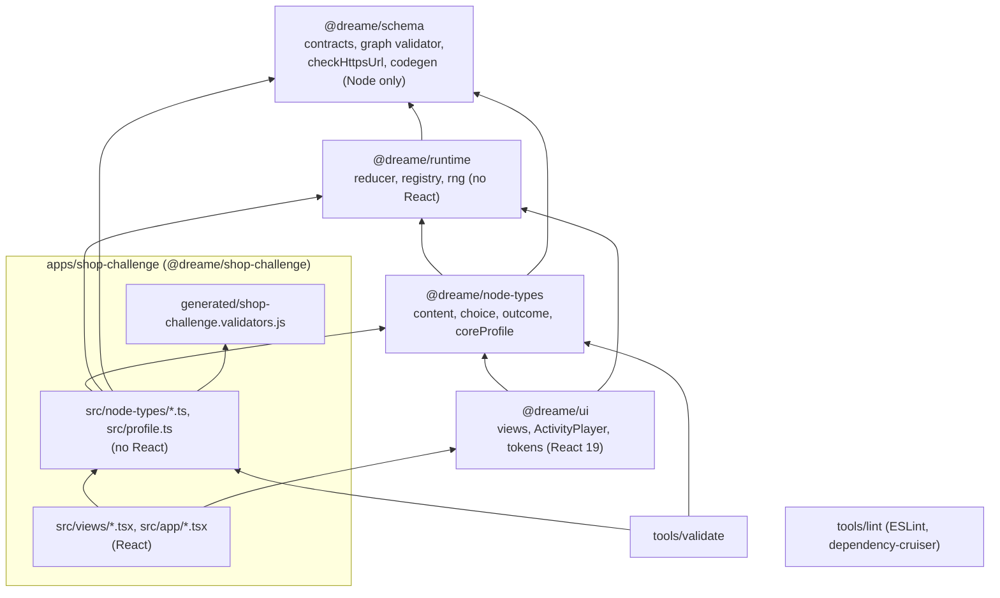
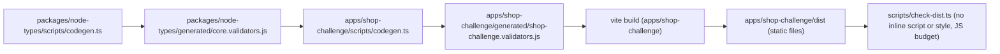

# Design Document: shop-challenge

## Overview

This design covers Days 6 and 7 of the Brief §8 plan. It adds:

1. The Day 5 entries in `KIRO_LOG.md` and their commit (Requirements 1, 2).
2. The workspace package `@dreame/shop-challenge` in `apps/shop-challenge`, with the `shop-challenge` profile, its precompiled validators and the app wiring files of ui-renderer D20 (Requirements 3, 4, 19).
3. The app node types `collectionSelect` and `recommendOutcome` with their views and tests, and the WhatsApp and Telegram Channel_Modules that the result view uses to name a Contact_Link's channel (Requirements 5–11).
4. Two small changes in shared packages: two new diagnostic codes and one new `GraphCtx` method in `@dreame/schema`, and rejection handling in the `@dreame/ui` `ActivityPlayer` (Requirements 5, 7, 12).
5. The static Shop Challenge app: routes, bundled demo playback, landing page, footer, `vercel.json`, `PRIVACY.md` and the manual deploy of URL #1 (Requirements 13–16).
6. One demo manifest and one broken fixture (Requirement 17).
7. dependency-cruiser and ESLint in the Check_Pipeline (Requirement 18).

Decisions D1–D23 of the earlier specs, the Playbook reconciliation P1–P12 and the 22 accepted answers of 2026-11-20 stay in force. The accepted answers are carried as D24–D45 in "Decisions for the user". This design adds D46–D54. The user accepted the recommended option of D46–D53 on 2026-11-20, and D54 records the user's change of the same day: a `contacts` list of 0–3 Contact_Links with WhatsApp and Telegram Channel_Modules in place of a single `cta` field.

The new validator checks catch specified errors only, such as a product rule that no selection can meet. They do not establish that prices are accurate or that the app is accessible. The property tests give evidence for the properties tested. Component tests and the axe check catch some accessibility errors; manual keyboard and screen-reader checks are still needed (Architecture Spec §A3).

### Research findings used by this design

Checked in the Workspace and the registry on 2026-11-21.

| Topic | Finding | Source |
|---|---|---|
| Node type hooks | `enter(cfg, s, env)` and `reduce(cfg, s, r, env)` get the attempt state but not the manifest. `isValidResponse(cfg, r)` gets neither. A node type can read an earlier node's data only through `s.answers` and `s.nodeState`. | `packages/runtime/src/node-type.ts`, `reducer.ts` |
| Enter on terminal nodes | `enterNode` sets `status: 'finished'` and then calls the node type's `enter`, also on the limit fallback. So `recommendOutcome.enter` runs for every way an attempt reaches it. | `packages/runtime/src/reducer.ts` `enterNode` |
| Set answers | `AnswerValue` is `Scalar \| readonly string[]`; `includes` is true when the array holds the value. `answerType` kind `set` makes `includes` type-check. | `packages/schema/src/contracts.ts`, `runtime/src/conditions.ts`, `schema/src/graph.ts` `leafTypeOk` |
| Upstream check | `graph.ts` computes dominators (`dom[v][u]`) in stage 7, but `GraphCtx` exposes only `manifest`, `nodePath`, `variables`, `checkEffect`, `checkHttpsUrl` and `checkText`. A node type cannot ask whether another node is upstream. | `packages/schema/src/node-type.ts`, `graph.ts` `stageConditions` |
| Node type diagnostics | Stage 7 adds `nodeId` to node type diagnostics and re-derives severity from the code (`withSeverity`). `choice` reports its own `duplicate-option-id` with stage `conditions`. | `graph.ts`, `packages/node-types/src/choice.ts` |
| Diagnostic codes | `DiagnosticCode` is a closed union. `packages/schema/test/ids.test.ts` lists every code in `ALL_CODES`. | `packages/schema/src/diagnostics.ts`, `ids.test.ts` |
| Codegen | `buildProfileModule(profileId, nodeTypes, options = DEFAULT_CODEGEN_OPTIONS)` already calls `inlineRuntimeHelpers` and `assertSelfContained`; `DEFAULT_CODEGEN_OPTIONS` is `{ inlineRefs: false, lines: false }` (D14). | `packages/schema/src/codegen/index.ts` |
| Codegen input | The `core` codegen imports `../src/core-types.ts`, which imports no generated code, so it runs before `generated/` exists. | `packages/node-types/scripts/codegen.ts`, `src/core-types.ts` |
| Rejection today | `ActivityPlayer` keys the view `${nodeId}#${rejections}` and renders one `role="alert"` paragraph while `rejected` is true. `ActivityPlayer.test.tsx` asserts that the view remounts on a rejection. | `packages/ui/src/components/ActivityPlayer.tsx`, `test/ActivityPlayer.test.tsx` |
| Once-only flag | `ContentNodeView` and `ChoiceNodeView` set `responded.current = true` on the first submit and never reset it within a mount. | `packages/ui/src/views/*.tsx` |
| Validate CLI | `PROFILES` holds `core` only. `run.ts` picks the profile from the manifest's `profile` field. | `tools/validate/src/run.ts` |
| Scans | The Source_Scan reads `packages/` and `tools/`; its ajv scan reads `packages/*/src` and `tools/*/src`. The boundary test does not scan `apps/`. The UI Privacy_Scan allows only radio inputs and does not list `sessionStorage` or `indexedDB`. | `packages/schema/test/source-scan.test.ts`, `packages/runtime/test/boundaries.test.ts`, `packages/ui/test/privacy-scan.test.ts` |
| Vitest projects | The `node` project includes `packages/*/test/**/*.test.ts` and `tools/*/test/**/*.test.ts`; the `dom` project includes `packages/*/test/**/*.test.tsx` with `packages/ui/test/setup.ts`. | `vitest.config.ts` |
| TypeScript 7 | The installed `typescript` 7.0.2 exports `.` as `./lib/version.cjs` and its API only under `./unstable/*`. Tools that load the classic compiler API through `require('typescript')` cannot use it. | `node_modules/typescript/package.json` |
| typescript-eslint | 8.73.0 (latest) has the peer `typescript >=4.8.4 <6.1.0`. The newest 6.x release of `typescript` is 6.0.3, whose `main` is `./lib/typescript.js`. | `pnpm view typescript-eslint@8.73.0 peerDependencies`; `pnpm view typescript@6` |
| ESLint plugins | `eslint-plugin-react` 7.37.5 has the peer `eslint ^3 … ^9.7`; `eslint-plugin-jsx-a11y` 6.10.2 has `eslint ^3 … ^9`. Neither lists ESLint 10. The newest ESLint 9 is 9.39.5; `latest` is 10.15.0. | `pnpm view … peerDependencies` |
| dependency-cruiser | 18.8.0 has engines `node ^22 \|\| ^24 \|\| >=26`, parses with acorn and uses `typescript` from the install when present to read `.ts` files. It declares no peer on `typescript`. | `pnpm view dependency-cruiser@18.8.0` |
| React Router | The current docs install `react-router` and import `BrowserRouter` from `"react-router"` in declarative mode. `react-router` is 8.5.2 (peer `react >=19.2.7`, engines `node >=22.22.0`); `react-router-dom` stops at 7.18.6. | [React Router declarative installation](https://reactrouter.com/start/declarative/installation); `pnpm view` |
| JSX build | Vite 8 transforms JSX with Oxc; the root `vitest.config.ts` already sets `oxc.jsx`. `@vitejs/plugin-react` 6.3.0 is not needed to build JSX (ui-renderer research). | ui-renderer design, Research findings; `vitest.config.ts` |
| Vercel and pnpm | Vercel picks pnpm from the lockfile; `lockfileVersion: '9.0'` maps to pnpm 9 or 10. Corepack, which honours the `packageManager` field (`pnpm@12.21.0`), needs the project variable `ENABLE_EXPERIMENTAL_COREPACK=1`. The supported list includes pnpm 12. | [Vercel package managers](https://vercel.com/docs/package-managers); `pnpm-lock.yaml` line 1; root `package.json` |
| Vercel headers and rewrites | `vercel.json` takes `headers` (`source` plus `key`/`value` list) and `rewrites` (`source`, `destination`). Vercel serves an existing file before it applies a rewrite, which is the SPA fallback pattern. | [Vercel project configuration](https://vercel.com/docs/project-configuration/vercel-json) |
| CSP and headers | The exact CSP and three headers are in Architecture Spec §A3 ("`vercel.json` headers"); "SPA rewrite" sends every route to `index.html`. | Architecture Spec §A3 |
| Shop screens | §B3 lists `ProductCard` (checkbox semantics, name, price, tag chips), `BundleBar` (items x/max, total, budget meter, Continue), `ConstraintHint` ("Add 1 more item", "₦2,000 over budget" (user override 2026-11-20: demos in USD, for example "$2 over budget")), `BundleResult` (bundle, total, "Why these" line, CTA) and `OfferEndedView`. This design shows the §B3 CTA as 0–3 Contact_Links (C10, D54). | Architecture Spec §B3 |
| Check duration | `pnpm check` took 265.2 s on 2026-11-20 against the 300 s Post_Task_Hook timeout (600 s from task 12.0, D53). | `docs/HANDOFF.md` §3 |

Content from the Vercel and React Router pages was rephrased for compliance with licensing restrictions.

## Architecture

### Package layers

`apps/shop-challenge` sits on top of the shared packages. Its node types and profile import only `@dreame/runtime`, `@dreame/schema` and `@dreame/node-types`, so Node can load them in the codegen script and the Validate_CLI. Its views and app shell also import `@dreame/ui` and React. No package imports the app; `tools/validate` imports only the app's React-free profile entry (D45).



The Boundary_Rules (C15) block every arrow from `packages/` into `apps/`, and every import of `react`, `react-dom` or `@dreame/ui` from the React-free folders. `tools/lint` reads the repository but no package imports it.

### Build-time flow



The shop codegen runs after the `core` codegen, because `src/node-types/index.ts` imports `coreNodeTypes` from `@dreame/node-types`, whose barrel loads `core.validators.js`.

### Player data flow

```mermaid
sequenceDiagram
  participant Route as PlayDemoRoute
  participant V as validateManifest (shopProfile)
  participant Player as ActivityPlayer
  participant RT as @dreame/runtime
  participant CS as collectionSelect
  participant RO as recommendOutcome
  Route->>V: bundled manifest JSON
  V-->>Route: ok + ValidManifest, or diagnostics
  Route->>Player: shopProfile, manifest, seed (crypto.getRandomValues), shopViews
  Player->>RT: createAttempt
  Note over RT,CS: occasion choice answered, then edge to the collectionSelect node
  RT->>CS: enter(cfg, s): nodeState = { occasion, offered }
  Player->>Player: view renders offered Items from nodeState
  Player->>RT: checkAction(respond { itemIds })
  alt rejected
    RT-->>Player: rejection code; attempt unchanged
    Player->>Player: new alert element, focus moves to it, view keeps its picks
  else accepted
    RT->>CS: reduce: answers[node] = itemIds, nodeState[node] += items, currency
    RT->>RO: enter(cfg, s): reads answers[from], nodeState[from]
    RO-->>RT: nodeState[outcome] = { selection, total, currency, suggestions }
    Player->>Player: RecommendOutcomeNodeView renders the bundle and the Contact_Links
  end
```

## Components and Interfaces

### C1. KIRO_LOG Day 5 entries and commit (Requirements 1, 2)

This is the first task (Requirement 1.1). The entries follow the Playbook §6 template, as the Days 2–4 entries do: a `## YYYY-MM-DD — <title>` heading and five lines `Spec:`, `Kiro did:`, `Caught by:`, `Fix:` and `Kiro features:` (Requirement 1.3). The entries are appended after the last existing entry; no existing line changes (Requirement 1.2). The task checks this with `git diff -- KIRO_LOG.md`, which must show added lines only.

**Heading date.** Every Day_5_Entries heading uses the author date of the commit that completed ui-renderer, read with `git log -1 --format=%ad --date=short 082ed51` (it printed `2026-11-21` on 2026-11-21). The hash is used only to read the date and is not written into the log (Requirement 1.10).

**Entries** (Requirements 1.5–1.7). Each row is one entry; the Fact_Source is in brackets. The agent reads each number from its source at run time and does not copy it from this table.

| Title | Spec | Kiro did | Caught by | Fix | Kiro features |
|---|---|---|---|---|---|
| ui-renderer spec done | `ui-renderer` | Built `@dreame/ui`, the smaller validator module, the four Kiro hooks and `EXTENDING.md`; N of N tasks marked done in `.kiro/specs/ui-renderer/tasks.md` (59 at design time); decisions in `.kiro/specs/ui-renderer/design.md` [ui-renderer `tasks.md`, `design.md`] | Each final ui-renderer check with its command and exit code, for example `pnpm check` exit 0 [HANDOFF §3 "Task 9 checkpoint", final task output] | None needed | Spec workflow and tasks, steering, agent hooks, sub-agent task runs, fast-check property tests [HANDOFF §2–§4] |
| Validator module over budget | `ui-renderer / Requirement 3` | Generated the `core` validator module | `pnpm codegen` printed 428,768 bytes JS before the change [HANDOFF §3] | Ajv `inlineRefs: false` and `code.lines: false` (D14); the module is 167,384 bytes raw and 11,465 bytes gzip against limits of 180,000 and 14,000 [HANDOFF §3] | Spec tasks |
| Check failed under machine load | `ui-renderer / task 9` | Ran `pnpm check` | Vitest reported worker start timeouts and exit 1 after 428.8 s; all tests that ran passed [HANDOFF §3] | Re-run with no code change passed, exit 0, Vitest 265.2 s [HANDOFF §3] | Spec tasks |
| Regression hook timeout raised | `ui-renderer / task 12.1` | Measured `pnpm -s test:shared` at 98.82 s, over the 96 s threshold of the 120 s timeout [ui-renderer design "User answers (2026-11-20)"] | Requirement 17.10 timing step | The user raised the H2 timeout to 180 s [same source] | Agent hooks |
| Rejection focus and CI enforcement deferred | `ui-renderer` | Left rejection focus and dependency-cruiser and ESLint enforcement out of the ui-renderer scope [ui-renderer design "User answers (2026-11-20)"] | Design review with the user | Moved to the shop-challenge spec (Requirements 12, 18 of this spec) | Spec workflow |

Each field is one line. At the start of the task the agent tells the user that it cannot take screenshots and asks for the file names of any Day 5 screenshots in `docs/kiro-evidence/` (Requirement 1.8). It links a screenshot only after `Test-Path` returns `True` for that path (Requirement 1.9). The entries hold no commit hash, commit message, statement about a commit or push, or file list (Requirement 1.10). The permanent banned-phrase check is the Repo_Text_Scan, which already covers `KIRO_LOG.md` (Requirement 1.11).

**Commit** (Requirement 2). The agent shows `git status --porcelain` and `git diff --stat`, asks the user whether to commit `KIRO_LOG.md` and the two Leftover_Status_Files, and whether to include `.kiro/specs/shop-challenge/`. On approval it stages exactly the approved paths and runs `git -c user.name="chukwuebuka henry" -c user.email="121734925+ChukwuebukaHenrey@users.noreply.github.com" commit -m "<message>"`, without `--no-verify`, `--amend` or a co-author trailer. The pre-commit hook runs `pnpm check` (about 265 s). If it fails, the agent reports the command, output and exit code and waits (Requirement 2.5). It never stages `packages/*/generated/`, `apps/*/generated/`, `design-refs/`, `.git.ignore` or the four untracked `docs/` files (Requirement 2.6). Before any push request it reports the count from `git rev-list --count origin/main..HEAD` (Requirement 2.7).

### C2. Shop_App package and workspace configuration (Requirements 3, 13.1, 13.2)

```
apps/shop-challenge/
  package.json            # @dreame/shop-challenge
  tsconfig.json
  vite.config.ts
  vercel.json             # C14
  index.html
  README.md               # existing placeholder; Deploy_URL added in C14
  scripts/
    codegen.ts            # Shop_Codegen (C3)
    check-dist.ts         # built-output checks (C13)
  generated/              # gitignored: shop-challenge.validators.js and .d.ts
  src/
    profile.ts            # Wiring_File W6 (C5)
    format.ts             # formatPrice, budgetStatus (pure, no React)
    demos.ts              # bundled Demo_Manifests (C12)
    node-types/
      index.ts            # Wiring_File W5 (C5)
      bundle-rules.ts     # pure rules shared by node types and views (C6)
      collectionSelect.ts # C7
      recommendOutcome.ts # C8
    views/
      registry.ts         # Wiring_File W7 (C5)
      CollectionSelectNodeView.tsx   # C9
      RecommendOutcomeNodeView.tsx   # C10
    app/
      main.tsx            # entry: stylesheets, BrowserRouter, App
      App.tsx             # routes (C12)
      LandingView.tsx
      PlayDemoRoute.tsx
      OfferEndedView.tsx
      NotFoundView.tsx
      Footer.tsx
      shop.css            # app layout rules that use the @dreame/ui tokens
  test/
    *.test.ts             # node environment
    *.test.tsx            # jsdom environment
```

The helper file names `bundle-rules.ts` and `format.ts` contain a hyphen or sit outside `src/node-types/`, so they do not match `TYPE_NAME_PATTERN` in the Wiring_Hook matcher, the same way `core-types.ts` does not.

`apps/shop-challenge/package.json`:

```json
{
  "name": "@dreame/shop-challenge",
  "version": "0.0.0",
  "private": true,
  "type": "module",
  "engines": { "node": "22.x" },
  "exports": {
    "./profile": "./src/profile.ts",
    "./node-types": "./src/node-types/index.ts"
  },
  "scripts": {
    "codegen": "node --experimental-strip-types scripts/codegen.ts",
    "build": "pnpm -w run codegen && vite build && node --experimental-strip-types scripts/check-dist.ts"
  },
  "dependencies": {
    "@dreame/node-types": "workspace:*",
    "@dreame/runtime": "workspace:*",
    "@dreame/schema": "workspace:*",
    "@dreame/ui": "workspace:*",
    "react": "^19.3.1",
    "react-dom": "^19.3.1",
    "react-router": "^8.5.2",
    "typebox": "^1.4.7"
  },
  "devDependencies": {
    "@testing-library/dom": "^10.4.2",
    "@testing-library/react": "^16.3.3",
    "@testing-library/user-event": "^14.6.12",
    "@types/react": "^19.3.0",
    "@types/react-dom": "^19.3.0",
    "axe-core": "^4.14.1",
    "vite": "^8.3.8"
  }
}
```

`engines.node` is pinned to `22.x` in this package only, so Vercel, which reads the Root Directory's `package.json`, stays on the CI major; the root keeps `>=22` (user decision 2026-11-20).

The two `exports` entries are React-free, so `tools/validate` can import `@dreame/shop-challenge/profile` under `node --experimental-strip-types` (D45). The test tooling is listed again in the app because pnpm resolves each package's imports from its own `node_modules`; the versions are the ones ui-renderer installed. `vite` is listed so `vite build` and `vite.config.ts` resolve it from the app folder. `pnpm -w run codegen` runs the root `codegen` script from the workspace root, also when Vercel starts the build in `apps/shop-challenge`.

`apps/shop-challenge/tsconfig.json` mirrors `packages/ui/tsconfig.json`: it extends `../../tsconfig.base.json`, sets `"strict": true` and `"types": ["node"]`, and includes `src/**/*.ts`, `src/**/*.tsx`, `scripts/**/*.ts`, `test/**/*.ts`, `test/**/*.tsx`, `generated/*.d.ts` and `vite.config.ts` (Requirement 3.1).

`apps/shop-challenge/vite.config.ts`:

```ts
import { defineConfig } from 'vite';

export default defineConfig({
  oxc: { jsx: { runtime: 'automatic', importSource: 'react' } },
  build: { outDir: 'dist', emptyOutDir: true },
});
```

No `@vitejs/plugin-react` (D49).

**Root changes.**

| File | Change |
|---|---|
| `tsconfig.json` | `include` adds `apps/*/src/**/*.ts`, `apps/*/src/**/*.tsx`, `apps/*/scripts/**/*.ts`, `apps/*/test/**/*.ts`, `apps/*/test/**/*.tsx`, `apps/*/generated/*.d.ts` and `apps/*/vite.config.ts` (Requirement 3.5). |
| `vitest.config.ts` | The `node` project adds `apps/*/test/**/*.test.ts`; the `dom` project adds `apps/*/test/**/*.test.tsx` and keeps `setupFiles: ['packages/ui/test/setup.ts']` (Requirement 3.6). |
| `.gitignore` | Adds `apps/*/generated/` and `.vercel` (Requirements 4.3, 15.6). `dist` is already listed. |
| `package.json` scripts | `codegen` becomes `pnpm --filter @dreame/node-types run codegen && pnpm --filter @dreame/shop-challenge run codegen` (Requirement 4.4). `lint` and `depcruise` are added and `check` runs them (C15). |
| `tools/validate/package.json` | Adds `"@dreame/shop-challenge": "workspace:*"` (C16, D45). |
| `.github/workflows/ci.yml` | One step `- run: pnpm --filter @dreame/shop-challenge build` after `- run: pnpm check` (Requirement 18.10). |

`pnpm-lock.yaml` stays the only lockfile and changes in the same commit as the `package.json` files (Requirement 3.9). Source files use relative imports with `.ts` or `.tsx` extensions and erasable syntax only (Requirement 3.10).

### C3. Shop_Codegen and the validator size test (Requirement 4)

`apps/shop-challenge/scripts/codegen.ts` is a copy of the `core` script with three changes: it imports `shopNodeTypes` from `../src/node-types/index.ts`, it calls `buildProfileModule('shop-challenge', shopNodeTypes)` with the default options (D14), and it writes `../generated/shop-challenge.validators.js` and `.d.ts`. It prints the same line form (Requirement 4.4):

```
codegen: wrote <js path> and <d.ts path> (<raw> bytes JS, <gzip> bytes gzip)
```

`buildProfileModule` already passes the code through `inlineRuntimeHelpers` and `assertSelfContained` (Requirement 4.7), and composes one `oneOf` manifest validator discriminated on `type` plus one `response_<type>` export per node type (Requirement 4.2). The script imports only `node:*`, `@dreame/schema/codegen` and the React-free node type index.

`apps/shop-challenge/test/validator-size.test.ts` (node) reads the generated file and fails when it exceeds the limits below (Requirement 4.5). The limits are set in the codegen task from the first measurement, by this rule: raw limit = measured raw bytes × 1.10, rounded up to a multiple of 1,000; gzip limit = measured gzip bytes × 1.10, rounded up to a multiple of 500. The task writes the measured values and limits into this table.

| Module | Measured raw | Measured gzip | Raw limit | Gzip limit |
|---|---|---|---|---|
| `apps/shop-challenge/generated/shop-challenge.validators.js` | 231,675 | 17,231 | 255,000 | 19,000 |
| `packages/node-types/generated/core.validators.js` (reference) | 167,384 | 11,465 | 180,000 | 14,000 |

The Source_Scan ajv check extends to `apps/*/src` (C13), so `ajv` stays inside `packages/schema/src/codegen/` (Requirement 4.6).

### C4. Shared schema changes (Requirements 5.5, 5.9, 5.11, 7.9)

`packages/schema/src/diagnostics.ts` adds two codes to `DiagnosticCode`: `'duplicate-item-id'` and `'select-unsatisfiable'` (D28). `severityOf` returns `'error'` for both without change.

`packages/schema/src/node-type.ts` adds one method to `GraphCtx` (D46):

```ts
export interface GraphCtx {
  // ... existing members unchanged
  /**
   * `true` when `nodeId` names a node other than the one being checked that lies on every path
   * from `entryNodeId` to the node being checked; `false` for an unknown ID and for the node itself.
   */
  isUpstream(nodeId: string): boolean;
}
```

`packages/schema/src/graph.ts` `stageConditions` adds the member to the context it builds for node `n`, reusing the `dom` array it already computes:

```ts
isUpstream: (id) => {
  const a = index.nodeIndex.get(id);
  return a !== undefined && a !== n && dom[n]![a] === 1;
},
```

The node itself is excluded because a node's own answer does not exist while it is entered. The edge check `checkLeaves` keeps its current rule, which allows an edge to read its own node's answer.

Existing tests that change:

| Test file | Change | Reason |
|---|---|---|
| `packages/schema/test/ids.test.ts` | `ALL_CODES` adds the two codes | The list mirrors the union; the severity test then covers them. |
| `packages/node-types/test/node-types.test.ts` | The stub `ctx()` adds `isUpstream: () => true` | `GraphCtx` gains a required member, so the stub no longer type-checks without it. |

New test `packages/schema/test/graph-upstream.test.ts` (node): with a diamond graph `a → b → d`, `a → c → d` and a test node type whose `validate` records `ctx.isUpstream` answers, `isUpstream('a')` is `true` at `d`, `isUpstream('b')` is `false` at `d`, `isUpstream('d')` is `false` at `d`, and `isUpstream('zz')` is `false`.

### C5. App wiring files and EXTENDING.md (Requirement 19)

The three App_Wiring_Files are written in the first app task, before any Own_File exists (Requirement 19.1). At that point they list only the core node types and views. When the agent creates `collectionSelect.ts`, the Wiring_Hook fires and adds that node type's lines (Requirement 19.2).

The hook prompt describes the app forms as "apply a–d to `index.ts`, `profile.ts` and `registry.ts`". This design fixes how a–d map to the three files (D47):

| ID | File | Line forms per app node type `<type>` |
|---|---|---|
| W5 | `apps/shop-challenge/src/node-types/index.ts` | (a) `export * from './<type>.ts';` and (b) `import { <type>NodeType } from './<type>.ts';` with `<type>NodeType` in `shopNodeTypes` |
| W6 | `apps/shop-challenge/src/profile.ts` | (c) `response_<type>` in the import from `'../generated/shop-challenge.validators.js'` and `<type>: response_<type>,` in `responseValidators` |
| W7 | `apps/shop-challenge/src/views/registry.ts` | (d) `import { <Type>NodeView } from './<Type>NodeView.tsx';`, `<Type>NodeView` in the export list, and `{ type: '<type>', Render: <Type>NodeView }` in `shopViews` |
| W8 | `EXTENDING.md` | a `### <type>` section with `Node type`, `View` and `Tests` lines |

The node type list lives in W5, not in the profile, because the Shop_Codegen must import the list before `generated/` exists, the same split as `core-types.ts` and `core-profile.ts`.

Final W5:

```ts
// Node types of the shop-challenge profile in profile order (Wiring_File W5). Imports no generated
// code and no React, so the codegen script and the validate CLI can load it.
import type { AnyNodeType } from '@dreame/runtime';
import { coreNodeTypes } from '@dreame/node-types';
import { collectionSelectNodeType } from './collectionSelect.ts';
import { recommendOutcomeNodeType } from './recommendOutcome.ts';

export * from './collectionSelect.ts';
export * from './recommendOutcome.ts';

export const shopNodeTypes: readonly AnyNodeType[] = [...coreNodeTypes, collectionSelectNodeType, recommendOutcomeNodeType];
```

Final W6:

```ts
// The shop-challenge profile (Wiring_File W6): the node types bound to their precompiled validators.
import { defineProfile, type Profile } from '@dreame/runtime';
import { shopNodeTypes } from './node-types/index.ts';
import {
  response_choice,
  response_collectionSelect,
  response_content,
  response_outcome,
  response_recommendOutcome,
  validateManifest,
} from '../generated/shop-challenge.validators.js';

export const SHOP_PROFILE_ID = 'shop-challenge';

export const shopProfile: Profile = defineProfile({
  id: SHOP_PROFILE_ID,
  nodeTypes: shopNodeTypes,
  validateSchema: validateManifest,
  responseValidators: {
    content: response_content,
    choice: response_choice,
    outcome: response_outcome,
    collectionSelect: response_collectionSelect,
    recommendOutcome: response_recommendOutcome,
  },
});
```

Final W7:

```ts
// Views of the shop-challenge profile (Wiring_File W7), in profile order.
import { ChoiceNodeView, ContentNodeView, createRenderRegistry, OutcomeNodeView, type RenderRegistry } from '@dreame/ui';
import { CollectionSelectNodeView } from './CollectionSelectNodeView.tsx';
import { RecommendOutcomeNodeView } from './RecommendOutcomeNodeView.tsx';

export { CollectionSelectNodeView, RecommendOutcomeNodeView };

export const shopViews: RenderRegistry = createRenderRegistry([
  { type: 'content', Render: ContentNodeView },
  { type: 'choice', Render: ChoiceNodeView },
  { type: 'outcome', Render: OutcomeNodeView },
  { type: 'collectionSelect', Render: CollectionSelectNodeView },
  { type: 'recommendOutcome', Render: RecommendOutcomeNodeView },
]);
```

The first versions of W5–W7 are these files without the two app node type lines; `shopNodeTypes` is then `[...coreNodeTypes]`. The profile with only core types still generates a valid module.

**EXTENDING.md entries** (Requirement 19.4), in the existing form:

```
### collectionSelect

- Node type: `apps/shop-challenge/src/node-types/collectionSelect.ts` (`collectionSelectNodeType`, profile `shop-challenge`)
- View: `apps/shop-challenge/src/views/CollectionSelectNodeView.tsx`
- Tests: `apps/shop-challenge/test/collectionSelect.test.ts`, `apps/shop-challenge/test/collectionSelect.property.test.ts`
```

`### recommendOutcome` uses the same form with `recommendOutcome.ts`, `recommendOutcomeNodeType`, `RecommendOutcomeNodeView.tsx` and the two `recommendOutcome` test files. Until a view file exists, its line is `- View: not written yet` (ui-renderer W8).

**`tools/validate/test/extending-doc.test.ts`** (Requirement 19.5) changes in the wiring task, before the hook adds any section:

- The expected `###` headings are the `coreNodeTypes` names followed by the names in `shopNodeTypes` that are not core names, read from `@dreame/shop-challenge/node-types`. While `shopNodeTypes` holds only the core types, the expected list equals today's.
- Every listed path must exist. For an app node type, the `View` line must name `apps/shop-challenge/src/views/<Type>NodeView.tsx` when that file exists and must read `- View: not written yet` when it does not. So the test passes between the node type task and the view task, and fails if a written view is missing from the doc.

**Shop_Views test** (Requirement 19.3). `apps/shop-challenge/test/registry.test.tsx` (jsdom, because it imports the views) checks that `shopViews.types()` equals `shopProfile.nodeTypes.map((t) => t.type)`. It is written in the task after both views exist, because the two lists differ between the node type tasks and the view tasks.

The Own_Files test files are `apps/shop-challenge/test/<type>.test.ts` and `apps/shop-challenge/test/<type>.property.test.ts` (Requirement 19.6). When the node type file is created first, hook steps 5 and 6 create these two files at exactly these paths. The following tasks then complete them, so the hook never creates any other test file. The four files in `.kiro/hooks/` stay unchanged (Requirement 19.8).

### C6. Bundle rules module (Requirements 5.11, 6.2, 6.3, 8.2, 8.7, 10.5, 10.6)

`apps/shop-challenge/src/node-types/bundle-rules.ts` holds the pure rules that the node types, the views and the tests share, so the view and `isValidResponse` apply one definition. It imports no React and reads no clock or randomness.

```ts
/** The fields of an Item that the rules read. */
export interface RuleItem {
  readonly id: string;
  readonly price: number;
  readonly tags: readonly string[];
  readonly occasions?: readonly string[];
}

export interface SelectionRules {
  readonly min: number;
  readonly max: number;
  readonly budget: number;
}

/** First broken Selection_Rule, in this order; `null` when the Selection meets every rule. */
export type RuleBreak =
  | { readonly rule: 'unknown-item'; readonly id: string }
  | { readonly rule: 'repeated-item'; readonly id: string }
  | { readonly rule: 'too-few'; readonly missing: number }
  | { readonly rule: 'too-many'; readonly extra: number }
  | { readonly rule: 'over-budget'; readonly over: number };

/** All `items` when `occasion` is `null`; otherwise the Items with no `occasions` list or with `occasion` in it. Config order kept. */
export function offeredItems<T extends RuleItem>(items: readonly T[], occasion: string | null): T[];

/** Sum of the prices of the Items whose IDs are in `ids`; IDs not in `items` add nothing. */
export function selectionTotal(items: readonly RuleItem[], ids: readonly string[]): number;

/** The first broken rule for `ids` against `items` and `rules`, or `null`. */
export function checkSelection(items: readonly RuleItem[], rules: SelectionRules, ids: readonly string[]): RuleBreak | null;

/** Why no Selection of `offered` can meet `rules`, or `null` when one can (Satisfiable). */
export type Unsatisfiable =
  | { readonly reason: 'min-above-max' }
  | { readonly reason: 'too-few-offered'; readonly offered: number }
  | { readonly reason: 'cheapest-over-budget'; readonly cheapest: number };
export function unsatisfiable(offered: readonly RuleItem[], rules: SelectionRules): Unsatisfiable | null;

export type WhereClause =
  | { readonly op: 'includes'; readonly field: 'tags'; readonly value: string }
  | { readonly op: 'lte' | 'gte'; readonly field: 'price'; readonly value: number };

export interface RecommendRules {
  readonly where?: readonly WhereClause[];
  readonly sortBy: 'priceAsc' | 'priceDesc';
  readonly limit: number;
}

/** Suggestions: Items not in `selected` that meet every clause, stably sorted by price, cut to `limit`. */
export function suggestItems<T extends RuleItem>(items: readonly T[], selected: readonly string[], rec: RecommendRules): T[];

/** Budget status of Requirement 10.5, computed with integers: `total * 5 <= budget * 4` is "under". */
export type BudgetStatus = 'under' | 'close' | 'over';
export function budgetStatus(total: number, budget: number): BudgetStatus;
```

Rules in detail:

- `checkSelection` checks, in order: every ID names an Item (`unknown-item`), no ID repeats (`repeated-item`), `ids.length >= min` (`too-few`, `missing = min - n`), `ids.length <= max` (`too-many`, `extra = n - max`), and `selectionTotal <= budget` (`over-budget`, `over = total - budget`). The view uses the last three for its hint (Requirement 10.6), which has the same order.
- `unsatisfiable` returns `min-above-max` when `min > max`, `too-few-offered` when `offered.length < min`, and `cheapest-over-budget` when the sum of the `min` lowest offered prices exceeds `budget`; otherwise `null`. Because every price is at least 0, the sum of the `k` lowest prices does not decrease as `k` grows, so a Selection exists exactly when the `min` cheapest Items fit the budget. Property 3 checks this against an exhaustive search.
- `suggestItems` keeps Items whose ID is not in `selected` and that meet every clause (`includes`: the tag is in `tags`; `lte`/`gte`: compares `price`), sorts with `Array.prototype.sort`, which is stable in ES2019 and later, so ties keep config order, and returns the first `limit`.

`apps/shop-challenge/src/format.ts` (React-free, used by the views):

```ts
/** `Intl.NumberFormat('en-US', { style: 'currency', currency, maximumFractionDigits: 0, minimumFractionDigits: 0 })`; "$12" for 12 USD. */
export function formatPrice(amount: number, currency: string): string;
/** "Add 1 more item", "Add 2 more items", "Remove 1 item", "$2 over budget"; `null` for no break or for the ID rules. */
export function hintText(brk: RuleBreak | null, currency: string): string | null;
```

The `Intl.NumberFormat` instances are cached per currency in a `Map`. Node 22 ships full ICU, so the test output matches the browser for `en-US` and `USD`.

### C7. `collectionSelect` node type (Requirements 5, 6)

File `apps/shop-challenge/src/node-types/collectionSelect.ts`. Limits follow D34 (Open question 11). Strings use UTF-16 code unit lengths (runtime-core D6).

```ts
import Type, { type Static } from 'typebox';
import { DATE_PATTERN, NODE_ID_PATTERN, severityOf, type Diagnostic, type DiagnosticCode, type GraphCtx } from '@dreame/schema';
import type { AttemptState, JsonValue, NodeType } from '@dreame/runtime';
import type { ChoiceConfig } from '@dreame/node-types';
import { checkSelection, offeredItems, unsatisfiable } from './bundle-rules.ts';

const closed = { additionalProperties: false } as const;

export const SELECT_LIMITS = {
  maxItems: 24,
  maxPrice: 100_000_000,
  maxBudget: 1_000_000_000,
  maxPick: 24,
  maxTags: 8,
  maxOccasionsPerItem: 8,
} as const;

export const SelectItemSchema = Type.Object(
  {
    id: Type.String({ pattern: NODE_ID_PATTERN }),
    name: Type.String({ maxLength: 80 }),
    price: Type.Integer({ minimum: 0, maximum: SELECT_LIMITS.maxPrice }),
    tags: Type.Array(Type.String({ minLength: 1, maxLength: 32 }), { maxItems: SELECT_LIMITS.maxTags }),
    occasions: Type.Optional(
      Type.Array(Type.String({ pattern: NODE_ID_PATTERN }), { minItems: 1, maxItems: SELECT_LIMITS.maxOccasionsPerItem }),
    ),
    emoji: Type.Optional(Type.String({ minLength: 1, maxLength: 16 })),
  },
  closed,
);

export const CollectionSelectConfigSchema = Type.Object(
  {
    prompt: Type.String({ maxLength: 500 }),
    items: Type.Array(SelectItemSchema, { minItems: 1, maxItems: SELECT_LIMITS.maxItems }),
    min: Type.Integer({ minimum: 1, maximum: SELECT_LIMITS.maxPick }),
    max: Type.Integer({ minimum: 1, maximum: SELECT_LIMITS.maxPick }),
    budget: Type.Integer({ minimum: 1, maximum: SELECT_LIMITS.maxBudget }),
    currency: Type.String({ pattern: '^[A-Z]{3}$' }),
    occasionFrom: Type.Optional(Type.String({ pattern: NODE_ID_PATTERN })),
    pricesAsOf: Type.Optional(Type.String({ pattern: DATE_PATTERN })),
    continueLabel: Type.Optional(Type.String({ maxLength: 40 })),
  },
  closed,
);

export const CollectionSelectResponseSchema = Type.Object(
  { itemIds: Type.Array(Type.String({ maxLength: 64 }), { maxItems: SELECT_LIMITS.maxPick }) },
  closed,
);

export type SelectItem = Static<typeof SelectItemSchema>;
export type CollectionSelectConfig = Static<typeof CollectionSelectConfigSchema>;
export type CollectionSelectResponse = Static<typeof CollectionSelectResponseSchema>;

export const collectionSelectNodeType: NodeType<CollectionSelectConfig, CollectionSelectResponse>;
```

String limits (Requirement 5.4):

| Field | Limit |
|---|---|
| `prompt` | 500 |
| Item `id`, `occasionFrom`, `occasions[]` entries | `NODE_ID_PATTERN` (1–64) |
| Item `name` | 80 |
| Item `tags[]` entries | 1–32 |
| Item `emoji` | 1–16 (a ZWJ emoji sequence can use 11 code units) |
| `currency` | `^[A-Z]{3}$` |
| `pricesAsOf` | `DATE_PATTERN` (`YYYY-MM-DD`) |
| `continueLabel` | 40 |
| response `itemIds[]` entries | 64 |

**Descriptor fields.** `type: 'collectionSelect'`, `version: 1`, `terminal: false` (Requirement 5.1). `answerType: (cfg) => ({ kind: 'set', values: cfg.items.map((i) => i.id) })` (Requirement 5.12).

**`validate(cfg, ctx)`.** `base` is `${ctx.nodePath}/config`. Every diagnostic it builds has `stage: 'conditions'` and `severity: severityOf(code)`; stage 7 adds `nodeId`.

1. `ctx.checkText(cfg.prompt, base + '/prompt')` and, per Item `i`, `ctx.checkText(item.name, base + '/items/i/name')` (Requirement 5.6).
2. Per Item `i` whose `id` was seen before: `duplicate-item-id` at `base + '/items/i'`, message `Item ID "<id>" is used more than once in this product list.` (Requirement 5.5).
3. Occasion source, when `cfg.occasionFrom` is set, at path `base + '/occasionFrom'` (Requirements 5.7–5.9):
   - no node with that ID in `ctx.manifest.nodes`: `dangling-ref`, and the occasion checks below are skipped;
   - the node's `type` is not `choice`: `type-mismatch`, and the occasion checks below are skipped;
   - `ctx.isUpstream(id)` is `false`: `answer-not-upstream`; the checks below still run with the node's option IDs.
4. Per Item `i` and `occasions` entry `j` (Requirement 5.10): `dangling-ref` at `base + '/items/i/occasions/j'` when the config has no `occasionFrom`, or when the entry is not an option ID of the Occasion_Source.
5. Satisfiability (Requirement 5.11). The occasion values are `[null]` without `occasionFrom`, and the Occasion_Source option IDs in config order with it. For each value `v`, `unsatisfiable(offeredItems(cfg.items, v), cfg)` is computed; each non-null result gives one `select-unsatisfiable` at `base`, with one of these messages:
   - `No bundle can meet the rules for occasion "<v>": min (<min>) is greater than max (<max>).`
   - `No bundle can meet the rules for occasion "<v>": only <n> items are offered and min is <min>.`
   - `No bundle can meet the rules for occasion "<v>": the <min> cheapest offered items cost <cheapest> <currency>, over the budget of <budget> <currency>.`
   Without `occasionFrom`, the prefix is `No bundle can meet the rules:` with no occasion named, because there is no occasion value. The check is skipped when step 3 reported `dangling-ref` or `type-mismatch`.

The option IDs come from the Occasion_Source config, read as `ChoiceConfig` from `@dreame/node-types`; stage 7 runs only on schema-valid manifests, so the cast is safe.

**Occasion at run time.** `occasionOf(cfg, s): string | null` returns `s.answers[cfg.occasionFrom]` when `occasionFrom` is set and that own property is a string, else `null`. With a validated manifest the Occasion_Source is upstream, so its answer exists; `null` is the defensive fallback and offers every Item.

**`enter(cfg, s, env)`** stores the node state of the entered node (Requirement 6.5): `{ ...s, nodeState: { ...s.nodeState, [s.currentNodeId]: selectNodeState(cfg, s) } }`, where

```ts
/** Offered_Items snapshot for the current occasion, in config order, plus the currency. */
export function selectNodeState(cfg: CollectionSelectConfig, s: AttemptState): CollectionSelectNodeState;
```

The view reads `items` to know which Items to show (C9). `env` is not read.

**`isValidResponse(cfg, r)`** returns `true` exactly when `r` is a non-null, non-array object with an own `itemIds` property that is an array of strings, and `checkSelection(cfg.items, cfg, itemIds)` is `null` (Requirements 6.2, 6.3). The precompiled `response_collectionSelect` runs first in `checkAction` (Requirement 6.1).

**`reduce(cfg, s, r, env)`** (Requirements 6.4–6.6):

```ts
reduce(cfg, s, r) {
  const ids = cfg.items.filter((item) => r.itemIds.includes(item.id)).map((item) => item.id); // config order
  return {
    ...s,
    answers: { ...s.answers, [s.currentNodeId]: ids },
    nodeState: { ...s.nodeState, [s.currentNodeId]: selectNodeState(cfg, s) },
  };
}
```

`reduce` writes the same node state as `enter`, so the item data exists even when a test calls `reduce` on a state that did not pass through `enter`. Neither hook reads `env.now` or `env.rng`, and both build new objects with spreads, so their inputs stay unchanged (Requirement 6.6).

### C8. `recommendOutcome` node type (Requirements 7, 8)

File `apps/shop-challenge/src/node-types/recommendOutcome.ts`.

```ts
export const WhereClauseSchema = Type.Union([
  Type.Object(
    { op: Type.Literal('includes'), field: Type.Literal('tags'), value: Type.String({ minLength: 1, maxLength: 32 }) },
    closed,
  ),
  Type.Object(
    {
      op: Type.Union([Type.Literal('lte'), Type.Literal('gte')]),
      field: Type.Literal('price'),
      value: Type.Integer({ minimum: 0, maximum: SELECT_LIMITS.maxPrice }),
    },
    closed,
  ),
]);

export const RecommendSchema = Type.Object(
  {
    where: Type.Optional(Type.Array(WhereClauseSchema, { maxItems: 4 })),
    sortBy: Type.Union([Type.Literal('priceAsc'), Type.Literal('priceDesc')]),
    limit: Type.Integer({ minimum: 1, maximum: 8 }),
  },
  closed,
);

export const RecommendOutcomeConfigSchema = Type.Object(
  {
    title: Type.String({ maxLength: 120 }),
    body: Type.String({ maxLength: 2000 }),
    from: Type.String({ pattern: NODE_ID_PATTERN }),
    whyText: Type.Optional(Type.String({ maxLength: 300 })),
    recommend: Type.Optional(RecommendSchema),
    contacts: Type.Optional(
      Type.Array(
        Type.Object({ label: Type.String({ maxLength: 60 }), url: Type.String({ pattern: '^https://', maxLength: 2048 }) }, closed),
        { maxItems: 3 },
      ),
    ),
  },
  closed,
);
export const RecommendOutcomeResponseSchema = Type.Object({}, closed);

export type RecommendOutcomeConfig = Static<typeof RecommendOutcomeConfigSchema>;
export type RecommendOutcomeResponse = Static<typeof RecommendOutcomeResponseSchema>;
export const recommendOutcomeNodeType: NodeType<RecommendOutcomeConfig, RecommendOutcomeResponse>;
```

`where` is optional and means no clauses. The `where` clause shape mirrors a condition leaf (`op`, a target, `value`) and uses only `includes`, `lte` and `gte` from the `activity-authoring.md` operator set (Requirement 7.4). `contacts` holds 0–3 Contact_Links in the order the view shows them (Requirements 7.2, 7.5). Each entry has the same shape as the `outcome` node type `cta`, plus the 2,048-character cap that `checkHttpsUrl` enforces. An absent `contacts` and an empty list both mean no Contact_Links. The list replaces the single `cta` field of the earlier draft (D54).

**Descriptor fields.** `type: 'recommendOutcome'`, `version: 1`, `terminal: true` (Requirement 7.1). `answerType: () => null` (Requirement 7.11).

**`validate(cfg, ctx)`** (Requirements 7.6–7.10), with `base = ${ctx.nodePath}/config`:

- `ctx.checkText(cfg.title, base + '/title')`;
- for each `contacts[i]`, `ctx.checkHttpsUrl(contacts[i].url, base + '/contacts/' + i + '/url')`, so `http:`, `javascript:`, `data:`, credentials and shortener hosts give `conditions/unsafe-url` at that Contact_Link's path, and `https://wa.me/...` and `https://t.me/...` pass (Requirement 7.6);
- `from` at `base + '/from'`: `dangling-ref` when no node has that ID; else `type-mismatch` when its type is not `collectionSelect`; else `answer-not-upstream` when `ctx.isUpstream(cfg.from)` is `false`.

**Imports.** `recommendOutcome.ts` imports nothing from `../contact/`: no Channel_Module and no Channel_List (Requirement 7.12). The node type checks only that each URL is a Safe_Url; naming the channel is a view concern (C8b, C10). So adding or removing a Contact_Channel changes no node type file.

**`isValidResponse`** is the `outcome` rule (a non-null, non-array object). **`reduce`** returns `s`; the runtime never calls it, because the attempt is no longer `playing` on a terminal node.

**`enter(cfg, s, env)`** (Requirements 8.1–8.5) stores `bundleResult(cfg, s)` under `s.currentNodeId`:

```ts
/** Pure: reads only `s.answers[cfg.from]` and `s.nodeState[cfg.from]`. */
export function bundleResult(cfg: RecommendOutcomeConfig, s: AttemptState): BundleResultState;
```

1. `source = readSelectNodeState(s.nodeState[cfg.from])` (Data Models). `answer = s.answers[cfg.from]`, own property only.
2. If `answer` is not an array of strings or `source` is `null`: `{ selection: [], total: 0, currency: source?.currency ?? null, suggestions: [] }` (Requirement 8.4).
3. Otherwise `selection` is the `source.items` entries whose IDs are in `answer`, in config order, each as `{ id, name, price }` plus `emoji` when present; `total` is the sum of their prices (Requirement 8.7); `currency` is `source.currency`.
4. `suggestions` is `[]` without `cfg.recommend` (Requirement 8.3), else `suggestItems(source.items, answer, cfg.recommend)` mapped to the same entry shape (Requirement 8.2).

`enter` reads no `env` field and builds new objects (Requirement 8.5). Because `source.items` holds only the Offered_Items, Suggestions are always Offered_Items (Requirement 8.6).

### C8b. Contact channels (Requirements 11.9–11.14)

Files in `apps/shop-challenge/src/contact/`:

```ts
// channel.ts
export interface ContactChannel {
  readonly id: string;
  readonly name: string;
  matches(url: URL): boolean;
}

// whatsapp.ts (imports only ./channel.ts)
export const whatsappChannel: ContactChannel = {
  id: 'whatsapp',
  name: 'WhatsApp',
  matches: (url) => {
    const host = url.hostname.toLowerCase();
    return url.protocol === 'https:' && (host === 'wa.me' || host === 'api.whatsapp.com');
  },
};

// telegram.ts (imports only ./channel.ts)
export const telegramChannel: ContactChannel = {
  id: 'telegram',
  name: 'Telegram',
  matches: (url) => url.protocol === 'https:' && url.hostname.toLowerCase() === 't.me',
};

// channels.ts
export const CONTACT_CHANNELS: readonly ContactChannel[] = Object.freeze([whatsappChannel, telegramChannel]);

export function channelFor(url: string): ContactChannel | undefined {
  let parsed: URL;
  try {
    parsed = new URL(url);
  } catch {
    return undefined; // Requirement 11.12
  }
  return CONTACT_CHANNELS.find((c) => c.matches(parsed)); // first match, else undefined (Requirement 11.11)
}
```

- Each Channel_Module (`whatsapp.ts`, `telegram.ts`) imports only `./channel.ts` (Requirement 11.13).
- No file in the folder imports `react` or `react-dom` or calls `fetch`, `XMLHttpRequest`, `navigator.sendBeacon` or `WebSocket` (Requirement 11.14). Naming a channel parses the URL locally and makes no network call.
- `recommendOutcome.ts` imports nothing from `../contact/` (Requirement 7.12). Only `RecommendOutcomeNodeView` (C10) calls `channelFor`.
- Adding a channel takes one new file, its import in `channels.ts` and its entry in `CONTACT_CHANNELS`. Removing one deletes the file, the import and the entry. Neither needs a node type, view or schema change.
- `wa.me` and `t.me` are not in `SHORTENER_HOSTS` (`packages/schema/src/url.ts`), so both pass `checkHttpsUrl` (Requirement 7.6).

### C9. CollectionSelectNodeView (Requirements 10, 12.5, 12.6)

File `apps/shop-challenge/src/views/CollectionSelectNodeView.tsx`, a `RenderModule<CollectionSelectConfig, CollectionSelectResponse>`.

```
<form className="dr-node shop-select" noValidate onSubmit={submit}>
  <fieldset aria-describedby={describedBy}>           // hintId while a hint shows, errorId while the error shows; undefined when neither
    <legend id={legendId}>{cfg.prompt}</legend>
    {cfg.pricesAsOf && <p className="dr-note">Prices as of {cfg.pricesAsOf}. The seller's page has the current prices.</p>}
    <ul className="shop-products">
      for each shown Item, in config order:
      <li>
        <label className="dr-option shop-product">
          <input type="checkbox" value={item.id} checked={selected.has(item.id)} onChange={toggle} />
          {item.emoji && <span className="shop-emoji" aria-hidden="true">{item.emoji}</span>}
          <span className="shop-product-name">{item.name}</span>
          <span className="shop-product-price">{formatPrice(item.price, cfg.currency)}</span>
          {item.tags.length > 0 && <span className="shop-tags">{item.tags.join(', ')}</span>}
        </label>
      </li>
    </ul>
  </fieldset>
  <div className="shop-bundle-bar">
    <p aria-live="polite">{count} of {cfg.max} items · Total {formatPrice(total)} of {formatPrice(cfg.budget)} · {statusText}</p>
    {hint !== null && <p id={hintId} className="shop-hint">{hint}</p>}
  </div>
  {showError && <p id={errorId} className="dr-error" role="alert">Your bundle does not meet the rules yet. {hint}</p>}
  <button type="submit" className="dr-button dr-button-primary">{cfg.continueLabel ?? 'Continue'}</button>
</form>
```

- **Shown Items** (Requirement 10.1): `readSelectNodeState(nodeState)?.items` mapped back to the config Items by ID, in config order. When `nodeState` is missing or damaged, all config Items are shown, so a damaged state never hides a product.
- **Accessible name** (Requirement 10.2): the label text holds the name, the formatted price and the tags; the emoji is `aria-hidden="true"` (Requirement 10.3).
- **Status text** (Requirement 10.5): `budgetStatus(total, cfg.budget)` maps to "Under budget", "Close to budget" or "Over budget". The polite live region announces count, total and status on each change.
- **Hint** (Requirement 10.6): `hintText(checkSelection(shown, cfg, ids), cfg.currency)`; only the count and budget rules can break, because the checkboxes produce only shown IDs and no repeats.
- **Submit** (Requirements 10.7–10.9): if `responded.current` is `true`, nothing happens. If `checkSelection` returns a break, the view shows the inline error and leaves `onRespond` uncalled. Otherwise it sets `responded.current = true` and calls `onRespond({ itemIds })`, with the selected shown Items in config order.
- **After a Rejection** (D48): `useEffect(() => { responded.current = false; }, [rejections])` re-enables submit (Requirement 12.6). The view is not remounted, so `selected` keeps the player's picks (Requirement 12.5).
- Every manifest string is a text child. The view uses native `form`, `fieldset`, `legend`, `label`, `input type="checkbox"` and `button` elements and no `style` attribute (Requirement 10.11). Cards stay enabled in every state (D29).
- `useId()` gives `legendId`, `hintId` and `errorId`.

### C10. RecommendOutcomeNodeView (Requirement 11)

File `apps/shop-challenge/src/views/RecommendOutcomeNodeView.tsx`, a `RenderModule<RecommendOutcomeConfig, RecommendOutcomeResponse>`.

```
<div className="dr-node shop-result">
  <h2 className="dr-heading" tabIndex={-1}>{cfg.title}</h2>
  <p className="dr-body">{cfg.body}</p>
  {selection.length === 0
    ? <p className="dr-note">No bundle was chosen.</p>
    : <section aria-labelledby={bundleId}>
        <h3 id={bundleId}>Your bundle</h3>
        <ul>{selection: <li>{emoji aria-hidden}<span>{name}</span> <span>{formatPrice(price, currency)}</span></li>}</ul>
        <p className="shop-total">Total {formatPrice(total, currency)}</p>
      </section>}
  {cfg.whyText && <p className="shop-why">{cfg.whyText}</p>}
  {suggestions.length > 0 &&
    <section aria-labelledby={suggestId}>
      <h3 id={suggestId}>You might also like</h3>
      <ul>{suggestions: same row form}</ul>
    </section>}
  {contacts.length > 0 &&
    <ul className="shop-contacts">
      for each c of contacts, in config order:
      <li>
        <ExternalLinkButton label={c.label} url={c.url} />
        {channel && <span className="dr-note">via {channel.name}</span>}   // channel = channelFor(c.url)
      </li>
    </ul>}
</div>
```

- `contacts` is `cfg.contacts ?? []`. Each `<li>` holds one Contact_Link in config order (Requirement 11.6). When `channelFor(c.url)` (C8b) returns a Contact_Channel, the `<span>` shows "via <name>" (Requirement 11.9); when it returns `undefined`, the `<li>` holds the button alone (Requirement 11.10).
- `readBundleResult(nodeState)` (Data Models) returns `null` for a missing or misshapen state; the view then shows the title, body, `whyText`, the Contact_Links and the "No bundle was chosen." note (Requirements 11.5, 11.8).
- `.dr-body` keeps line breaks (Requirement 11.1).
- Each Contact_Link goes through `ExternalLinkButton`, which shows the host, asks for confirmation and renders an anchor with `target="_blank"` and `rel="noopener noreferrer"` only for a Safe_Url (Requirement 11.6).
- The view has no control that calls `onRespond` (Requirement 11.7).

### C11. Rejection handling in `@dreame/ui` (Requirement 12)

Today a Rejection remounts the view, which clears the picks, drops focus to `body` and reuses one alert element. The change has three parts.

**1. Views learn about a Rejection through a prop, not a remount** (D48). `packages/ui/src/render.ts`:

```ts
export interface RenderProps<C = unknown, R = unknown> {
  readonly cfg: C;
  readonly onRespond: (response: R) => void;
  readonly nodeState: JsonValue | undefined;
  /** Number of Rejections so far in this attempt; a change means the last submit was rejected. Absent counts as 0. */
  readonly rejections?: number;
}
```

`NodeRendererProps` gains `readonly rejections?: number`, passed through to the view. The prop is optional, so the existing view and NodeRenderer tests compile unchanged.

**2. ActivityPlayer** (`packages/ui/src/components/ActivityPlayer.tsx`):

```tsx
const alertRef = useRef<HTMLParagraphElement>(null);

// Runs after a Rejection; the alert element is new because its key is the rejection count.
useEffect(() => {
  if (view.rejected) alertRef.current?.focus();
}, [rejections, view.rejected]);

{view.rejected && (
  <p key={rejections} ref={alertRef} className="dr-error" role="alert" tabIndex={-1}>
    That answer was not accepted. Please try again.
  </p>
)}
<NodeRenderer node={node} nodeState={nodeState} views={views} onRespond={onRespond}
              viewKey={currentNodeId} rejections={rejections} />
```

- `key={rejections}` makes React insert a new `<p>` on each Rejection (Requirements 12.1, 12.3), so screen readers see a new alert.
- `tabIndex={-1}` and the effect move focus to the new alert (Requirements 12.2, 12.3).
- `viewKey` is now the node ID only, so the view keeps its state while the node is unchanged (Requirement 12.5).
- An accepted response moves to another node (the graph is a DAG), `rejected` becomes `false`, the alert is removed, and the existing node-change effect focuses the new `h2` or the container (Requirement 12.4).
- `PlayerState.rejections` and its comment in `player-state.ts` stay; only the comment text "part of the view key" changes.

**3. Views re-enable submit after a Rejection** (Requirement 12.6). `ContentNodeView`, `ChoiceNodeView` and `CollectionSelectNodeView` add:

```ts
useEffect(() => {
  responded.current = false;
}, [rejections]);
```

On mount the effect runs once with the flag already `false`, so it changes nothing. `ChoiceNodeView` keeps its selected option after a Rejection for the same reason as C9 (Requirement 12.5). `OutcomeNodeView` and `RecommendOutcomeNodeView` never respond and need no change.

Existing `@dreame/ui` tests that change (Requirement 12.9):

| Test file | Change | Reason |
|---|---|---|
| `packages/ui/test/ActivityPlayer.test.tsx` | The test "shows the rejection message and stays on the node…" now expects the same view button element after the Rejection (`toBe(before)`), focus on the alert, a second click that is sent again, a second alert element that is a different object from the first and has focus (Requirement 12.7). | The old test asserted the remount, which this change removes on purpose. |
| `packages/ui/test/a11y.test.tsx` | Adds one case: ActivityPlayer with a stub choice view that sends an invalid response, scanned after one Rejection (Requirement 12.8). | New state to scan. |

All other `@dreame/ui` tests stay unchanged. NodeRenderer tests keep passing `viewKey="n1#0"`; the key is still a prop.

### C12. App shell, routes and views (Requirement 13)

`apps/shop-challenge/index.html`:

```html
<!doctype html>
<html lang="en">
  <head>
    <meta charset="UTF-8" />
    <meta name="viewport" content="width=device-width, initial-scale=1" />
    <title>Shop Challenge</title>
    <meta name="description" content="A bundle-builder game for small online sellers. No sign-up, no tracking." />
    <meta property="og:title" content="Shop Challenge" />
    <meta property="og:description" content="Pick a gift bundle within the budget, then open the seller's link. No sign-up, no tracking." />
  </head>
  <body>
    <div id="root"></div>
    <script type="module" src="/src/app/main.tsx"></script>
  </body>
</html>
```

Vite replaces the module script with an external `/assets/*.js` file and adds a `<link rel="stylesheet">`, so the built page has no inline script or style (Requirement 14.6, checked in C13).

`src/app/main.tsx` imports `@dreame/ui/tokens.css`, `@dreame/ui/components.css` and `./shop.css` (Requirement 13.12), finds `#root` (throwing an `Error` if it is missing) and renders `<StrictMode><BrowserRouter><App /></BrowserRouter></StrictMode>` with `BrowserRouter` from `react-router` (declarative mode, D40).

`src/app/App.tsx` (Requirement 13.3):

```tsx
<div className="shop-app">
  <main className="shop-main">
    <Routes>
      <Route path="/" element={<LandingView />} />
      <Route path="/play/demo/:id" element={<PlayDemoRoute />} />
      <Route path="*" element={<NotFoundView />} />
    </Routes>
  </main>
  <Footer />
</div>
```

`src/demos.ts` bundles the Demo_Manifest JSON at build time (Architecture Spec §A4 "Bundled demos"):

```ts
import giftBundle from '../../../activities/shop-gift-bundle.json';

export interface DemoEntry {
  readonly id: string;        // equals the manifest's activityId
  readonly title: string;     // link text on the landing page
  readonly json: unknown;     // validated in the browser before playback
}
export const DEMOS: readonly DemoEntry[] = [{ id: 'shop-gift-bundle', title: 'Gift bundle challenge', json: giftBundle }];
/** Lookup in a `Map`, so `__proto__` or `toString` never match. */
export function findDemo(id: string | undefined): DemoEntry | undefined;
```

`src/offer.ts` (pure):

```ts
/** `YYYY-MM-DD` of `d` in the device's local time zone. */
export function localDateString(d: Date): string;
/** `true` when `validUntil` is set and is earlier than `today`; both are `YYYY-MM-DD`, so string order is date order. */
export function isOfferEnded(validUntil: string | undefined, today: string): boolean;
```

**PlayDemoRoute** (`src/app/PlayDemoRoute.tsx`, Requirements 13.4–13.7):

1. `findDemo(useParams().id)`; no match renders `NotFoundView` (Requirement 13.6).
2. `useMemo(() => validateManifest(demo.json, shopProfile), [demo])`, the graph validator with the precompiled Shop_Validator_Module. On `ok: false` it renders `InvalidActivityView` with `actionLabel="Back to home"` and `onAction={() => navigate('/')}` (Requirement 13.5).
3. `isOfferEnded(manifest.validUntil, localDateString(new Date()))` renders `OfferEndedView` (Requirement 13.7).
4. Otherwise it renders `<h1>{demo.title}</h1>` and `<ActivityPlayer key={id} profile={shopProfile} manifest={result.manifest} seed={seed} views={shopViews} />`, where `seed` comes from `useState(() => crypto.getRandomValues(new Uint32Array(1))[0] ?? 0)` (Requirement 13.4). The `?? 0` satisfies `noUncheckedIndexedAccess`; a one-element array always has index 0.

The date check runs in the app shell, not in a node type, so `packages/runtime` and the node types stay free of the wall clock (boundary purity test).

| View | File | Content |
|---|---|---|
| LandingView | `src/app/LandingView.tsx` | `<h1>Shop Challenge</h1>`; the sentence "A bundle-builder game for small online sellers, such as Instagram and WhatsApp shops: players pick products within a budget and end at the seller's link."; one `<Link to="/play/demo/<id>">` per `DEMOS` entry with its `title`; `<p className="shop-trust">No sign-up · No tracking · Open source</p>` (Requirement 13.8). The only toolkit statement is the Brief §0 sentence quoted in `product.md`: "The toolkit checks activity definitions against documented structural and supported semantic rules before playback." (Requirement 13.10). |
| NotFoundView | `src/app/NotFoundView.tsx` | `<h1>Page not found</h1>`, a sentence, and `<Link to="/">Back to home</Link>` (Requirement 13.6). |
| OfferEndedView | `src/app/OfferEndedView.tsx` | `<h1>This offer has ended</h1>`, "The seller set this offer to end on {validUntil}. The end date is checked on this device only.", and `<Link to="/">Back to home</Link>` (Requirement 13.7, Brief B11). |
| Footer | `src/app/Footer.tsx` | "Built with Kiro", an anchor "MIT License" to `https://github.com/ChukwuebukaHenrey/my-kiro-win/blob/main/LICENSE`, an anchor "Source on GitHub" to `https://github.com/ChukwuebukaHenrey/my-kiro-win`, both with `target="_blank"`, `rel="noopener noreferrer"` and the visible text "(opens in a new tab)", and "Activities are made by their authors and are not verified by Shop Challenge." (Requirement 13.9; Architecture Spec §A5). The repository URL is the `origin` remote. |

`src/app/shop.css` holds layout rules (`.shop-app`, `.shop-products`, `.shop-bundle-bar`, `.shop-hint`, `.shop-result`, `.shop-footer`) that use only `var(--dr-*)` tokens. The bundle bar is `position: sticky; bottom: 0` with the surface background, as §B3 describes. No component sets a `style` attribute (Requirement 14.5).

### C13. Privacy, safe rendering and build output checks (Requirement 14)

| File | Change or content |
|---|---|
| `packages/schema/test/source-scan.test.ts` | Test (a) scans `apps/` as well as `packages/` and `tools/`, and asserts that the file list includes a `.tsx` file under `apps/shop-challenge/src/` (Requirement 14.3). Test (c) `listSrcDirs` also reads `apps/` (Requirement 4.6). |
| `packages/runtime/test/boundaries.test.ts` | `NO_UI_DIRS` adds `apps/shop-challenge/src/node-types`, and a new case scans the single file `apps/shop-challenge/src/profile.ts` (Requirement 3.4). Kept next to the Boundary_Rules (Requirement 18.2). |
| `apps/shop-challenge/test/privacy-scan.test.ts` (new, node) | Over every file in `apps/shop-challenge/src`: no `fetch(`, `XMLHttpRequest`, `sendBeacon`, `WebSocket`, `localStorage`, `sessionStorage` or `indexedDB` (Requirement 14.2); no `<input` tag whose `type` is not `checkbox`, and no `<textarea` or `<select` (Requirement 14.1); no JSX `style=` attribute (Requirement 14.5); every `<a` tag has an `href` starting with `https://`, `target="_blank"` and `rel="noopener noreferrer"` (Requirement 14.4). Tokens are built from fragments, as in the UI scan. A sample-code case checks that each pattern matches. |
| `tools/validate/test/repo-text.test.ts` | Adds cases for `.kiro/specs/shop-challenge/*.md`, every file under `apps/shop-challenge/src`, `apps/shop-challenge/index.html`, `apps/shop-challenge/README.md` and `PRIVACY.md` (Requirement 14.7). |
| `apps/shop-challenge/scripts/check-dist.ts` (new) | Runs at the end of the app `build` script. It reads `dist/index.html` and exits 1 when it finds a `<script` tag without `src=`, a `<style` tag or a `style=` attribute (Requirement 14.6). It also sums the gzip sizes (`node:zlib` `gzipSync`, default level) of `dist/assets/*.js` and exits 1 above 153,600 bytes, the 150 KB budget of Architecture Spec §A7 (D44). It prints both results. |

Internal links use `Link` from `react-router`, which renders same-origin anchors; the scan's `<a` pattern does not match `<Link`. Contact_Links and `outcome` node `cta` links render only through `ExternalLinkButton` (Requirement 14.4).

`PRIVACY.md` (new, root, Open question 20):

```
# Privacy

Shop Challenge collects no personal data. It has no accounts, no sign-up and no analytics.

- The app asks for no name, email address or phone number.
- The app sends nothing about you to any server. It stores nothing on your device in this version.
- The demo activities are bundled into the app. The app makes no network request for them.
- When you open a seller's link, you leave this app. The seller's site has its own privacy terms.

The app is static files hosted on Vercel. Vercel, as the host, receives the standard request data that any website receives, such as your IP address.
```

The Shop_App stores nothing on the device in this spec; `packages/storage` stays with Practice Path (Requirement 14.8, D25).

### C14. Static hosting configuration and deploy (Requirements 15, 16)

`apps/shop-challenge/vercel.json`, exact content:

```json
{
  "$schema": "https://openapi.vercel.sh/vercel.json",
  "installCommand": "pnpm install --frozen-lockfile",
  "buildCommand": "pnpm run build",
  "outputDirectory": "dist",
  "rewrites": [{ "source": "/(.*)", "destination": "/index.html" }],
  "headers": [
    {
      "source": "/(.*)",
      "headers": [
        {
          "key": "Content-Security-Policy",
          "value": "default-src 'self'; script-src 'self'; style-src 'self'; img-src 'self' https: data:; connect-src 'self'; frame-ancestors 'none'; base-uri 'none'; form-action 'none'"
        },
        { "key": "Referrer-Policy", "value": "no-referrer" },
        { "key": "X-Content-Type-Options", "value": "nosniff" },
        { "key": "Permissions-Policy", "value": "camera=(), microphone=(), geolocation=()" }
      ]
    }
  ]
}
```

- Vercel serves a built file before it applies a rewrite, so `/assets/*.js` loads and every other path, such as `/play/demo/shop-gift-bundle`, gets `index.html` (Requirement 15.2).
- With Root Directory `apps/shop-challenge`, `pnpm install --frozen-lockfile` finds `pnpm-workspace.yaml` in the repository root and installs the workspace; `pnpm run build` runs the app script, which runs the root `codegen` through `pnpm -w` (Requirement 15.3). The build reads `packages/`, `activities/` and the lockfile outside the Root Directory, so the Vercel setting "Include files outside the root directory in the Build Step" stays on (its default).
- No environment variable, token or secret is needed (Requirement 15.5); D52 covers the pnpm version Vercel uses.

`apps/shop-challenge/test/vercel-config.test.ts` (node) parses the file and checks the header list, the rewrite, the three commands and that no `env`, `build` or `buildEnv` key exists (Requirement 15.4). Property 11 compares the headers with Architecture Spec §A3 read at run time, so the spec text and the file cannot drift apart.

**Deploy steps for the user** (Requirement 16.1). The agent gives these steps and states that the user performs them with the user's own Vercel account:

1. Push `main` to GitHub (only when the user asks, Requirement 2.7).
2. In Vercel, "Add New… → Project", import `ChukwuebukaHenrey/my-kiro-win`.
3. Set Root Directory to `apps/shop-challenge`. Leave Framework Preset as detected; `vercel.json` sets the commands. Keep "Include files outside the root directory in the Build Step" on.
4. Deploy, then check the build log for the pnpm version line (D52).
5. Send the agent the Deploy_URL.

The agent writes no Vercel token, project ID or organisation ID to any file (Requirement 16.2); `.vercel` is gitignored (Requirement 15.6).

**Deploy checks** (Requirements 16.3, 16.4). For `/` and `/play/demo/<id>` of each Demo_Manifest, in PowerShell 5.1:

```powershell
try { $r = Invoke-WebRequest -Uri "<Deploy_URL>/play/demo/shop-gift-bundle" -UseBasicParsing -MaximumRedirection 0; $r.StatusCode; $r.Headers['Content-Security-Policy']; $r.Headers['Referrer-Policy']; $r.Headers['X-Content-Type-Options']; $r.Headers['Permissions-Policy'] } catch { $_.Exception.Response.StatusCode.value__ }
```

The agent reports each status code and whether each header equals the C14 value. On any difference it reports it and changes no Vercel setting. When all checks pass, it adds the Deploy_URL and "No login needed" to `apps/shop-challenge/README.md` (Requirement 16.5) and asks the user to play the demo to its result on an Android phone and open the confirm step of each Contact_Link, then records the reported result (Requirement 16.6).

### C15. Boundary rules and lint check (Requirement 18)

**Package.** The lint and boundary tools live in a new workspace package `tools/lint` (`@dreame/lint`), so they can use TypeScript 6.0.3 while the root `tsc` stays 7.0.2 (D51):

```json
{
  "name": "@dreame/lint",
  "version": "0.0.0",
  "private": true,
  "type": "module",
  "devDependencies": {
    "dependency-cruiser": "^18.8.0",
    "eslint": "^9.39.5",
    "eslint-plugin-jsx-a11y": "^6.10.2",
    "eslint-plugin-react": "^7.37.5",
    "typescript": "6.0.3",
    "typescript-eslint": "^8.73.0"
  }
}
```

`pnpm-workspace.yaml` adds:

```yaml
packageExtensions:
  dependency-cruiser@18:
    peerDependencies:
      typescript: "*"
```

With the added peer, pnpm links `dependency-cruiser` to the `typescript` of its importer, `tools/lint` (6.0.3). Without it, `require('typescript')` from inside the pnpm store could find another copy. dependency-cruiser 18.8.0 lists `typescript >=2.0.0 <7.0.0 || >=7.1.0 <8.0.0` as supported, so it would not parse `.ts` files with 7.0.2. The install task checks the result with `pnpm --filter @dreame/lint exec depcruise --info`, which must list `typescript` as available at 6.0.3. `tools/lint` adds no `prettier` (Requirement 18.1).

```
tools/lint/
  package.json
  tsconfig.json             # extends base, strict, types ["node"]
  src/
    eslint-config.ts        # eslintConfig(): Linter.Config[]
    eslint-cli.ts           # root script `lint`
    depcruise-rules.ts      # BOUNDARY_RULES, cruiseOptions()
    depcruise-cli.ts        # root script `depcruise`
    untyped-modules.d.ts    # module declaration for eslint-plugin-jsx-a11y, which ships no types
  test/
    lint-rules.test.ts      # Requirement 18.9
```

**ESLint config** (`eslint-config.ts`, flat config passed through the Node API, so no config file lookup is involved):

```ts
import type { Linter } from 'eslint';
import react from 'eslint-plugin-react';
import jsxA11y from 'eslint-plugin-jsx-a11y';
import tseslint from 'typescript-eslint';

export const LINT_IGNORES = ['**/node_modules/**', '**/generated/**', '**/dist/**', '**/coverage/**', 'design-refs/**'];

export function eslintConfig(): Linter.Config[] {
  return [
    { ignores: LINT_IGNORES },
    {
      files: ['apps/**/*.{ts,tsx}', 'packages/**/*.{ts,tsx}', 'tools/**/*.{ts,tsx}'],
      languageOptions: {
        parser: tseslint.parser,
        parserOptions: { ecmaFeatures: { jsx: true }, sourceType: 'module' },
      },
      plugins: { react },
      settings: { react: { version: '19.3' } },
      rules: { 'react/no-danger': 'error' },
    },
    {
      files: ['apps/**/*.tsx', 'packages/ui/**/*.tsx'],
      plugins: { 'jsx-a11y': jsxA11y },
      rules: asErrors(jsxA11y.flatConfigs.recommended.rules),
    },
  ];
}
```

`asErrors` keeps each rule's options and raises a `warn` level to `error`; `off` stays `off` (Requirements 18.6, 18.7). The parser runs without `parserOptions.project`, so no type information is loaded and the run stays short.

**ESLint CLI** (`eslint-cli.ts`): `new ESLint({ cwd: ROOT, overrideConfigFile: true, overrideConfig: eslintConfig(), errorOnUnmatchedPattern: true })`, `lintFiles(['apps', 'packages', 'tools'])`, and the `stylish` formatter. It sets `process.exitCode = 1` when any result has an error or a warning. On failure it writes the report to stderr, so Kiro passes it to the agent (the D18 pattern); on success it writes one summary line to stdout.

**Boundary_Rules** (`depcruise-rules.ts`), all `severity: 'error'`:

| Name | `from.path` | `to.path` | Requirement |
|---|---|---|---|
| `runtime-no-ui-or-apps` | `^packages/runtime/` | `(^\|/node_modules/)(react\|react-dom)(/\|$)` or `^packages/ui/` or `^apps/` | 18.3 |
| `react-free-no-ui` | `^(packages/node-types/(src\|scripts)/\|packages/schema/src/\|apps/shop-challenge/src/node-types/\|apps/shop-challenge/src/profile\.ts$)` | `(^\|/node_modules/)(react\|react-dom)(/\|$)` or `^packages/ui/` | 18.4 |
| `packages-no-apps` | `^packages/` | `^apps/` | 18.5 |
| `ajv-only-in-codegen` | any, with `pathNot` `^packages/schema/src/codegen/` | `(^\|/node_modules/)ajv(/\|$)` | 18.5 |

`@dreame/ui` resolves through the workspace link to `packages/ui/src/index.ts`, because dependency-cruiser follows symlinks by default; `react` resolves to a path that contains `/node_modules/react/`; an unresolved name such as `react` in a sample keeps its bare name. The `to.path` patterns cover all three forms.

**depcruise CLI** (`depcruise-cli.ts`): `cruise(['apps', 'packages', 'tools'], cruiseOptions(ROOT))` from `dependency-cruiser`, with `ruleSet: { forbidden: BOUNDARY_RULES }`, `validate: true`, `doNotFollow: { path: 'node_modules' }`, `exclude: { path: '(^|/)(node_modules|generated|dist|coverage)/' }` and `tsPreCompilationDeps: true`, so type-only imports count too. It prints violations with `format(result.output, { outputType: 'err' })` to stderr and sets exit code 1 when `summary.error > 0`.

**Root scripts** (Requirement 18.8):

```json
"lint": "node --experimental-strip-types tools/lint/src/eslint-cli.ts",
"depcruise": "node --experimental-strip-types tools/lint/src/depcruise-cli.ts",
"check": "pnpm codegen && tsc -p tsconfig.json && pnpm -s depcruise && pnpm -s lint && vitest run && node --experimental-strip-types tools/validate/src/cli.ts activities/*.json"
```

`ci.yml` keeps running `pnpm check`, so CI runs both tools without a new step for them (Requirement 18.10).

**Rule test** (`tools/lint/test/lint-rules.test.ts`, node, Requirement 18.9):

- ESLint: `lintText(sample, { filePath: <ROOT>/packages/ui/src/Sample.tsx })` on a sample built from string fragments that uses the React raw-HTML prop reports `react/no-danger` at severity 2; `` reports `jsx-a11y/alt-text`; a clean sample reports nothing. The sample exists only in memory.
- dependency-cruiser: the test writes `packages/runtime/src/sample.ts` with an import of `react` into a new folder from `mkdtempSync(join(tmpdir(), 'dreame-depcruise-'))`, cruises it with `baseDir` set to that folder, expects one `runtime-no-ui-or-apps` violation, and removes the folder with `rmSync` in `afterAll`. No violating file is written under `apps/`, `packages/` or `tools/`.

**Timing** (Requirements 18.11, 18.12). After the two tools are in `check`, the agent measures `Measure-Command { pnpm -s check }` and reports the wall time. Over 240 s, it stops and asks the user (D53).

### C16. Demo activity, fixture and validate CLI (Requirement 17)

`tools/validate/src/run.ts`:

```ts
import { shopProfile } from '@dreame/shop-challenge/profile';
export const PROFILES: Readonly<Record<string, ProfileDescriptor>> = Object.freeze({
  core: coreProfile,
  'shop-challenge': shopProfile,
});
```

The unknown-profile message then reads "one of: core, shop-challenge"; `run.test.ts` checks `toContain('one of: core')`, which still holds (Requirement 17.7).

**Demo_Manifest** `activities/shop-gift-bundle.json` (one file, D37). The product list and the two Contact_Link URLs (WhatsApp and Telegram) come from the user at the start of the task (Requirements 17.1–17.3). If the user gives no list, the agent proposes this synthetic list and shows it before saving. Prices are whole US dollars (D33).

| ID | Name | Price (USD) | Tags | Occasions | Emoji |
|---|---|---|---|---|---|
| `candle` | Scented candle | 18 | home, calm | — | 🕯️ |
| `chocolate` | Chocolate box | 12 | sweet | — | 🍫 |
| `perfume` | Mini perfume | 32 | beauty | birthday, anniversary | 🌸 |
| `mug` | Coffee mug | 9 | home | — | ☕ |
| `card` | Greeting card | 4 | card | — | 💌 |
| `bracelet` | Bead bracelet | 22 | jewellery | birthday, anniversary | 📿 |
| `cookies` | Cookie tin | 7 | sweet | thankYou | 🍪 |
| `plant` | Small succulent | 14 | home, calm | — | 🪴 |

Graph:

| Node | Type | Config summary | Edges |
|---|---|---|---|
| `intro` | `content` | title "Build a gift bundle", body with the rules | `pick-occasion` |
| `pick-occasion` | `choice` | "What is the gift for?"; options `birthday`, `anniversary`, `thankYou` | `pick` |
| `pick` | `collectionSelect` | `occasionFrom: "pick-occasion"`, `min: 2`, `max: 3`, `budget: 50`, `currency: "USD"`, `pricesAsOf` the task date | `result` |
| `result` | `recommendOutcome` | `from: "pick"`, `whyText`, `recommend: { sortBy: "priceAsc", limit: 2 }`, `contacts: [{ label: "Order on WhatsApp", url: "https://wa.me/12125550142" }, { label: "Order on Telegram", url: "https://t.me/dreame_demo_shop" }]` | none |

Both Contact_Link URLs are placeholders. `+1 212 555 0142` is in the 555-0100 to 555-0199 range that North American numbering keeps for fictional use. `dreame_demo_shop` is a placeholder Telegram name, not checked against Telegram. Before the deploy, the user replaces them with real shop handles or approves the placeholders (Requirements 17.1, 17.3).

`requires` is `{ "content": 1, "choice": 1, "collectionSelect": 1, "recommendOutcome": 1 }`; `outcome` is not used, so it is not listed. `entryNodeId` is `intro`, `fallbackOutcomeId` is `result`, `limits` is `{ "maxNodes": 10, "maxTransitions": 10 }`, `variables` is `[]`, `theme` is `default`, and there is no `validUntil` (Requirements 17.4, 17.5). Every occasion is Satisfiable with the list above: the two cheapest offered Items cost $13 for `birthday` and `anniversary` (card and mug) and $11 for `thankYou` (card and cookie tin), all under the $50 budget. The data is synthetic, with no brands or real people (Requirement 17.6).

**Shop_Fixture** `activities/fixtures/broken-shop-over-budget.json`: a `content` node, a `collectionSelect` node with no `occasionFrom`, `min: 2`, `budget: 10` and two Items priced 15 and 20, and a `recommendOutcome` node. `pnpm -s validate activities/fixtures/broken-shop-over-budget.json` prints `FAIL`, one `conditions/select-unsatisfiable` diagnostic, and exits 1 (Requirement 17.8). `activities/fixtures/README.md` adds one line for it. The Activity_Hook also fires when the agent writes this file and reports the failure; that report is expected.

**Play test** (`apps/shop-challenge/test/demo-manifest.test.ts`, node, Requirement 17.9): validates the Demo_Manifest with `shopProfile`, plays it with `createAttempt` and `reduce` (Start, option `birthday`, `{ itemIds: ['chocolate', 'card'] }`), and checks that the attempt is `finished` at `result` with a stored selection of `chocolate` and `card` and a total of 16. It also checks that `DEMOS` IDs equal the manifests' `activityId` values.

## Data Models

### Manifest node configs

| Type | Field | Type and limits | Required |
|---|---|---|---|
| `collectionSelect` | `prompt` | string ≤ 500 | yes |
| | `items` | 1–24 `SelectItem` | yes |
| | `min`, `max` | integer 1–24 | yes |
| | `budget` | integer 1–1,000,000,000 (Price_Units) | yes |
| | `currency` | `^[A-Z]{3}$` | yes |
| | `occasionFrom` | node ID of an upstream `choice` node | no |
| | `pricesAsOf` | `YYYY-MM-DD` | no |
| | `continueLabel` | string ≤ 40 | no |
| `SelectItem` | `id` | `NODE_ID_PATTERN`, unique in the config | yes |
| | `name` | string ≤ 80 | yes |
| | `price` | integer 0–100,000,000 (Price_Units) | yes |
| | `tags` | 0–8 strings of 1–32 | yes |
| | `occasions` | 1–8 option IDs of the Occasion_Source | no |
| | `emoji` | string of 1–16 | no |
| `recommendOutcome` | `title` | string ≤ 120 | yes |
| | `body` | string ≤ 2,000 | yes |
| | `from` | node ID of an upstream `collectionSelect` node | yes |
| | `whyText` | string ≤ 300 | no |
| | `recommend` | `{ where?: WhereClause[0..4], sortBy: 'priceAsc' \| 'priceDesc', limit: 1–8 }` | no |
| | `contacts` | `{ label: string ≤ 60, url: '^https://', ≤ 2,048 }[0..3]`, each `url` also checked by `checkHttpsUrl` | no |
| `WhereClause` | | `{ op: 'includes', field: 'tags', value: string 1–32 }` or `{ op: 'lte' \| 'gte', field: 'price', value: integer 0–100,000,000 }` | |

Every object schema is closed with `additionalProperties: false` (Requirements 5.2, 5.3, 7.2).

### Responses and answers

| Type | Response | Stored answer (`s.answers[nodeId]`) |
|---|---|---|
| `collectionSelect` | `{ itemIds: string[] }`, at most 24 entries of ≤ 64 | the selected Item IDs, without repeats, in config order (`AnswerValue` `readonly string[]`); `answerType` is `{ kind: 'set', values: <Item IDs> }` |
| `recommendOutcome` | `{}` | none; `answerType` is `null` |

### Node state

Node state is plain JSON (`JsonValue`), so `JSON.parse(JSON.stringify(s))` stays deep-equal to `s` (runtime-core Req 15.12). Optional fields are left out when absent, never set to `undefined`.

```ts
/** `s.nodeState[<collectionSelect node>]`, written by `enter` and again by `reduce`. */
export interface CollectionSelectNodeState {
  readonly occasion: string | null;     // null: no occasionFrom, or its answer is missing
  readonly currency: string;            // cfg.currency
  readonly items: readonly ItemSnapshot[]; // the Offered_Items for `occasion`, in config order
}
export interface ItemSnapshot {
  readonly id: string;
  readonly name: string;
  readonly price: number;
  readonly tags: readonly string[];
  readonly emoji?: string;
}

/** `s.nodeState[<recommendOutcome node>]`, written by `enter`. */
export interface BundleResultState {
  readonly selection: readonly BundleLine[];
  readonly total: number;               // sum of selection prices
  readonly currency: string | null;     // null only when the `from` node has no node state
  readonly suggestions: readonly BundleLine[];
}
export interface BundleLine {
  readonly id: string;
  readonly name: string;
  readonly price: number;
  readonly emoji?: string;
}
```

Readers (in `bundle-rules.ts`, pure):

```ts
/** The value as a CollectionSelectNodeState when every field has the right JSON type, else null. */
export function readSelectNodeState(value: JsonValue | undefined): CollectionSelectNodeState | null;
/** The value as a BundleResultState when every field has the right JSON type and `currency` is a string whenever `selection` is not empty, else null. */
export function readBundleResult(value: JsonValue | undefined): BundleResultState | null;
```

Both read own properties only, so `__proto__` and other inherited keys are never read. The views and `recommendOutcome.enter` read node state only through them.

### App data

| Type | Fields | Notes |
|---|---|---|
| `DemoEntry` | `id`, `title`, `json` | `id` equals the manifest `activityId`; lookup through a `Map` |
| `RuleBreak` | `unknown-item`, `repeated-item`, `too-few`, `too-many`, `over-budget` with their counts | first broken Selection_Rule (C6) |
| `Unsatisfiable` | `min-above-max`, `too-few-offered`, `cheapest-over-budget` | reason a config is not Satisfiable for one occasion value (C6) |
| `BudgetStatus` | `under`, `close`, `over` | `total * 5 <= budget * 4`, `total <= budget`, otherwise |

### New diagnostic codes

| Code | Stage | Severity | Path | Reported by |
|---|---|---|---|---|
| `duplicate-item-id` | `conditions` | error | `/nodes/<n>/config/items/<i>` of the repeated Item | `collectionSelect.validate` |
| `select-unsatisfiable` | `conditions` | error | `/nodes/<n>/config`, one per unsatisfiable occasion value | `collectionSelect.validate` |

`dangling-ref`, `type-mismatch`, `answer-not-upstream`, `blank-text` and `unsafe-url` are reused with their current meaning.

## Correctness Properties

*A property is a characteristic or behavior that should hold true across all valid executions of a system: a formal statement about what the system should do. Properties connect human-readable specifications to checks that a machine can run.* (The standard wording ends with a phrase on the product.md banned list, so it is reworded here, as in ui-renderer.)

The property tests give evidence for the properties tested; they do not prove correctness (testing.md). Property reflection merged these criteria: 6.1–6.3 and 6.7 into Property 1; 5.12, 6.4 and 6.5 into Property 2; 6.6, 6.8 and 8.5 into Property 3; 5.11 and 5.13 into Property 4; 8.1–8.4, 8.6 and 8.7 into Property 5; 12.1–12.3, 12.5 and 12.6 into Property 9; 7.6, 11.6 and 14.4 into Property 10; 15.1 and 15.2 into Property 11; 10.1, 10.7–10.9 and 10.12 into Property 12; 10.5 and 10.6 into Property 13; and the text display criteria of both views into Property 14. Criteria classified as examples, smoke checks or manual steps are covered in the Testing Strategy.

### Property 1: Response acceptance matches the Selection_Rules model

*For any* generated `collectionSelect` config (1–24 Items with unique IDs, generated `min`, `max` and `budget`) and *any* candidate response (subsets of the Item IDs in any order, with repeated IDs, unknown IDs, more than 24 entries, non-string entries, extra keys, or random JSON), `checkAction` on an attempt at that node accepts the response exactly when a reference model written in the test accepts it: the value is an object with only the key `itemIds`, which is an array of at most 24 strings, every ID names an Item, no ID repeats, the count is from `min` to `max`, and the price total is at most `budget`. A rejection has the code `invalid-response`.

**Validates: Requirements 6.1, 6.2, 6.3, 6.7**

### Property 2: An accepted selection is stored as an ordered set with the offered Item data

*For any* generated `collectionSelect` config, occasion value and accepted response, `reduce` stores under the node ID an answer that contains each response ID exactly once, in config order, and is a subset of the `answerType` `values` (which equal the config Item IDs in order); and it stores a node state that `readSelectNodeState` accepts, whose `currency` equals the config `currency` and whose `items` equal the Offered_Items for that occasion (ID, name, price, tags and emoji), in config order.

**Validates: Requirements 5.12, 6.4, 6.5**

### Property 3: Node type hooks leave their inputs unchanged and are deterministic

*For any* generated `collectionSelect` config, attempt state and accepted response, and *any* generated `recommendOutcome` config with an attempt state that may or may not hold the `from` answer and node state, calling `collectionSelect.enter`, `collectionSelect.reduce` and `recommendOutcome.enter` on deep-frozen copies of their inputs throws no error, leaves the inputs deep-equal to the originals, leaves `rngState` unchanged, and returns a state deep-equal to a second call with the same inputs and the same `Env`.

**Validates: Requirements 6.6, 6.8, 8.5**

### Property 4: The `select-unsatisfiable` check agrees with an exhaustive search

*For any* generated `collectionSelect` config with at most 10 Items, with or without an Occasion_Source (generated `occasions` lists drawn from its option IDs), placed in an otherwise valid `shop-challenge` manifest, `validateManifest` reports a `select-unsatisfiable` diagnostic naming occasion value `v` exactly when an exhaustive search over all subsets of the Offered_Items for `v` finds no subset whose size is from `min` to `max` and whose price total is at most `budget`; and the manifest passes validation exactly when no occasion value is unsatisfiable.

**Validates: Requirements 5.11, 5.13**

### Property 5: Bundle total and Suggestions are within the rules and deterministic

*For any* generated Offered_Item list, selection, and `recommend` block (absent, or with 0–4 `where` clauses, either `sortBy`, and `limit` 1–8), and with the `from` answer present or absent, the state stored by `recommendOutcome.enter` satisfies: the selection lines are the selected Items in config order with their names and prices; `total` equals the sum of the stored line prices; the Suggestions are Offered_Items, share no Item with the selection, meet every `where` clause, are ordered by price in the `sortBy` order with ties in config order, and number exactly the smaller of `limit` and the count of eligible Items; Suggestions are empty without a `recommend` block; selection, total and Suggestions are empty or 0 when the `from` answer is absent; and a second call with equal inputs returns a deep-equal state.

**Validates: Requirements 8.1, 8.2, 8.3, 8.4, 8.6, 8.7**

### Property 6: Shop manifests that pass validation finish within `maxTransitions`

*For any* generated `shop-challenge` manifest that passes `validateManifest` (core-type graphs relabelled to the shop profile, and bundle graphs with an optional occasion `choice`, a `collectionSelect`, optional `includes` edges on its answer and a `recommendOutcome`), *any* seed and *every* generated sequence of accepted responses tested, the runtime reaches status `finished` or `limit_reached` within `limits.maxTransitions` transitions.

**Validates: Requirements 9.1**

### Property 7: The validator does not crash on random input with the shop profile

*For any* generated JSON value, and *any* valid `shop-challenge` manifest with one value replaced by random JSON, `validateManifest(value, shopProfile)` returns a result with `ok` and at most 50 diagnostics and throws no error.

**Validates: Requirements 9.2**

### Property 8: Same seed and same actions give the same attempt

*For any* generated `shop-challenge` manifest that passes validation, *any* uint32 seed, *any* sequence of actions (accepted responses, rejected responses and random JSON responses) and *any* clock sequence, two runs of `createAttempt` and `reduce` with equal inputs return deep-equal attempt states after every step.

**Validates: Requirements 9.3**

### Property 9: A Rejection adds a new focused alert and keeps the picks

*For any* generated `collectionSelect` config, *any* set of picked Items and *any* number of rejected submits from 1 to 4 (forced through a profile wrapper whose `isValidResponse` rejects the first `k` responses), after each Rejection the ActivityPlayer shows exactly one `role="alert"` element, that element is a different object from the alert of the previous Rejection, `document.activeElement` is that element, the checked checkboxes equal the picks made before the submit, and the next submit calls `onRespond` again.

**Validates: Requirements 12.1, 12.2, 12.3, 12.5, 12.6**

### Property 10: A recommendOutcome Contact_Link becomes an anchor only for a safe https URL

*For any* list of 0–3 URL strings (generated safe `https:` URLs including `https://wa.me/<digits>` and `https://t.me/<name>`, `http:`, `javascript:` and `data:` URLs, shortener hosts, URLs with credentials, over-long URLs and random strings) used as Contact_Links, `recommendOutcome.validate` reports `unsafe-url` at `/config/contacts/<i>/url` exactly for the indexes where `checkHttpsUrl(url, '')` returns a diagnostic; and the RecommendOutcomeNodeView, after each link button is activated when present, renders an anchor for a Contact_Link exactly when its URL is a Safe_Url, with `href` equal to the input, `target="_blank"` and `rel="noopener noreferrer"`.

**Validates: Requirements 7.6, 11.6, 14.4**

### Property 11: The hosting headers and rewrite apply to every path

*For any* generated request path starting with `/` (route paths, asset paths, deep paths, encoded characters), the `source` of the Vercel_Config header rule and of its rewrite rule, read as the path pattern `/(.*)`, matches the path; the header rule sets exactly the four headers of Architecture Spec §A3, each byte-equal to the value parsed from `docs/Architecture_and_UI_Spec.md` at run time; and the rewrite destination is `/index.html`.

**Validates: Requirements 15.1, 15.2**

### Property 12: The selection view sends only valid responses of offered Items

*For any* generated `collectionSelect` config, occasion value (given through the node state that `enter` stores), and *any* sequence of 0–30 checkbox toggles and 1–4 continue activations, the CollectionSelectNodeView shows one checkbox per Offered_Item in config order, calls `onRespond` once if at least one activation found the checked set meeting the Selection_Rules (at the first such activation) and never otherwise, and passes `{ itemIds }` in config order that holds only Offered_Item IDs and passes `collectionSelectNodeType.isValidResponse` and `response_collectionSelect`; while the rules are broken at an activation, the inline message is shown and linked to the group with `aria-describedby`.

**Validates: Requirements 10.1, 10.7, 10.8, 10.9, 10.12**

### Property 13: Budget status and hint follow the thresholds and rule order

*For any* integers `total` from 0 to 2,400,000,000 and `budget` from 1 to 1,000,000,000, `budgetStatus` returns `under` exactly when `total ≤ 0.8 × budget`, `close` exactly when `0.8 × budget < total ≤ budget`, and `over` otherwise (checked with exact rational comparison); and *for any* Item list, rules and selection, the hint names the first broken rule in the order count below `min`, count above `max`, total above `budget`, with the number to add or remove or the formatted amount over budget, and is absent when no rule is broken.

**Validates: Requirements 10.5, 10.6**

### Property 14: Shop views show manifest strings as text

*For any* strings used as `collectionSelect` `prompt`, Item `name`, `tags` and `continueLabel`, and `recommendOutcome` `title`, `body`, `whyText`, selection and Suggestion names (including strings that contain markup such as `<b>x</b>` or ``), the rendered view contains an element whose `textContent` equals or contains each string, each Item checkbox has an accessible name containing the Item name and its formatted price, and the view creates no element that the string's markup names.

**Validates: Requirements 10.2, 10.11, 11.1, 11.2, 11.4**

## Error Handling

| Situation | Behaviour |
|---|---|
| Two Items share an ID | `duplicate-item-id` at the second Item; validation fails (Requirement 5.5). |
| Blank `prompt`, Item `name` or `title` | `conditions/blank-text` at that path (Requirements 5.6, 7.10). |
| `occasionFrom` or `from` names no node, the wrong type, or a node that is not upstream | `dangling-ref`, `type-mismatch` or `answer-not-upstream` at that field. After `dangling-ref` or `type-mismatch` on `occasionFrom`, the occasion and satisfiability checks are skipped, so one mistake gives one diagnostic (C7). |
| An Item `occasions` entry is not an option of the Occasion_Source, or there is no `occasionFrom` | `dangling-ref` at that entry (Requirement 5.10). |
| No Selection can meet the rules for an occasion | One `select-unsatisfiable` per occasion value at `/nodes/<n>/config`, naming the occasion and the reason (Requirement 5.11). |
| Unsafe Contact_Link URL | `conditions/unsafe-url` from `checkHttpsUrl` at `/nodes/<n>/config/contacts/<i>/url`, one per unsafe Contact_Link; validation fails. If a state ever reaches the view with an unsafe URL, `ExternalLinkButton` shows the blocked note and no anchor (defence in depth). |
| A response breaks a Selection_Rule | `checkAction` returns `invalid-response`; the attempt is unchanged; the player inserts a new alert and focuses it; the view keeps the picks and accepts a new submit (C11). |
| The player continues with a broken Selection | The view shows the inline message linked by `aria-describedby` and does not call `onRespond` (Requirement 10.8). |
| `onRespond` would be called twice | The view's once-only flag drops the second call until the node changes or a Rejection arrives (Requirement 10.9). |
| `collectionSelect` node state missing or damaged | The view shows every config Item (C9); `recommendOutcome.enter` stores an empty bundle (C8). |
| `recommendOutcome` entered with no `from` answer (for example through the limit fallback) | Empty selection, total 0, empty Suggestions; the view shows "No bundle was chosen." (Requirement 8.4, 11.5). |
| `recommendOutcome` node state missing or damaged | The view shows title, body, the Contact_Links and the no-bundle note (Requirement 11.8). |
| A Contact_Link URL matches no Contact_Channel, or `new URL` cannot parse it | `channelFor` returns `undefined`; the view shows the link button with no "via" note (Requirements 11.10, 11.12). |
| Demo ID not bundled | Not-found view with a link to `/` (Requirement 13.6). |
| Bundled demo fails validation in the browser | `InvalidActivityView` with the diagnostics and "Back to home" (Requirement 13.5). |
| `validUntil` earlier than the device date | Offer-ended view; the copy says the date is checked on this device only (Requirement 13.7). |
| `#root` missing in `index.html` | `main.tsx` throws an `Error` with a plain message; this is a build bug, not a player state. |
| Generated module over its byte limit | `validator-size.test.ts` fails, so `pnpm check`, the pre-commit hook and CI fail (Requirement 4.5). |
| Built `index.html` has inline script or style, or the JS is over 150 KB gzip | `check-dist.ts` exits 1, so the app build, the CI build step and the Vercel build fail (Requirement 14.6). |
| A boundary or lint rule is broken | `pnpm -s depcruise` or `pnpm -s lint` writes the report to stderr and exits 1; `pnpm check` stops (Requirement 18.8). |
| `depcruise --info` does not list TypeScript 6.0.3 as available | The install task stops and reports the output; without it `.ts` files are not parsed and the Boundary_Rules would pass without checking (C15). |
| `pnpm -s check` takes more than 240 s | The agent reports the time and asks the user (Requirement 18.12, D53). |
| Wiring_Hook fires before a wiring file exists | Cannot happen if the task order holds (Requirement 19.1); the prompt itself stops and names the missing file. |
| Wiring_Hook's `pnpm -s test:shared` fails | The agent reports the failing test and stops (H3 step 8). |
| Vercel build uses a pnpm version that rejects the lockfile or settings | The deploy fails with a build-log error; the agent reports it and the user picks the D52 fallback. The agent changes no Vercel setting. |
| A deploy check returns a non-200 status or a header differs | The agent reports the URL, the status and the differing header; it changes no Vercel setting (Requirement 16.4). |
| The Activity_Hook validates the broken Shop_Fixture | The hook reports `FAIL` and `select-unsatisfiable`; this is the expected result for a fixture. |

## Testing Strategy

### Dual approach

Example tests cover fixed behaviour: schema limits, each validator diagnostic, routes, views in specific states, configuration files and scans. Property tests cover the 14 properties above, where behaviour varies with the input: selection rules, satisfiability, node state, termination, replay, the views' responses and text display, rejection handling, Contact_Link safety and header coverage. Both run in `pnpm check`. UI rendering is tested with Testing Library and axe, not with snapshots.

### Property test configuration

- Library: fast-check 4.10.3 (root devDependency). No property framework is written by hand.
- Each property is one test with `numRuns` of at least 100 (Requirement 9.4, 20.8). Component properties (9, 10, 12, 14) render in jsdom and use `fireEvent` for clicks to keep the run short, as ui-renderer Property 7 does; keyboard examples use user-event.
- Each test title carries the tag `Feature: shop-challenge, Property N: <title>` (Requirement 20.8).
- Generators live in `apps/shop-challenge/test/shop-arbitraries.ts`: `selectItemArb`, `selectConfigArb` (unique IDs, 1–24 Items, or at most 10 for Property 4), `occasionChoiceArb`, `recommendArb`, `bundleManifestArb`, `shopManifestArb` (`bundleManifestArb` or a `validManifestArb` manifest from `packages/node-types/test/arbitraries.ts` with `profile` set to `shop-challenge`), `acceptedSelectResponse(cfg, nodeState, pick)` and `playShopManifest(rt, opts)`. The core arbitraries are reused through a relative import and are not changed. `SAFE_CONTACT_URLS` (including `https://wa.me/<digits>` and `https://t.me/<name>` forms) and `UNSAFE_CONTACT_URLS` from the same file, and `contactsArb` (0–3 Contact_Links drawn from both), feed Property 10.
- Comments and test titles describe results as evidence for the properties tested.

| Property | Test file | Environment |
|---|---|---|
| 1 | `apps/shop-challenge/test/collectionSelect.property.test.ts` | node |
| 2 | `apps/shop-challenge/test/collectionSelect.property.test.ts` | node |
| 3 | `apps/shop-challenge/test/collectionSelect.property.test.ts` (both node types; it references `collectionSelectNodeType` and `recommendOutcomeNodeType`) | node |
| 4 | `apps/shop-challenge/test/satisfiable.property.test.ts` | node |
| 5 | `apps/shop-challenge/test/recommendOutcome.property.test.ts` | node |
| 6 | `apps/shop-challenge/test/termination.property.test.ts` | node |
| 7 | `apps/shop-challenge/test/validator.property.test.ts` | node |
| 8 | `apps/shop-challenge/test/replay.property.test.ts` | node |
| 9 | `apps/shop-challenge/test/rejection.property.test.tsx` | jsdom |
| 10 | `apps/shop-challenge/test/RecommendOutcomeNodeView.property.test.tsx` | jsdom |
| 11 | `apps/shop-challenge/test/vercel-config.property.test.ts` | node |
| 12 | `apps/shop-challenge/test/CollectionSelectNodeView.property.test.tsx` | jsdom |
| 13 | `apps/shop-challenge/test/bundle-rules.property.test.ts` | node |
| 14 | `apps/shop-challenge/test/text-rendering.property.test.tsx` | jsdom |

`collectionSelect.property.test.ts` and `recommendOutcome.property.test.ts` are the Own_Files property tests of Requirement 19.6. Property 3 references both node type constants, so Wiring_Hook step 6 finds a property test for each.

### Example tests

| Test file | Covers |
|---|---|
| `packages/schema/test/graph-upstream.test.ts` (new) | `GraphCtx.isUpstream` on a diamond graph (C4) |
| `packages/schema/test/ids.test.ts` (changed) | severity of the two new codes |
| `packages/node-types/test/node-types.test.ts` (changed) | stub `ctx` gains `isUpstream` |
| `packages/ui/test/ActivityPlayer.test.tsx` (changed) | Rejection keeps the view, new alert per Rejection, `document.activeElement` after one and two Rejections (Requirement 12.7); focus on node change after an accepted response (Requirement 12.4) |
| `packages/ui/test/ChoiceNodeView.test.tsx` and `ContentNodeView.test.tsx` (one case each added) | a change of the `rejections` prop re-enables submit and keeps the selected option (Requirements 12.5, 12.6) |
| `packages/ui/test/a11y.test.tsx` (changed) | player state after a Rejection (Requirement 12.8) |
| `packages/schema/test/source-scan.test.ts` (changed) | scans `apps/` (Requirements 4.6, 14.3) |
| `packages/runtime/test/boundaries.test.ts` (changed) | app node types and profile import no UI code (Requirement 3.4) |
| `apps/shop-challenge/test/profile.test.ts` | profile ID, node type names in order, each once; generated module exports `validateManifest` and one `response_<type>` per node type (Requirements 3.3, 4.2) |
| `apps/shop-challenge/test/validator-size.test.ts` | byte limits (Requirement 4.5) |
| `apps/shop-challenge/test/bundle-rules.test.ts` | `checkSelection` order, `unsatisfiable` reasons, `suggestItems` ties, `formatPrice(12, 'USD')` is "$12", `hintText` plurals, `readSelectNodeState` and `readBundleResult` on damaged values (Requirement 10.4) |
| `apps/shop-challenge/test/collectionSelect.test.ts` | descriptor fields; schema limits at both sides of each bound with the precompiled validator; closed objects; each `validate` diagnostic and its path (Requirements 5.1–5.10); `reduce` example (Requirement 6.4) |
| `apps/shop-challenge/test/recommendOutcome.test.ts` | descriptor fields; schema limits; `where` rejects `eq`; each `validate` diagnostic; `https://wa.me/12125550142` and `https://t.me/dreame_demo_shop` pass; `http:` fails at `/config/contacts/0/url`; 4 contacts fail the schema; the file imports nothing from `../contact/` (Requirement 7.12); `enter` examples with and without `from` answer (Requirements 7.1–7.12, 8.3, 8.4) |
| `apps/shop-challenge/test/CollectionSelectNodeView.test.tsx` | group label, emoji `aria-hidden`, tags text, `pricesAsOf` note, status text at 80% and 100%, hint text, inline message with `aria-describedby`, keyboard toggle with Space (Requirements 10.1–10.10) |
| `apps/shop-challenge/test/RecommendOutcomeNodeView.test.tsx` | heading, body, lines, total, `whyText`, Suggestions heading, empty note, damaged state, one link button per contact in config order with its confirm step, "via WhatsApp" and "via Telegram" notes, no note for another https host, no respond control (Requirements 11.1–11.10) |
| `apps/shop-challenge/test/contact-channels.test.ts` (node) | each Contact_Channel matches its hosts (`wa.me` and `api.whatsapp.com`, `t.me`); rejects the hosts `wa.me.evil.com`, `evilwa.me` and `t.me.example.org` and the URL `http://t.me/x`; `channelFor` returns the first match, and `undefined` for no match and for unparsable input; a scan of `src/contact/` checks the import rule and finds no `react` or `react-dom` import and no network call (Requirements 11.11–11.14) |
| `apps/shop-challenge/test/registry.test.tsx` | `shopViews.types()` equals the profile node type names (Requirement 19.3) |
| `apps/shop-challenge/test/routes.test.tsx` | `MemoryRouter` at `/`, `/play/demo/shop-gift-bundle`, `/play/demo/nope` and `/x`; an invalid manifest through a test-only demo list shows "Back to home"; `isOfferEnded` with a past, same-day and future date (Requirements 13.3–13.9) |
| `apps/shop-challenge/test/a11y.test.tsx` | axe on the landing, not-found and offer-ended views, the two shop views, and the player on each node of the demo (Requirement 13.13) |
| `apps/shop-challenge/test/index-html.test.ts` | `index.html` has a `<title>`, `og:title` and `og:description` (Requirement 13.11) |
| `apps/shop-challenge/test/privacy-scan.test.ts` | Requirements 14.1, 14.2, 14.4, 14.5, 14.8 |
| `apps/shop-challenge/test/vercel-config.test.ts` | Requirements 15.3–15.5 |
| `apps/shop-challenge/test/demo-manifest.test.ts` | Requirements 17.4, 17.5, 17.9 |
| `tools/validate/test/run.test.ts` (one case added) | a `shop-challenge` manifest passes; the Shop_Fixture gives one `select-unsatisfiable` and exit 1 (Requirements 17.7, 17.8) |
| `tools/validate/test/extending-doc.test.ts` (changed) | Requirement 19.5 |
| `tools/validate/test/repo-text.test.ts` (changed) | Requirement 14.7 |
| `tools/lint/test/lint-rules.test.ts` | Requirement 18.9 |

The axe scan and role queries catch some accessibility errors only. Keyboard and screen-reader checks by a person are still needed before the app is announced (Architecture Spec §A3).

### Verification commands

Tasks list Verify commands for PowerShell 5.1 with `;` and `; $LASTEXITCODE`, no `&&` or `||`, and Vitest only as `pnpm exec vitest run <path>` (Requirements 20.2, 20.3). App tests import generated code, so a Verify command that runs them starts with `pnpm codegen`. Typical forms:

```
pnpm codegen; $LASTEXITCODE
pnpm codegen; pnpm exec vitest run apps/shop-challenge/test/collectionSelect.test.ts; $LASTEXITCODE
pnpm exec vitest run packages/ui/test/ActivityPlayer.test.tsx; $LASTEXITCODE
pnpm -s validate activities/shop-gift-bundle.json; $LASTEXITCODE
pnpm -s validate activities/fixtures/broken-shop-over-budget.json; $LASTEXITCODE   # expected 1
pnpm --filter @dreame/shop-challenge build; $LASTEXITCODE
pnpm --filter @dreame/lint exec depcruise --info; $LASTEXITCODE
pnpm -s depcruise; $LASTEXITCODE
pnpm -s lint; $LASTEXITCODE
git diff --exit-code -- .kiro/hooks .github/workflows/ci.yml; $LASTEXITCODE
pnpm check; $LASTEXITCODE
```

Each command other than a full `pnpm check` must finish within 180,000 ms (Requirement 20.3). The app build and the full check are run only in checkpoint tasks.

### Notes for the tasks run

**Build order.**

1. KIRO_LOG Day 5 entries and the commit question (C1). This is the first task (Requirement 1.1).
2. Shared schema changes (C4) with their test changes. Write each file in one save: every save of a `.ts` file in `packages/runtime`, `packages/schema` or `packages/node-types` fires the Regression_Hook, which runs `pnpm -s test:shared` (98.82 s measured, 180 s timeout).
3. Shop_App package files and root configuration (C2), then `pnpm install` once, after the user confirms the dependency list.
4. App_Wiring_Files W5–W7 with the core types only, the Shop_Codegen and the `extending-doc.test.ts` change (C3, C5). These come before any Own_File, because the Wiring_Hook stops when an app wiring file is missing (Requirement 19.1, H3 step 3).
5. `bundle-rules.ts`, `format.ts` and their example tests (C6).
6. The validate CLI profile entry (C16), before any `activities/shop-*.json` file is written, so the Activity_Hook can check it.
7. `collectionSelect.ts` (C7). Creating it fires the Wiring_Hook: it adds the W5 and W6 lines, writes the `EXTENDING.md` section with `View: not written yet`, creates `collectionSelect.test.ts` and `collectionSelect.property.test.ts` at the Own_Files paths, and runs `pnpm -s test:shared`. The agent records the reply (Requirement 19.7). The next tasks complete the example tests, then Properties 1, 2 and 4, each in its own task (Requirement 20.11); the Property 1 task replaces the hook's generated property with the design's version and keeps the file name.
8. `recommendOutcome.ts` (C8), the same way; then its example tests, Property 5 and Property 3.
9. Validator size measurement: run `pnpm codegen`, write the measured sizes and limits into the C3 table, then add `validator-size.test.ts`.
10. Shop profile properties 6, 7 and 8, one task each.
11. Rejection handling in `@dreame/ui` (C11) with its example test changes.
12. `CollectionSelectNodeView.tsx` (C9). Creating it fires the Wiring_Hook for W7 and the `View` line. Then its example tests, Properties 12 and 13.
13. The Contact_Channel files in `src/contact/` (C8b) with `contact-channels.test.ts`; then `RecommendOutcomeNodeView.tsx` (C10), its example tests and Property 10; then `registry.test.tsx`, Property 9 and Property 14.
14. Demo manifest and fixture (C16): the agent asks the user for the products and the WhatsApp and Telegram Contact_Link URLs first (Requirement 17.1).
15. App shell and views (C12), routes tests, `index-html.test.ts` and the app axe test.
16. Scans, `PRIVACY.md` and `check-dist.ts` (C13).
17. `vercel.json`, its example test and Property 11 (C14).
18. `tools/lint` (C15): D50 and D51 are accepted; install; confirm D51 with `depcruise --info`; fix any reported violations in existing files (each fix in its own small task, with the file named); add the rule test; then add `depcruise` and `lint` to `check`.
19. The `ci.yml` build step (Requirement 18.10).
20. Checkpoint: `pnpm check`, the app build, `Measure-Command { pnpm -s check }` (Requirements 18.11, 18.12).
21. Commit with user approval (Requirement 2 rules).
22. Deploy steps, deploy checks, README entry and the Android check (C14).

**Post_Task_Hook time.** The Post_Task_Hook runs `pnpm -s check` after every task (Requirement 20.12). It took 265.2 s on 2026-11-20, against a 300 s timeout (600 s from task 12.0, D53). This spec adds the shop codegen, about 20 new test files with seven property tests at 100 runs, and the lint and boundary runs, so the check may pass 300 s before the end of the plan. Each task therefore counts about 5 minutes of check time after it ends, and the plan keeps tasks small so that a failed check points at one change. When a task changes no source file, the hook still runs. The timing step of item 20 is planned for the point where the lint tools join the check; if the hook times out earlier, the agent stops and asks the user (D53). Before any timing run, the agent asks the user to close other heavy processes (HANDOFF §4).

**Hook interactions.**

- Wiring_Hook (H3): fires on creating or saving `apps/shop-challenge/src/node-types/<type>.ts` and `apps/shop-challenge/src/views/<Type>NodeView.tsx`. `index.ts`, `bundle-rules.ts` and `registry.ts` do not match or are told "no wiring needed". After the wiring is complete, a later save gives "already wired".
- Activity_Hook (H1): fires on `activities/**/*.json`; the Shop_Fixture fails by design.
- Regression_Hook (H2): fires on `.ts` saves in the three shared packages (step 2 and the C4 test changes).
- The four hook files stay unchanged (Requirement 19.8); the final checkpoint runs `git diff --exit-code -- .kiro/hooks`.

**Manual steps for the user.**

- Day 5 screenshots: the agent cannot take screenshots; the user saves them to `docs/kiro-evidence/` and gives the names (Requirement 1.8). Useful Day 6–7 evidence: the Wiring_Hook reply in the Kiro panel, the `select-unsatisfiable` failure of the fixture, and the deployed app on a phone.
- Commit approvals (Requirement 2) and push requests.
- Dependency approvals: none left for this spec; the user accepted D50 and D51 on 2026-11-20.
- Demo product list and public-safe WhatsApp and Telegram Contact_Link URLs (Requirement 17.1).
- Vercel project creation and the first deploy with the user's account (Requirement 16.1).
- The Android check of the Deploy_URL (Requirement 16.6) and a keyboard and screen-reader pass.
- The GitHub About panel license check (D42).

## Dependencies

Versions checked in the npm registry on 2026-11-21 with read-only `pnpm view` (Requirement 3.8). "Named" means named in the Architecture Spec or the Submission Checklist, or approved by the user in an earlier spec.

| Package | Version checked | Range to add | Where | Named? | Status |
|---|---|---|---|---|---|
| `react`, `react-dom` | 19.3.1 (installed) | `^19.3.1` | app `dependencies` | yes, React 19 (§A7) | allowed |
| `typebox` | 1.4.7 (installed) | `^1.4.7` | app `dependencies` | yes, TypeBox (§A3) | allowed |
| `react-router` | 8.5.2 (published 2026-11-18; peers `react`, `react-dom` `>=19.2.7`, `@types/react`, `@types/react-dom` `>=19.2.0`; engines `node >=22.22.0`) | `^8.5.2` | app `dependencies` | yes, React Router (§A7) | approved by the user 2026-11-20 (Open question 17, D40) |
| `react-router-dom` | 7.18.6 (no 8.x release) | — | — | — | not added: the current docs install `react-router` and import `BrowserRouter` from it |
| `vite` | 8.3.8 (installed at the root) | `^8.3.8` | app `devDependencies` | yes, Vite (§A7) | allowed |
| `@vitejs/plugin-react` | 6.3.0 (peer `vite ^8.0.0`) | — | — | no | not added (D49) |
| `@testing-library/react`, `@testing-library/dom`, `@testing-library/user-event`, `@types/react`, `@types/react-dom`, `axe-core` | 16.3.3, 10.4.2, 14.6.13, 19.3.0, 19.3.0, 4.14.1 (installed in `@dreame/ui`) | the `@dreame/ui` ranges | app `devDependencies` | approved 2026-11-19 (ui-renderer D15, D17) | allowed |
| `dependency-cruiser` | 18.8.0 (published 2026-11-16; engines `node ^22 \|\| ^24 \|\| >=26`; supported `typescript` `>=2.0.0 <7.0.0 \|\| >=7.1.0 <8.0.0`) | `^18.8.0` | `tools/lint` `devDependencies` | yes (§A3) | approved by the user 2026-11-20 (Open question 15) |
| `eslint` | 9.39.5 (published 2026-07-10; `latest` is 10.15.0, engines `node ^20.19.0 \|\| ^22.13.0 \|\| >=24`) | `^9.39.5` | `tools/lint` `devDependencies` | yes, ESLint flat (§A3) | approved 2026-11-20; major 9 instead of 10 (D50, accepted 2026-11-20) |
| `eslint-plugin-react` | 7.37.5 (peer `eslint ^3 … ^9.7`) | `^7.37.5` | `tools/lint` `devDependencies` | through the rule `react/no-danger` (§A3) | approved by the user 2026-11-20 |
| `eslint-plugin-jsx-a11y` | 6.10.2 (peer `eslint ^3 … ^9`; ships no types) | `^6.10.2` | `tools/lint` `devDependencies` | yes, jsx-a11y (§A3) | approved by the user 2026-11-20 |
| `typescript-eslint` | 8.73.0 (published 2026-11-16; peers `eslint ^8.57.0 \|\| ^9.0.0 \|\| ^10.0.0`, `typescript >=4.8.4 <6.1.0`) | `^8.73.0` | `tools/lint` `devDependencies` | no | approved by the user 2026-11-20 (Open question 15) |
| `typescript` (second copy) | 6.0.3 (published 2026-04-16; `main` `./lib/typescript.js`) | `6.0.3` | `tools/lint` `devDependencies` | TypeScript is named (§A3); this second copy is not | approved 2026-11-20 (D51) |
| `prettier` | — | — | — | yes (§A3) | not added (Open question 15) |

Compatibility notes:

- The root keeps `typescript` 7.0.2 for `tsc`. Its package exports only a version stub at `.`, so the two lint tools need the 6.0.3 copy in `tools/lint` (Research findings, D51).
- The `pnpm-workspace.yaml` `packageExtensions` entry of C15 adds no package; it adds a peer declaration so that pnpm links `dependency-cruiser` to `tools/lint`'s `typescript`.
- `react-router` 8.5.2, `dependency-cruiser` 18.8.0 and `typescript-eslint` 8.73.0 are three to five days old. `pnpm-workspace.yaml` has a `minimumReleaseAgeExclude` list, so a minimum release age can block an install. If pnpm blocks one, the agent asks the user whether to add an exclude entry or to pin the newest older release; this design adds no entry.
- Node v22.23.5 locally and `node-version: 22` in CI meet every engine range above.
- `tools/lint/src/untyped-modules.d.ts` declares `eslint-plugin-jsx-a11y`, which ships no types, so the root `tsc` with `strict` passes. If `tsc` also reports that `eslint-plugin-react` has no types, the same file declares it; no `@types/*` package is added.

## Decisions for the user

### Accepted answers of 2026-11-20 (in force)

| ID | Decision | Choice in force | Source |
|---|---|---|---|
| D24 | Days 6 and 7 in one spec | One `shop-challenge` spec for node types, views, app and deploy | Open question 1 |
| D25 | `packages/storage` timing | Day 8 with Practice Path; Shop Challenge stores nothing on the device | Open question 2 |
| D26 | `packages/link`, `/play#a=…`, `/create` | Deferred to the Day 11 editor work, with the link-size measurement | Open question 3 |
| D27 | Where products live | In the `collectionSelect` config; `recommendOutcome` reads them through the `from` node's stored state | Open question 4 |
| D28 | New diagnostic codes | `duplicate-item-id` and `select-unsatisfiable` added to `DiagnosticCode`, severity `error` | Open question 5 |
| D29 | Over budget or over the item limit | Cards stay enabled; status and hint shown in text; rules checked on continue | Open question 6 |
| D30 | Occasion | An upstream `choice` named by `occasionFrom`; Items with `occasions` shown only for those options; not-offered Items hidden; enforced by the view | Open question 7 |
| D31 | Recommended bundle | The player's own bundle with its total, plus up to `limit` Suggestions from `recommend` | Open question 8 |
| D32 | Selection after a Rejection | Kept; the view is no longer remounted on a Rejection | Open question 9 |
| D33 | Currency and number format | Integer whole units, 3-letter code, demos in `USD`, `Intl.NumberFormat('en-US')` with no decimals (changed by the user on 2026-11-20 from NGN) | Open question 10 |
| D34 | Limits | 1–24 Items, ≤ 8 tags, prices 0–100,000,000, budget 1–1,000,000,000, `min`/`max` 1–24, `limit` 1–8, ≤ 4 `where` clauses | Open question 11 |
| D35 | Product images | Emoji only | Open question 12 |
| D36 | WhatsApp message text | Each Contact_Link URL is used exactly as written; Telegram links are offered as well (D54) | Open question 13 |
| D37 | Demo count | One Demo_Manifest and one Shop_Fixture | Open question 14 |
| D38 | Lint and boundary packages | `dependency-cruiser`, `eslint`, `eslint-plugin-react`, `typescript-eslint`, `eslint-plugin-jsx-a11y`; no `prettier` | Open question 15 |
| D39 | `ci.yml` edits | Only one added step `pnpm --filter @dreame/shop-challenge build`; lint and boundaries run inside `pnpm check` | Open question 16 |
| D40 | Styling and routing libraries | React Router (declarative mode) now; Tailwind CSS, shadcn/ui, Radix, Lucide and `canvas-confetti` deferred to Days 11–12 | Open question 17 |
| D41 | Landing page size | The minimal landing of Requirement 13.8 | Open question 18 |
| D42 | "MIT license visible in About" | The footer names the license; the user checks the GitHub About panel by hand | Open question 19 |
| D43 | `PRIVACY.md` | A short file in this spec (C13) | Open question 20 |
| D44 | Byte budgets | Shop_Validator_Module limits set from the first measurement (C3 rule); app JavaScript ≤ 150 KB gzip (§A7) | Open question 21 |
| D45 | `tools/validate` depending on the app | Allowed, through the React-free `@dreame/shop-challenge/profile` entry; `packages/` never imports `apps/` | Open question 22 |

### New decisions in this design (accepted 2026-11-20)

| ID | Decision | Recommended option | Alternative | Reason | Status |
|---|---|---|---|---|---|
| D46 | How a node type checks that another node is upstream (Requirements 5.9, 7.9) | Add `isUpstream(nodeId)` to `GraphCtx`, backed by the dominator array `graph.ts` already computes (C4). One existing test stub gains one line. | Each app node type recomputes dominators from `ctx.manifest`. | One implementation of the rule that `checkLeaves` already uses; no second graph algorithm in app code. | accepted 2026-11-20 (recommended option) |
| D47 | How the Wiring_Hook's app forms a–d map to the three App_Wiring_Files | a and b in `src/node-types/index.ts` (with the list `shopNodeTypes`), c in `src/profile.ts`, d in `src/views/registry.ts` (C5) | Put the node type list in `profile.ts`. | The codegen script must import the list before `generated/` exists; this is the `core-types.ts` / `core-profile.ts` split. | accepted 2026-11-20 (recommended option) |
| D48 | How a view learns about a Rejection without a remount (Requirements 10.9, 12.5, 12.6) | Optional `rejections?: number` prop on `RenderProps` and `NodeRendererProps`; views reset their once-only flag when it changes (C11) | A React context from `@dreame/ui` that views read through a hook. | A prop is explicit, visible in the render contract and easy to set in tests; being optional, existing views and tests compile unchanged. | accepted 2026-11-20 (recommended option) |
| D49 | `@vitejs/plugin-react` | Not added; Vite 8's Oxc transform builds JSX with `oxc.jsx` set in `vite.config.ts` | Add `@vitejs/plugin-react` 6.3.0 for dev Fast Refresh. | The build and tests need no plugin; Fast Refresh only speeds local editing and the plugin pulls in more packages. | accepted 2026-11-20 (recommended option) |
| D50 | ESLint major version | ESLint 9.39.5 | ESLint 10.15.0 with the plugins outside their declared peer ranges. | `eslint-plugin-react` 7.37.5 and `eslint-plugin-jsx-a11y` 6.10.2 declare peers up to ESLint 9 only. | accepted 2026-11-20 (recommended option) |
| D51 | TypeScript for the lint and boundary tools | A new package `tools/lint` with `typescript` 6.0.3 next to the tools, plus a `packageExtensions` peer for `dependency-cruiser` (C15); root `tsc` stays 7.0.2. The user approved the second `typescript` copy on 2026-11-20. | (B) Downgrade the root to TypeScript 6.0.3. (C) Use only dependency-cruiser with TypeScript 7.1 when it ships and keep the Source_Scan for raw HTML. | `typescript-eslint` 8.73.0 supports `typescript <6.1.0` and dependency-cruiser excludes 7.0.x; TypeScript 7.0.2 exposes no classic compiler API. A separate package keeps the repository's typecheck unchanged. | accepted 2026-11-20 (recommended option): `tools/lint` with `typescript` 6.0.3, used by the linters only, is approved as a dependency |
| D52 | pnpm version on Vercel | Keep `pnpm install --frozen-lockfile` and no environment variable. Vercel starts pnpm 9 or 10 from `lockfileVersion: '9.0'`; pnpm then follows the `packageManager` field. The user checks the pnpm version line in the first build log. | If that build fails on the pnpm version, the user sets the project variable `ENABLE_EXPERIMENTAL_COREPACK=1` (not a secret). That is an exception to Requirement 15.5 and needs the user's approval. | Requirement 15.5 asks for no environment variable; the Vercel docs name Corepack as the way to honour `packageManager`. | accepted 2026-11-20 (recommended option): Vercel with no environment variable. Stop condition: the `ENABLE_EXPERIMENTAL_COREPACK=1` fallback still needs the user's approval at deploy time |
| D53 | `pnpm -s check` longer than 240 s or than the 300 s Post_Task_Hook timeout | When the measurement exceeds 240 s, ask the user to raise the H4 timeout to 600 s, a one-field change to `.kiro/hooks/post-task-check.json` and an exception to Requirement 19.8 | Narrow `check` (for example, move property tests to a separate script), which weakens the post-task, pre-commit and CI gate. | Requirement 18.12 asks the user before either change; a longer timeout keeps every check in the gate. | accepted 2026-11-20 (recommended option). Stop condition: raise the Post_Task_Hook timeout only after a measurement over 240 s and after asking the user. Applied early on 2026-11-21: the user approved 600 s after checkpoint 11 measured 224.6 s (task 12.0). |
| D54 | Contact links on the result step (Requirements 7.2, 7.5, 7.6, 7.12, 11.6, 11.9–11.14) | A `contacts` list of 0–3 Contact_Links, with WhatsApp and Telegram as Channel_Modules in `apps/shop-challenge/src/contact/` that only the view reads (C8, C8b, C10) | A single `cta` field, or channel-specific node fields such as a WhatsApp number. | The user asked for WhatsApp and Telegram as modules that do not depend on each other or on the node type. | accepted 2026-11-20 |

The user accepted the recommended option of each of D46–D53 and the `contacts` list of D54, and the components above describe those options. D52 (Corepack fallback) and D53 (post-task timeout) keep their stop conditions: the agent asks the user at the time the condition occurs.

## Requirements traceability

| Requirement | Design sections | Tests |
|---|---|---|
| 1, 2 | C1 | Verify commands; `repo-text.test.ts` |
| 3 | C2, Dependencies | `profile.test.ts`, `boundaries.test.ts`, `pnpm typecheck` |
| 4 | C3 | `validator-size.test.ts`, `profile.test.ts`, `source-scan.test.ts` |
| 5 | C4, C6, C7 | Property 4; `collectionSelect.test.ts`, `graph-upstream.test.ts` |
| 6 | C6, C7 | Properties 1, 2, 3 |
| 7 | C4, C8 | Property 10; `recommendOutcome.test.ts` |
| 8 | C6, C8 | Properties 3, 5; `recommendOutcome.test.ts` |
| 9 | Testing Strategy | Properties 6, 7, 8 |
| 10 | C6, C9 | Properties 12, 13, 14; `CollectionSelectNodeView.test.tsx` |
| 11 | C8b, C10 | Properties 10, 14; `RecommendOutcomeNodeView.test.tsx`, `contact-channels.test.ts` |
| 12 | C11 | Property 9; `ActivityPlayer.test.tsx`, `a11y.test.tsx` |
| 13 | C12 | `routes.test.tsx`, `index-html.test.ts`, app `a11y.test.tsx`; app build |
| 14 | C13 | scans, `repo-text.test.ts`, `check-dist.ts` |
| 15 | C14 | Property 11; `vercel-config.test.ts` |
| 16 | C14 | deploy checks and the user's Android check |
| 17 | C16 | `demo-manifest.test.ts`, `run.test.ts`, validate CLI runs |
| 18 | C15 | `lint-rules.test.ts`; `pnpm check`; timing step |
| 19 | C5 | `extending-doc.test.ts`, `registry.test.tsx`; hook reply in the task report |
| 20 | Testing Strategy ("Notes for the tasks run") | task conventions |
