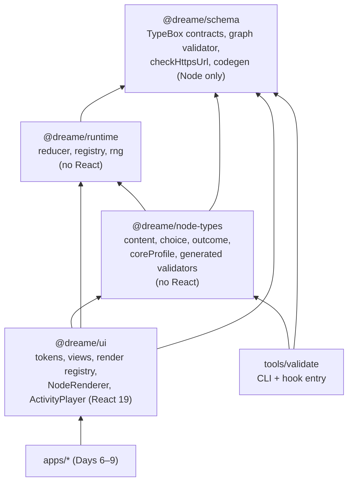
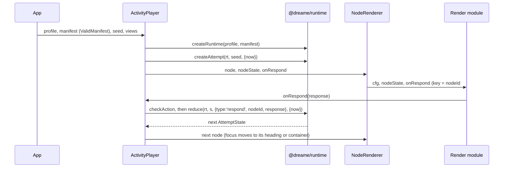

# Design Document: ui-renderer

## Overview

This design covers Day 5 of the Brief §8 plan plus two carried-over items. It adds:

1. The `## 2026-11-19 — Days 2–4` entry in `KIRO_LOG.md` and its commit (Requirements 1, 2).
2. A smaller generated validator module, a size test and an equivalence test (Requirements 3, 4).
3. The `@dreame/ui` package: theme tokens, the `content`, `choice` and `outcome` views, a render registry, `NodeRenderer`, `ExternalLinkButton`, `InvalidActivityView` and a minimal `ActivityPlayer` (Requirements 5–14).
4. The four Kiro hook files of Playbook §3b in `.kiro/hooks/`: `validate-activities.json`, `runtime-regression.json`, `node-type-wiring.json` and `post-task-check.json`, plus a first `EXTENDING.md` that holds the node-type entries the wiring hook maintains (Requirements 15–17).

Decisions D1–D12 of `.kiro/specs/runtime-core/design.md` stay in force. The user approved D13–D16 on 2026-11-19 and chose the recommended option A for each of D17–D23 on 2026-11-19 (section "Decisions for the user"). On 2026-11-20 this design was reconciled with `docs/Kiro_Setup_and_Operating_Playbook.md` (the Playbook), which the user named as authoritative for Kiro setup and use; section "Playbook reconciliation" lists each change, including the amendments to D13, D18 and D23. No decision in this design is open.

The views display activities that already passed the validator. Component tests and the automated axe check catch some accessibility errors only; manual keyboard and screen-reader checks are still needed (Architecture Spec §A3).

### Research findings used by this design

| Topic | Finding | Source |
|---|---|---|
| Kiro hook files | IDE 1.0 and CLI V3 read standalone JSON files at `.kiro/hooks/<id>.json` with `version: "v1"` and a `hooks` array. Each hook has `name`, `trigger` (PascalCase), optional `matcher` (a regex against the file path for file triggers), `action` (`command` or `agent`), optional `timeout` in seconds (default 60) and optional `description` and `enabled`. | [Kiro hooks](https://kiro.dev/docs/hooks/), [What's new in IDE 1.0: Hooks](https://kiro.dev/docs/ide/whats-new-v1/hooks/) |
| File triggers | `PostFileCreate`, `PostFileSave` and `PostFileDelete` fire when the agent creates, saves or deletes a file; the matcher is tested against the file path. A command action can use the `{{filePath}}` template variable on file triggers and also receives JSON on stdin. | [Hook triggers](https://kiro.dev/docs/hooks/types/), [What's new in IDE 1.0](https://kiro.dev/docs/ide/whats-new-v1/hooks/) |
| Stdin payload of file events | Checked again on 2026-11-20: the hooks overview says the hook receives the saved file path and session context on stdin, but no page names the JSON field that holds the path. The documented payload examples cover only session, tool and permission events (`hook_event_name`, `cwd`, `session_id`, `tool_name`, `tool_input`). | [Hooks](https://kiro.dev/docs/hooks/), [Hook triggers](https://kiro.dev/docs/hooks/types/) |
| Task trigger names | The v1 schema names are `PreTaskExec` and `PostTaskExec`; the legacy IDE 0.x names were `preTaskExecution` and `postTaskExecution`. The hook-creation tool of the installed Kiro lists `PostTaskExec`. | [What's new in IDE 1.0: Hooks](https://kiro.dev/docs/ide/whats-new-v1/hooks/); Kiro hook-creation tool in this session |
| Command output | On exit code 0, the command's stdout is added to the agent's context. On any other exit code, stderr is sent to the agent and the agent is told the hook failed. | [Hook actions](https://kiro.dev/docs/hooks/actions/) |
| Validate CLI streams | `pnpm -s validate activities/fixtures/broken-dangling-edge.json` exits 1 and writes the codegen line, the `FAIL` line and the `refs/dangling-ref` line to stdout; stderr is empty (measured 2026-11-20). With the Playbook's plain `pnpm -s validate` command, Kiro would pass the agent no diagnostics. | local measurement |
| Playbook | `docs/Kiro_Setup_and_Operating_Playbook.md` §3b gives the four hook files, §4.3 the task rules and §6 the KIRO_LOG entry template. It allows Kiro's own field and trigger names where they differ from its examples. | Playbook |
| Vitest environments | Vitest 5 supports inline `test.projects`, each with its own `include` and `environment`; inline projects inherit the root options. | Vitest v5.0.3 docs, `guide/projects.md` (via Context7) |
| JSX without a Vite plugin | Vite 8 transforms with Oxc and reads `jsx` and `jsxImportSource` from the matching `tsconfig.json`; `oxc.jsx` in the Vite config takes precedence. `@vitejs/plugin-react` is not needed for tests. | Vite v8.3.5 docs, `guide/features.md` (via Context7) |
| Validator size | `inlineRefs: false` with `lines: false` and `allErrors: true` gives 167,311 raw and 11,408 gzip bytes for the `core` profile with `CondD1`–`CondD8` (measured 2026-11-19, requirements.md). | requirements.md, "Research facts" |
| Test run time | `pnpm exec vitest run packages/runtime packages/schema packages/node-types` ran 19 files and 348 tests, exit 0, in 87 s wall time on this machine (measured 2026-11-20). A later run the same day of `pnpm -s test:shared` (codegen and all 21 test files) took 45.5 s, and `pnpm -s validate activities/core-demo-study-break.json` took 10.7 s. Run times vary by about a factor of two on this machine, so the hook timeouts are checked again once the UI tests exist (Requirement 17.10). | local measurement |

The dependency versions checked in the npm registry are in the section "Dependencies".

## Architecture

### Package layers

`@dreame/runtime` and `@dreame/node-types` stay free of React. The `Render` part of each node type lives in `@dreame/ui`, matched to the node type by its `type` name (Brief §3: "the `Render` part lives in each node type's UI module"). `@dreame/ui` depends on `@dreame/node-types` for config types; nothing below it depends on `@dreame/ui`.



Boundary tests (Requirement 14.3, 14.4) fail the build when `packages/runtime`, `packages/node-types/src`, `packages/node-types/scripts` or `packages/schema/src` import `react`, `react-dom` or `@dreame/ui`. The codegen script imports only `@dreame/schema/codegen` and `../src/core-types.ts`, so it never loads React (Requirement 12.6).

### Player data flow



## Components and Interfaces

### C1. KIRO_LOG entries and commit (Requirements 1, 2)

This is the first task (Requirement 1.1). The entries use the Playbook §6 template: a `## YYYY-MM-DD — <title>` heading and five lines `Spec:`, `Kiro did:`, `Caught by:`, `Fix:`, `Kiro features:` (Requirement 1.4). The Day_1_Entry predates the Playbook and keeps its bullet format byte-for-byte (Requirement 1.2).

**Log_Note replacement** (Requirement 1.3). The two-line "Provisional format" blockquote is replaced by:

```
> Entries from Days 2–4 on use the entry template in §6 of `docs/Kiro_Setup_and_Operating_Playbook.md`.
> The Day 1 entry was written before that playbook was in the workspace and keeps its original format.
```

The note is replaced, not deleted, because its old text says the format is provisional until the playbook arrives; leaving it would be false, and removing it without a replacement would leave the two formats unexplained.

**Heading date.** Every Days_2_4_Entries heading uses the author date of the commit that completed runtime-core, read with `git log -1 --format=%ad --date=short cd0f142` (2026-11-20 on 2026-11-20). One rule avoids mixing the HANDOFF date (2026-11-19) with the commit dates (2026-11-20). The hash is used only to read the date and is not written into the log (Requirement 1.13).

**Entries** (Requirements 1.6–1.10). Each row is one entry; the Fact_Source is in brackets.

| Title | Spec | Kiro did | Caught by | Fix | Kiro features |
|---|---|---|---|---|---|
| runtime-core spec done | `runtime-core / tasks 1–10` | Built the schema composer, Ajv standalone build, reducer and registry, graph validator, property tests and validate CLI; 62 of 62 tasks done; decisions D1–D12 approved by the user on 2026-11-19, listed in "Decisions for the user" of `.kiro/specs/runtime-core/design.md` [runtime-core `tasks.md`, `design.md`, HANDOFF §2] | Task 9.2 checks with exit codes (Requirement 1.7) and the three most recent CI runs on `main` passed [task 9.2 output, GitHub Actions] | None needed | Spec workflow and tasks, steering, Context7 MCP, sub-agent task runs, fast-check property tests [HANDOFF §2–§4] |
| Sub-agent runs timed out | `runtime-core / tasks 3.6, 5.2, 9.1` | Ran each task in one sub-agent run | The sub-agent runs timed out or aborted [HANDOFF §4] | Split each task into smaller tasks [HANDOFF §4, runtime-core `tasks.md`] | Spec tasks, sub-agents |
| Generated validators too large | `runtime-core / Ajv standalone build` | Generated `packages/node-types/generated/core.validators.js` | `pnpm codegen` printed 428,768 bytes JS [HANDOFF §3, codegen output] | Requirement 3 of spec `ui-renderer` sets a byte budget | Spec tasks |
| Day 4 hooks not created | `runtime-core` | Finished Days 2–4 without the Kiro hooks of Brief §8 Day 4 [HANDOFF §3] | HANDOFF review of deferred items [HANDOFF §3] | Requirement 17 of spec `ui-renderer` adds them | Spec workflow |

Each field is one line. Entries hold no screenshot reference unless the user names a file that exists in `docs/kiro-evidence/` (Requirements 1.11, 1.12); the agent checks with `Test-Path` before linking it. On 2026-11-20 the user confirmed that the entries follow the Playbook §6 template only (Requirement 1.15): the Day 1 style "Files created" list is not repeated, because the template has no field for it and git history holds the list, and decisions D1–D12 are named with a link to `.kiro/specs/runtime-core/design.md` instead of being summarised.

The entries have no commit hash, commit message, or statement about a commit or push (Requirement 1.13). The banned-phrase check reads the quoted phrases from the "Do not use" line of `.kiro/steering/product.md` at run time, so neither this design nor the task text repeats them; the permanent check is the repo text test in C12.

The commit follows Requirement 2: show `git status --porcelain` and `git diff --stat`, ask the user, then stage the three files by explicit path and commit with the Commit_Identity, without `--no-verify`, `--amend` or a co-author trailer. The pre-commit hook runs `pnpm check`.

### C2. Validator codegen change (Requirements 3, 4)

`buildProfileModule` in `packages/schema/src/codegen/index.ts` gets an optional options argument. The default is the new size-reducing setting; tests can pass the old setting to build a baseline.

```ts
export interface CodegenOptions {
  /** Ajv `inlineRefs`. `false` emits one function per `$ref` target instead of inlining it at every use site. */
  readonly inlineRefs: boolean;
  /** Ajv `code.lines`. */
  readonly lines: boolean;
}
export const DEFAULT_CODEGEN_OPTIONS: CodegenOptions = Object.freeze({ inlineRefs: false, lines: false });
/** The Day 2–4 setting, used only as the baseline of the equivalence test. */
export const BASELINE_CODEGEN_OPTIONS: CodegenOptions = Object.freeze({ inlineRefs: true, lines: true });

export function buildProfileModule(
  profileId: string,
  nodeTypes: readonly NodeTypeDescriptor[],
  options: CodegenOptions = DEFAULT_CODEGEN_OPTIONS,
): ProfileModule;
```

The Ajv instance keeps `strict: true`, `allErrors: true`, `discriminator: true`, `unicode: false` and the logger. Only `code.lines` and `inlineRefs` change. `CondD1`–`CondD8` stay (D5, D14). The output still goes through `inlineRuntimeHelpers` and `assertSelfContained` (Requirement 3.6), and `ajv` is still imported only in `packages/schema/src/codegen/` (Requirement 3.5).

`mapSchemaErrors` reads `instancePath`, `keyword`, `params` and `message` and ignores `schemaPath`, the one Ajv error field that changes when refs are compiled as separate functions. The equivalence property (Property 1) checks that the diagnostics stay the same.

`packages/node-types/scripts/codegen.ts` prints both counts (Requirement 3.4):

```
codegen: wrote <js path> and <d.ts path> (<raw> bytes JS, <gzip> bytes gzip)
```

`<gzip>` is `gzipSync(Buffer.from(jsText, 'utf8')).length` from `node:zlib` at the default level.

New tests:

| File | Kind | Checks |
|---|---|---|
| `packages/node-types/test/validator-size.test.ts` | example | The Validator_Module is ≤ 180,000 UTF-8 bytes and ≤ 14,000 gzip bytes (Requirements 3.1–3.3). |
| `packages/node-types/test/validator-equivalence.property.test.ts` | property | Property 1; also that the module built in-test with `DEFAULT_CODEGEN_OPTIONS` is byte-identical to the generated file, so the property covers the shipped module. |

The test files named in Requirement 4.2 and `packages/schema/test/codegen.test.ts` stay unchanged; `codegen.test.ts` calls `buildProfileModule` with two arguments and gets the new defaults.

### C3. `@dreame/ui` package layout and exports (Requirement 5)

```
packages/ui/
  package.json            # @dreame/ui, private, type: module
  tsconfig.json           # extends ../../tsconfig.base.json, strict, types ["node"]
  README.md               # existing placeholder
  src/
    index.ts              # public barrel
    render.ts             # RenderProps, RenderModule, RenderRegistry, createRenderRegistry
    core-views.ts         # Wiring_File W4: the three core views and coreViews
    choice-order.ts       # orderedOptions (pure)
    link.ts               # describeLink (pure)
    player-state.ts       # PlayerState, playerReducer (pure)
    views/
      ContentNodeView.tsx
      ChoiceNodeView.tsx
      OutcomeNodeView.tsx
    components/
      ExternalLinkButton.tsx
      NodeRenderer.tsx
      ActivityPlayer.tsx
      InvalidActivityView.tsx
    theme/
      tokens.ts           # themeTokens, reducedMotionTokens, BACKGROUND_TOKENS, CONTRAST_PAIRS
      contrast.ts         # relativeLuminance, contrastRatio (pure)
      tokens.css          # Theme_Tokens as CSS custom properties
      components.css      # component rules that use the tokens
  test/
    setup.ts              # afterEach(cleanup) for Testing Library
    *.test.ts             # pure tests, node environment
    *.test.tsx            # Component_Tests, jsdom environment
```

The view names follow Architecture Spec §B2 (`ContentNodeView`, `ChoiceNodeView`, `OutcomeNodeView`). In the requirements they are the Content_View, Choice_View and Outcome_View.

`package.json`:

```json
{
  "name": "@dreame/ui",
  "version": "0.0.0",
  "private": true,
  "type": "module",
  "exports": {
    ".": "./src/index.ts",
    "./tokens.css": "./src/theme/tokens.css",
    "./components.css": "./src/theme/components.css"
  },
  "dependencies": {
    "@dreame/node-types": "workspace:*",
    "@dreame/runtime": "workspace:*",
    "@dreame/schema": "workspace:*",
    "react": "^19.3.1",
    "react-dom": "^19.3.1"
  },
  "devDependencies": {
    "@testing-library/dom": "^10.4.2",
    "@testing-library/react": "^16.3.3",
    "@testing-library/user-event": "^14.6.12",
    "@types/react": "^19.3.0",
    "@types/react-dom": "^19.3.0",
    "axe-core": "^4.14.1"
  }
}
```

`react` and `react-dom` are in `dependencies` (D22). `axe-core` is a direct devDependency and the a11y test calls `axe.run` itself; `vitest-axe` is not added (D17). `jsdom` goes in the root `devDependencies`, next to `vitest`, because Vitest resolves the environment package from its own install location. All test tooling except `jsdom` sits in `@dreame/ui`, so the React peers of Testing Library resolve to the same `react` copy as the components.

`src/index.ts` exports: `createRenderRegistry`, the types `RenderProps`, `RenderModule`, `RenderEntry` and `RenderRegistry`, `coreViews`, the three views, `ExternalLinkButton`, `NodeRenderer`, `ActivityPlayer`, `InvalidActivityView`, `orderedOptions`, `describeLink`, `themeTokens`, `reducedMotionTokens` and `contrastRatio`. Apps import the stylesheets as `@dreame/ui/tokens.css` and `@dreame/ui/components.css`; components do not import CSS.

Source files use relative imports with `.ts` or `.tsx` extensions and erasable syntax only (Requirement 5.8, D4).

### C4. TypeScript and Vitest configuration (Requirements 5.5, 5.6)

`tsconfig.base.json` gets `"jsx": "react-jsx"`. The root `tsconfig.json` adds `packages/*/src/**/*.tsx` and `packages/*/test/**/*.tsx` to `include`. `packages/ui/tsconfig.json` mirrors the runtime package config (`strict: true`, `types: ["node"]`, include `src/**/*.ts`, `src/**/*.tsx`, `test/**/*.ts`, `test/**/*.tsx`).

`vitest.config.ts` uses two inline projects, so the existing tests keep the `node` environment and only `*.test.tsx` files run in `jsdom`:

```ts
import { defineConfig } from 'vitest/config';

export default defineConfig({
  oxc: { jsx: { runtime: 'automatic', importSource: 'react' } },
  test: {
    projects: [
      {
        test: {
          name: 'node',
          include: ['packages/*/test/**/*.test.ts', 'tools/*/test/**/*.test.ts'],
          environment: 'node',
        },
      },
      {
        test: {
          name: 'dom',
          include: ['packages/*/test/**/*.test.tsx'],
          environment: 'jsdom',
          setupFiles: ['packages/ui/test/setup.ts'],
        },
      },
    ],
  },
});
```

`packages/ui/test/setup.ts` calls `cleanup()` from `@testing-library/react` in `afterEach`, because Vitest globals are off and Testing Library's automatic cleanup needs a global `afterEach`. Positional filters such as `vitest run packages/ui/` keep working across projects.

### C5. Theme tokens (Requirement 6)

`tokens.css` defines every token on `:root` and sets the motion tokens to `0ms` inside `@media (prefers-reduced-motion: reduce)`. `tokens.ts` exports the same names and values. Colour values are 6-digit hex, so the contrast test can parse them. The palette is a neutral grey and blue set chosen for this project, with no third-party brand colours, logos or illustrations (Requirement 6.7).

| Token | Value | Use |
|---|---|---|
| `--dr-color-bg` | `#ffffff` | page background (background token) |
| `--dr-color-surface` | `#f4f4f5` | cards, option rows (background token) |
| `--dr-color-notice-bg` | `#fef3c7` | blocked-link and step-limit notes (background token) |
| `--dr-color-text` | `#18181b` | body text |
| `--dr-color-text-muted` | `#52525b` | destination line, author note |
| `--dr-color-accent` | `#1d4ed8` | primary button fill, selected option border |
| `--dr-color-on-accent` | `#ffffff` | text on the accent fill |
| `--dr-color-danger` | `#b91c1c` | inline error text |
| `--dr-color-notice-text` | `#78350f` | text on the notice background |
| `--dr-color-border` | `#71717a` | control borders |
| `--dr-focus-ring-color` | `#1d4ed8` | `:focus-visible` outline |
| `--dr-focus-ring-width` | `3px` | |
| `--dr-focus-ring-offset` | `2px` | outline sits on the page background, outside the control |
| `--dr-touch-target-min` | `44px` | minimum height and width of buttons, links styled as buttons, and option rows |
| `--dr-space-1` … `--dr-space-8` | `4px`, `8px`, `12px`, `16px`, `24px`, `32px` (keys 1, 2, 3, 4, 6, 8) | spacing |
| `--dr-radius-sm`, `--dr-radius-md` | `4px`, `8px` | corners |
| `--dr-font-family` | `system-ui, -apple-system, "Segoe UI", Roboto, sans-serif` | |
| `--dr-font-size-sm`, `-base`, `-lg`, `-xl` | `0.875rem`, `1rem`, `1.25rem`, `1.5rem` | type sizes |
| `--dr-motion-duration-fast`, `--dr-motion-duration-base` | `120ms`, `200ms`; `0ms` under reduced motion | transitions |

Text and background pairs used together (`CONTRAST_PAIRS`, Requirement 6.3), with ratios computed by the WCAG 2.2 relative-luminance formula:

| Text token | Background token | Ratio |
|---|---|---|
| text | bg | 17.72 |
| text | surface | 16.12 |
| text-muted | bg | 7.73 |
| text-muted | surface | 7.03 |
| on-accent | accent | 6.70 |
| danger | bg | 6.47 |
| danger | surface | 5.89 |
| notice-text | notice-bg | 8.15 |

The focus ring colour against the background tokens bg, surface and notice-bg gives 6.70, 6.10 and 6.02 (Requirement 6.4, minimum 3:1). The test recomputes all ratios from the token values.

`components.css` holds the component rules: `:focus-visible` uses the three focus tokens (Requirement 7.3); `.dr-button` and `.dr-option` set `min-height` and `min-width` to `var(--dr-touch-target-min)` (Requirement 6.5); `.dr-body` sets `white-space: pre-line` so that line breaks in `body` show (Requirements 9.1, 11.1); every `transition` or `animation` duration is a `var(--dr-motion-duration-*)` token, so reduced motion sets all of them to `0ms` (Requirement 14.1). Components use class names only and no inline `style`, so the apps' CSP `style-src 'self'` (Architecture Spec §A3) needs no exception.

### C6. Render contract and registry (Requirement 12)

```ts
import type { ReactNode } from 'react';
import type { JsonValue } from '@dreame/runtime';

/** Brief §3 `Render` props plus `nodeState` (D16). */
export interface RenderProps<C = unknown, R = unknown> {
  readonly cfg: C;
  readonly onRespond: (response: R) => void;
  /** `AttemptState.nodeState[currentNodeId]`, or `undefined`. */
  readonly nodeState: JsonValue | undefined;
}
export type RenderModule<C = any, R = any> = (props: RenderProps<C, R>) => ReactNode;
export interface RenderEntry {
  readonly type: string;
  readonly Render: RenderModule;
}
export interface RenderRegistry {
  get(type: string): RenderModule | undefined;
  /** Registered type names in entry order. */
  types(): readonly string[];
}
/** Throws `Error('createRenderRegistry: duplicate node type "<type>"')` on a repeated name (Requirement 12.3). */
export function createRenderRegistry(entries: readonly RenderEntry[]): RenderRegistry;
```

The registry stores entries in a `Map`, so names such as `__proto__` or `toString` never resolve to inherited values. `RenderModule` uses `any` for the same reason `AnyNodeType` does in `@dreame/runtime`: one registry holds modules with different config and response types.

`core-views.ts` (Wiring_File W4):

```ts
import { createRenderRegistry, type RenderRegistry } from './render.ts';
import { ContentNodeView } from './views/ContentNodeView.tsx';
import { ChoiceNodeView } from './views/ChoiceNodeView.tsx';
import { OutcomeNodeView } from './views/OutcomeNodeView.tsx';

export { ContentNodeView, ChoiceNodeView, OutcomeNodeView };

export const coreViews: RenderRegistry = createRenderRegistry([
  { type: 'content', Render: ContentNodeView },
  { type: 'choice', Render: ChoiceNodeView },
  { type: 'outcome', Render: OutcomeNodeView },
]);
```

A unit test checks that `coreViews.types()` equals the `type` names of `coreNodeTypes`, in order.

### C7. Views (Requirements 7, 9, 10, 11)

All three views render manifest strings as React text children only (Requirement 7.4), use native elements (Requirement 7.1) and render headings as `<h2 className="dr-heading" tabIndex={-1}>` so the player can move focus to them. A view calls `onRespond` at most once per mount: a `useRef(false)` flag is set on the first call, so a second click in the same event loop turn is also ignored (Requirements 9.3, 10.8). `NodeRenderer` keys the view by node ID, so the flag resets when the node changes.

**ContentNodeView** (`RenderModule<ContentConfig, ContentResponse>`): optional `<h2>` with `title`; `<p className="dr-body">` with `body`; `<button type="button" className="dr-button dr-button-primary">` labelled `continueLabel ?? 'Continue'`, which calls `onRespond({})` (Requirements 9.1, 9.2).

**ChoiceNodeView** (`RenderModule<ChoiceConfig, ChoiceResponse>`):

```
<form className="dr-node dr-choice" noValidate onSubmit={submit}>
  <fieldset role="radiogroup" aria-labelledby={legendId} aria-describedby={showError ? errorId : undefined}>
    <legend id={legendId}>{cfg.prompt}</legend>
    for each option in orderedOptions(cfg, nodeState):
      <label className="dr-option">
        <input type="radio" name={groupName} value={option.id} checked={selected === option.id}
               onChange={select} onKeyDown={submitOnEnter} />
        <span>{option.label}</span>
      </label>
  </fieldset>
  {showError && <p id={errorId} className="dr-error" role="alert">Choose an answer first.</p>}
  <button type="submit" className="dr-button dr-button-primary">Submit</button>
</form>
```

- `groupName`, `legendId` and `errorId` come from `useId()`, so two choice nodes never share a radio group.
- Arrow keys move the selection through the native radio group (Requirement 10.4). user-event 14 implements arrow-key radio navigation, so the Component_Test can check it in jsdom.
- `submitOnEnter` calls `preventDefault()` and `submit()` when the key is Enter (Requirement 10.6). Calling `preventDefault()` stops the browser's implicit form submission, so Enter submits once.
- `submit()` with no selection shows the error and leaves `onRespond` uncalled (Requirement 10.7); with a selection it calls `onRespond({ optionId: selected })` once (Requirements 10.5, 10.8).

`orderedOptions(cfg, nodeState)` in `choice-order.ts` returns `cfg.options` in config order unless `cfg.shuffle === true` and `nodeState` is an object whose own `order` property is an array of strings that is a permutation of the option IDs; then it returns the options in that order (Requirements 10.2, 10.3). Any other `nodeState` falls back to config order, so a damaged state never hides an option.

**OutcomeNodeView** (`RenderModule<OutcomeConfig, OutcomeResponse>`): `<h2>` with `title`, `<p className="dr-body">` with `body`, and `<ExternalLinkButton label={cta.label} url={cta.url} />` when `cfg.cta` is present (Requirements 11.1, 11.2). It never calls `onRespond` (Requirement 11.3).

No view renders a text input or sends data anywhere (Requirement 7.6); the privacy scan in C12 checks the source.

### C8. ExternalLinkButton (Requirement 8)

```ts
export type LinkDescription = { readonly safe: true; readonly host: string } | { readonly safe: false };
/** `safe` exactly when `checkHttpsUrl(url, '')` returns no diagnostics; `host` is `new URL(url).hostname`. */
export function describeLink(url: string): LinkDescription;

export interface ExternalLinkButtonProps {
  readonly label: string;
  readonly url: string;
}
```

`describeLink` calls `checkHttpsUrl` from `@dreame/schema`, the same check the validator runs, so schema and renderer apply one rule (security.md "Links"). `URL.hostname` is the ASCII (punycode) form, so a look-alike Unicode host shows as `xn--…`.

| State | Rendered |
|---|---|
| default (safe) | `<button type="button" aria-describedby={destId}>{label}</button>`, `<p id={destId}>Opens {host}</p>`, `<p className="dr-note">Added by the activity's author, not verified by this app.</p>` (Requirements 8.1, 8.6) |
| confirm (safe) | `<div role="group" aria-labelledby={confirmTextId}>` with `<p id={confirmTextId}>You are leaving this page for {host}.</p>`, `<a href={url} target="_blank" rel="noopener noreferrer" className="dr-button">Open {host}</a>` and `<button type="button">Stay here</button>`; the author note stays visible (Requirements 8.2, 8.3) |
| blocked (not safe) | `<p>{label}</p>` and `<p className="dr-notice">This link was blocked because it is not a safe https link.</p>`; no anchor and no button (Requirement 8.4) |

Activating the CTA button switches to confirm and moves focus to the anchor; "Stay here" switches back and moves focus to the CTA button. The anchor `href` is the exact input string (Requirement 8.5).

### C9. NodeRenderer (Requirement 12.4, 12.5)

```ts
export interface NodeRendererProps {
  readonly node: ManifestNode;
  readonly nodeState: JsonValue | undefined;
  readonly views: RenderRegistry;
  readonly onRespond: (response: unknown) => void;
  /** Changes force a remount of the view; the player passes `${nodeId}#${rejections}`. */
  readonly viewKey: string;
}
```

It renders `<Render key={viewKey} cfg={node.config} nodeState={nodeState} onRespond={onRespond} />`. For an unregistered type it renders `<p className="dr-error" role="alert">This activity has a step of type "{node.type}" that this app cannot show.</p>` and no view.

### C10. ActivityPlayer (Requirement 13)

```ts
export interface ActivityPlayerProps {
  readonly profile: Profile;
  readonly manifest: ValidManifest;
  /** uint32; `createAttempt` throws a `RangeError` otherwise. */
  readonly seed: number;
  readonly views: RenderRegistry;
  /** Time source for the runtime `Clock`; defaults to `Date.now`. */
  readonly now?: () => number;
}
```

- `rt = useMemo(() => createRuntime(profile, manifest), [profile, manifest])`.
- State is `useReducer` over the pure `playerReducer` in `player-state.ts`, initialised with `createAttempt(rt, seed, { now: now() })` (Requirement 13.1). To play a different manifest or seed, the app remounts the player with a new `key`.
- `onRespond(response)` dispatches `{ type: 'respond', response, at: now() }`. The time is read in the event handler, so the reducer stays pure.
- `playerReducer(rt, ps, event)` builds `{ type: 'respond', nodeId: ps.attempt.currentNodeId, response }`, calls `checkAction`, and on `null` returns `{ ...ps, attempt: reduce(rt, ps.attempt, action, { now: event.at }) }` (Requirement 13.2). On a rejection it returns `{ ...ps, rejections: ps.rejections + 1, lastRejection: code }` with the attempt unchanged.
- The player renders `<section className="dr-player" data-node-id={currentNodeId} tabIndex={-1} ref={containerRef}>` around `NodeRenderer`, with `viewKey` `${currentNodeId}#${rejections}`. A rejection therefore remounts the view and clears its once-only flag, and the player shows `<p className="dr-error" role="alert">That answer was not accepted. Please try again.</p>`.
- `status === 'finished'`: the current node is the reached outcome and is displayed as usual (Requirement 13.3).
- `status === 'limit_reached'`: the current node is `fallbackOutcomeId`; above it the player shows `<p className="dr-notice" role="status">This activity stopped because it reached its step limit.</p>` (Requirement 13.4).
- Focus: a `useEffect` on `currentNodeId` skips the first render and afterwards focuses the first `h2` inside the container, or the container itself when the node has no heading (Requirement 13.5). The first render does not move focus, so an embedded `LiveDemo` on a landing page does not take focus on load.

### C11. InvalidActivityView (Requirement 13.7)

```ts
export interface InvalidActivityViewProps {
  readonly diagnostics: readonly Diagnostic[];
  readonly actionLabel: string;
  readonly onAction: () => void;
}
```

It renders `<h2 tabIndex={-1}>This activity cannot be played</h2>`, a `<ul>` with one `<li>` per diagnostic `message` as text (at most `HARD_LIMITS.maxDiagnostics`, 50), and `<button type="button" onClick={onAction}>{actionLabel}</button>`. The app supplies the label, for example "Back to home" (Architecture Spec §B2).

### C12. Scans and boundary tests (Requirements 7.5, 7.6, 14, 18.7)

| File | Change |
|---|---|
| `packages/schema/test/source-scan.test.ts` | The file filter in `listSourceFiles` becomes `/\.(ts|tsx|js|jsx)$/`, so the `eval`, `new Function`, `innerHTML` and `dangerouslySetInnerHTML` scan covers `.tsx` (Requirements 7.5, 14.2). The ajv scans then cover `.tsx` too. |
| `packages/runtime/test/boundaries.test.ts` | `isForbiddenSpecifier` also flags `@dreame/ui` (Requirement 14.3). A new `describe` scans `packages/node-types/src`, `packages/node-types/scripts` and `packages/schema/src` for `react`, `react-dom` and `@dreame/ui` (Requirements 12.6, 14.4). |
| `packages/ui/test/privacy-scan.test.ts` (new, node) | No file under `packages/ui/src` contains `fetch(`, `XMLHttpRequest`, `sendBeacon`, `WebSocket`, `localStorage` or an `<input` whose `type` is not `radio` (Requirement 7.6). Tokens are built from fragments, as in the existing scans. |
| `tools/validate/test/repo-text.test.ts` (new, node) | No Banned_Phrase_List phrase in `KIRO_LOG.md`, `EXTENDING.md`, `.kiro/specs/ui-renderer/*.md`, `.kiro/hooks/*.json` or `packages/ui/src/**` (Requirements 1.14, 18.7). The phrases are read from `.kiro/steering/product.md` at run time. |

`.github/workflows/ci.yml` stays unchanged: CI runs `pnpm install --frozen-lockfile` and `pnpm check`, which now include the new tests (Requirement 14.5).

### C13. Kiro hooks (Requirements 15, 17)

The four Hook_Files use the v1 hook format and the file names of Playbook §3b (Requirement 17.1). Kiro file hooks fire only on agent edits, and hooks are not an enforcement boundary (Brief C5, Playbook §3b): the pre-commit hook and CI run `pnpm check` on every commit, which covers manual edits.

| File | Hooks (name: trigger) | Action | Timeout |
|---|---|---|---|
| H1 `validate-activities.json` | `validate-activities`: `PostFileSave`; `validate-activities-on-create`: `PostFileCreate` | command `pnpm -s validate:hook "{{filePath}}"` | 30 |
| H2 `runtime-regression.json` | `runtime-regression`: `PostFileSave` | command `pnpm -s test:shared` | 180 |
| H3 `node-type-wiring.json` | `node-type-wiring`: `PostFileSave`; `node-type-wiring-on-create`: `PostFileCreate` | agent prompt | — |
| H4 `post-task-check.json` | `post-task-check`: `PostTaskExec` | command `pnpm -s check` | 600 (raised 2026-11-21, shop-challenge D53) |

Every hook sets `"enabled": true`. Hook names are unique across the four files, because the docs describe `name` as the hook's identifier. All commands use `pnpm -s`, so pnpm adds no script banner or `ELIFECYCLE` line to the output the agent reads.

The Implementing_Agent writes the four files with the editor tool. If Kiro denies a write under `.kiro/hooks/`, the Implementing_Agent stops, gives the user the exact JSON from this section, and the user creates the file by hand with that name (D23). Kiro's hook-creation tool is not used, because it writes one hook per file and H1 and H3 hold two hooks each. After the files exist, the user checks them in the Hook_Panel (Playbook §3b "Verify triggers on your version"): if Kiro shows an error or creates a hook with other field or trigger names, the Hook_File, `kiro-hooks.test.ts` and this section change to Kiro's names (Requirements 17.13, 17.14).

Every matcher uses only syntax shared by common regex engines (no lookahead, lookbehind or backreferences), because the Kiro docs do not name the engine. Each matcher accepts both separators through the class `[\\/]`, written `[\\\\/]` in the JSON files as in Playbook §3b, and accepts an absolute or relative path, because the docs do not say which form Kiro passes. The JSON files store each backslash doubled.

#### H1. `.kiro/hooks/validate-activities.json` (Activity_Hook, Requirements 17.2–17.5, 17.8, 17.9)

```json
{
  "version": "v1",
  "hooks": [
    {
      "name": "validate-activities",
      "description": "Brief §5 hook 1: runs the validate CLI on an agent-saved activities/**/*.json file.",
      "trigger": "PostFileSave",
      "matcher": "<ACTIVITY_MATCHER>",
      "action": { "type": "command", "command": "pnpm -s validate:hook \"{{filePath}}\"" },
      "timeout": 30,
      "enabled": true
    },
    {
      "name": "validate-activities-on-create",
      "description": "Brief §5 hook 1: runs the validate CLI on an agent-created activities/**/*.json file.",
      "trigger": "PostFileCreate",
      "matcher": "<ACTIVITY_MATCHER>",
      "action": { "type": "command", "command": "pnpm -s validate:hook \"{{filePath}}\"" },
      "timeout": 30,
      "enabled": true
    }
  ]
}
```

The Playbook example has only the `PostFileSave` hook. The `PostFileCreate` hook is added because the docs list create and save as separate events and do not say whether a new file also fires `PostFileSave`; the `activity-author` agent and the Brief §6 demo create new manifest files. A new file may be validated twice, which changes no file.

`<ACTIVITY_MATCHER>` (shown unescaped):

```
^(?:[A-Za-z]:)?[\\/]?(?:[A-Za-z0-9._ -]+[\\/])*activities[\\/](?:[A-Za-z0-9._-]+[\\/])*[A-Za-z0-9._-]+\.json$
```

The whole path may contain only letters, digits, `.`, `_`, `-`, separators, a drive colon and, before the `activities` segment, spaces. This excludes `"`, `$`, `` ` ``, `%`, `&`, `^`, `(`, `)` and `;`, which PowerShell or `cmd.exe` would interpret inside or around the double-quoted `{{filePath}}` (Requirement 17.5, D19). The Playbook matcher `activities[\\\\/].*\\.json$` accepts any character, so it is narrowed here: with `{{filePath}}` in the command, the matcher is the only control on what reaches the shell.

**Path source: `{{filePath}}`, not `--stdin`.** The Playbook proposes `pnpm -s validate --stdin`, reading the changed path from the stdin JSON. This design keeps D19 for two reasons. First, no Kiro docs page names the stdin field that holds the file path (Research findings), while `{{filePath}}` is documented for file triggers; a guessed field name would fail silently in the Brief §6 demo. Second, the plain validate CLI writes its `FAIL` lines to stdout only (measured 2026-11-20), so a `--stdin` flag alone would still not deliver diagnostics on a failure, and D18 would be needed anyway. If Kiro later documents the field, switching is a change to `hook-cli.ts` and the H1 command only; the switch would then read at most 64 KB from stdin, parse it with `JSON.parse`, take the one documented field, accept it only if it matches `<ACTIVITY_MATCHER>`, and pass it to `run` as an argument array, never through a shell.

Root script added to `package.json`:

```json
"validate:hook": "pnpm codegen && node --experimental-strip-types tools/validate/src/hook-cli.ts"
```

Kiro sends only stderr to the agent when a command exits non-zero, but the validate CLI prints `FAIL` and diagnostic lines to stdout. `tools/validate/src/hook.ts` therefore runs the existing `run` with an in-memory output buffer and routes the buffer by exit code (Requirements 17.3, 17.4, D18):

```ts
export interface HookResult {
  readonly code: 0 | 1 | 2;
  /** All output lines in order when `code` is 0, otherwise ''. */
  readonly stdout: string;
  /** All output lines in order when `code` is 1 or 2, otherwise ''. */
  readonly stderr: string;
}
export function runValidateHook(argv: readonly string[], io: Pick<CliIo, 'readFile' | 'listFiles'>): HookResult;
```

`tools/validate/src/hook-cli.ts` wires the real file system, writes `stdout` and `stderr`, and sets `process.exitCode`. The file-system half of `cli.ts` moves to `tools/validate/src/node-io.ts`, so `cli.ts` and `hook-cli.ts` share it; `run.ts` and its tests are unchanged. With the demo manifest the hook prints `PASS activities/core-demo-study-break.json` to stdout and exits 0; with `activities/fixtures/broken-dangling-edge.json` it prints the `FAIL` line and the `refs/dangling-ref` diagnostic to stderr and exits 1, which is the Brief §6 1:30 demo step.

#### H2. `.kiro/hooks/runtime-regression.json` (Regression_Hook, Requirements 17.6, 17.8, 17.9)

```json
{
  "version": "v1",
  "hooks": [
    {
      "name": "runtime-regression",
      "description": "Brief §5 hook 2: runs the shared tests after the agent saves a .ts file in packages/runtime, packages/schema or packages/node-types.",
      "trigger": "PostFileSave",
      "matcher": "packages[\\\\/](runtime|schema|node-types)[\\\\/].*\\.ts$",
      "action": { "type": "command", "command": "pnpm -s test:shared" },
      "timeout": 180,
      "enabled": true
    }
  ]
}
```

The matcher and command are the Playbook's. The matcher also covers test and script files of the three packages, so a changed test reruns the suite. The existing root script `test:shared` (`pnpm codegen && vitest run`) runs every test, including the UI tests; the `test:regression` script of the earlier design is dropped. The command takes no path from the event, so nothing is interpolated into the shell. Measured times are 87 s for the three packages and 45.5 s for the whole of `pnpm -s test:shared` (both 2026-11-20); the UI tests add to this, so Requirement 17.10 measures again and Requirement 17.11 asks the user before the timeout is changed. Task 12.1 measured 98.82 s for `pnpm -s test:shared`, over the 96 s threshold of the Playbook's 120 s, and the user raised the timeout to 180 s on 2026-11-20. On failure, Vitest prints the failed-test details through its error logger to stderr, which Kiro passes to the agent; the summary line goes to stdout. This stream split is Vitest's reporter behaviour and is not covered by a repository test.

#### H3. `.kiro/hooks/node-type-wiring.json` (Wiring_Hook, Requirements 15, 16)

Two hooks with the same `agent` action and the same matcher: `node-type-wiring` on `PostFileSave` (the Playbook trigger) and `node-type-wiring-on-create` on `PostFileCreate`. Both set `"enabled": true`; agent hooks take no `timeout`. `<WIRING_MATCHER>` (unescaped) has four alternatives:

```
(^|[\\/])packages[\\/]node-types[\\/]src[\\/][a-z][A-Za-z0-9]{0,31}\.ts$
|(^|[\\/])packages[\\/]ui[\\/]src[\\/]views[\\/][A-Z][A-Za-z0-9]{0,31}NodeView\.tsx$
|(^|[\\/])apps[\\/][a-z0-9-]+[\\/]src[\\/]node-types[\\/][a-z][A-Za-z0-9]{0,31}\.ts$
|(^|[\\/])apps[\\/][a-z0-9-]+[\\/]src[\\/]views[\\/][A-Z][A-Za-z0-9]{0,31}NodeView\.tsx$
```

The file names follow `TYPE_NAME_PATTERN` (`^[a-z][A-Za-z0-9]{0,31}$`), so `core-types.ts` and `core-profile.ts` never match; `index.ts` matches and the prompt tells the agent to stop for it. The hook also fires when a view file is created or saved, so a view written after its node type gets registered then. Saving a shared node type file also fires H2; the prompt runs no command when nothing changed, so a plain save runs the tests once, through H2.

Prompt (stored as one JSON string; `<type>` is the node type name, `<Type>` the same name with a capital first letter; `<test>` is `packages/node-types/test` for a shared node type and `apps/<app>/test` for an app node type):

```
Node-type wiring hook (Playbook §3b). Follow #new-node-type for the node type of the file the agent just created or saved.
1. If the file is an index.ts, or it exports neither `<type>NodeType` (node type file) nor `<Type>NodeView` (view file), reply "no wiring needed", change nothing and run nothing.
2. Edit only the files named in steps 3-7 and this node type's own files: its node type file, its view file, <test>/<type>.test.ts and <test>/<type>.property.test.ts. Do not delete or rename files, and do not read or write any other file.
3. Registered exactly once. Each line below must appear exactly once: add it if it is missing and remove any extra copy.
   a. packages/node-types/src/index.ts: `export * from './<type>.ts';`
   b. packages/node-types/src/core-types.ts: the import of `<type>NodeType` from './<type>.ts' and its entry in `coreNodeTypes`.
   c. packages/node-types/src/core-profile.ts: `response_<type>` in the import from '../generated/core.validators.js' and `<type>: response_<type>,` in `responseValidators`.
   d. packages/ui/src/core-views.ts, only if packages/ui/src/views/<Type>NodeView.tsx exists: its import, its name in the export list, and `{ type: '<type>', Render: <Type>NodeView }` in `coreViews`. If the view does not exist, report that the view is still to be written.
   For an app node type apps/<app>/src/node-types/<type>.ts or an app view apps/<app>/src/views/<Type>NodeView.tsx, apply a-d to apps/<app>/src/node-types/index.ts, apps/<app>/src/profile.ts and apps/<app>/src/views/registry.ts instead. If one of these files does not exist, stop and report which one.
4. Closed schemas. In the node type file, every object schema in `configSchema` and `responseSchema` sets `additionalProperties: false`; add it where it is missing.
5. reduce() unit test. If no test file in <test> references `<type>NodeType`, create <test>/<type>.test.ts with Vitest tests for `validate` and `reduce`.
6. fast-check property. If no *.property.test.ts file in <test> references `<type>NodeType`, create <test>/<type>.property.test.ts with one fast-check property at numRuns of at least 100: for generated configs, attempt states and valid responses, `reduce` leaves its inputs unchanged and returns equal results for equal inputs.
7. EXTENDING.md entry. If EXTENDING.md does not exist, create it with the two lines "# Extending DREAME" and "## Node types". Under "## Node types", the section "### <type>" has the lines "- Node type:", "- View:" and "- Tests:" in the form of the existing entries; add the section or any missing line.
8. If steps 3-7 changed no file, reply "already wired" and run nothing. Otherwise run `pnpm -s test:shared` and report its exit code; if it is not 0, report the failing test and stop.
```

Step 2 names no delete command and no settings path, so the prompt meets Requirement 15.12 and passes the forbidden-text check of `kiro-hooks.test.ts`; the rule "edit only the files named" already keeps the agent out of `.kiro/settings/` (corrected 2026-11-20 while writing tasks.md).

**Extending_Doc entry form** (W8, Requirements 15.8, 16.4). The Implementing_Agent creates `EXTENDING.md` with the title, the `## Node types` heading and one entry for each of `content`, `choice` and `outcome`, and nothing else; the Day 10 guide adds the other sections. The entry for `choice`:

```
### choice

- Node type: `packages/node-types/src/choice.ts` (`choiceNodeType`, profile `core`)
- View: `packages/ui/src/views/ChoiceNodeView.tsx`
- Tests: `packages/node-types/test/node-types.test.ts`, `packages/node-types/test/node-types.property.test.ts`
```

The `Tests:` line lists the test files that reference the node type's constant. A node type without a view has `- View: not written yet`, which step 7 replaces when the view hook fires.

#### Wiring_Files and the new-node-type.md steps (Requirements 15.3, 16)

| ID | Wiring_File | Line form per node type |
|---|---|---|
| W1 | `packages/node-types/src/index.ts` | `export * from './<type>.ts';` |
| W2 | `packages/node-types/src/core-types.ts` | `import { <type>NodeType } from './<type>.ts';` and an entry in `coreNodeTypes` |
| W3 | `packages/node-types/src/core-profile.ts` | `response_<type>` in the generated import and `<type>: response_<type>,` in `responseValidators` |
| W4 | `packages/ui/src/core-views.ts` | an import, an entry in the export list, and `{ type: '<type>', Render: <Type>NodeView }` in `coreViews` |
| W5–W7 | `apps/<app>/src/node-types/index.ts`, `apps/<app>/src/profile.ts`, `apps/<app>/src/views/registry.ts` | the same forms for an app profile (D20; created on Days 6–9) |
| W8 | `EXTENDING.md` | a `### <type>` section with `Node type`, `View` and `Tests` lines |

W1–W3 already hold `content`, `choice` and `outcome` in these forms; W4 and W8 are written in the same form (Requirements 16.2, 16.4). The Own_Files of a node type are its node type file, its view file, `<test>/<type>.test.ts` and `<test>/<type>.property.test.ts`; for app node types the test folder `apps/<app>/test/` extends D20.

The shared node types already have unit tests in `packages/node-types/test/node-types.test.ts`. This spec adds `packages/node-types/test/node-types.property.test.ts` with Property 10, which references `contentNodeType`, `choiceNodeType` and `outcomeNodeType` (Requirement 16.5). With that file, steps 5 and 6 of the prompt find existing tests for the shared node types, so saving `content.ts`, `choice.ts` or `outcome.ts` creates no new test file.

| new-node-type.md step | Where | Reason when manual |
|---|---|---|
| 1–6 `type`, `version`, schemas, `validate`, `reduce` | own file `<type>.ts`; the hook closes any open object schema (prompt step 4) | manual: the node type's logic is the developer's design; the hook fires once the file exists |
| 7 `Render` | own file `<Type>NodeView.tsx`; registered in W4 by the hook | writing the view is manual: its layout depends on the node type (D21) |
| 8 placement | `packages/node-types/src/` or `apps/<app>/src/node-types/` | manual: the developer picks shared or app-specific; the matcher covers only these folders |
| 9 register in the runtime registry | W1, W2 (the profile's `nodeTypes` list feeds `createRegistry` through `defineProfile`) | — |
| 10 add `configSchema` to the composed schema | automatic: `pnpm codegen` composes from `coreNodeTypes`; the hook adds the response validator in W3 | — |
| 11 declare in manifest `requires` | each manifest | manual: manifests are content; the validator reports a missing `requires` entry |
| 12 tests for `validate` and `reduce` | own files `<test>/<type>.test.ts` and `<test>/<type>.property.test.ts`, created if no test references the node type | — |

**Differences from the Playbook `node-type-wiring.json` example** (Requirement 15.13):

| Playbook example | This design | Reason |
|---|---|---|
| Trigger `PostFileSave` only | `PostFileSave` and `PostFileCreate` | The docs list create and save as separate events; a new node type file is created first. |
| Matcher `node-types[\\\\/][^\\\\/]+[\\\\/]index\\.ts$` | `<WIRING_MATCHER>` above | The Playbook matcher assumes one folder per node type (`node-types/<type>/index.ts`). This repository keeps one file per node type in `packages/node-types/src/` (runtime-core layout), where the Playbook matcher matches only the barrel `packages/node-types/src/index.ts` and no node type file. |
| "registered exactly once in the registry" | exactly once in W1–W4 (or W5–W7) | The runtime registry is built from the profile's node type list through `defineProfile`, so these files are the registration points. |
| "a closed configSchema" | closed `configSchema` and `responseSchema` | `new-node-type.md` steps 3 and 4 require both. |
| Always run `pnpm -s test:shared` | Run it only when the hook changed a file | Playbook hook safety rule "every hook is idempotent"; on a plain save, H2 already runs the same command. |
| No view step | View registration in W4 | Brief §3 puts `Render` in each node type's UI module (D21). |

#### H4. `.kiro/hooks/post-task-check.json` (Post_Task_Hook, Requirements 17.7–17.9)

```json
{
  "version": "v1",
  "hooks": [
    {
      "name": "post-task-check",
      "description": "Playbook §3b: runs the full check after a spec task finishes.",
      "trigger": "PostTaskExec",
      "action": { "type": "command", "command": "pnpm -s check" },
      "timeout": 600,
      "enabled": true
    }
  ]
}
```

The Playbook writes the trigger as `PostTaskExecution` and warns that trigger names differ between versions. The v1 schema name is `PostTaskExec` (Research findings), and the Playbook rule "keep Kiro's field names" applies. The command takes no input from the event. On a failure Kiro passes only stderr: Vitest failure details reach the agent, but `tsc` errors and validate CLI `FAIL` lines go to stdout, so the agent reruns `pnpm check` in the session to read them (Playbook §4.4). A wrapper like D18 is not added for this hook, because the agent can rerun the command itself and the Playbook names `pnpm -s check` directly.

#### Hook file test (Requirements 15.12, 17.1, 17.12)

`tools/validate/test/kiro-hooks.test.ts` (node) reads every `*.json` in `.kiro/hooks/` and fails when:

- the folder holds any file other than the four Hook_Files, or one of them is missing;
- a file is not valid JSON, or lacks `version: "v1"` or a non-empty `hooks` array;
- a hook lacks a non-empty string `name`, a `trigger` from the documented list, or an `action` whose `type` is `command` with a string `command` or `agent` with a string `prompt`;
- two hooks in the four files share a `name`, or a hook has an `enabled` value other than `true`;
- a `matcher` does not compile as a JavaScript `RegExp` or contains `(?=`, `(?!`, `(?<=` or `(?<!`;
- a command hook's `timeout` is not an integer from 1 to 300;
- a hook's name, trigger, matcher, action type, command or timeout differs from the table at the start of C13 and the JSON in H1–H4;
- a file contains `Remove-Item`, `rm -`, `rmdir`, `del `, `.kiro/settings`, `--no-verify`, or a secret-like assignment (Requirement 15.12).

It also checks matcher examples: H1 matches `activities/new.json` and `C:\Users\ADMIN\my-kiro-win\activities\fixtures\broken-dangling-edge.json` and rejects `packages/ui/src/x.json`, `activities/a$(b).json` and `activities/x.txt`; H2 matches `packages/runtime/src/reducer.ts`, `packages\schema\test\graph.test.ts` and `packages/node-types/src/choice.ts` and rejects `packages/ui/src/index.ts`; H3 matches `packages/node-types/src/quiz.ts`, `packages\ui\src\views\QuizNodeView.tsx` and `apps/shop-challenge/src/node-types/collectionSelect.ts` and rejects `packages/node-types/src/core-types.ts`; H4 has no matcher. The prompt of both H3 hooks contains `#new-node-type`, `exactly once`, `additionalProperties: false`, `reduce`, `fast-check`, `EXTENDING.md` and `pnpm -s test:shared`.

## Data Models

### Render and player types

| Type | Fields | Notes |
|---|---|---|
| `RenderProps<C, R>` | `cfg: C`, `onRespond(r: R): void`, `nodeState: JsonValue \| undefined` | D16 |
| `RenderEntry` | `type: string`, `Render: RenderModule` | input of `createRenderRegistry` |
| `RenderRegistry` | `get(type)`, `types()` | `Map`-backed |
| `ChoiceNodeState` | `{ order: string[] }` | written by `choiceNodeType.enter` when `shuffle` is `true`; read only through `orderedOptions` |
| `PlayerState` | `attempt: AttemptState`, `rejections: number`, `lastRejection: ActionRejection \| null` | plain JSON plus counters |
| `PlayerEvent` | `{ type: 'respond'; response: unknown; at: number }` | `at` read in the event handler |
| `LinkDescription` | `{ safe: true; host: string } \| { safe: false }` | from `describeLink` |

### Theme tokens

```ts
export const themeTokens = {
  '--dr-color-bg': '#ffffff',
  // … every token of C5
} as const satisfies Readonly<Record<`--dr-${string}`, string>>;

export const reducedMotionTokens = {
  '--dr-motion-duration-fast': '0ms',
  '--dr-motion-duration-base': '0ms',
} as const;

export const BACKGROUND_TOKENS = ['--dr-color-bg', '--dr-color-surface', '--dr-color-notice-bg'] as const;
export const CONTRAST_PAIRS: readonly { readonly text: TokenName; readonly background: TokenName }[];
```

`contrastRatio(a, b)` takes two `#rrggbb` strings and returns `(L1 + 0.05) / (L2 + 0.05)` with the WCAG 2.2 relative luminance of each.

### Hook file model

| Field | Type | Required |
|---|---|---|
| `version` | `"v1"` | yes |
| `hooks[]` | array, at least 1 | yes |
| `hooks[].name` | non-empty string | yes |
| `hooks[].description` | string | no |
| `hooks[].trigger` | `PostFileCreate`, `PostFileSave`, `PostFileDelete`, `PreToolUse`, `PostToolUse`, `SessionStart`, `Stop`, `UserPromptSubmit`, `PreTaskExec`, `PostTaskExec`, `PreCompact`, `PostCompact`, `PermissionRequest` | yes |
| `hooks[].matcher` | regex string | no |
| `hooks[].action` | `{ type: "command"; command: string }` or `{ type: "agent"; prompt: string }` | yes |
| `hooks[].timeout` | integer seconds; this repo requires 1–600 for command hooks and sets 30, 180 and 600 (C13) | no |
| `hooks[].enabled` | boolean; this repo sets `true` on every hook (Playbook §3b) | no |


## Correctness Properties

*A property is a characteristic or behavior that should hold true across all valid executions of a system-essentially, a formal statement about what the system should do. Properties serve as the bridge between human-readable specifications and machine-checkable tests.* (The standard wording of this sentence ends with a word on the product.md banned list, so it is reworded here.)

The property tests give evidence for the properties tested; they are not a proof of correctness (testing.md). Property reflection merged the text display criteria of the three views into Property 2, the choice order criteria into Property 4, the choice response criteria into Property 5, the link criteria into Property 3, the registry criteria into Property 6, the player criteria into Property 7 and the hook output criteria into Property 8.

### Property 1: Smaller validators report the same diagnostics

*For any* input value (a valid manifest, a valid manifest with one injected defect, a valid manifest with one value replaced by random JSON, a manifest with an edge `when` nested 1–10 levels, or random JSON), `validateManifest` with the module built from `DEFAULT_CODEGEN_OPTIONS` returns the same multiset of `(code, stage, path, severity)` diagnostics and the same `ok` as with the module built from `BASELINE_CODEGEN_OPTIONS`; and *for any* JSON value, each `response_<type>` validator of the two modules returns the same boolean.

**Validates: Requirements 4.1, 4.3, 4.4**

### Property 2: Manifest strings are displayed as text

*For any* strings used as `content` `title`, `body` and `continueLabel`, `choice` `prompt` and option `label`, and `outcome` `title`, `body` and `cta.label` (including strings that contain markup such as `<b>x</b>` or ``), the rendered view contains an element whose `textContent` equals each string, and the view creates no element that the string's markup names.

**Validates: Requirements 7.4, 9.1, 10.1, 11.1**

### Property 3: Only safe CTA URLs become anchors

*For any* URL string (generated safe `https:` URLs, `http:`, `javascript:` and `data:` URLs, shortener hosts, URLs with credentials, over-long URLs and random strings), the ExternalLinkButton, after the CTA button is activated when present, renders an anchor exactly when `checkHttpsUrl(url, '')` returns no diagnostics; that anchor has `href` equal to the input string, `rel="noopener noreferrer"` and `target="_blank"`, and the default state shows `new URL(url).hostname`; otherwise no anchor is rendered and the blocked note is shown.

**Validates: Requirements 8.1, 8.2, 8.3, 8.4, 8.5**

### Property 4: Choice options keep a defined order

*For any* valid `choice` config and *any* `nodeState` value, the radio values displayed by the ChoiceNodeView are a permutation of the config's option IDs; they equal `nodeState.order` when `shuffle` is `true` and `nodeState.order` is a permutation of the option IDs, and they equal the config order in every other case.

**Validates: Requirements 10.1, 10.2, 10.3**

### Property 5: A choice submission yields one valid response

*For any* valid `choice` config, *any* `nodeState`, *any* selected option and *any* number of submit attempts from 1 to 4 (button clicks or Enter), `onRespond` is called exactly once, with `{ optionId }` of the selected option, and that response passes `choiceNodeType.isValidResponse(cfg, r)` and the precompiled `response_choice`.

**Validates: Requirements 10.5, 10.8, 10.9**

### Property 6: The render registry returns what it was given

*For any* list of entries with generated type names, `createRenderRegistry` throws an `Error` whose message names a repeated type exactly when a name repeats; otherwise `get(name)` returns the given module for every listed name, returns `undefined` for every other generated name (including `__proto__` and `toString`), and `types()` lists the names in entry order.

**Validates: Requirements 12.2, 12.3**

### Property 7: The player shows the reducer's node

*For any* seed and *any* sequence of option picks, playing the demo manifest `activities/core-demo-study-break.json` or a manifest from `validManifestArb` through the ActivityPlayer (clicking continue on `content` nodes, selecting the picked option and submitting on `choice` nodes) displays, after every step, the node whose ID equals the `currentNodeId` of the state that `reduce` returns for the same seed, responses and clock; when that state is `finished`, the displayed node is that outcome.

**Validates: Requirements 13.1, 13.2, 13.3, 13.6**

### Property 8: Hook output reaches the agent on every exit code

*For any* file contents (valid manifests, defective manifests, random JSON and random bytes) read through an in-memory `CliIo`, `runValidateHook` returns the exit code that `run` returns for the same arguments and files; when the code is 0, `stdout` holds every line `run` printed, in order, and `stderr` is empty; otherwise `stderr` holds every line, in order, and `stdout` is empty.

**Validates: Requirements 17.2, 17.3, 17.4**

### Property 9: The activity matcher accepts only shell-safe paths

*For any* string, if the Activity_Hook matcher matches it, then the string consists only of letters, digits, `.`, `_`, `-`, space, `:`, `/` and `\`, ends with `.json`, and has a path segment equal to `activities`; and *for any* path built from a safe prefix, the segment `activities`, zero or more safe segments and a safe file name ending in `.json`, with either separator, the matcher matches.

**Validates: Requirements 17.2, 17.5**

### Property 10: Shared node type reduce leaves its inputs unchanged

*For any* shared node type (`content`, `choice`, `outcome`), *any* valid config of that type taken from a manifest generated by `validManifestArb`, *any* attempt state reached by playing that manifest, and *any* response that passes the node type's `isValidResponse`, calling `reduce` on deep-frozen copies of the config, state and response throws no error, leaves the three inputs deep-equal to their originals, and returns a state deep-equal to a second call with the same inputs and the same `Env`.

**Validates: Requirements 16.5**

## Error Handling

| Situation | Behaviour |
|---|---|
| A node type has no Render_Module | `NodeRenderer` shows the plain-language unknown-type error with `role="alert"` and no view (Requirement 12.5). |
| A view submits a response that `checkAction` rejects | The attempt is unchanged; the player shows "That answer was not accepted. Please try again." and remounts the view (C10). |
| `onRespond` called twice | The view's once-only flag drops the second call (Requirements 9.3, 10.8). |
| Choice submitted with no selection | Inline error linked with `aria-describedby`; `onRespond` not called (Requirement 10.7). |
| `nodeState` for a choice node is missing or damaged | `orderedOptions` falls back to config order (C7). |
| CTA URL fails `checkHttpsUrl` | No anchor; label and blocked note shown (Requirement 8.4). A validated manifest cannot reach this state, so it is defence in depth. |
| `seed` is not a uint32, or the manifest uses a type the profile lacks | `createAttempt` or `createRuntime` throws during render. This is a caller bug; the app's error boundary handles it (Days 6–9). |
| Duplicate render registry name | `createRenderRegistry` throws at module load, naming the type (Requirement 12.3). |
| Byte_Budget exceeded | `validator-size.test.ts` fails, so `pnpm check`, the pre-commit hook and CI fail (Requirement 3.3). |
| Activity_Hook: invalid manifest | Exit 1; `FAIL` and diagnostic lines on stderr, which Kiro passes to the agent (Requirement 17.4). |
| Activity_Hook: `{{filePath}}` not substituted, or file unreadable | The CLI prints `FAIL <path>: file is missing or unreadable`, exit 1, on stderr. |
| A command hook exceeds its timeout (30 s, 180 s or 300 s) | Kiro stops the command and reports a timeout to the agent. The agent reports it to the user, who decides whether to narrow the command or raise the timeout (Requirement 17.11); per Playbook §3b, a hook that keeps misfiring is set to `"enabled": false` and the reason is logged in KIRO_LOG. |
| Post_Task_Hook: `pnpm check` fails | Kiro passes stderr to the agent; `tsc` and validate CLI output is on stdout, so the agent reruns `pnpm check` and fixes the failure in the same session (H4, Playbook §4.4). |
| Hook_Panel shows an error for a hook, or Kiro uses another field or trigger name | The Hook_File, `kiro-hooks.test.ts` and C13 change to Kiro's names (Requirement 17.14). |
| Wiring_Hook: an app Wiring_File is missing | The prompt tells the agent to stop and name the missing file (H3 step 3). |
| Wiring_Hook: `pnpm -s test:shared` fails after wiring | The agent reports the failing test and stops (H3 step 8); the Post_Task_Hook, the pre-commit hook and CI also fail (Brief C5). |

## Testing Strategy

### Dual approach

Example-based unit and component tests cover specific behaviour, keyboard interaction, error states and configuration. Property tests cover the ten properties above. Both run in `pnpm check`.

### Property test configuration

- Library: fast-check 4.10.3 (already a root devDependency). No property framework is written by hand.
- Each property is one test with `numRuns` of at least 100. Component property tests (Properties 2–5, 7) render in jsdom; Property 7 uses `fireEvent` for clicks to keep the run short, while keyboard examples use user-event.
- Each test title carries the tag `Feature: ui-renderer, Property N: <title>` (Requirement 18.6).
- Generators reuse `packages/node-types/test/arbitraries.ts` (`validManifestArb`, `defectiveManifestArb`, `condRecipeArb`, `SAFE_CTA_URLS`, `UNSAFE_CTA_URLS`, `playManifest`) through relative imports; that file is not changed.

| Property | Test file | Environment |
|---|---|---|
| 1 | `packages/node-types/test/validator-equivalence.property.test.ts` | node |
| 2 | `packages/ui/test/text-rendering.property.test.tsx` | jsdom |
| 3 | `packages/ui/test/ExternalLinkButton.property.test.tsx` | jsdom |
| 4, 5 | `packages/ui/test/ChoiceNodeView.property.test.tsx` | jsdom |
| 6 | `packages/ui/test/render-registry.property.test.ts` | node |
| 7 | `packages/ui/test/ActivityPlayer.property.test.tsx` | jsdom |
| 8 | `tools/validate/test/hook.property.test.ts` | node |
| 9 | `tools/validate/test/kiro-hooks.property.test.ts` | node |
| 10 | `packages/node-types/test/node-types.property.test.ts` | node |

### Example tests

| Test file | Covers |
|---|---|
| `packages/node-types/test/validator-size.test.ts` | Requirements 3.1–3.3 |
| `packages/ui/test/tokens.test.ts` | CSS ↔ TS token sync, contrast pairs, focus ring ratios, 44 px target, reduced-motion block, motion durations only through tokens (Requirements 6.1–6.6, 14.1) |
| `packages/ui/test/ContentNodeView.test.tsx` | default "Continue" label, one call with `{}`, second click ignored (Requirements 9.1–9.3) |
| `packages/ui/test/ChoiceNodeView.test.tsx` | group name from `prompt`, arrow keys, Enter submits, empty-submit message with `aria-describedby` (Requirements 10.1, 10.4, 10.6, 10.7) |
| `packages/ui/test/OutcomeNodeView.test.tsx` | CTA through ExternalLinkButton, no respond control (Requirements 11.2, 11.3) |
| `packages/ui/test/ExternalLinkButton.test.tsx` | confirm step, focus moves, "Stay here", author note (Requirements 8.2, 8.6) |
| `packages/ui/test/NodeRenderer.test.tsx` | registered view shown, unknown type error (Requirements 12.4, 12.5) |
| `packages/ui/test/core-views.test.ts` | `coreViews.types()` equals the `coreNodeTypes` names (Requirements 12.1, 16.2) |
| `packages/ui/test/ActivityPlayer.test.tsx` | focus on node change, not on mount; `limit_reached` note with a hand-built manifest whose `maxTransitions` is 1; rejection message (Requirements 13.4, 13.5) |
| `packages/ui/test/InvalidActivityView.test.tsx` | messages as text, action button (Requirement 13.7) |
| `packages/ui/test/a11y.test.tsx` | `axe.run(container, options)` from `axe-core`, called directly and asserted with `expect(result.violations).toEqual([])` (D17), on each view, the confirm state, the player and InvalidActivityView with the WCAG 2.x A and AA rule tags; `color-contrast` is disabled because jsdom does not compute layout, and `tokens.test.ts` covers contrast (Requirements 7.1, 7.2) |
| `packages/ui/test/privacy-scan.test.ts` | Requirement 7.6 |
| `packages/schema/test/source-scan.test.ts` (changed) | Requirements 7.5, 14.2 |
| `packages/runtime/test/boundaries.test.ts` (changed) | Requirements 12.6, 14.3, 14.4 |
| `tools/validate/test/hook.test.ts` | demo manifest → 0 and PASS on stdout; broken fixture → 1 and `refs/dangling-ref` on stderr; no arguments → 2 and usage on stderr (Requirements 17.2–17.4) |
| `tools/validate/test/kiro-hooks.test.ts` | the four Hook_Files: format, names, triggers, matchers, commands, timeouts, `enabled`, prompt phrases and matcher examples (Requirements 15.1–15.12, 17.1, 17.5–17.7, 17.9, 17.12) |
| `tools/validate/test/extending-doc.test.ts` | `EXTENDING.md` has the title, one `## Node types` heading, no other `##` heading, and one `### <type>` section with `Node type`, `View` and `Tests` lines for each `coreNodeTypes` name, in order (Requirements 16.2, 16.4) |
| `tools/validate/test/repo-text.test.ts` | Requirements 1.14, 18.7 |

The axe scan and the Testing Library role queries catch some accessibility errors. Keyboard and screen-reader checks by a person are still needed before the apps ship (Architecture Spec §A3).

### Verification commands

Tasks list Verify commands for PowerShell 5.1 with `;` and `; $LASTEXITCODE`, no `&&` or `||`, and Vitest only as `vitest run` (Requirement 18.2, 18.3). Typical forms:

```
pnpm codegen; $LASTEXITCODE
pnpm exec vitest run packages/ui/; $LASTEXITCODE
pnpm exec vitest run packages/node-types/test/validator-size.test.ts; $LASTEXITCODE
pnpm -s validate:hook activities/fixtures/broken-dangling-edge.json; $LASTEXITCODE
pnpm check; $LASTEXITCODE
```

The full `pnpm check` took over 87 s for the existing tests alone; tasks that only touch `packages/ui` verify with the narrower `vitest run packages/ui/` and leave `pnpm check` to checkpoint tasks, so each command stays within 180,000 ms (Requirement 18.3). Once the Post_Task_Hook exists, Kiro also runs `pnpm -s check` after each spec task.

### Notes for the tasks run (Playbook §4.3)

- Every task ends with a test step: a `vitest run` of the task's test file, or a Verify_Command whose exit code checks the result, such as `git diff --exit-code` or `Test-Path` (Requirement 18.8).
- Each of Properties 1–10 is its own task, placed directly after the task that writes the code it tests (Requirement 18.9). An implementation task keeps its example tests; it does not hold a property test. The Property 10 task is not optional: without `node-types.property.test.ts`, the Wiring_Hook would create a property test file the first time the agent saves a shared node type file.
- Each task creates one component with its example tests, or one config change (Requirement 18.4).
- The hook files are written after `validate:hook` (H1) and `node-types.property.test.ts` (Property 10) exist, so that H1's command and the prompt's test checks work from the first trigger. The Post_Task_Hook is written last, because it runs `pnpm check` after every later task.

## Dependencies

Versions checked in the npm registry on 2026-11-20 (`npm view`).

| Package | Version checked | Range to add | Where | Named in planning docs? | Status |
|---|---|---|---|---|---|
| `react` | 19.3.1 | `^19.3.1` | `@dreame/ui` dependencies | yes, React 19 (Architecture Spec §A7) | allowed |
| `react-dom` | 19.3.1 (peer `react ^19.3.1`) | `^19.3.1` | `@dreame/ui` dependencies | yes (§A7) | allowed |
| `@testing-library/react` | 16.3.3 (peers `react`, `react-dom`, `@types/react`, `@types/react-dom` ^18 or ^19; `@testing-library/dom` ^10) | `^16.3.3` | `@dreame/ui` devDependencies | yes, Testing Library (§A3) | allowed |
| `@testing-library/dom` | 10.4.2 | `^10.4.2` | `@dreame/ui` devDependencies | no (peer of `@testing-library/react`) | Approved by the user (2026-11-19) |
| `@testing-library/user-event` | 14.6.13 (published 2026-11-18 23:59 UTC; peer `@testing-library/dom >=7.21.4`) | `^14.6.12` | `@dreame/ui` devDependencies | no | Approved by the user (2026-11-19) |
| `@types/react` | 19.3.0 | `^19.3.0` | `@dreame/ui` devDependencies | no | Approved by the user (2026-11-19) |
| `@types/react-dom` | 19.3.0 (peer `@types/react ^19.3.0`) | `^19.3.0` | `@dreame/ui` devDependencies | no | Approved by the user (2026-11-19) |
| `jsdom` | 31.0.1 (engines `node ^22.22.2 \|\| ^24.15.0 \|\| >=26.0.0`; optional peer `@napi-rs/canvas`, not installed) | `^31.0.1` | root devDependencies | no | Approved by the user (2026-11-19) |
| `axe-core` | 4.14.1 (published 2026-11-16) | `^4.14.1` | `@dreame/ui` devDependencies | only through `@axe-core/playwright` (§A3) | Approved by the user as a dev dependency (2026-11-19, D17) |
| `vitest-axe` | 0.1.0 (`latest`, 2022-10-21); 1.0.0-pre.5 (`pre`, 2025-01-22) | — | — | no | Not added. Approved on 2026-11-19 under D15, then dropped by D17 because of its matcher typings |

Compatibility notes:

- `vitest` 5.1.1 lists `jsdom` as an optional peer with range `*`, so `jsdom` 31 has no peer conflict. Node v22.23.5 meets `jsdom`'s engine range. CI uses `node-version: 22`, which installs the newest 22.x release.
- `axe-core` has no peer dependencies. Its `axe.run` accepts a DOM element and works in jsdom; rules that need layout, such as `color-contrast`, are disabled in the test options (Testing Strategy).
- `pnpm-workspace.yaml` has a `minimumReleaseAgeExclude` list, so a minimum release age applies to installs. `@testing-library/user-event` 14.6.13 and `axe-core` 4.14.1 are one to four days old. The `^14.6.12` range lets pnpm pick an older patch if 14.6.13 is still too new. This design adds no `minimumReleaseAgeExclude` entry; if an install is blocked, the Implementing_Agent asks the user.
- `@vitejs/plugin-react` is not needed: Vite 8 applies the `jsx` setting to its Oxc transform, and `vitest.config.ts` sets `oxc.jsx` (C4).

## Decisions for the user

### Approved by the user (2026-11-19)

| ID | Decision | Choice in force |
|---|---|---|
| D13 | Brief §8 Day 4 hooks 1 and 2 | In scope and mandatory (Requirement 17): H1 validates agent-written `activities/**/*.json`, H2 runs the shared tests. Extended on 2026-11-20 (Playbook reconciliation P1): H4, the post-task check, is also in scope. |
| D14 | Validator size | Keep D5 (`CondD1`–`CondD8`); reach the Byte_Budget (≤ 180,000 raw, ≤ 14,000 gzip bytes) with Ajv `inlineRefs: false` and `code.lines: false`. `compose.test.ts`, `validator.test.ts` and the property test files stay unchanged. |
| D15 | Dependencies not named in the planning docs | `@types/react`, `@types/react-dom`, `@testing-library/dom`, `@testing-library/user-event`, `jsdom` (chosen over `happy-dom`) and `vitest-axe` are approved, which satisfies the tech.md dependency rule. D17 later replaced `vitest-axe` with `axe-core`, so `vitest-axe` is not added. |
| D16 | Renderer assumptions | `Render` gets a third prop `nodeState`; `@dreame/ui` has a minimal `ActivityPlayer`; CTA links use the two-step confirm of Architecture Spec §B2; Tailwind CSS, Radix and Lucide are deferred to the apps. |

### Decided by the user (2026-11-19, option A for each)

The user chose the recommended option A for every row below. The alternative column records the option not taken.

| ID | Decision | Choice in force (option A) | Alternative not taken | Reason |
|---|---|---|---|---|
| D17 | How the axe check runs in Vitest | Call `axe-core` directly: `const r = await axe.run(container, options); expect(r.violations).toEqual([])`. `axe-core` `^4.14.1` is approved as a dev dependency of `@dreame/ui`; `vitest-axe` is dropped. | `vitest-axe@1.0.0-pre.5` with `expect.extend(matchers)`. | `vitest-axe` 0.1.0 declares its matcher types on the global `Vi` namespace, which Vitest 5 does not read, so `toHaveNoViolations` fails `tsc` under `strict`. 1.0.0-pre.5 augments `vitest`'s `Assertion` interface without its type parameter and is an unmaintained prerelease. |
| D18 | How H1 passes CLI output to the agent | New root script `pnpm validate:hook`, which runs codegen and `tools/validate/src/hook-cli.ts`; the hook entry writes all output to stdout on exit 0 and all output to stderr on exit 1 or 2. Amended on 2026-11-20 (P3): the hook calls it as `pnpm -s validate:hook`; the routing is unchanged. | The hook runs `pnpm validate "{{filePath}}"` unchanged. | Kiro passes only stderr to the agent on a non-zero exit, and the CLI prints diagnostics to stdout (confirmed by measurement on 2026-11-20). Without the change, the Brief §6 demo would show "hook failed" without the diagnostics. |
| D19 | How H1 gets the file path | `{{filePath}}` in double quotes, with the matcher limited to shell-safe characters (Property 9). Kept on 2026-11-20 against the Playbook's `--stdin` proposal (P4). | Read the path from the stdin JSON event in `hook-cli.ts` (the Playbook's `pnpm -s validate --stdin`). | The docs pages checked on 2026-11-19 and again on 2026-11-20 do not give the stdin field name for file events. The quoted variable depends only on the matcher, which the tests check. |
| D20 | App wiring file names for Days 6–9 | `apps/<app>/src/node-types/<type>.ts` and `index.ts`, `apps/<app>/src/profile.ts`, `apps/<app>/src/views/<Type>NodeView.tsx` and `registry.ts`, fixed now. | Leave app paths out of H3 until Day 6 and narrow Requirement 15.2. | Requirement 15.2 asks H3 to fire for app node-type folders, which do not exist yet; this fixes their layout. |
| D21 | H3 when the view file does not exist yet | Skip the registration and report that the view is still to be written; H3 fires again when the view file is created. | Generate a placeholder view. | A placeholder would put untested UI into the registry, and Brief C5 asks hooks to stay limited to named files. |
| D22 | React in `@dreame/ui` | `dependencies` at `^19.3.1`, as Requirement 5.2 states. | `peerDependencies`, with the apps supplying React. | With one React version in the workspace, pnpm links one copy. If the apps ever pin a different version, switching to peers is a small change. |
| D23 | If Kiro denies writes to `.kiro/hooks/` (as it did for `.kiro/settings/` on Day 1) | The Implementing_Agent stops and gives the user the JSON from C13; the user creates the files by hand. Amended on 2026-11-20 (P1, P9): four files instead of three, and after the files exist the user checks them in the Hook_Panel. | Use Kiro's hook-creation tool, which writes one hook per file; H1 and H3 would then be two files each. | The hook file test expects the four Playbook file names; the tool would change that list. |

### User answers (2026-11-20)

| Question | Answer |
|---|---|
| When do dependency-cruiser and ESLint `react/no-danger` CI enforcement come in (P11)? | Day 6, with the Shop Challenge spec. Out of scope here. |
| What form do the KIRO_LOG Days 2–4 entries take? | The Playbook §6 template only: no "Files created" list and no D1–D12 summaries; the Spec_Done_Entry links to `.kiro/specs/runtime-core/design.md` (C1, Requirement 1.15). |
| Should `tools/validate/tsconfig.json` get `"types": ["node"]`? | Yes. It is the only package tsconfig without it (`packages/ui`, `node-types`, `runtime` and `schema` all have it), so `pnpm exec tsc -p tools/validate/tsconfig.json` fails on `node:fs` and `process` and the editor shows false errors in `tools/validate`. `pnpm check` and `pnpm typecheck` use the root `tsconfig.json` and were never affected. The one-line change is made before task 11.1, because tasks 11.1–11.3 edit files in `tools/validate`. No dependency is added (`@types/node` is already installed). |
| How is focus and the screen-reader announcement handled after a rejected response? | Deferred to the Shop Challenge spec (plan Day 6). Today a rejection remounts the view (`viewKey` includes `rejections`), so keyboard focus on Submit falls to `body`, and a second rejection reuses the same `role="alert"` element, so a screen reader may not announce it again. The core views cannot trigger a rejection with a validated manifest, because `ChoiceNodeView` sends only option IDs from `cfg.options` and `choiceNodeType.isValidResponse` accepts exactly those; only a stub view in `ActivityPlayer.test.tsx` reaches the path. `collectionSelect` (budget, occasion and max-item rules) is the first node type that can be rejected. Proposed fix for that spec, in `ActivityPlayer.tsx`: give the rejection alert `key={rejections}` so each rejection inserts a new alert element; give it `tabIndex={-1}` and move focus to it when `rejections` increases on the same node; test `document.activeElement` and a new element on a second rejection in `ActivityPlayer.test.tsx`, and add the rejection state to `a11y.test.tsx`. If manual screen-reader checks show the message read twice, keep the focus move and drop `role="alert"`. That spec also decides whether a rejection keeps the user's selection, because the remount clears it. |
| Narrow the Regression_Hook command or raise its timeout? (Requirement 17.11) | Raise the timeout from 120 s to 180 s and keep `pnpm -s test:shared`. Task 12.1 measured 98.82 s against the 96 s threshold; the same suite took 70.35 s inside `pnpm -s check`. The new threshold is 144 s. |

## Playbook reconciliation (2026-11-20)

The Playbook (`docs/Kiro_Setup_and_Operating_Playbook.md`) is now in the workspace and replaces the earlier "Open dependency" section. It states that it is authoritative for how Kiro is set up and used, and the user authorised resolving contradictions with it. Each change:

| ID | Contradiction | Resolution | Decision affected |
|---|---|---|---|
| P1 | The design had three hooks; Playbook §3b and Brief §5 list four, including a post-task check. | H4 `post-task-check.json` added (C13). | D13 extended; D23 amended |
| P2 | File name `validate-activity.json` and descriptive hook names differed from Playbook §3b. | File names `validate-activities.json`, `runtime-regression.json`, `node-type-wiring.json`, `post-task-check.json`; hook names follow the file names. | none |
| P3 | Commands used plain `pnpm`; the Playbook uses `pnpm -s`. | All hook commands use `pnpm -s`. | D18 amended (call form only) |
| P4 | The Playbook proposes `pnpm -s validate --stdin`; the design uses a quoted `{{filePath}}`. | Kept `{{filePath}}` with the narrowed matcher, and the D18 stderr routing. The stdin field name is undocumented, and `--stdin` alone would still leave diagnostics on stdout. The conditions for a later switch are in C13 H1. | D19 kept, reason updated |
| P5 | H2 ran a new `test:regression` script on `src` files only with a 180 s timeout. | The Playbook command `pnpm -s test:shared`, the Playbook matcher (any `.ts` file in the three packages) and a 120 s timeout (raised to 180 s on 2026-11-20, see P6); `test:regression` is dropped. | none |
| P6 | Timeouts were 180 s for H1 and H2. | 30 s for H1, 120 s for H2, 300 s for H4 (Playbook §3b); times are measured again once the UI tests exist, and the user decides any change (Requirements 17.10, 17.11). On 2026-11-20 the user raised H2 to 180 s after `pnpm -s test:shared` measured 98.82 s, over the 96 s threshold. | none |
| P7 | The H3 prompt ran `pnpm check` and did not cover closed schemas, a fast-check property or `EXTENDING.md`. | The prompt follows the Playbook items (C13 H3); `EXTENDING.md` becomes Wiring_File W8 and is created in this spec; the remaining differences from the Playbook example are listed with reasons in C13 H3. | none |
| P8 | The Playbook writes the task trigger as `PostTaskExecution`. | `PostTaskExec`, the v1 schema name, under the Playbook's "keep Kiro's field names" rule. | none |
| P9 | The Playbook asks for each hook to be checked against what the installed Kiro creates; the design had no such step. | The user checks the hooks in the Hook_Panel; any name Kiro uses replaces the design's (Requirements 17.13, 17.14). | D23 amended |
| P10 | KIRO_LOG used the provisional Day 1 bullet format. | Playbook §6 entry template for Days 2–4; the "Provisional format" note is replaced; Day 1 stays unchanged (C1). | none |
| P11 | Playbook §3a enforces steering rules in CI with dependency-cruiser and ESLint `react/no-danger`. | Kept out of scope: no day schedules them in the Playbook or Brief §8. CI already runs `pnpm check`, whose boundary test and Source_Scan check the same import and DOM rules (C12). On 2026-11-20 the user deferred both to Day 6, with the Shop Challenge spec. | none |
| P12 | Playbook §4.3: every task ends with a test, and property tests are separate tasks. | Requirements 18.8 and 18.9; "Notes for the tasks run" in Testing Strategy. | none |

`new-node-type.md` and the Brief stay the sources for the wiring steps, and the public Kiro docs for field and trigger names.

## Requirements traceability

| Requirement | Design sections | Tests |
|---|---|---|
| 1, 2 | C1 | Verify commands; `repo-text.test.ts` |
| 3 | C2 | `validator-size.test.ts`; existing `codegen.test.ts`, `source-scan.test.ts` |
| 4 | C2 | Property 1; existing tests unchanged |
| 5 | C3, C4, Dependencies | `pnpm typecheck`, `pnpm check` |
| 6 | C5 | `tokens.test.ts` |
| 7 | C7, C12 | Property 2; `a11y.test.tsx`; scans |
| 8 | C8 | Property 3; `ExternalLinkButton.test.tsx` |
| 9 | C7 | Property 2; `ContentNodeView.test.tsx` |
| 10 | C7 | Properties 2, 4, 5; `ChoiceNodeView.test.tsx` |
| 11 | C7 | Property 2; `OutcomeNodeView.test.tsx` |
| 12 | C6, C9 | Property 6; `NodeRenderer.test.tsx`, `core-views.test.ts`, boundary test |
| 13 | C10, C11 | Property 7; `ActivityPlayer.test.tsx`, `InvalidActivityView.test.tsx` |
| 14 | C5, C12 | `tokens.test.ts`, scans, boundary test |
| 15, 16 | C13 (H3, Wiring_Files, Extending_Doc entry form) | Property 10; `kiro-hooks.test.ts`, `core-views.test.ts`, `extending-doc.test.ts` |
| 17 | C13 (H1, H2, H4, hook file test) | Properties 8, 9; `hook.test.ts`, `kiro-hooks.test.ts`; timing measurement and Hook_Panel check in the tasks |
| 18 | Testing Strategy ("Notes for the tasks run") | `repo-text.test.ts`; task conventions |
